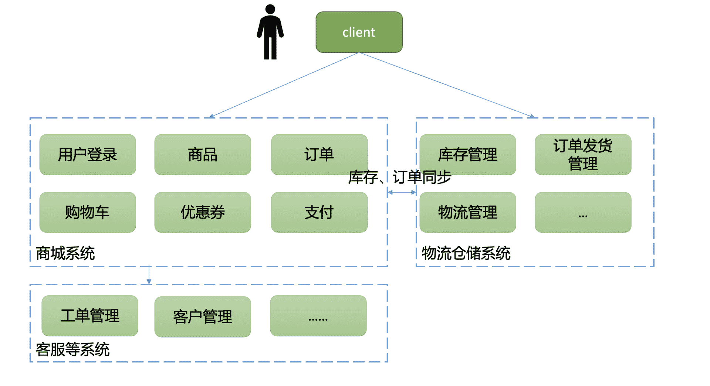
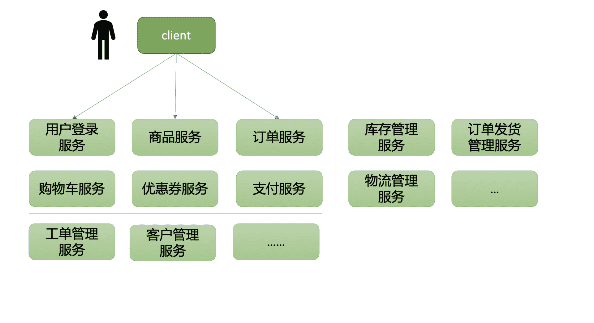
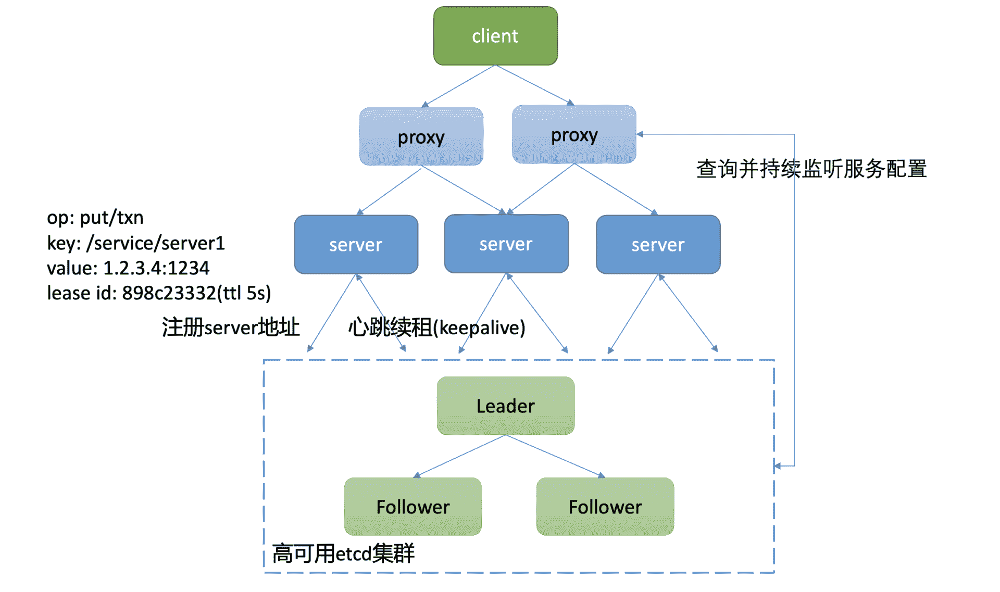
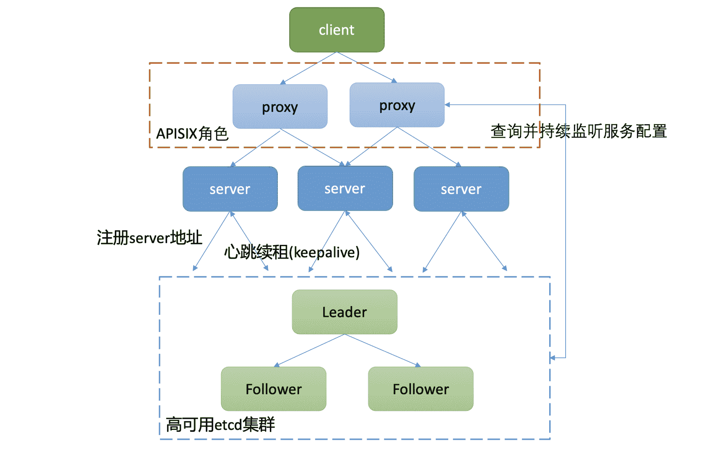
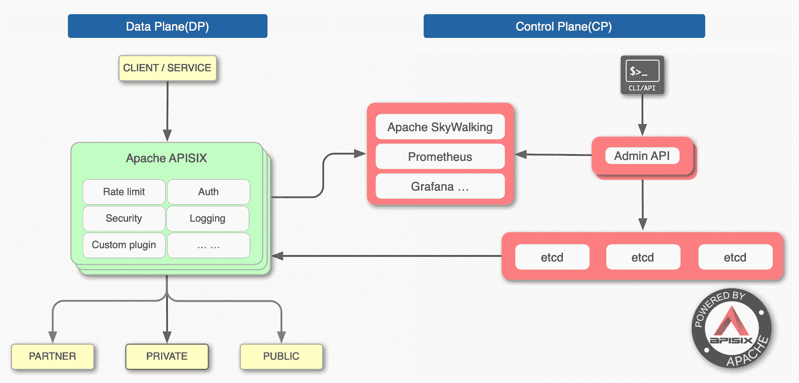

# 22 | 配置及服务发现：解析etcd在API Gateway开源项目中应用

 

你好，我是唐聪。

在软件开发的过程中，为了提升代码的灵活性和开发效率，我们大量使用配置去控制程序的运行行为。

从简单的数据库账号密码配置，到confd支持以 etcd 为后端存储的本地配置及模板管理，再到Apache APISIX等 API Gateway 项目使用 etcd 存储服务配置、路由信息等，最后到 Kubernetes 更实现了 Secret 和 ConfigMap 资源对象来解决配置管理的问题。

那么它们是如何实现实时、动态调整服务配置而不需要重启相关服务的呢？

今天我就和你聊聊 etcd 在配置和服务发现场景中的应用。我将以开源项目 Apache APISIX 为例，为你分析服务发现的原理，带你了解 etcd 的 key-value 模型，Watch 机制，鉴权机制，Lease 特性，事务特性在其中的应用。

希望通过这节课，让你了解 etcd 在配置系统和服务发现场景工作原理，帮助你选型适合业务场景的配置系统、服务发现组件。同时，在使用 Apache APISIX 等开源项目过程中遇到 etcd 相关问题时，你能独立排查、分析，并向社区提交 issue 和 PR 解决。

## 服务发现

首先和你聊聊服务发现，服务发现是指什么？为什么需要它呢?

为了搞懂这个问题，我首先和你分享下程序部署架构的演进。

### 单体架构

在早期软件开发时使用的是单体架构，也就是所有功能耦合在同一个项目中，统一构建、测试、发布。单体架构在项目刚启动的时候，架构简单、开发效率高，比较容易部署、测试。但是随着项目不断增大，它具有若干缺点，比如：

1. 所有功能耦合在同一个项目中，修复一个小 Bug 就需要发布整个大工程项目，增大引入问题风险。同时随着开发人员增多、单体项目的代码增长、各模块堆砌在一起、代码质量参差不齐，内部复杂度会越来越高，可维护性差。
2. 无法按需针对仅出现瓶颈的功能模块进行弹性扩容，只能作为一个整体继续扩展，因此扩展性较差。
3. 一旦单体应用宕机，将导致所有服务不可用，因此可用性较差。

### 分布式及微服务架构

如何解决以上痛点呢？

当然是将单体应用进行拆分，大而化小。如何拆分呢？ 这里我就以一个我曾经参与重构建设的电商系统为案例给你分析一下。在一个单体架构中，完整的电商系统应包括如下模块：

1. 商城系统，负责用户登录、查看及搜索商品、购物车商品管理、优惠券管理、订单管理、支付等功能。
2. 物流及仓储系统，根据用户订单，进行发货、退货、换货等一系列仓储、物流管理。
3. 其他客服系统、客户管理系统等。

因此在分布式架构中，你可以按整体功能，将单体应用垂直拆分成以上三大功能模块，各个功能模块可以选择不同的技术栈实现，按需弹性扩缩容，如下图所示。



那什么又是微服务架构呢？

它是对各个功能模块进行更细立度的拆分，比如商城系统模块可以拆分成：

1. 用户鉴权模块；
2. 商品模块；
3. 购物车模块；
4. 优惠券模块；
5. 支付模块；
6. ……

在微服务架构中，每个模块职责更单一、独立部署、开发迭代快，如下图所示。



那么在分布式及微服务架构中，各个模块之间如何及时知道对方网络地址与端口、协议，进行接口调用呢？

### 为什么需要服务发现中间件?

其实这个知道的过程，就是服务发现。在早期的时候我们往往通过硬编码、配置文件声明各个依赖模块的网络地址、端口，然而这种方式在分布式及微服务架构中，其运维效率、服务可用性是远远不够的。

那么我们能否实现通过一个特殊服务就查询到各个服务的后端部署地址呢？ 各服务启动的时候，就自动将 IP 和 Port、协议等信息注册到特殊服务上，当某服务出现异常的时候，特殊服务就自动删除异常实例信息？

是的，当然可以，这个特殊服务就是注册中心服务，你可以基于 etcd、ZooKeeper、consul 等实现。

### etcd 服务发现原理

那么如何基于 etcd 实现服务发现呢?

下面我给出了一个通用的服务发现原理架构图，通过此图，为你介绍下服务发现的基本原理。详细如下：

1. 整体上分为四层，client 层、proxy 层 (可选)、业务 server、etcd 存储层组成。引入 proxy 层的原因是使 client 更轻、逻辑更简单，无需直接访问存储层，同时可通过 proxy 层支持各种协议。
2. client 层通过负载均衡访问 proxy 组件。proxy 组件启动的时候，通过 etcd 的 Range RPC 方法从 etcd 读取初始化服务配置数据，随后通过 Watch 接口持续监听后端业务 server 扩缩容变化，实时修改路由。
3. proxy 组件收到 client 的请求后，它根据从 etcd 读取到的对应服务的路由配置、负载均衡算法（比如 Round-robin）转发到对应的业务 server。
4. 业务 server 启动的时候，通过 etcd 的写接口 Txn/Put 等，注册自身地址信息、协议到高可用的 etcd 集群上。业务 server 缩容、故障时，对应的 key 应能自动从 etcd 集群删除，因此相关 key 需要关联 lease 信息，设置一个合理的 TTL，并定时发送 keepalive 请求给 Leader 续租，以防止租约及 key 被淘汰。



当然，在分布式及微服务架构中，我们面对的问题不仅仅是服务发现，还包括如下痛点：

1. 限速；
2. 鉴权；
3. 安全；
4. 日志；
5. 监控；
6. 丰富的发布策略；
7. 链路追踪；
8. ......

为了解决以上痛点，各大公司及社区开发者推出了大量的开源项目。这里我就以国内开发者广泛使用的 Apache APISIX 项目为例，为你分析 etcd 在其中的应用，了解下它是怎么玩转服务发现的。

### Apache APISIX 原理

Apache APISIX 它具备哪些功能呢？

它的本质是一个无状态、高性能、实时、动态、可水平扩展的 API 网关。核心原理就是基于你配置的服务信息、路由规则等信息，将收到的请求通过一系列规则后，正确转发给后端的服务。

Apache APISIX 其实就是上面服务发现原理架构图中的 proxy 组件，如下图红色虚线框所示。



Apache APISIX 详细架构图如下（引用自社区项目文档）。从图中你可以看到，它由控制面和数据面组成。

控制面顾名思义，就是你通过 Admin API 下发服务、路由、安全配置的操作。控制面默认的服务发现存储是 etcd，当然也支持 consul、nacos 等。

你如果没有使用过 Apache APISIX 的话，可以参考下这个example，快速、直观的了解下 Apache APISIX 是如何通过 Admin API 下发服务和路由配置的。

数据面是在实现基于服务路由信息数据转发的基础上，提供了限速、鉴权、安全、日志等一系列功能，也就是解决了我们上面提的分布式及微服务架构中的典型痛点。



那么当我们通过控制面 API 新增一个服务时，Apache APISIX 是是如何实现实时、动态调整服务配置，而不需要重启网关服务的呢？

下面，我就和你聊聊 etcd 在 Apache APISIX 项目中的应用。

### etcd 在 Apache APISIX 中的应用

在搞懂这个问题之前，我们先看看 Apache APISIX 在 etcd 中，都存储了哪些数据呢？它的数据存储格式是怎样的？

#### 数据存储格式

下面我参考 Apache APISIX 的example案例（apisix:2.3），通过 Admin API 新增了两个服务、路由规则后，执行如下查看 etcd 所有 key 的命令：

```
etcdctl get "" --prefix --keys-only
```

etcd 输出结果如下：

```
/apisix/consumers/  
/apisix/data_plane/server_info/f7285805-73e9-4ce4-acc6-a38d619afdc3  
/apisix/global_rules/  
/apisix/node_status/  
/apisix/plugin_metadata/  
/apisix/plugins  
/apisix/plugins/  
/apisix/proto/  
/apisix/routes/  
/apisix/routes/12  
/apisix/routes/22  
/apisix/services/  
/apisix/services/1  
/apisix/services/2  
/apisix/ssl/  
/apisix/ssl/1  
/apisix/ssl/2  
/apisix/stream_routes/  
/apisix/upstreams/
```

然后我们继续通过 etcdctl get 命令查看下 services 都存储了哪些信息呢？

```
root@e9d3b477ca1f:/opt/bitnami/etcd# etcdctl get /apisix/services --prefix  
/apisix/services/  
init_dir  
/apisix/services/1  
{"update_time":1614293352,"create_time":1614293352,"upstream":{"type":"roundrobin","nodes":{"172.18.5.12:80":1},"hash_on":"vars","scheme":"http","pass_host":"pass"},"id":"1"}  
/apisix/services/2  
{"update_time":1614293361,"create_time":1614293361,"upstream":  
{"type":"roundrobin","nodes":{"172.18.5.13:80":1},"hash_on":"vars","scheme":"http","pass_host":"pass"},"id":"2"}
```

从中我们可以总结出如下信息：

1. Apache APSIX 2.x 系列版本使用的是 etcd3。
2. 服务、路由、ssl、插件等配置存储格式前缀是 /apisix + "/" + 功能特性类型（routes/services/ssl 等），我们通过 Admin API 添加的路由、服务等配置就保存在相应的前缀下。
3. 路由和服务配置的 value 是个 Json 对象，其中服务对象包含了 id、负载均衡算法、后端节点、协议等信息。

了解完 Apache APISIX 在 etcd 中的数据存储格式后，那么它是如何动态、近乎实时地感知到服务配置变化的呢？

#### Watch 机制的应用

与 Kubernetes 一样，它们都是通过 etcd 的 **Watch 机制**来实现的。

Apache APISIX 在启动的时候，首先会通过 Range 操作获取网关的配置、路由等信息，随后就通过 Watch 机制，获取增量变化事件。

使用 Watch 机制最容易犯错的地方是什么呢？

答案是不处理 Watch 返回的相关错误信息，比如已压缩 ErrCompacted 错误。Apache APISIX 项目在从 etcd v2 中切换到 etcd v3 早期的时候，同样也犯了这个错误。

去年某日收到小伙伴求助，说使用 Apache APISIX 后，获取不到新的服务配置了，是不是 etcd 出什么 Bug 了？

经过一番交流和查看日志，发现原来是 Apache APISIX 未处理 ErrCompacted 错误导致的。根据我们07Watch 原理的介绍，当你请求 Watch 的版本号已被 etcd 压缩后，etcd 就会取消这个 watcher，这时你需要重建 watcher，才能继续监听到最新数据变化事件。

查清楚问题后，小伙伴向社区提交了 issue 反馈，随后 Apache APISIX 相关同学通过PR 2687修复了此问题，更多信息你可参考 Apache APISIX 访问 etcd相关实现代码文件。

#### 鉴权机制的应用

除了 Watch 机制，Apache APISIX 项目还使用了鉴权，毕竟配置网关是个高危操作，那它是如何使用 etcd 鉴权机制的呢？ **etcd 鉴权机制**中最容易踩的坑是什么呢？

答案是不复用 client 和鉴权 token，频繁发起 Authenticate 操作，导致 etcd 高负载。正如我在17和你介绍的，一个 8 核 32G 的高配节点在 100 个连接时，Authenticate QPS 仅为 8。可想而知，你如果不复用 token，那么出问题就很自然不过了。

Apache APISIX 是否也踩了这个坑呢？

Apache APISIX 是基于 Lua 构建的，使用的是lua-resty-etcd这个项目访问 etcd，从相关issue反馈看，的确也踩了这个坑。社区用户反馈后，随后通过复用 client、更完善的 token 复用机制解决了 Authenticate 的性能瓶颈，详细信息你可参考PR 2932、PR 100。

除了以上介绍的 Watch 机制、鉴权机制，Apache APISIX 还使用了 etcd 的 Lease 特性和事务接口。

#### Lease 特性的应用

为什么 Apache APISIX 项目需要 Lease 特性呢？

服务发现的核心工作原理是服务启动的时候将地址信息登录到注册中心，服务异常时自动从注册中心删除。

这是不是跟我们前面05节介绍的 <Lease 特性: 如何检测客户端的存活性 > 应用场景很匹配呢？

没错，Apache APISIX 通过 etcd v2 的 TTL 特性、etcd v3 的 Lease 特性来实现类似的效果，它提供的增加服务路由 API，支持设置 TTL 属性，如下面所示：

```
# Create a route expires after 60 seconds, then it's deleted automatically  
$ curl http://127.0.0.1:9080/apisix/admin/routes/2?ttl=60 -H 'X-API-KEY: edd1c9f034335f136f87ad84b625c8f1' -X PUT -i -d '  
{  
    "uri": "/aa/index.html",  
    "upstream": {  
        "type": "roundrobin",  
        "nodes": {  
            "39.97.63.215:80": 1  
        }  
    }  
}'
```

当一个路由设置非 0 TTL 后，Apache APISIX 就会为它创建 Lease，关联 key，相关代码如下：

```
-- lease substitute ttl in v3  
local res, err  
if ttl then  
    local data, grant_err = etcd_cli:grant(tonumber(ttl))  
    if not data then  
        return nil, grant_err  
    end  
    res, err = etcd_cli:set(prefix .. key, value, {prev_kv = true, lease = data.body.ID})  
else  
    res, err = etcd_cli:set(prefix .. key, value, {prev_kv = true})  
end

#### 事务特性的应用

介绍完 Lease 特性在 Apache APISIX 项目中的应用后，我们再来思考两个问题。为什么它还依赖 etcd 的事务特性呢？简单的执行 put 接口有什么问题？
```

答案是它跟 Kubernetes 是一样的使用目的。使用事务是为了防止并发场景下的数据写冲突，比如你可能同时发起两个 Patch Admin API 去修改配置等。如果简单地使用 put 接口，就会导致第一个写请求的结果被覆盖。

Apache APISIX 是如何使用事务接口提供的乐观锁机制去解决并发冲突的问题呢？

核心依然是我们前面课程中一直强调的 mod_revision，它会比较事务提交时的 mod_revision 与预期是否一致，一致才能执行 put 操作，Apache APISIX 相关使用代码如下：

```
local compare = {  
    {  
        key = key,  
        target = "MOD",  
        result = "EQUAL",  
        mod_revision = mod_revision,  
    }  
}  
local success = {  
    {  
        requestPut = {  
            key = key,  
            value = value,  
            lease = lease_id,  
        }  
    }  
}  
local res, err = etcd_cli:txn(compare, success)  
if not res then  
    return nil, err  
end
```

关于 Apache APISIX 事务特性的引入、背景以及更详细的实现，你也可以参考PR 2216。

## 小结

最后我们来小结下今天的内容。今天我给你介绍了服务部署架构的演进，我们从单体架构的缺陷开始、到分布式及微服务架构的诞生，和你分享了分布式及微服务架构中面临的一系列痛点（如服务发现，鉴权，安全，限速等等）。

而开源项目 Apache APISIX 正是一个基于 etcd 的项目，它为后端存储提供了一系列的解决方案，我通过它的架构图为你介绍了其控制面和数据面的工作原理。

随后我从数据存储格式、Watch 机制、鉴权机制、Lease 特性以及事务特性维度，和你分析了它们在 Apache APISIX 项目中的应用。

数据存储格式上，APISIX 采用典型的 prefix + 功能特性组织格式。key 是相关配置 id，value 是个 json 对象，包含一系列业务所需要的核心数据。你需要注意的是 Apache APISIX 1.x 版本使用的 etcd v2 API，2.x 版本使用的是 etcd v3 API，要求至少是 etcd v3.4 版本以上。

Watch 机制上，APISIX 依赖它进行配置的动态、实时更新，避免了传统的修改配置，需要服务重启等缺陷。

鉴权机制上，APISIX 使用密码认证，进行多租户认证、授权，防止用户出现越权访问，保护网关服务的安全。

Lease 及事务特性上，APISIX 通过 Lease 来设置自动过期的路由规则，解决服务发现中的节点异常自动剔除等问题，通过事务特性的乐观锁机制来实现并发场景下覆盖更新等问题。

希望通过本节课的学习，让你从 etcd 角度更深入了解 APISIX 项目的原理，了解 etcd 各个特性在其中的应用，学习它的最佳实践经验和经历的各种坑，避免重复踩坑。在以后的工作中，在你使用 APISIX 等开源项目遇到 etcd 相关错误时，能独立分析、排查，甚至给社区提交 PR 解决。

## 思考题

好了，这节课到这里也就结束了，最后我给你留了一个开放的配置系统设计思考题。

假设老板让你去设计一个大型配置系统，满足公司各个业务场景的诉求，期望的设计目标如下：

1. 高可靠。配置系统的作为核心基础设施，期望可用性能达到 99.99%。
2. 高性能。公司业务多，规模大，配置系统应具备高性能、并能水平扩容。
3. 支持多业务、多版本管理、多种发布策略。

你认为 etcd 适合此业务场景吗？如果适合，分享下你的核心想法、整体架构，如果不适合，你心目中的理想存储和架构又是怎样的呢？

欢迎大家留言一起讨论，后面我也将在答疑篇中分享我的一些想法和曾经大规模 TO C 业务中的实践经验。

感谢你阅读，也欢迎你把这篇文章分享给更多的朋友一起阅读。
