# 24 | 运维：如何构建高可靠的etcd集群运维体系？

 

你好，我是唐聪。

在使用 etcd 过程中，我们经常会面临着一系列问题与选择，比如：

1. etcd 是使用虚拟机还是容器部署，各有什么优缺点？
2. 如何及时发现 etcd 集群隐患项（比如数据不一致）？
3. 如何及时监控及告警 etcd 的潜在隐患（比如 db 大小即将达到配额）？
4. 如何优雅的定时、甚至跨城备份 etcd 数据？
5. 如何模拟磁盘 IO 等异常来复现 Bug、故障？

今天，我就和你聊聊如何解决以上问题。我将通过从 etcd 集群部署、集群组建、监控体系、巡检、备份及还原、高可用、混沌工程等维度，带你了解如何构建一个高可靠的 etcd 集群运维体系。

希望通过这节课，让你对 etcd 集群运维过程中可能会遇到的一系列问题和解决方案有一定的了解，帮助你构建高可靠的 etcd 集群运维体系，助力业务更快、更稳地运行。

## 整体解决方案

那要如何构建高可靠的 etcd 集群运维体系呢?

我通过下面这个思维脑图给你总结了 etcd 运维体系建设核心要点，它由 etcd 集群部署、成员管理、监控及告警体系、备份及还原、巡检、高可用及自愈、混沌工程等维度组成。

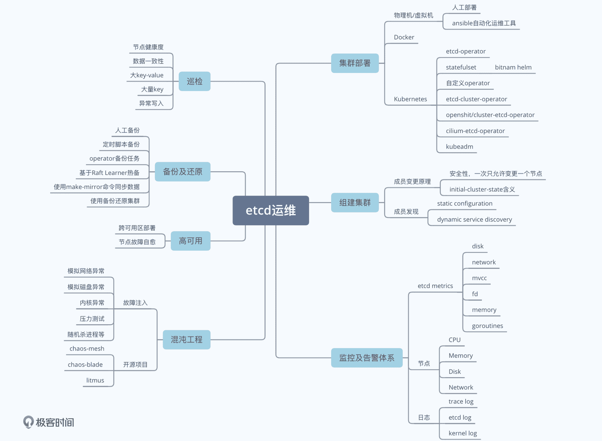

## 集群部署

要想使用 etcd 集群，我们面对的第一个问题是如何选择合适的方案去部署 etcd 集群。

首先是计算资源的选择，它本质上就是计算资源的交付演进史，分别如下：

1. 物理机；
2. 虚拟机；
3. 裸容器（如 Docker 实例）；
4. Kubernetes 容器编排。

物理机资源交付慢、成本高、扩缩容流程费时，一般情况下大部分业务团队不再考虑物理机，除非是超大规模的上万个节点的 Kubernetes 集群，对 CPU、内存、网络资源有着极高诉求。

虚拟机是目前各个云厂商售卖的主流实例，无论是基于 KVM 还是 Xen 实现，都具有良好的稳定性、隔离性，支持故障热迁移，可弹性伸缩，被 etcd、数据库等存储业务大量使用。

在基于物理机和虚拟机的部署方案中，我推荐你使用 ansible、puppet 等自动运维工具，构建标准、自动化的 etcd 集群搭建、扩缩容流程。基于 ansible 部署 etcd 集群可以拆分成以下若干个任务:

1. 下载及安装 etcd 二进制到指定目录；
2. 将 etcd 加入 systemd 等服务管理；
3. 为 etcd 增加配置文件，合理设置相关参数；
4. 为 etcd 集群各个节点生成相关证书，构建一个安全的集群；
5. 组建集群版（静态配置、动态配置，发现集群其他节点）；
6. 开启 etcd 服务，启动 etcd 集群。

详细你可以参考 digitalocean这篇博客文章，它介绍了如何使用 ansible 去部署一个安全的 etcd 集群，并给出了对应的 yaml 任务文件。

容器化部署则具有极速的交付效率、更灵活的资源控制、更低的虚拟化开销等一系列优点。自从 Docker 诞生后，容器化部署就风靡全球。有的业务直接使用裸 Docker 容器来跑 etcd 集群。然而裸 Docker 容器不具备调度、故障自愈、弹性扩容等特性，存在较大局限性。

随后为了解决以上问题，诞生了以 Kubernetes、Swarm 为首的容器编排平台，Kubernetes 成为了容器编排之战中的王者，大量业务使用 Kubernetes 来部署 etcd、ZooKeeper 等有状态服务。在开源社区中，也诞生了若干个 etcd 的 Kubernetes 容器化解决方案，分别如下：

1. etcd-operator；
2. bitnami etcd/statefulset；
3. etcd-cluster-operator；
4. openshit/cluster-etcd-operator；
5. kubeadm。

etcd-operator目前已处于 Archived 状态，无人维护，基本废弃。同时它是基于裸 Pod 实现的，要做好各种备份。在部分异常情况下存在集群宕机、数据丢失风险，我仅建议你使用它的数据备份 etcd-backup-operator。

bitnami etcd提供了一个 helm 包一键部署 etcd 集群，支持各个云厂商，支持使用 PV、PVC 持久化存储数据，底层基于 StatefulSet 实现，较稳定。目前不少开源项目使用的是它。

你可以通过如下 helm 命令，快速在 Kubernete 集群中部署一个 etcd 集群。

```
helm repo add bitnami https://charts.bitnami.com/bitnami  
helm install my-release bitnami/etcd
```

etcd-cluster-operator和 openshit/cluster-etcd-operator比较小众，目前 star 不多，但是有相应的开发者维护，你可参考下它们的实现思路，与 etcd-operator 基于 Pod、bitnami etcd 基于 Statefulset 实现不一样的是，它们是基于 ReplicaSet 和 Static Pod 实现的。

最后要和你介绍的是kubeadm，它是 Kubernetes 集群中的 etcd 高可用部署方案的提供者，kubeadm 是基于 Static Pod 部署 etcd 集群的。Static Pod 相比普通 Pod 有其特殊性，它是直接由节点上的 kubelet 进程来管理，无需通过 kube-apiserver。

创建 Static Pod 方式有两种，分别是配置文件和 HTTP。kubeadm 使用的是配置文件，也就是在 kubelet 监听的静态 Pod 目录下（一般是 /etc/kubernetes/manifests）放置相应的 etcd Pod YAML 文件即可，如下图所示。

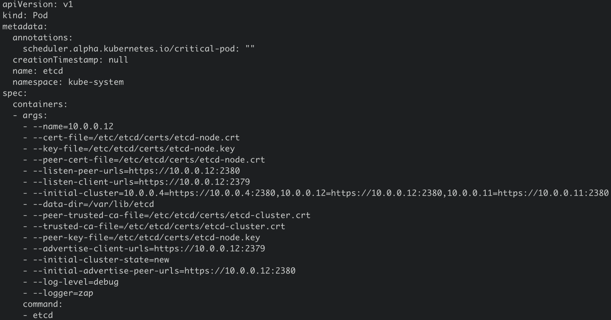

注意在这种部署方式中，部署 etcd 的节点需要部署 docker、kubelet、kubeadm 组件，依赖较重。

## 集群组建

和你聊完 etcd 集群部署的几种模式和基本原理后，我们接下来看看在实际部署过程中最棘手的部分，那就是集群组建。因为集群组建涉及到 etcd 成员管理的原理和节点发现机制。

在特别放送里，超凡已通过一个诡异的故障案例给你介绍了成员管理的原理，并深入分析了 etcd 集群添加节点、新建集群、从备份恢复等场景的核心工作流程。etcd 目前通过一次只允许添加一个节点的方式，可安全的实现在线成员变更。

你要特别注意，当变更集群成员节点时，节点的 initial-cluster-state 参数的取值可以是 new 或 existing。

1. new，一般用于初始化启动一个新集群的场景。当设置成 new 时，它会根据 initial-cluster-token、initial-cluster 等参数信息计算集群 ID、成员 ID 信息。
2. existing，表示 etcd 节点加入一个已存在的集群，它会根据 peerURLs 信息从 Peer 节点获取已存在的集群 ID 信息，更新自己本地配置、并将本身节点信息发布到集群中。

那么当你要组建一个三节点的 etcd 集群的时候，有哪些方法呢?

在 etcd 中，无论是 Leader 选举还是日志同步，都涉及到与其他节点通信。因此组建集群的第一步得知道集群总成员数、各个成员节点的 IP 地址等信息。

这个过程就是发现（Discovery）。目前 etcd 主要通过两种方式来获取以上信息，分别是 **static configuration** 和 **dynamic service discovery**。

**static configuration** 是指集群总成员节点数、成员节点的 IP 地址都是已知、固定的，根据我们上面介绍的 initial-cluster-state 原理，有如下两个方法可基于静态配置组建一个集群。

1. 方法 1，三个节点的 initial-cluster-state 都配置为 new，静态启动，initial-cluster 参数包含三个节点信息即可，详情你可参考社区文档。
2. 方法 2，第一个节点 initial-cluster-state 设置为 new，独立成集群，随后第二和第三个节点都为 existing，通过扩容的方式，不断加入到第一个节点所组成的集群中。

如果成员节点信息是未知的，你可以通过 **dynamic service discovery** 机制解决。

etcd 社区还提供了通过公共服务来发现成员节点信息，组建集群的方案。它的核心是集群内的各个成员节点向公共服务注册成员地址等信息，各个节点通过公共服务来发现彼此，你可以参考官方详细文档。

## 监控及告警体系

当我们把集群部署起来后，在业务开始使用之前，部署监控是必不可少的一个环节，它是我们保障业务稳定性，提前发现风险、隐患点的重要核心手段。那么要如何快速监控你的 etcd 集群呢？

正如我在14和15里和你介绍延时、内存时所提及的，etcd 提供了丰富的 metrics 来展示整个集群的核心指标、健康度。metrics 按模块可划分为磁盘、网络、MVCC 事务、gRPC RPC、etcdserver。

磁盘相关的 metrics 及含义如下图所示。

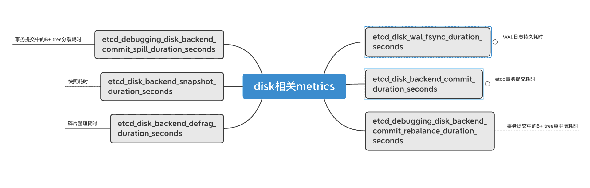

网络相关的 metrics 及含义如下图所示。

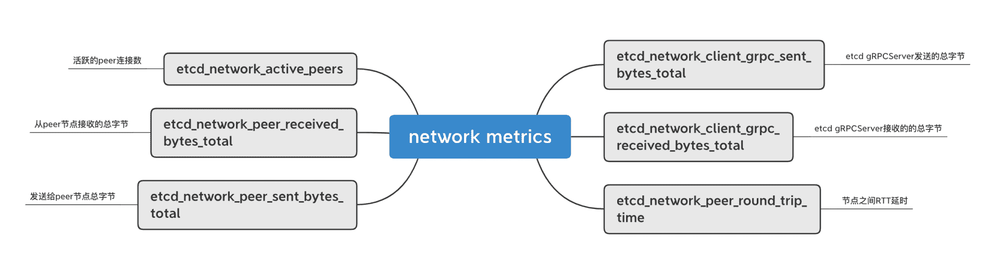

mvcc 相关的较多，我在下图中列举了部分其含义，如下所示。

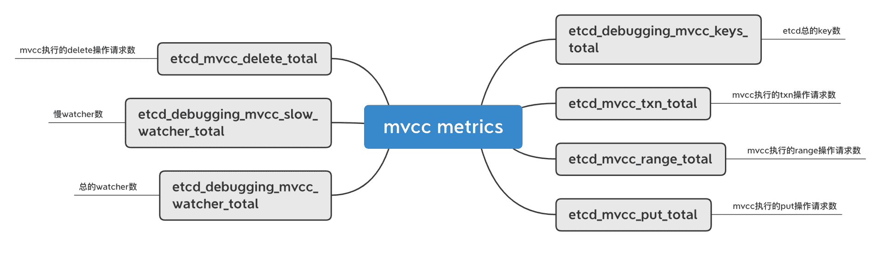

etcdserver 相关的如下，集群是否有 leader、堆积的 proposal 数等都在此模块。

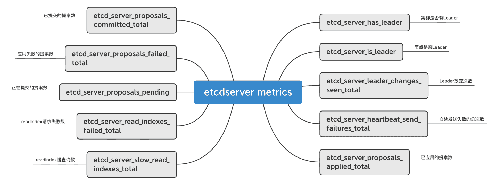

更多 metrics，你可以通过如下方法查看。

```
curl 127.0.0.1:2379/metrics
```

了解常见的 metrics 后，我们只需要配置 Prometheus 服务，采集 etcd 集群的 2379 端口的 metrics 路径。

采集的方案一般有两种，静态配置和动态配置。

静态配置是指添加待监控的 etcd target 到 Prometheus 配置文件，如下所示。

```
global:  
  scrape_interval: 10s  
scrape_configs:  
  - job_name: test-etcd  
    static_configs:  
    - targets:  
 ['10.240.0.32:2379','10.240.0.33:2379','10.240.0.34:2379']
```

静态配置的缺点是每次新增集群、成员变更都需要人工修改配置，而动态配置就可解决这个痛点。

动态配置是通过 Prometheus-Operator 的提供 ServiceMonitor 机制实现的，当你想采集一个 etcd 实例时，若 etcd 服务部署在同一个 Kubernetes 集群，你只需要通过 Kubernetes 的 API 创建一个如下的 ServiceMonitor 资源即可。若 etcd 集群与 Promehteus-Operator 不在同一个集群，你需要去创建、更新对应的集群 Endpoint。

那 Prometheus 是如何知道该采集哪些服务的 metrics 信息呢?

答案 ServiceMonitor 资源通过 Namespace、Labels 描述了待采集实例对应的 Service Endpoint。

```
apiVersion: monitoring.coreos.com/v1  
kind: ServiceMonitor  
metadata:  
  name: prometheus-prometheus-oper-kube-etcd  
  namespace: monitoring  
spec:  
  endpoints:  
  - bearerTokenFile: /var/run/secrets/kubernetes.io/serviceaccount/token  
    port: http-metrics  
    scheme: https  
    tlsConfig:  
      caFile: /etc/prometheus/secrets/etcd-certs/ca.crt  
      certFile: /etc/prometheus/secrets/etcd-certs/client.crt  
      insecureSkipVerify: true  
      keyFile: /etc/prometheus/secrets/etcd-certs/client.key  
  jobLabel: jobLabel  
  namespaceSelector:  
    matchNames:  
    - kube-system  
  selector:  
    matchLabels:  
      app: prometheus-operator-kube-etcd  
      release: prometheus
```

采集了 metrics 监控数据后，下一步就是要基于 metrics 监控数据告警了。你可以通过 Prometheus 和Alertmanager组件实现，那你应该为哪些核心指标告警呢？

当然是影响集群可用性的最核心的 metric。比如是否有 Leader、Leader 切换次数、WAL 和事务操作延时。etcd 社区提供了一个丰富的告警规则，你可以参考下。

最后，为了方便你查看 etcd 集群运行状况和提升定位问题的效率，你可以基于采集的 metrics 配置个grafana 可视化面板。下面我给你列出了集群是否有 Leader、总的 key 数、总的 watcher 数、出流量、WAL 持久化延时的可视化面板。

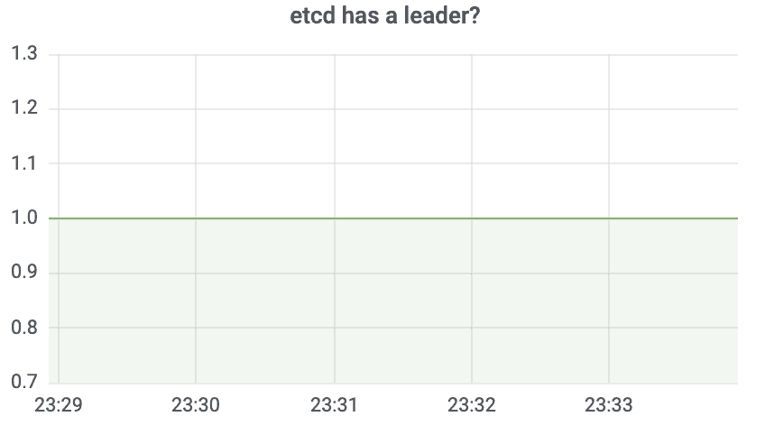

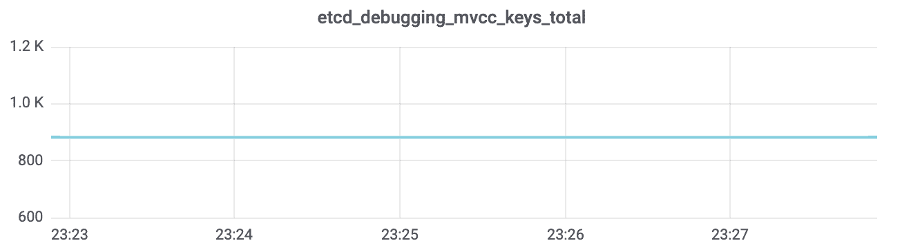

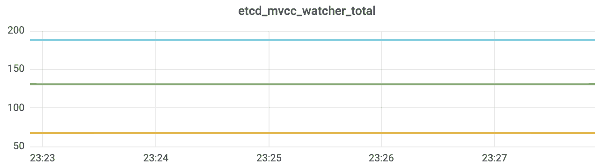

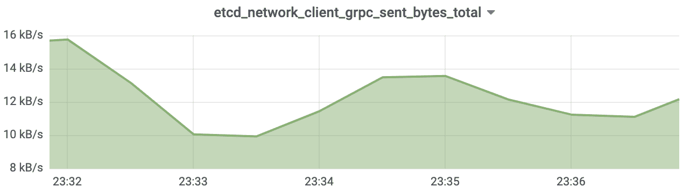

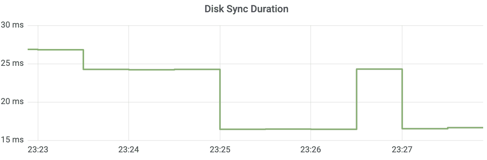

## 备份及还原

监控及告警就绪后，就可以提供给业务在生产环境使用了吗？

当然不行，数据是业务的安全红线，所以你还需要做好最核心的数据备份工作。

如何做呢？

主要有以下方法，首先是通过 etcdctl snapshot 命令行人工备份。在发起重要变更的时候，你可以通过如下命令进行备份，并查看快照状态。

```
ETCDCTL_API=3 etcdctl --endpoints $ENDPOINT   
snapshot save snapshotdb  
ETCDCTL_API=3 etcdctl --write-out=table snapshot status snapshotdb
```

其次是通过定时任务进行定时备份，建议至少每隔 1 个小时备份一次。

然后是通过etcd-backup-operator进行自动化的备份，类似 ServiceMonitor，你可以通过创建一个备份任务 CRD 实现。CRD 如下：

```
apiVersion: "etcd.database.coreos.com/v1beta2"  
kind: "EtcdBackup"  
metadata:  
  name: example-etcd-cluster-periodic-backup  
spec:  
  etcdEndpoints: [<etcd-cluster-endpoints>]  
  storageType: S3  
  backupPolicy:  
    # 0 > enable periodic backup  
    backupIntervalInSecond: 125  
    maxBackups: 4  
  s3:  
    # The format of "path" must be: "<s3-bucket-name>/<path-to-backup-file>"  
    # e.g: "mybucket/etcd.backup"  
    path: <full-s3-path>  
    awsSecret: <aws-secret>
```

最后你可以通过给 etcd 集群增加 Learner 节点，实现跨地域热备。因 Learner 节点属于非投票成员的节点，因此它并不会影响你集群的性能。它的基本工作原理是当 Leader 收到写请求时，它会通过 Raft 模块将日志同步给 Learner 节点。你需要注意的是，在 etcd 3.4 中目前只支持 1 个 Learner 节点，并且只允许串行读。

## 巡检

完成集群部署、了解成员管理、构建好监控及告警体系并添加好定时备份策略后，这时终于可以放心给业务使用了。然而在后续业务使用过程中，你可能会遇到各类问题，而这些问题很可能是 metrics 监控无法发现的，比如如下：

1. etcd 集群因重启进程、节点等出现数据不一致；
2. 业务写入大 key-value 导致 etcd 性能骤降；
3. 业务异常写入大量 key 数，稳定性存在隐患；
4. 业务少数 key 出现写入 QPS 异常，导致 etcd 集群出现限速等错误；
5. 重启、升级 etcd 后，需要人工从多维度检查集群健康度；
6. 变更 etcd 集群过程中，操作失误可能会导致 etcd 集群出现分裂；

......

因此为了实现高效治理 etcd 集群，我们可将这些潜在隐患总结成一个个自动化检查项，比如：

1. 如何高效监控 etcd 数据不一致性？
2. 如何及时发现大 key-value?
3. 如何及时通过监控发现 key 数异常增长？
4. 如何及时监控异常写入 QPS?
5. 如何从多维度的对集群进行自动化的健康检测，更安心变更？
6. ......

如何将这些 etcd 的最佳实践策略反哺到现网大规模 etcd 集群的治理中去呢？

答案就是巡检。

参考 ServiceMonitor 和 EtcdBackup 机制，你同样可以通过 CRD 的方式描述此巡检任务，然后通过相应的 Operator 实现此巡检任务。比如下面就是一个数据一致性巡检的 YAML 文件，其对应的 Operator 组件会定时、并发检查其关联的 etcd 集群各个节点的 key 差异数。

```
apiVersion: etcd.cloud.tencent.com/v1beta1  
kind: EtcdMonitor  
metadata:    
creationTimestamp: "2020-06-15T12:19:30Z"    
generation: 1    
labels:      
clusterName: gz-qcloud-etcd-03      
region: gz      
source: etcd-life-cycle-operator    
name: gz-qcloud-etcd-03-etcd-node-key-diff    
namespace: gz  
spec:    
clusterId: gz-qcloud-etcd-03    
metricName: etcd-node-key-diff    
metricProviderName: cruiser    
name: gz-qcloud-etcd-03    
productName: tke    
region: gz  
status:    
records:    
- endTime: "2021-02-25T11:22:26Z"      
message: collectEtcdNodeKeyDiff,etcd cluster gz-qcloud-etcd-03,total key num is        
122143,nodeKeyDiff is 0       
startTime: "2021-02-25T12:39:28Z"    
updatedAt: "2021-02-25T12:39:28Z"

## 高可用及自愈

通过以上机制，我们已经基本建设好一个高可用的 etcd 集群运维体系了。最后再给你提供几个集群高可用及自愈的小建议：
```

1. 若 etcd 集群性能已满足业务诉求，可容忍一定的延时上升，建议你将 etcd 集群做高可用部署，比如对 3 个节点来说，把每个节点部署在独立的可用区，可容忍任意一个可用区故障。
2. 逐步尝试使用 Kubernetes 容器化部署 etcd 集群。当节点出现故障时，能通过 Kubernetes 的自愈机制，实现故障自愈。
3. 设置合理的 db quota 值，配置合理的压缩策略，避免集群 db quota 满从而导致集群不可用的情况发生。

## 混沌工程

在使用 etcd 的过程中，你可能会遇到磁盘、网络、进程异常重启等异常导致的故障。如何快速复现相关故障进行问题定位呢？

答案就是混沌工程。一般常见的异常我们可以分为如下几类：

1. 磁盘 IO 相关的。比如模拟磁盘 IO 延时上升、IO 操作报错。之前遇到的一个底层磁盘硬件异常导致 IO 延时飙升，最终触发了 etcd 死锁的 Bug，我们就是通过模拟磁盘 IO 延时上升后来验证的。
2. 网络相关的。比如模拟网络分区、网络丢包、网络延时、包重复等。
3. 进程相关的。比如模拟进程异常被杀、重启等。之前遇到的一个非常难定位和复现的数据不一致 Bug，我们就是通过注入进程异常重启等故障，最后成功复现。
4. 压力测试相关的。比如模拟 CPU 高负载、内存使用率等。

开源社区在混沌工程领域诞生了若干个优秀的混沌工程项目，如 chaos-mesh、chaos-blade、litmus。这里我重点和你介绍下chaos-mesh，它是基于 Kubernetes 实现的云原生混沌工程平台，下图是其架构图（引用自社区）。

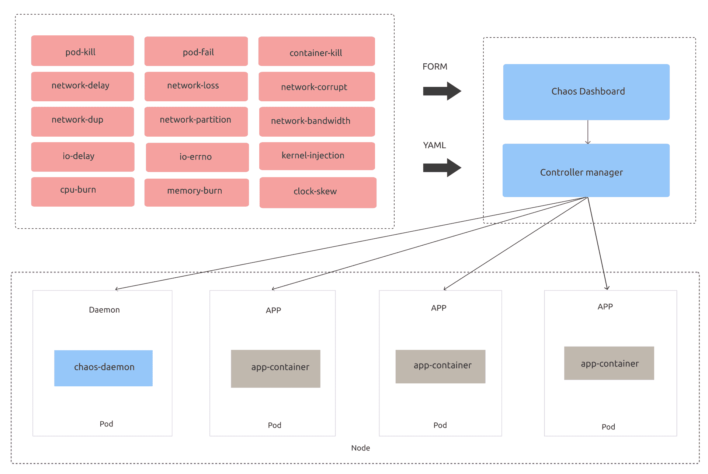

为了实现以上异常场景的故障注入，chaos-mesh 定义了若干种资源类型，分别如下：

1. IOChaos，用于模拟文件系统相关的 IO 延时和读写错误等。
2. NetworkChaos，用于模拟网络延时、丢包等。
3. PodChaos，用于模拟业务 Pod 异常，比如 Pod 被杀、Pod 内的容器重启等。
4. StressChaos，用于模拟 CPU 和内存压力测试。

当你希望给 etcd Pod 注入一个磁盘 IO 延时的故障时，你只需要创建此 YAML 文件就好。

```
apiVersion: chaos-mesh.org/v1alpha1  
kind: IoChaos  
metadata:  
  name: io-delay-example  
spec:  
  action: latency  
  mode: one  
  selector:  
    labelSelectors:  
      app: etcd  
  volumePath: /var/run/etcd  
  path: '/var/run/etcd/**/*'  
  delay: '100ms'  
  percent: 50  
  duration: '400s'  
  scheduler:  
    cron: '@every 10m'

## 小结

最后我们来小结下今天的内容。
```

今天我通过从集群部署、集群组建、监控及告警体系、备份、巡检、高可用、混沌工程几个维度，和你深入介绍了如何构建一个高可靠的 etcd 集群运维体系。

在集群部署上，当你的业务集群规模非常大、对稳定性有着极高的要求时，推荐使用大规格、高性能的物理机、虚拟机独占部署，并且使用 ansible 等自动化运维工具，进行标准化的操作 etcd，避免人工一个个修改操作。

对容器化部署来说，Kubernetes 场景推荐你使用 kubeadm，其他场景可考虑分批、逐步使用 bitnami 提供的 etcd helm 包，它是基于 statefulset、PV、PVC 实现的，各大云厂商都广泛支持，建议在生产环境前，多验证各个极端情况下的行为是否符合你的预期。

在集群组建上，各个节点需要一定机制去发现集群中的其他成员节点，主要可分为 **static configuration** 和 **dynamic service discovery**。

static configuration 是指集群中各个成员节点信息是已知的，dynamic service discovery 是指你可以通过服务发现组件去注册自身节点信息、发现集群中其他成员节点信息。另外我和你介绍了重要参数 initial-cluster-state 的含义，它也是影响集群组建的一个核心因素。

在监控及告警体系上，我和你介绍了 etcd 网络、磁盘、etcdserver、gRPC 核心的 metrics。通过修改 Prometheues 配置文件，添加 etcd target，你就可以方便的采集 etcd 的监控数据。我还给你介绍了 ServiceMonitor 机制，你可通过它实现动态新增、删除、修改待监控的 etcd 实例，灵活的、高效的采集 etcd Metrcis。

备份及还原上，重点和你介绍了 etcd snapshot 命令，etcd-backup-operator 的备份任务 CRD 机制，推荐使用后者。

最后是巡检、混沌工程，它能帮助我们高效治理 etcd 集群，及时发现潜在隐患，低成本、快速的复现 Bug 和故障等。

## 思考题

好了，这节课到这里也就结束了，最后我给你留了一个思考题。

你在生产环境中目前是使用哪种方式部署 etcd 集群的呢？若基于 Kubernetes 容器化部署的，是否遇到过容器化后的相关问题？

感谢你的阅读，也欢迎你把这篇文章分享给更多的朋友一起阅读。
