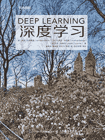
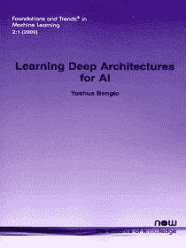
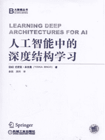
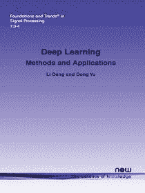
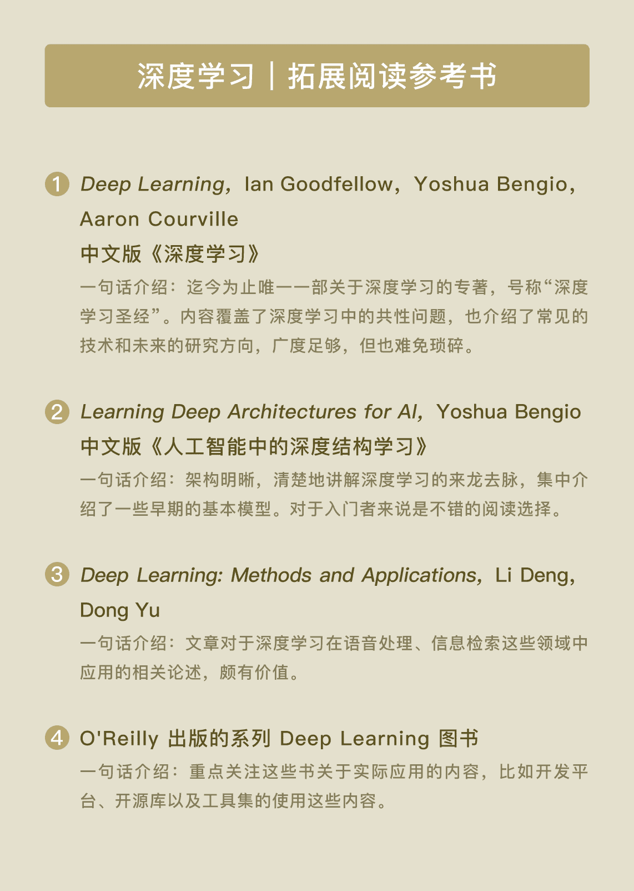

# （课外辅导）深度学习 | 拓展阅读参考书

 

由于深度学习是近五年才流行起来的概念，参考资料因而屈指可数。要推荐深度学习的参考书，就不得不提炙手可热的 **Deep Learning**，中译本名为**《深度学习》**。这本由 **Ian Goodfellow**、**Yoshua Bengio** 和 **Aaron Courville** 合著的大部头是迄今为止唯一一部关于深度学习的专著，号称“深度学习圣经”。几位作者都是人工智能领域响当当的人物，这让本书的质量得以保证。内容上，本书既覆盖了深度学习中的共性问题，也介绍了常见的技术和未来的研究方向，广度是足够的。
 

 

这本书的问题，我认为在于过于琐碎。但这并非是作者水平问题，而是因为深度学习本身还没有形成完整的理论框架，于是阅读本书时难免会有“天上一脚，地下一脚”的感觉，章节之间难觅较强的关联性。这个角度看，这本书更像是把所有菜一股脑扔到锅里炖出来的杂菜汤，反而缺少了调理的过程。另外，前后章节的深度跨度也比较大，阅读体验就像从马里亚纳海沟一下子跳上珠穆朗玛峰。
 

近期有一本新出的关于深度学习的中文书，名叫**《人工智能中的深度结构学习》**。它实际上就是 **Yoshua Bengio** 与 2009 年发表的综述性论文 **[Learning Deep Architectures for AI](https://www.iro.umontreal.ca/~lisa/pointeurs/TR1312.pdf)** 的翻译版。和前面那本大书相比，Bengio 这篇论文的架构更加明晰，至少能把深度学习这个事儿的来龙去脉讲清楚。此外，由于成文时间较早，Bengio 的论文也没有太广的覆盖面，而是集中火力介绍了一些早期的基本模型。对于入门者来说，这篇论文是不错的阅读选择。
 

 

 

另一篇值得推荐的综述文章是微软研究院的 **Li Deng** 和 **Dong Yu** 合撰的 **Deep Learning: Methods and Applications**，成文于 2014 年。正所谓文如其名，本文前几个章节介绍深度学习的常用方法，后几个章节介绍深度学习在语音处理、信息检索这些领域中的应用，条分缕析，娓娓道来。由于像微软这样的企业主要从事的是将理论落地的工作，因而本文关于应用的论述是颇有价值的。
 

 

除了以上的著作外，著名的计算机图书出版商 O'Reilly 也出版了一系列名字里面包含 Deep Learning 的图书。但这些书的关注点都在于实际应用，也就是深度网络的实现，因而内容也侧重于开发平台、开源库以及工具集的使用这样的内容。可能是出于完整性的考虑，这些书中也着实花了笔墨来介绍相关原理，这就让它们看起来不伦不类了。
 

  

