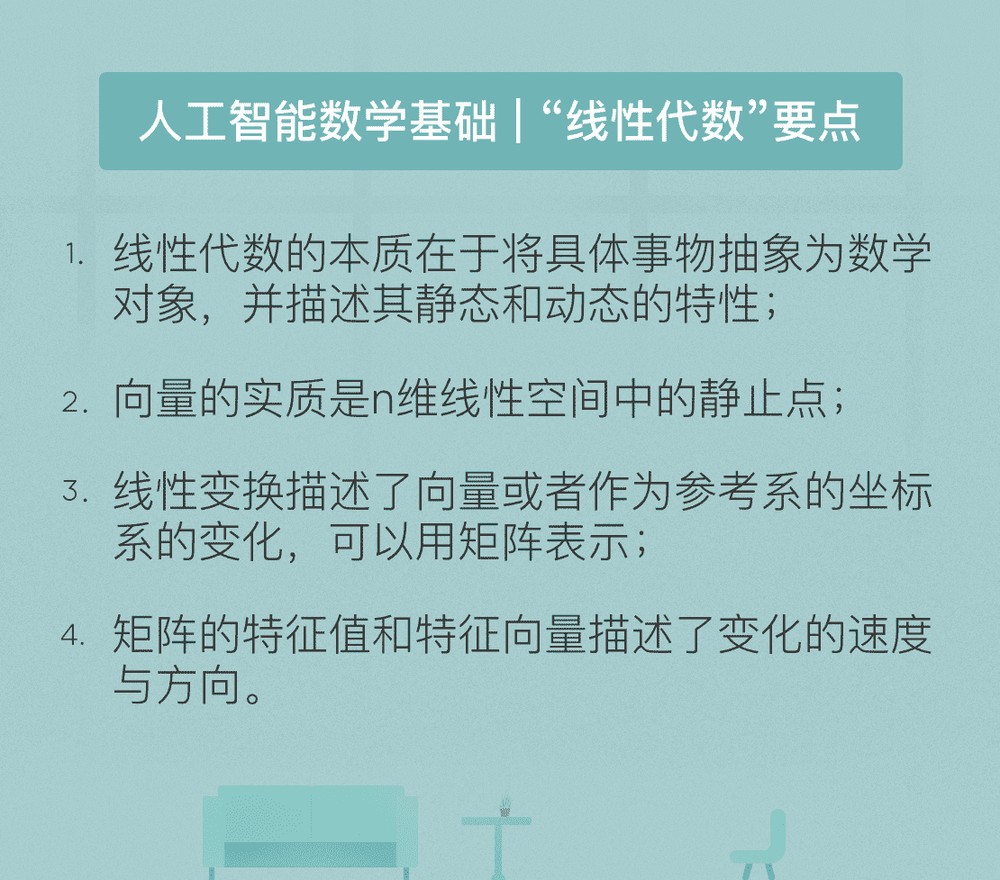
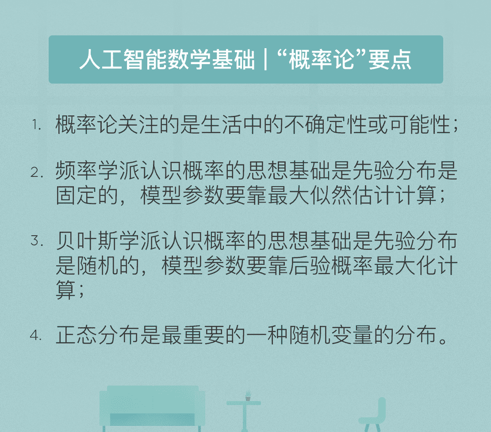
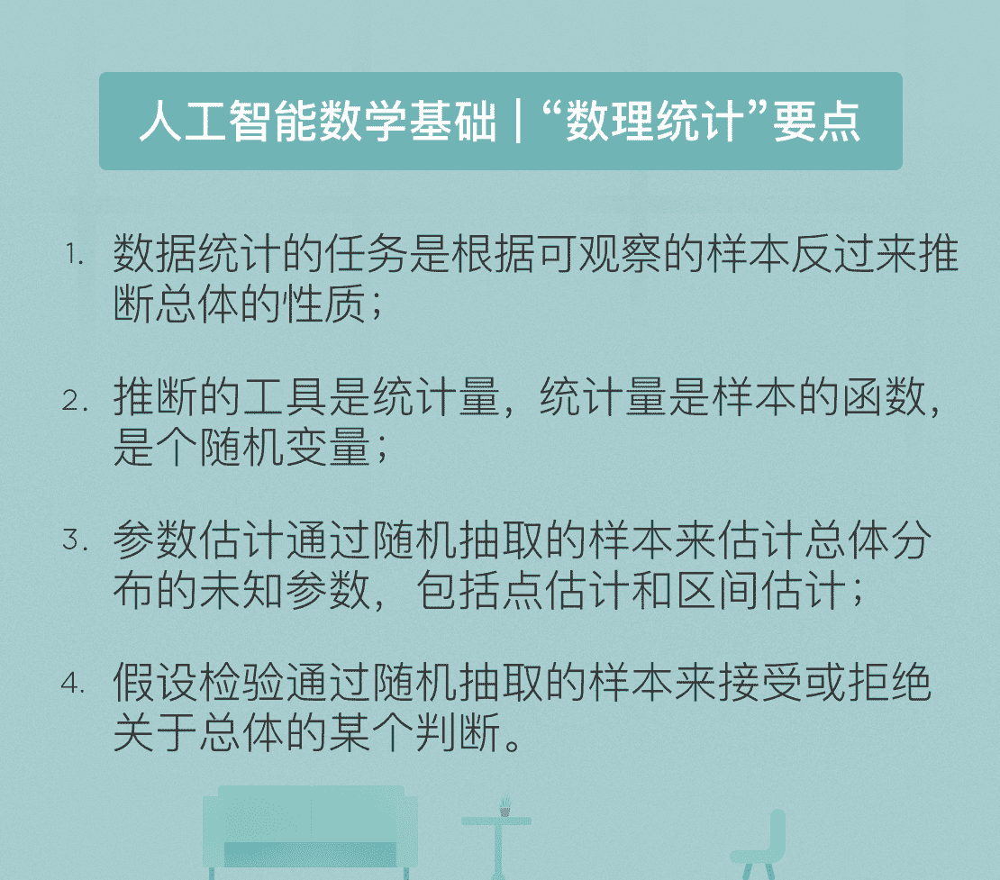
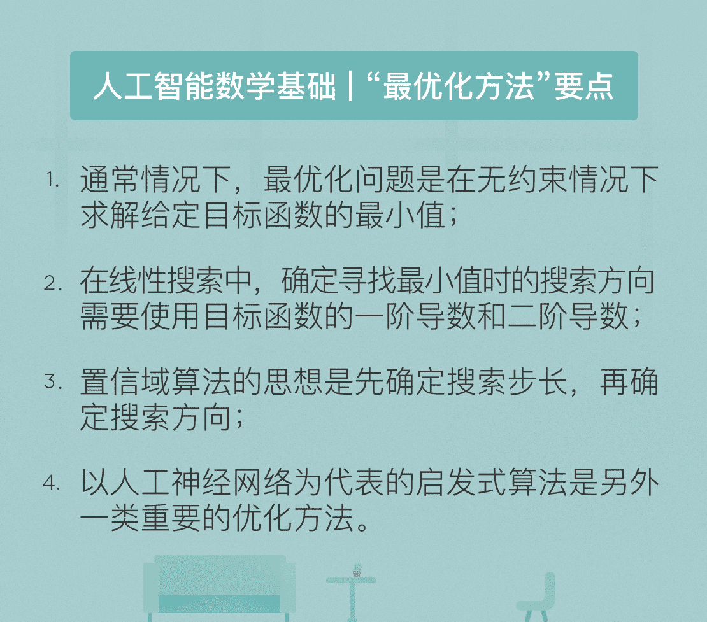
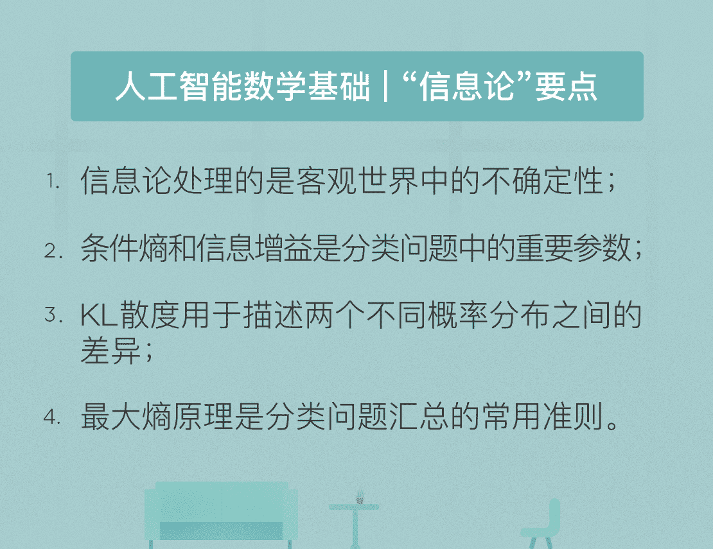
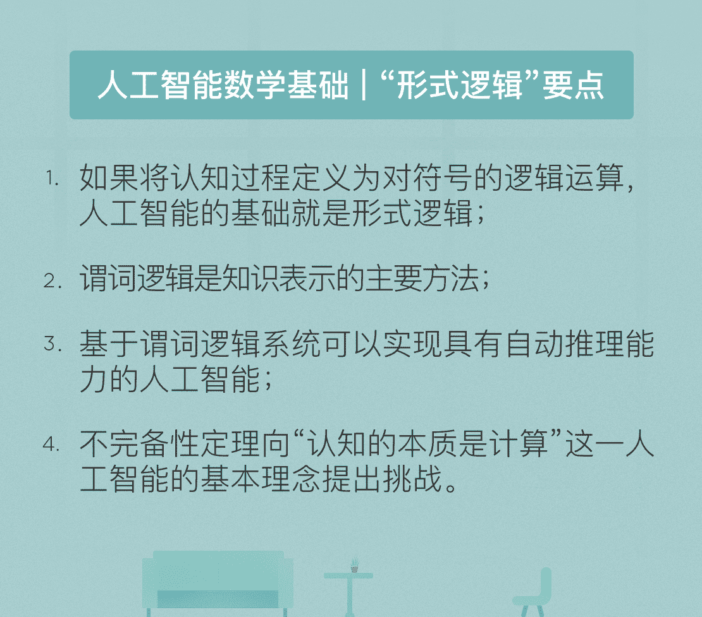
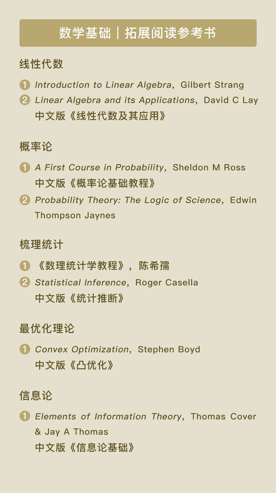

# 一键到达 | 数学基础复习课

 

任何学习都是一个过程，需要不断复习，以强化理解。
 

从今天开始，我会带你复习专栏的内容。按照专栏的七个模块，我为你把每个模块里发布过的文章要点卡都梳理出来，你可以用来回顾每一篇的内容。点击要点卡，一键到达你最需要温故的那一篇。
 

今天来复习专栏的第一部分内容，数学基础。在这个模块里，我们一起学习了线性代数、概率论、数理统计、最优化方法、信息论和形式逻辑这几个内容。
 

复习的过程中，还有什么困惑，获得了什么收获，都欢迎你继续给我留言。
 

 

 

 

 

 

  

 

