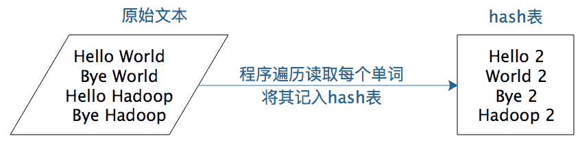
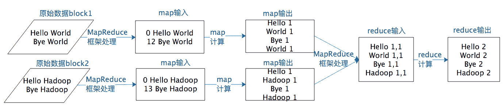
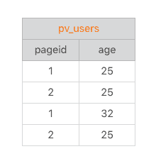

# 07 | 为什么说MapReduce既是编程模型又是计算框架？

 

在 Hadoop 问世之前，其实已经有了分布式计算，只是那个时候的分布式计算都是专用的系统，只能专门处理某一类计算，比如进行大规模数据的排序。很显然，这样的系统无法复用到其他的大数据计算场景，每一种应用都需要开发与维护专门的系统。而 Hadoop MapReduce 的出现，使得大数据计算通用编程成为可能。我们只要遵循 MapReduce 编程模型编写业务处理逻辑代码，就可以运行在 Hadoop 分布式集群上，无需关心分布式计算是如何完成的。也就是说，我们只需要关心业务逻辑，不用关心系统调用与运行环境，这和我们目前的主流开发方式是一致的。

请你先回忆一下，在前面[专栏第 4 期](http://time.geekbang.org/column/article/65106)我们讨论过，大数据计算的核心思路是移动计算比移动数据更划算。既然计算方法跟传统计算方法不一样，移动计算而不是移动数据，那么用传统的编程模型进行大数据计算就会遇到很多困难，因此 Hadoop 大数据计算使用了一种叫作 MapReduce 的编程模型。

其实 MapReduce 编程模型并不是 Hadoop 原创，甚至也不是 Google 原创，但是 Google 和 Hadoop 创造性地将 MapReduce 编程模型用到大数据计算上，立刻产生了神奇的效果，看似复杂的各种各样的机器学习、数据挖掘、SQL 处理等大数据计算变得简单清晰起来。

今天我们就来聊聊Hadoop 解决大规模数据分布式计算的方案——MapReduce。

在我看来，**MapReduce 既是一个编程模型，又是一个计算框架**。也就是说，开发人员必须基于 MapReduce 编程模型进行编程开发，然后将程序通过 MapReduce 计算框架分发到 Hadoop 集群中运行。我们先看一下作为编程模型的 MapReduce。

为什么说 MapReduce 是一种非常简单又非常强大的编程模型？

简单在于其编程模型只包含 Map 和 Reduce 两个过程，map 的主要输入是一对 <Key, Value> 值，经过 map 计算后输出一对 <Key, Value> 值；然后将相同 Key 合并，形成 <Key, Value 集合 >；再将这个 <Key, Value 集合 > 输入 reduce，经过计算输出零个或多个 <Key, Value> 对。

同时，MapReduce 又是非常强大的，不管是关系代数运算（SQL 计算），还是矩阵运算（图计算），大数据领域几乎所有的计算需求都可以通过 MapReduce 编程来实现。

下面，我以 WordCount 程序为例，一起来看下 MapReduce 的计算过程。

WordCount 主要解决的是文本处理中词频统计的问题，就是统计文本中每一个单词出现的次数。如果只是统计一篇文章的词频，几十 KB 到几 MB 的数据，只需要写一个程序，将数据读入内存，建一个 Hash 表记录每个词出现的次数就可以了。这个统计过程你可以看下面这张图。



如果用 Python 语言，单机处理 WordCount 的代码是这样的。

```
# 文本前期处理strl_ist = str.replace('\n', '').lower().split(' ')count_dict = {}# 如果字典里有该单词则加 1，否则添加入字典for str in strl_ist:if str in count_dict.keys():    count_dict[str] = count_dict[str] + 1    else:        count_dict[str] = 1
```

简单说来，就是建一个 Hash 表，然后将字符串里的每个词放到这个 Hash 表里。如果这个词第一次放到 Hash 表，就新建一个 Key、Value 对，Key 是这个词，Value 是 1。如果 Hash 表里已经有这个词了，那么就给这个词的 Value + 1。

小数据量用单机统计词频很简单，但是如果想统计全世界互联网所有网页（数万亿计）的词频数（而这正是 Google 这样的搜索引擎的典型需求），不可能写一个程序把全世界的网页都读入内存，这时候就需要用 MapReduce 编程来解决。

WordCount 的 MapReduce 程序如下。

```
public class WordCount {   public static class TokenizerMapper       extends Mapper<Object, Text, Text, IntWritable>{     private final static IntWritable one = new IntWritable(1);    private Text word = new Text();     public void map(Object key, Text value, Context context                    ) throws IOException, InterruptedException {      StringTokenizer itr = new StringTokenizer(value.toString());      while (itr.hasMoreTokens()) {        word.set(itr.nextToken());        context.write(word, one);      }    }  }   public static class IntSumReducer       extends Reducer<Text,IntWritable,Text,IntWritable> {    private IntWritable result = new IntWritable();     public void reduce(Text key, Iterable<IntWritable> values,                       Context context                       ) throws IOException, InterruptedException {      int sum = 0;      for (IntWritable val : values) {        sum += val.get();      }      result.set(sum);      context.write(key, result);    }  }}
```

你可以从这段代码中看到，MapReduce 版本 WordCount 程序的核心是一个 map 函数和一个 reduce 函数。

map 函数的输入主要是一个 <Key, Value> 对，在这个例子里，Value 是要统计的所有文本中的一行数据，Key 在一般计算中都不会用到。

```
public void map(Object key, Text value, Context context                    )
```

map 函数的计算过程是，将这行文本中的单词提取出来，针对每个单词输出一个 <word, 1> 这样的 <Key, Value> 对。

MapReduce 计算框架会将这些 <word , 1> 收集起来，将相同的 word 放在一起，形成 <word , <1,1,1,1,1,1,1…>> 这样的 <Key, Value 集合 > 数据，然后将其输入给 reduce 函数。

```
public void reduce(Text key, Iterable<IntWritable> values,                       Context context                       ) 
```

这里 reduce 的输入参数 Values 就是由很多个 1 组成的集合，而 Key 就是具体的单词 word。

reduce 函数的计算过程是，将这个集合里的 1 求和，再将单词（word）和这个和（sum）组成一个 <Key, Value>，也就是 <word, sum> 输出。每一个输出就是一个单词和它的词频统计总和。

一个 map 函数可以针对一部分数据进行运算，这样就可以将一个大数据切分成很多块（这也正是 HDFS 所做的），MapReduce 计算框架为每个数据块分配一个 map 函数去计算，从而实现大数据的分布式计算。

假设有两个数据块的文本数据需要进行词频统计，MapReduce 计算过程如下图所示。



以上就是 MapReduce 编程模型的主要计算过程和原理，但是这样一个 MapReduce 程序要想在分布式环境中执行，并处理海量的大规模数据，还需要一个计算框架，能够调度执行这个 MapReduce 程序，使它在分布式的集群中并行运行，而这个计算框架也叫 MapReduce。

所以，当我们说 MapReduce 的时候，可能指编程模型，也就是一个 MapReduce 程序；也可能是指计算框架，调度执行大数据的分布式计算。关于 MapReduce 计算框架，我们下期再详细聊。

## 小结

总结一下，今天我们学习了 MapReduce 编程模型。这个模型既简单又强大，简单是因为它只包含 Map 和 Reduce 两个过程，强大之处又在于它可以实现大数据领域几乎所有的计算需求。这也正是 MapReduce 这个模型令人着迷的地方。

说起模型，我想跟你聊聊我的体会。

模型是人们对一类事物的概括与抽象，可以帮助我们更好地理解事物的本质，更方便地解决问题。比如，数学公式是我们对物理与数学规律的抽象，地图和沙盘是我们对地理空间的抽象，软件架构图是软件工程师对软件系统的抽象。

通过抽象，我们更容易把握事物的内在规律，而不是被纷繁复杂的事物表象所迷惑，更进一步深刻地认识这个世界。通过抽象，伽利略发现力是改变物体运动的原因，而不是使物体运动的原因，为全人类打开了现代科学的大门。

这些年，我自己认识了很多优秀的人，他们各有所长、各有特点，但是无一例外都有个共同的特征，就是**对事物的洞察力**。他们能够穿透事物的层层迷雾，直指问题的核心和要害，不会犹豫和迷茫，轻松出手就搞定了其他人看起来无比艰难的事情。有时候光是看他们做事就能感受到一种美感，让人意醉神迷。

**这种洞察力就是来源于他们对事物的抽象能力**，虽然我不知道这种能力缘何而来，但是见识了这种能力以后，我也非常渴望拥有对事物的抽象能力。所以在遇到问题的时候，我就会停下来思考：这个问题为什么会出现，它揭示出来背后的规律是什么，我应该如何做。甚至有时候会把这些优秀的人带入进思考：如果是戴老师、如果是潘大侠，他会如何看待、如何解决这个问题。通过这种不断地训练，虽然和那些最优秀的人相比还是有巨大的差距，但是仍然能够感受到自己的进步，这些小小的进步也会让自己产生大大的快乐，一种不荒废光阴、没有虚度此生的感觉。

我希望你也能够不断训练自己，遇到问题的时候，停下来思考一下：这些现象背后的规律是什么。有时候并不需要多么艰深的思考，仅仅就是停一下，就会让你察觉到以前不曾注意到的一些情况，进而发现事物的深层规律。这就是洞察力。

## 思考题

对于这样一张数据表



如果存储在 HDFS 中，每一行记录在 HDFS 对应一行文本，文本格式是

```
1,252,251,322,25
```

根据上面 WordCount 的示例，请你写一个 MapReduce 程序，得到下面这条 SQL 的计算结果。

```
SELECT pageid, age, count(1) FROM pv_users GROUP BY pageid, age;
```

TIPS：如何用 MapReduce 实现 SQL 计算，我们在后面还会进一步讨论。

欢迎你写下自己的思考或疑问，与我和其他同学一起讨论。


