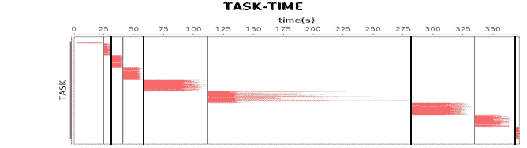
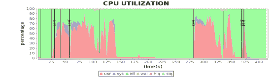
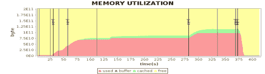
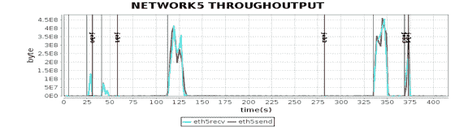
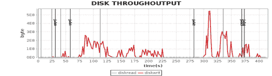

# 19 | Spark的性能优化案例分析（上）

 

我们知道，现在最主流的大数据技术几乎都是开源的产品，不管是 Hadoop 这样的大数据存储与计算产品，还是 Hive、Spark SQL 这样的大数据仓库，又或者 Storm、Flink 这样的大数据流计算产品，还有 Mahout、MLlib 这样的大数据机器学习算法库，它们都来自开源社区。所以，我们在使用大数据、学习大数据的过程中肯定少不了要和开源社区打交道。

我在 Intel 工作期间主要工作就是参与 Apache 开源社区的大数据项目开发，其实上一期我讲的 Panthera 最初也是准备为 Hive 项目增强标准 SQL 处理能力而开发，但是因为和 Apache Hive 项目管理方在开发理念上的冲突，最终选择独立开源。后来我又参与了 Apache Spark 的开发，为 Spark 源代码提交了一些性能优化的 Patch。我想通过专栏两期的内容，具体介绍一下如何参与 Apache 这样开源社区的软件开发，如何进行软件性能优化，以及我在 Apache Spark 源码上做的一些优化实践。

一方面我希望你能借此更深入、系统地了解软件性能优化；另一方面也可以更深入了解 Spark 的一些运行机制，同时也可以了解 Apache 开源社区的运作模式。因为我们在使用各类大数据产品的时候，一定会遇到各种问题，想要解决这些问题，你可以直接到官方的开源社区去求助并寻找答案。在使用过程中，如果这些大数据产品不能满足你的需求，你可以阅读源代码并直接对源代码进行修改和优化。因为你在实践过程中产生的需求可能其他人也会有，你可以将你修改的源代码提交到开源社区，请求合并到发布版本上，供全世界开发者使用。这也是开源最大的魅力。

你可能已经注意到，作为软件开发人员，日常我们使用的大量软件，基本上全部来自美国，不管是免费开源的 Linux、Java、Hadoop、PHP、Tomcat、Spring，还是商业收费的 Windows、WebLogic、Oracle，大到编程语言、操作系统、数据库，小到编程框架、日志组件，几乎全部来自美国。

软件，特别是开源软件，是没有国界的，属于全人类的技术财富。但是，我觉得我们还要承认，中美之间的技术差距真的很惊人。在当前这样一个中美贸易摩擦不断的背景下，难免让人有些忧虑。缩短这种技术差距也许非一日之功，但是更多的中国工程师参与到开源软件的开发中，让中国在世界软件技术领域获得很多影响力，也许是当下就可以迈出的一步。

## Apache 开源社区的组织和参与方式

Apache 是一个以基金会方式运作的非盈利开源软件组织，旗下有超过一百个各类开源软件，其中不乏 Apache、Tomcat、Kafka 等知名的开源软件，当然也包括 Hadoop、Spark 等最主流的大数据开源软件。

Apache 每个项目的管理团队叫项目管理委员会（PMC），一般由项目发起者、核心开发者、Apache 基金会指定的资深导师组成，主导整个项目的发展。此外，项目的主要开发者叫作 committer，是指有将代码合并到主干代码权限的开发者，而其他没有代码合并权限的开发者叫作 contributor。

一般说来，参与 Apache 开源产品开发，先从 contributor 做起。一般的流程是，从 GitHub 项目仓库 fork 代码到自己的仓库，在自己仓库修改代码然后创建 pull request，提交到 Spark 仓库后，如果有 committer 认为没问题，就 merge 到 Spark 主干代码里。

一旦你为某个 Apache 项目提交的代码被 merge 到代码主干，你就可以宣称自己是这个项目的 contributor 了，甚至可以写入自己的简历。如果能持续提交高质量的代码，甚至直接负责某个模块，你就有可能被邀请成为 committer，会拥有一个 apache.org 后缀的邮箱。

当然我希望你提交的是有质量的代码，而不仅仅是对代码注释里某个单词拼写错误进行修改，然后就号称自己是某个著名开源项目的 contributor 了。虽然修改注释也是有价值的，但是如果你的 pull request 总是修改注释的拼写错误，很难被认为是一个严肃的开发者。

除了 Apache，Linux、以太坊等开源基金会的组织和运作方式也都类似。就我观察，最近几年，越来越多来自中国的开发者开始活跃在各种重要的开源软件社区里，我希望你也成为其中一员。

## 软件性能优化

在熟悉开源社区的运作方式后，接下来我们就可以考虑开始进行性能优化了。但在上手之前，你是否清楚所谓性能优化具体要做些什么呢？

关于软件性能优化，有个著名的**论断**。

1. 你不能优化一个没有经过性能测试的软件。

2. 你不能优化一个你不了解其架构设计的软件。

不知你是否听过这个论断，我来解释一下。

如果没有性能测试，那么你就不会知道当前软件的主要性能指标有哪些。通常来说，软件的主要性能指标包括：

 
-  

响应时间：完成一次任务（请求）花费的时间。
  
-  

并发数：同时处理的任务数（请求数）。
  
-  

吞吐量：单位时间完成的任务数（请求数、事务数、查询数……）。
  
-  

性能计数器：System Load，线程数，进程数，CPU、内存、磁盘、网络使用率等。
  

如果没有性能指标，我们也就不清楚软件性能的瓶颈，优化前和优化后也是无从对比。这样的优化工作只能是主观臆断：别人这样做说性能好，我们也这样优化。

而如果不了解软件的架构设计，你可能根本无从判断性能瓶颈产生的根源，也不知道该从哪里优化。

所以性能优化的一般过程是：

1. 做性能测试，分析性能状况和瓶颈点。

2. 针对软件架构设计进行分析，寻找导致性能问题的原因。

3. 修改相关代码和架构，进行性能优化。

4. 做性能测试，对比是否提升性能，并寻找下一个性能瓶颈。

## 大数据软件性能优化

在大数据使用、开发过程的性能优化一般可以从以下角度着手进行。

**1. SQL 语句优化**。使用关系数据库的时候，SQL 优化是数据库优化的重要手段，因为实现同样功能但是不同的 SQL 写法可能带来的性能差距是数量级的。我们知道在大数据分析时，由于数据量规模巨大，所以 SQL 语句写法引起的性能差距就更加巨大。典型的就是 Hive 的 MapJoin 语法，如果 join 的一张表比较小，比如只有几 MB，那么就可以用 MapJoin 进行连接，Hive 会将这张小表当作 Cache 数据全部加载到所有的 Map 任务中，在 Map 阶段完成 join 操作，无需 shuffle。

**2. 数据倾斜处理**。数据倾斜是指当两张表进行 join 的时候，其中一张表 join 的某个字段值对应的数据行数特别多，那么在 shuffle 的时候，这个字段值（Key）对应的所有记录都会被 partition 到同一个 Reduce 任务，导致这个任务长时间无法完成。淘宝的产品经理曾经讲过一个案例，他想把用户日志和用户表通过用户 ID 进行 join，但是日志表有几亿条记录的用户 ID 是 null，Hive 把 null 当作一个字段值 shuffle 到同一个 Reduce，结果这个 Reduce 跑了两天也没跑完，SQL 当然也执行不完。像这种情况的数据倾斜，因为 null 字段没有意义，所以可以在 where 条件里加一个 userID != null 过滤掉就可以了。

**3. MapReduce、Spark 代码优化**。了解 MapReduce 和 Spark 的工作原理，了解要处理的数据的特点，了解要计算的目标，设计合理的代码处理逻辑，使用良好的编程方法开发大数据应用，是大数据应用性能优化的重要手段，也是大数据开发工程师的重要职责。

**4. 配置参数优化**。根据公司数据特点，为部署的大数据产品以及运行的作业选择合适的配置参数，是公司大数据平台性能优化最主要的手段，也是大数据运维工程师的主要职责。比如 Yarn 的每个 Container 包含的 CPU 个数和内存数目、HDFS 数据块的大小和复制数等，每个大数据产品都有很多配置参数，这些参数会对大数据运行时的性能产生重要影响。

**5. 大数据开源软件代码优化**。曾经和杭州某个 SaaS 公司的大数据工程师聊天，他们的大数据团队只有 5、6 个人，但是在使用开源大数据产品的时候，遇到问题都是直接修改 Hadoop、Spark、Sqoop 这些产品的代码。修改源代码进行性能优化的方法虽然比较激进，但是对于掌控自己公司的大数据平台来说，效果可能是最好的。

## Spark 性能优化

有了上面这些性能优化原则和过程，我们在了解 Spark 架构和代码的基础上，就可以进行性能优化了。

关于性能测试，我们使用的是 Intel 为某视频网站编写的一个基于 Spark 的关系图谱计算程序，用于计算视频的级联关系。我们使用 5 台服务器对样例数据进行性能测试，程序运行总体性能如下图。

这张图我在专栏 Spark 架构原理分析过。我们将 4 台 Worker 服务器上主要计算资源利用率指标和这张图各个 job 与 stage 的时间点结合，就可以看到不同运行阶段的性能指标如何，从而发现性能瓶颈。

  
 

  
 

  
 

从这些图我们可以看到，CPU、内存、网络、磁盘这四种主要计算资源的使用和 Spark 的计算阶段密切相关。后面我主要通过这些图来分析 Spark 的性能问题，进而寻找问题根源，并进一步进行性能优化。

下一期，我们一起来看几个 Spark 性能优化的案例，进一步了解 Spark 的工作原理以及性能优化的具体实践。

## 思考题

如果性能测试发现，网卡是整个系统的瓶颈，程序运行过程中网卡达到了最大 I/O 能力，整个系统经常在等待网卡的数据传输，请问，你有什么性能优化建议呢？

欢迎你点击“请朋友读”，把今天的文章分享给好友。也欢迎你写下自己的思考或疑问，与我和其他同学一起讨论。

