# 20 | Spark的性能优化案例分析（下）

 

上一期，我讲了软件性能优化必须经过进行性能测试，并在了解软件架构和技术的基础上进行。今天，我们通过几个 Spark 性能优化的案例，看一看所讲的性能优化原则如何落地。如果你忘记了性能优化的原则，可以返回上一期复习一下。

基于软件性能优化原则和 Spark 的特点，Spark 性能优化可以分解为下面几步。

1. 性能测试，观察 Spark 性能特性和资源（CPU、Memory、Disk、Net）利用情况。

2. 分析、寻找资源瓶颈。

3. 分析系统架构、代码，发现资源利用关键所在，思考优化策略。

4. 代码、架构、基础设施调优，优化、平衡资源利用。

5. 性能测试，观察系统性能特性，是否达到优化目的，以及寻找下一个瓶颈点。

下面我们一起进入详细的案例分析，希望通过这几个案例，可以帮助你更好地理解 Spark 的原理，以及性能优化如何实践落地，希望能对你有所启发。

## 案例 1：Spark 任务文件初始化调优

首先进行性能测试，发现这个视频图谱 N 度级联关系应用分为 5 个 job，最后一个 job 为保存结果到 HDFS，其余 job 为同样计算过程的反复迭代。但是发现第一个 job 比其他 job 又多了个计算阶段 stage，如图中红圈所示。

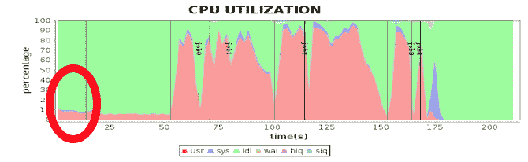

通过阅读程序代码，发现第一个 job 需要初始化一个空数组，从而产生了一个 stage，但是这个 stage 在性能测试结果上显示，花费了 14 秒的时间，远远超出合理的预期范围。同时，发现这段时间网络通信也有一定开销，事实上只是内存数据初始化，代码上看不出需要进行网络通信的地方。下图是其中一台计算节点的通信开销，发现在第一个 stage，写通信操作几乎没有，读通信操作大约每秒几十 MB 的传输速率。

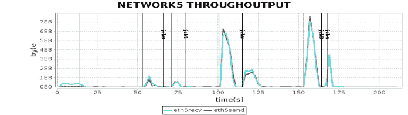

分析 Spark 运行日志，发现这个 stage 主要花费时间并不是处理应用的计算逻辑，而是在从 Driver 进程下载应用执行代码。前面说过，Spark 和 MapReduce 都是通过移动计算程序到数据所在的服务器节点，从而节省数据传输的网络通信开销，并进行分布式计算，即移动计算比移动数据更划算，而移动计算程序就是在这个阶段进行。

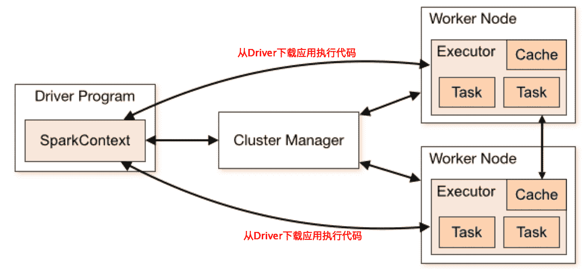

这个视频关系图谱计算程序因为依赖一个第三方的程序包，整个计算程序打包后大小超过 17MB，这个 17MB 的 JAR 包需要部署到所有计算服务器上，即 Worker 节点上。但是只传输 17MB 的数据不可能花费这么多时间啊？

进一步分析 Spark 日志和代码后发现，每个计算节点上会启动多个 Executor 进程进行计算，而 Spark 的策略是每个 Executor 进程自己去下载应用程序 JAR 包，当时每台机器启动了 30 个 Executor 进程，这样就是 4×30=120 个进程下载，而 Driver 进程所在机器是一块千兆网卡，导致将这些数据传输完成花费了 14 秒的时间。

发现问题以后，解决办法就显而易见了。同一台服务器上的多个 Executor 进程不必每个都通过网络下载应用程序，只需要一个进程下载到本地后，其他进程将这个文件 copy 到自己的工作路径就可以了。

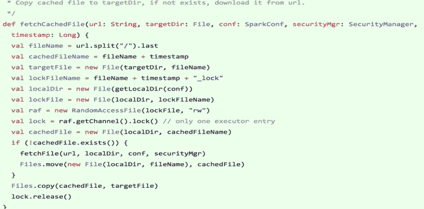

这段代码有个技术实现细节需要关注，就是多个进程同时去下载程序包的时候，如何保证只有一个进程去下载，而其他进程阻塞等待，也就是进程间的同步问题。

解决办法是使用了一个本地文件作为进程间同步的锁，只有获得文件锁的进程才去下载，其他进程得不到文件锁，就阻塞等待，阻塞结束后，检查本地程序文件是否已经生成。

这个优化实测效果良好，第一个 stage 从 14 秒下降到不足 1 秒，效果显著。

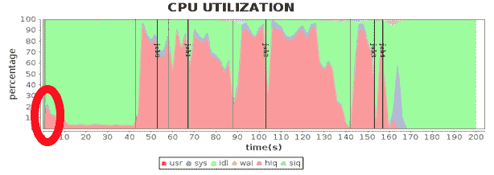

这个案例的具体代码你可以参考：  
 [https://github.com/apache/spark/pull/1616](https://github.com/apache/spark/pull/1616)

## 案例 2：Spark 任务调度优化

继续前面的性能测试，看看有没有新的性能瓶颈以及性能指标不合理的地方。我们将 4 台 Worker 机器的 CPU 使用率进行对比分析，发现 CPU 使用率有些蹊跷的地方。

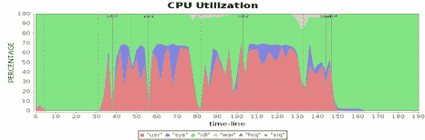

  
 


  
 

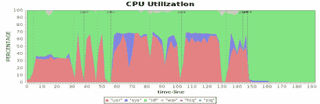

  
 

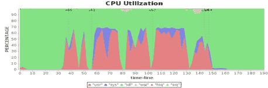

从图中看到，在第一个 job 的第二个阶段，第三台机器的 CPU 使用率和其他机器明显不同，也就是说计算资源利用不均衡，**这种有忙有闲的资源分配方式通常会引起性能问题**。

分析 Spark 运行日志和 Spark 源代码，发现当有空闲计算资源的 Worker 节点向 Driver 注册的时候，就会触发 Spark 的任务分配，分配的时候使用轮询方式，每个 Worker 都会轮流分配任务，保证任务分配均衡，每个服务器都能领到一部分任务。但是为什么实测的结果却是在第二个 stage，只有一个 Worker 服务器领了任务，而其他服务器没有任何任务可以执行？

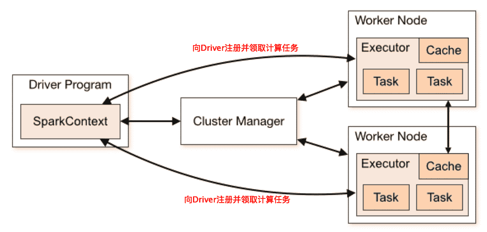

进一步分析日志，发现 Worker 节点向 Driver 注册有先有后，先注册的 Worker 开始领取任务，如果需要执行的任务数小于 Worker 提供的计算单元数，就会出现一个 Worker 领走所有任务的情况。

而第一个 job 的第二个 stage 刚好是这样的情况，demo 数据量不大，按照 HDFS 默认的 Block 大小，只有 17 个 Block，第二个 stage 就是加载这 17 个 Block 进行初始迭代计算，只需要 17 个计算任务就能完成，所以当第三台服务器先于其他三台服务器向 Driver 注册的时候，触发 Driver 的任务分配，领走了所有 17 个任务。

同时，为了避免这种一个 Worker 先注册先领走全部任务的情况，我们考虑的一个优化策略是增加一个配置项，只有注册的计算资源数达到一定比例才开始分配任务，默认值是 0.8。

```
spark.scheduler.minRegisteredResourcesRatio = 0.8
```

为了避免注册计算资源达不到期望资源比例而无法开始分配任务，在启动任务执行时，又增加了一个配置项，也就是最小等待时间，超过最小等待时间（秒），不管是否达到注册比例，都开始分配任务。

```
spark.scheduler.maxRegisteredResourcesWaitingTime = 3
```

启用这两个配置项后，第二个 stage 的任务被均匀分配到 4 个 Worker 服务器上，执行时间缩短了 1.32 倍。而 4 台 Worker 服务器的 CPU 利用率也变得很均衡了。

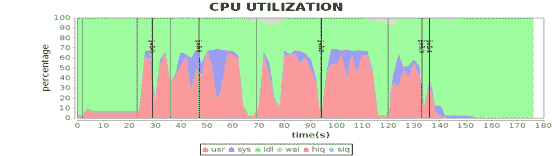

  
 

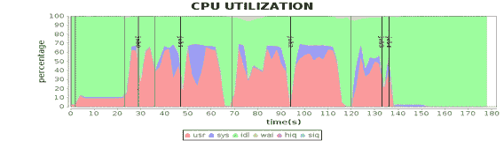

  
 

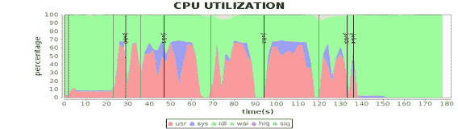

  
 

这个案例的具体代码你可以参考：[https://github.com/apache/spark/pull/900](https://github.com/apache/spark/pull/900)  
 [https://github.com/apache/spark/pull/1525](https://github.com/apache/spark/pull/1525)

## 案例 3：Spark 应用配置优化

看案例 2 的几张 CPU 利用率的图，我们还发现所有 4 个 Worker 服务器的 CPU 利用率最大只能达到 60% 多一点。例如下图，绿色部分就是 CPU 空闲。

这种资源利用瓶颈的分析无需分析 Spark 日志和源代码，根据 Spark 的工作原理，稍加思考就可以发现，当时使用的这些服务器的 CPU 的核心数是 48 核，而应用配置的最大 Executor 数目是 120，每台服务器 30 个任务，虽然 30 个任务在每个 CPU 核上都 100% 运行，但是总的 CPU 使用率仍只有 60% 多。

具体优化也很简单，设置应用启动参数的 Executor 数为 48×4=192 即可。

## 案例 4：操作系统配置优化

在性能测试过程中发现，当使用不同服务器的时候，CPU 资源利用情况也不同，某些服务器的 CPU 处于 sys 态，即系统态运行的占比非常高，如下图所示。

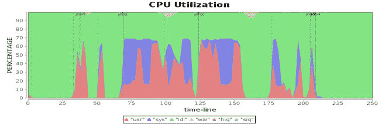

图中紫色为 CPU 处于 sys 态，某些时候 sys 态占了 CPU 总使用率的近 80%，这个比例显然是不合理的，表示虽然 CPU 很忙，但是没有执行用户计算，而是在执行操作系统的计算。

那么，操作系统究竟在忙什么，占用了这么多 CPU 时间？通过跟踪 Linux 内核执行指令，发现这些 sys 态的执行指令和 Linux 的配置参数 transparent huge pages 有关。

当 transparent huge pages 打开的时候，sys 态 CPU 消耗就会增加，而不同 Linux 版本的 transparent huge pages 默认是否打开是不同的，对于默认打开 transparent huge pages 的 Linux 执行下面的指令，关闭 transparent huge pages。

```
echo never > /sys/kernel/mm/transparent_hugepage/enabledecho never > /sys/kernel/mm/ transparent_hugepage/defrag
```

关闭以后，对比前面的 CPU 消耗，sys 占比明显下降，总的应用耗时也有明显下降。

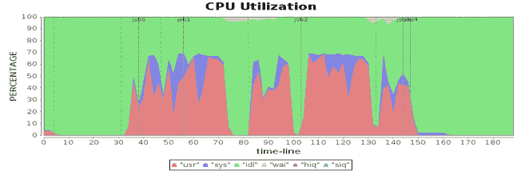

## 案例 5：硬件优化

分析网卡的资源消耗，发现网络通信是性能的瓶颈，对整个应用的影响非常明显。比如在第二个、第三个 job，网络通信消耗长达 50 秒的时间，网络读写通信都达到了网卡的最大吞吐能力，整个集群都在等待网络传输。

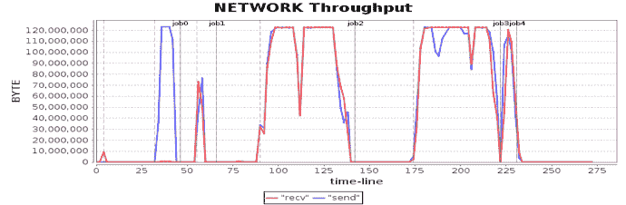

我们知道千兆网卡的最大传输速率是每秒 125MB，这样的速率和 CPU 内存固然没法比，而虽然比单个磁盘快一些，但是服务器磁盘是 8 块磁盘组成的阵列，总的磁盘吞吐量依然碾压千兆网卡，因此网卡传输速率的瓶颈就成为整个系统的性能瓶颈。

而优化手段其实很简单粗暴，就是是升级网卡使用万兆网卡。

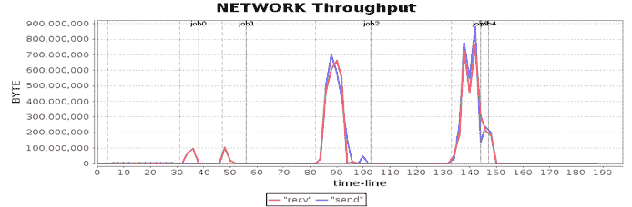

硬件优化的效果非常明显，以前需要 50 多秒的网络通信时间，缩短为 10 秒左右。从性能曲线上看，网络通信在刚刚触及网卡最大传输速率的时候，就完成了传输，总的计算时间缩短了近 100 秒。

## 小结

一般说来，大数据软件性能优化会涉及硬件、操作系统、大数据产品及其配置、应用程序开发和部署几个方面。当性能不能满足需求的时候，先看看各项性能指标是否合理，如果资源没有全面利用，那么可能是配置不合理或者大数据应用程序（包括 SQL 语句）需要优化；如果某项资源利用已经达到极限，那么就要具体来分析，是集群资源不足，需要增加新的硬件服务器，还是需要对某项硬件、操作系统或是 JVM，甚至是对大数据产品源代码进行调优。

## 思考题

关于目前的主要大数据产品，你在学习、使用过程中，从 SQL 写法、应用编程、参数配置，到大数据产品自身的架构原理与源码实现，你有没有发现有哪些可以进行性能优化的地方？

欢迎你点击“请朋友读”，把今天的文章分享给好友。也欢迎你写下自己的思考或疑问，与我和其他同学一起讨论。


