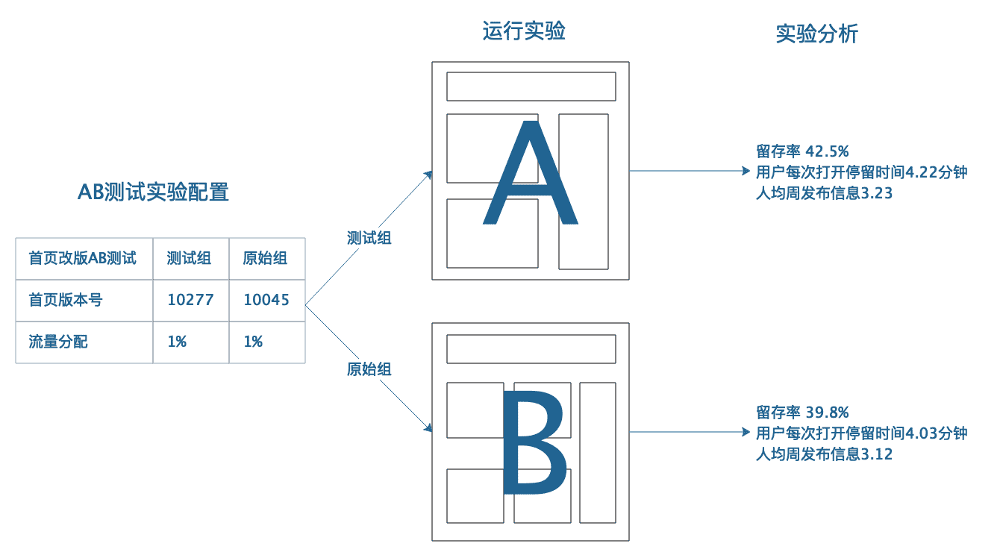
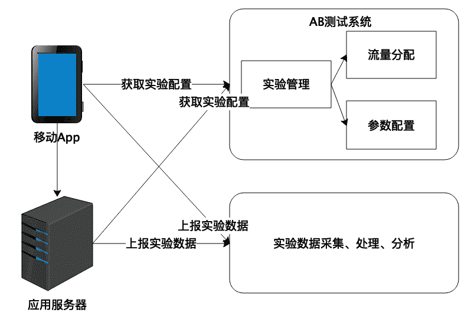

# 34 | A/B测试与灰度发布必知必会

 

在网站和 App 的产品设计中，经常会遇到关于哪种产品设计方案更优的思考和讨论：按钮大一点好还是小一点好；页面复杂一点好还是简单一点好；这种蓝色好还是另一种蓝色好；新的推荐算法是不是真的效果好…这种讨论会出现在运营人员和产品经理之间，也会出现在产品经理和工程师之间，有时候甚至会出现在公司最高层，成为公司生死存亡的战略决策。

在 Facebook 的发展历史上，曾经多次试图对首页进行重大改版，甚至有时候是扎克伯格亲自发起的改版方案，但是最终所有的重大改版方案都被放弃了，多年来 Facebook 基本保持了一贯的首页布局和风格。

相对应的是，一直被认为抄袭 Facebook 的人人网在 Facebook 多次改版举棋不定的时候，毅然进行了重大的首页改版，摆脱了长期被诟病的抄袭指责。但是讽刺的是，事后回头再看，伴随着人人网改版的是用户的快速流失，并最后导致了人人网的没落，而 Facebook 的守旧却保证了 Facebook 的持续发展。

让 Facebook 放弃改版决定的，正是 Facebook 的 A/B 测试。Facebook 开发出新的首页布局版本后，并没有立即向所有用户发布，而是随机选择了向大约 1% 的用户发布，即这 1% 的用户看到的首页是新版首页，而其他用户看到的还是原来的首页。过一段时间后观察两部分用户的数据指标，看新版本的数据指标是否好于旧版本。

事实上 Facebook 观察到的结果可不乐观，新版本的用户数据指标呈下跌状态。扎克伯格不甘心，要求继续放大新版测试用户的比例，运营团队一度将新版测试用户的比例放大到 16%，但是数据显示新版并不受用户欢迎，数据指标很糟糕。最后扎克伯格决定放弃新版，首页维持原来布局。

A/B 测试是大型互联网应用的常用手段。如果说设计是主观的，那么数据是客观的，与其争执哪种设计更好、哪种方案更受用户欢迎，不如通过 A/B 测试让数据说话。如果人人网当初认真做 A/B 测试，也许不会贸然改版；据说今日头条为了论证两条新闻之间的分割究竟应该用多宽的距离，同样是做了数百组 A/B 测试。

所以 A/B 测试是更精细化的数据运营手段，通过 A/B 测试实现数据驱动运营，驱动产品设计，是大数据从幕后走到台前的重要一步。

## A/B 测试的过程

A/B 测试将每一次测试当作一个实验。通过 A/B 测试系统的配置，将用户随机分成两组（或者多组），每组用户访问不同版本的页面或者执行不同的处理逻辑，即运行实验。通常将原来产品特性当作一组，即原始组；新开发的产品特性当作另一组，即测试组。

经过一段时间（几天甚至几周）以后，对 A/B 测试实验进行分析，观察两组用户的数据指标，使用新特性的测试组是否好于作为对比的原始组，如果效果比较好，那么这个新开发的特性就会在下次产品发布的时候正式发布出去，供所有用户使用；如果效果不好，这个特性就会被放弃，实验结束。

对于一个大型网站，通常都会开发很多新产品特性，其中很多特性需要进行 A/B 测试，所以在进行流量分配的时候，每个特性只会分配到比较小的一个流量进行测试，比如 1%。但是由于大型网站总用户量比较大，即使是 1% 的用户，实验得到的数据也具有代表性了。Facebook 拥有几十亿用户，如果 A/B 测试的新特性对用户不友好，那么即使只测试 1% 的用户，也有几千万用户受到影响。所以，在进行 A/B 测试时对实验流量和特性的选择也要谨慎对待。

## A/B 测试的系统架构

A/B 测试系统最重要的是能够根据用户 ID（或者设备 ID）将实验配置参数分发给应用程序，应用程序根据配置参数决定给用户展示的界面和执行的业务逻辑，如下图。

在实验管理模块里进行用户分组，比如测试组、原始组，并指定每个分组用户占总用户的百分比；流量分配模块根据某种 Hash 算法将用户（设备）分配到某个实验组中；一个实验可以有多个参数，每个组有不同的参数值。

移动 App 在启动后，定时和 A/B 测试系统通信，根据自身用户 ID 或者设备 ID 获取自己参与的 A/B 测试实验的配置项，根据配置项执行不同的代码，体验不同的应用特性。应用服务器和 A/B 测试系统在同一个数据中心，获取实验配置的方式可以更灵活。

移动 App 和应用服务器上报实验数据其实就是传统的数据采集，但是在有 A/B 测试的情况下，数据采集上报的时候需要将 A/B 测试实验 ID 和分组 ID 也上报，然后在数据分析的时候，才能够将同一个实验的不同分组数据分别统计，得到 A/B 测试的实验数据报告。

## 灰度发布

经过 A/B 测试验证过的功能特性，就可以发布到正式的产品版本中，向所有用户开放。但是有时候在 A/B 测试中表现不错的特性，正式版本发布后效果却不好。此外，A/B 测试的时候，每个功能都应该是独立（正交）的，正式发布的时候，所有的特性都会在同一个版本中一起发布，这些特性之间可能会有某种冲突，导致发布后的数据不理想。

解决这些问题的手段是灰度发布，即不是一次将新版本发布给全部用户，而是一批一批逐渐发布给用户。在这个过程中，监控产品的各项数据指标，看是否符合预期，如果数据表现不理想，就停止灰度发布，甚至进行灰度回滚，让所有用户都恢复到以前的版本，进一步观察分析数据指标。

灰度发布系统可以用 A/B 测试系统来承担，创建一个名叫灰度发布的实验即可，这个实验包含这次要发布的所有特性的参数，然后逐步增加测试组的用户数量，直到占比达到总用户量的 100%，即为灰度发布完成。

灰度发布的过程也叫作灰度放量，灰度放量是一种谨慎的产品运营手段。对于 Android 移动 App 产品而言，因为国内存在很多个应用下载市场，所以即使没有 A/B 测试系统，也可以利用应用市场实现灰度发布。即在发布产品新版本的时候，不是一次在所有应用市场同时发布，而是有选择地逐个市场发布。每发布一批市场，观察几天数据指标，如果没有问题，继续发布下一批市场。

## 小结

A/B 测试的目的依然是为了数据分析，因此通常被当作大数据平台的一个部分，由大数据平台团队主导，联合业务开发团队和大数据分析团队合作开发 A/B 测试系统。A/B 测试系统囊括了前端业务埋点、后端数据采集与存储、大数据计算与分析、后台运营管理、运维发布管理等一个互联网企业几乎全部的技术业务体系，因此开发 A/B 测试系统有一定难度。但是一个良好运行的 A/B 测试系统对企业的价值也是极大的，甚至可以支撑起整个公司的运营管理，我们下期会详细讨论。

## 思考题

A/B 测试需要在前端 App 根据实验分组展示不同界面、运行不同业务逻辑，你有没有比较好的设计方案或者技术架构，可以更灵活、对应用更少侵入地实现这一功能？

欢迎你点击“请朋友读”，把今天的文章分享给好友。也欢迎你写下自己的思考或疑问，与我和其他同学一起讨论。

