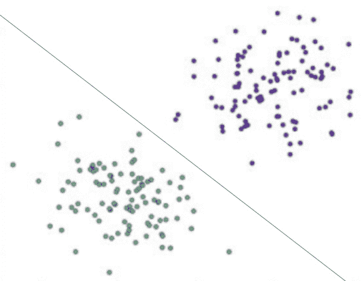
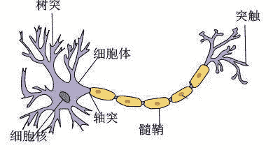
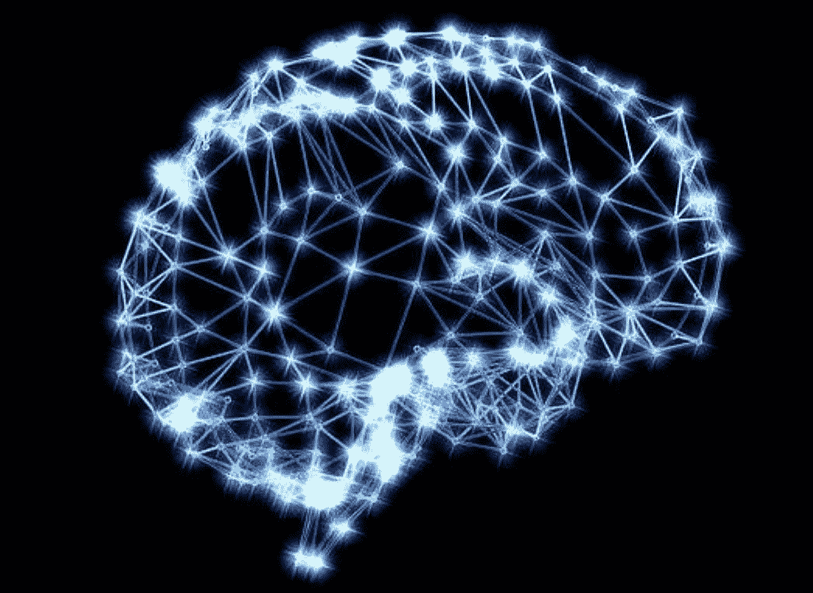
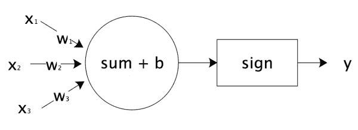
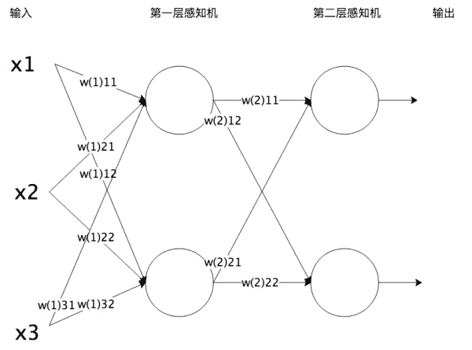
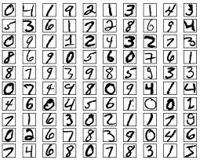
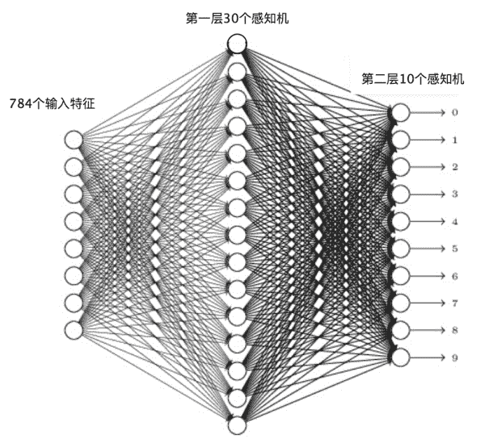
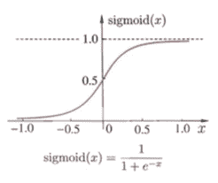
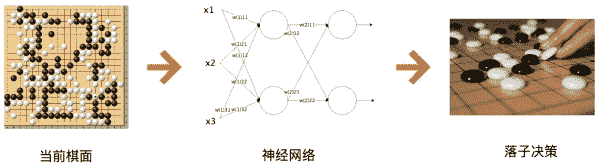

# 41 | 从感知机到神经网络算法

 

从机器学习模型角度看，目前最简单的机器学习模型大概就是感知机了，而最火热的机器学习模型则是神经网络。人工智能领域几乎所有炫酷的东西都是神经网络的成果，有下赢人类最顶尖围棋棋手的 AlphaGo、自动驾驶技术、聊天机器人、语音识别与自动翻译等。事实上，神经网络和感知机是一脉相承的，就像复杂的人体是由一个个细胞组成、复杂的大脑是由一个个神经元组成，而神经网络正是由感知机组成的。

## 感知机

感知机是一种比较简单的二分类模型，将输入特征分类为 +1、-1 两类，就像下图所示的，一条直线将平面上的两类点分类。

二维平面上的点只有两个输入特征（横轴坐标和纵轴坐标），一条直线就可以分类。如果输入数据有更多维度的特征，那么就需要建立同样多维度的模型，高维度上的分类模型也被称为超平面。

感知机模型如下：

f(x)=sign(w⋅x+b)f(x)=sign(w⋅x+b)

其中 xx 代表输入的特征空间向量，输出空间是{-1, +1}，ww 为权值向量，bb 叫作偏置，signsign 是一个符号函数。

w⋅x+b=0w⋅x+b=0 为超平面的方程，当感知机输出为 +1 表示输入值在超平面的上方，当感知机输出为 -1 表示输入值在超平面的下方。训练感知机模型就是要计算出 ww 和 bb 的值，当有新的数据需要分类的时候，输入感知机模型就可以计算出 +1 或者 -1 从而进行分类。

由于输出空间只有{-1, +1}两个值，所以只有误分类的时候，才会有模型计算值和样本真实值之间的偏差，偏差之和就是感知机的损失函数。

L(w,b)=−∑xi∈Myi(w⋅xi+b)L(w,b)=−∑xi∈Myi(w⋅xi+b)

其中 MM 为误分类点集合，误分类点越少，损失函数的值越小；如果没有误分类点，损失函数值为 0。求模型的参数 ww 和 bb，就是求损失函数的极小值。

数学上求函数的极小值就是求函数的一阶导数，但是感知机损失函数用统计求和函数表达，没办法计算解析解。机器学习采用梯度下降法求损失函数极小值，实质上就是求导过程的数值计算方法。

对于误分类点集合 MM，损失函数 L(w,b)L(w,b) 变化的梯度，就是某个函数变量的变化引起的函数值的变化，根据感知机损失函数可知：

ΔwL(w,b)=−∑xi∈MyixiΔwL(w,b)=−∑xi∈Myixi

ΔbL(w,b)=−∑xi∈MyiΔbL(w,b)=−∑xi∈Myi

使用梯度下降更新 ww 和 bb，不断迭代使损失函数 L(w,b)L(w,b) 不断减小，直到为 0，也就是没有误分类点。感知机算法的实现过程：

1. 选择初始值 w0,b0w0,b0。

2. 在样本集合中选择样本数据 xi,yixi,yi。

3. 如果 yi(w⋅xi+b)<0yi(w⋅xi+b)<0，表示 yiyi 为误分类点，那么 w=w+ηyixiw=w+ηyixi、b=b+ηyib=b+ηyi，在梯度方向校正 ww 和 bb。其中 ηη 为步长，步长选择要适当，步长太长会导致每次计算调整太大出现震荡；步长太短又会导致收敛速度慢、计算时间长。

4. 跳转回 2，直到样本集合中没有误分类点， 即全部样本数据 yi(w⋅xi+b)≥0yi(w⋅xi+b)≥0。

## 神经网络

我们现在所说的神经网络，通常是指机器学习所使用的“人工神经网络”，是对人脑神经网络的一种模拟。人脑神经网络由许多神经元构成，每个神经元有多个树突，负责接收其他神经元的输出信号，神经元细胞完成对输入信号的处理，转换成输出信号，通过突触传递给其他神经元。

神经元细胞的输出只有 0 或者 1 两种输出，但是人脑大约有 140 亿个神经元，这些神经元组成一个神经网络，前面的神经元输出作为后面的神经元输入进一步处理，最终实现人类的智能。

人脑神经元可以通过感知机进行模拟，每个感知机相当于一个神经元，使用 signsign 函数的感知机输出也是只有两个值，跟人脑神经元一样。

x1,x2,x3x1,x2,x3 相当于神经元的树突，实现信号的输入；sum()+bsum()+b 及 signsign 函数相当于神经元细胞，完成输入的计算；yy 是神经元的输出，上图用数学形式表达的话是  
 
y=sign(w1x1+w2x2+w3x3+b)y=sign(w1x1+w2x2+w3x3+b)

它是感知机 y=sign(w⋅x+b)y=sign(w⋅x+b) 向量展开形式。

将感知机组成一层或者多层网络状结构，就构成了机器学习神经网络。下图就是一个两层神经网络。

在多层神经网络中，每一层都由多个感知机组成。将输入的特征向量 xx 传递给第一层的每一个感知机，运算以后作为输出传递给下一层的每一个感知机，直到最后一层感知机产生最终的输出结果。这就是机器学习神经网络的实现过程，通过模拟人脑神经网络，利用样本数据训练每个感知机神经元的参数，在某些场景下得到的模型可以具有不可思议的效果。

以神经网络实现手写数字识别为例，样本如下。

这个手写数字样本中的每个数字都是一个 28×28 像素的图片，我们把每个像素当作一个特征值，这样每个数字就对应 784 个输入特征。因为输出需要判别 10 个数字，所以第二层（输出层）的感知机个数就是 10 个，每个感知机通过 0 或者 1 输出是否为对应的数字。

使用梯度下降算法，利用样本数据，可以训练神经网络识别手写数字，计算每个感知机的 ww 和 bb 参数值。当所有的感知机参数都计算出来，神经网络也就训练出来了。这样对于新输入的手写数字图片，可以进行自动识别，输出对应的数字。

训练神经网络的时候采用一种反向传播的算法，针对每个样本，从最后一层，也就是输出层开始，利用样本结果使用梯度下降算法计算每个感知机的参数。然后以这些参数计算出来的结果作为倒数第二层的输出计算该层的参数。然后逐层倒推，反向传播，计算完所有感知机的参数。

当选择两层神经网络的时候，原始感知机的 signsign 函数表现并不太好，更常用的是 sigmoidsigmoid 函数。

对于两层以上的多层神经网络，ReLUReLU 函数的效果更好一些。ReLUReLU 函数表达式非常简单

y=max(x,0)y=max(x,0)

当 xx 大于 0，输出 xx；当 xx 小于 0，输出 0。

神经网络根据组织和训练方式的不同有很多类型。当神经网络层数比较多的时候，我们称它们为深度学习神经网络。前两年在人工智能领域大放异彩的围棋程序 AlphaGo 则是一种卷积神经网络。

对于一个 19×19 的围棋棋盘，在下棋过程中，每个位置有黑、白、空三种状态，将其提取为特征就是神经网络的输入（事实上，输入特征还需要包括气、眼、吃等围棋规则盘面信息）。而输出设置 19×19 即 361 个感知机产生对应的落子。然后将大量人类的棋谱，即当前盘面下的最佳落子策略作为训练样本，就可以训练出一个智能下棋的神经网络。

但是这样根据人类棋谱训练得到神经网络最多就是人类顶尖高手的水平，AlphaGo 之所以能够碾压人类棋手还依赖一种叫蒙特卡洛搜索树的的算法，对每一次落子以后的对弈过程进行搜索，判断出真正的最佳落子策略。利用蒙特卡洛搜索树结合神经网络，AlphaGo 还可以进行自我对弈，不断进行自我强化，找到近乎绝对意义上的最优落子策略。

## 小结

神经网络的应用目前在大数据领域越来越广泛，很多传统机器学习模型的算法逐步尝试用神经网络代替。一般说来，传统的机器学习算法的结果是可以解释的，KNN 算法的分类结果为什么是这样，贝叶斯分类的结果为什么是这样，都是可以利用样本数据和算法来解释的。如果分类效果不好，是样本数据有问题，还是算法过程有问题，也都可以分析出来。但是一般认为，神经网络计算的结果是不可解释的，为什么神经网络会分类输出这样的结果，人们无法解释；输出结果不满意，也无法找到原因，只能不断尝试。

神经网络中每个感知机的参数可以通过训练获得，也就是 ww 和 bb 可以计算得到，但是一个神经网络应该设置多少层，每层应该有多少个感知机神经元，这些参数必须要算法工程师设置，因此这些参数也被称为超级参数。超级参数如何设置目前还没有太好的方法，只能依赖算法工程师的经验和不断尝试去优化。

## 思考题

你认为强人工智能是否会出现呢？人类有一天会被机器人统治吗？

欢迎你点击“请朋友读”，把今天的文章分享给好友。也欢迎你写下自己的思考或疑问，与我和其他同学一起讨论。

