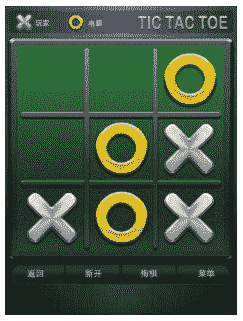

# 第1讲 | 游戏开发需要了解哪些背景知识？

 

这一节开始，我将带你进入游戏开发的世界。
 

从最初的小霸王，到充满混混和烟味的街机厅，到 PS、Xbox、DC、N64 等次世代游戏主机，再到电脑游戏，再到如今，在手机上就能玩到各种各样的游戏。
 

我会依次为你揭密，这些令人痴迷、沉浸的游戏，究竟是怎么发展的，常见的游戏种类有哪些，这些游戏在开发流程和细节上有什么不同，以及游戏开发究竟要从哪里开始学起。
 

## 浅述游戏的发展

 

我们现在公认的第一款电子游戏（也就是主机游戏），是 1952 年面世的。游戏玩的是井字棋，6 年后才出现了简陋的[网球游戏](https://www.bilibili.com/video/av1326850/)。
 

下面这幅图就是井字棋游戏，尽管它与 1952 年的游戏画面还是有所出入，但是游戏内容是一样的。
 

 

此后，我们就进入了“雅达利”时期。随后的《太空侵略者》，是最经典的一款游戏。在这之后，我们耳熟能详的任天堂红白机，发布了《吃豆人》《大金刚》等游戏。再之后，就进入了各种游戏主机竞相绽放的阶段。
 

在电脑游戏方面，第一款电脑游戏是 1962 年面世的《太空战争》。这是一个学生编写的。到 1980 年之后，随着电脑技术的日趋成熟，电脑游戏的画面才开始有了逐渐赶超电子游戏的态势。到 2005 年之后，随着电脑图形硬件的发展，电脑游戏的发展进入了加速期。
 

电子游戏的优势是，它集合了当时高精尖的图形显卡技术，纯粹为游戏所设计。比如索尼的 PS 系列。据闻，PS 使用的显卡技术来自军用科技（传闻的真实性有待考证，但每一代 PS 的图形显卡的确都是业内顶尖水平）。而电脑游戏的优势是，它能更换显卡和硬件。当显卡升级换代的时候，理论上，只要主板支持，你就可以更新；而电子游戏主机是固化的硬件，只能靠购买新的版本。
 

## 游戏有哪些种类？

 

当前全世界的游戏琳琅满目，从硬件来讲，大致可以分为四大类。
 

第一类是我们前面提到的**主机游戏**，业界称为**Console Game**。比如微软的 Xbox 系列、索尼的 PS 系列、任天堂的 Switch、N64、Wii 等。这类游戏的硬件可以插在电视机或者显示屏上。以前，游戏的载体一般是光盘、卡带，现在也可以直接从网上下载。
 

这些公司还相应推出了掌上游戏机，比如任天堂的 3DS、NDS、GBA，索尼的 PSP、PSV 等。掌上游戏机的推出，让玩家随时随地可以玩上游戏。由于是专业的游戏机，比之手机上的游戏，有更好的操作感，同时也更能体验到游戏的乐趣。
 

第二类是**电脑游戏**。电脑游戏品类繁多，有 PC 客户端游戏，比如《梦幻西游》《魔兽世界》《星际争霸》《GTA》等；还有 HTML5 网页游戏、Flash 游戏等等。
 

另外一类是**移动游戏**。包括 Pad 游戏、手机游戏。手机游戏目前品类繁多，包括 App 游戏、HTML5 游戏，以及微信发布的小游戏。
 

最后一类是目前并不是特别发达的**电视机游戏**。随着安卓系统的兴起，电视盒子的出现，出现了一种不需要游戏主机却能在电视屏幕上直接玩的游戏，这就是电视机游戏。但这类游戏一般需要用电视遥控器玩，而且由于电视盒子的机能限制，画面甚至可能比不上手机游戏，所以只适合闲暇的时候偶尔玩一下。
 

## 游戏开发使用什么编程语言？

 

在最早期的游戏开发中，比如任天堂的《FamiCom》（我们俗称《红白机 FC》）、《Super FamiCom》（我们俗称《超任 SFC》），都是使用**汇编语言**进行开发的。早期由于 8 位机能限制，程序员们为了优化游戏速度、提升游戏画面，无所不用其极，甚至到了奇技淫巧的地步。到了后期的游戏（比如《无赖战士》《足球小将》等），已经将机能挖掘到了极限。到了 16 位机后（任天堂《SFC》、世嘉的《MD》），才逐步使用**C 语言**进行编程。到了 32 位机之后，基本都是使用**C/C++ 语言**进行编程。
 

## 游戏开发从哪里开始学起？

 

手游这么火，我为什么不直接讲手游呢？原因很简单，想要开发手机游戏，对技术人员要求很高。手游有两种，一种是传统意义上的原生开发手游，一种是微信小游戏和网页小游戏。后面这个就不用说了，我主要说原生手游。
 

我在后面会讲到，游戏引擎可以购买也可以自己开发。原生手游的话，用购买的成熟引擎做的话，调试起来就会比较困难。毕竟要在手机跑，出问题再改，再跑，加上手机内存和硬件限制，不如电脑端可以随时调试。其次，手游的开发需要考量更多资源的分配和占比，发布的包就是一个考验，谁也不会下载一个三四百兆的安装包。
 

我会以电脑游戏为主，进行开发流程的讲解。首先，**电脑游戏开发便捷**。事实上，只要开发游戏，就一定离不开电脑，不管是主机游戏，还是掌上游戏、移动游戏，开发一定是在电脑上（或者专用开发电脑）；其次，**搞明白了电脑游戏的开发流程和知识之后，其他游戏的开发也一通百通**。
 

我会针对 2D 游戏（特指客户端游戏）进行剖析和讲解。为何专门选择 2D 游戏进行讲解呢？
  

主要有两方面的原因：
 
 
- 

**2D 游戏涉及最基本的图形、图像知识。**从画面方面考虑，开发 2D 游戏只需要你知道 X 和 Y 的位置即可，其他深层次的知识，引擎都可以替你完成。想要制作 3D 画面，你需要掌握更多的知识，特别是几何知识，这是毋庸置疑的。对于初学者来说，我们首先需要掌握核心的开发流程，至于过于细节的知识，可以在有了一定基础之后再进行拓展学习。
  
- 

**2D 游戏涉及最核心的网络呈现过程。**网络数据在客户端和服务器端之间传输，经过服务器端计算的数据返回给客户端，客户端进行呈现。比如，从“一颗炸弹消灭几个敌人”，就能知道网络是否有延迟，服务器计算是否正确等等。
  
 

## 2D 游戏的类型

 

**1. 横版游戏**
 

经典游戏《超级玛丽》就是一款横版过关游戏。横版游戏，是 2D 游戏可以实现的最基本的内容。横版游戏最主要的特点是它的画面，这种 2D 平面的画面只有左右两侧画面可以控制，玩家体验通常比较顺畅。还有前几年大火的《水管鸟》、耳熟能详的《魂斗罗》，以及 Steam 上的《返校》等等，都是横版 2D 游戏。
 

**2. 俯视视角游戏**
 

其次就是俯视视角的游戏。比如 FC 上的《勇者斗恶龙》《大航海时代》等等。这类的游戏提供一个空中俯视的视角给玩家，能很清晰地看到游戏中呈现的所有地图和区域。在区域中，主角可以给玩家呈现四个、六个或者八个方向的旋转和移动。在横版游戏中，玩家只能左右或者上下进行移动，而俯视角的游戏则可以移动四个、六个或八个方向。比如，在《GTA2》中，可以朝各个方向移动，并且通过缩放实现了主角的上下跳跃的视觉呈现。
 

**3. 斜 45 度角的视角游戏（“伪 3D”游戏）**
 

另外，还有斜 45 度角的视角游戏。我们看到大量的网页游戏、Flash 游戏、一些早期所谓的 2.5D MMO 游戏，都是这种类型的视角。这种视角下的游戏，也被俗称为“伪 3D”游戏。我们可以通过八个或者六个方向进行操作。地图和建筑物都是斜 45 度角的，做得好的游戏可以进行缩放，所以看起来就像是 3D 的画面。
 

事实上，到了 2D 斜 45 度角的后期，我们都使用 3D 建模，然后把它转成 2D 图形来进行制作。因为在 2D 角度下，有一个很细节的问题，那就是左右手脚的交换。也就是说，如果角色右手拿着武器，往左边走，当它在往右侧走的时候，为了节省资源和编程的方便，会对人物进行镜像绘制，这就变成了左手拿着武器了。
 

所以，到了后期的 2D MMO 游戏中，我们会通过 3D 建模，制作大量的非镜像图片来契合左右手的限制。比如主角骑的坐骑中，左右脚被坐骑遮挡，我们可以通过 3D 建模将各种模型的脚和坐骑制作在一起，以解决左右脚或者装备被遮挡的问题。
 

不管是开发 2D 游戏还是 3D 游戏，你首先需要理解什么是游戏引擎，这一点我会在第三节的时候着重介绍。以目前的技术手段，开发一款完整的游戏已经不是特别难的事情，只要你有一款强大的引擎，然后将焦点 focus 在你所要实现的逻辑上，只需要配置一些图片、关卡、音乐，就能很快地实现一款游戏。
 

但是，**如果你不明白游戏的总体开发逻辑和实现细节，在开发过程中出现了问题将会变得很棘手**。如果你了解和明白了游戏开发的本质、网络传输的基础知识，那么对于其他游戏的开发，比如移动端，比如 HTML5 端，比如小游戏的开发，则会变得更容易。因为，**知道了游戏开发的底层知识和开发逻辑之后，几乎所有的游戏都是以这样的结构和逻辑进行开发的**。
 

## 小结

 

以上是我今天分享的全部内容，你只需要记住一个理念即可：
 

不管何种类型、何种平台的游戏，其开发的顺序和手段几乎是一样的。而对于初学游戏开发的人来说，首先需要掌握的是开发流程，在有了一定基础之后，再学习细节的知识，就会如虎添翼。
 

最后，给你留一个思考题吧。在游戏开发中，很多游戏公司都会先出一个游戏 Demo，请问游戏 Demo 在游戏的开发流程中扮演一个怎样的角色？ 
 

欢迎留言说出你的看法，我在下一节的挑战中等你！
 

