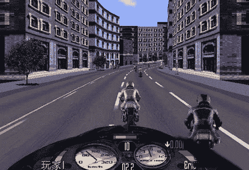
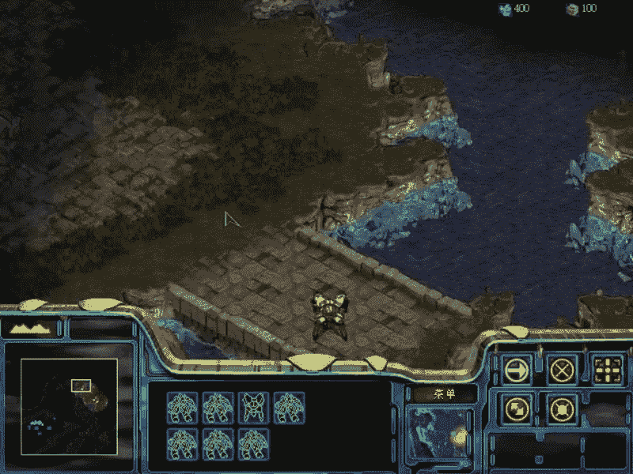
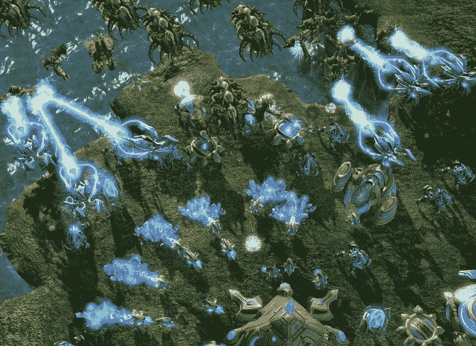

# 第2讲 | 2D游戏和3D游戏有什么区别？

 

我们知道，游戏的体现形式最主要是 2D 和 3D。最近比较流行的 AR/VR 等，都是属于 3D 类的体现形式。关于 VR 游戏，我会在之后的“热点剖析”模块详细介绍，这里就不多说了。 
 

最初的游戏，2D 是绝对的主流。虽然现如今 3D 游戏大行其道，但是 2D 游戏还是拥有一席之地。比如我们上一节提到的《返校》，日本光荣公司前几年仍然在推出 2D 版的《三国志》，以及最近暴雪又复刻的《星际争霸 1》高清版。
 

## 2D 游戏和 3D 游戏的区别

 

我在前面已经讲过我为何选择 2D 游戏作为讲解的对象，也阐述过手机游戏开发的难点。至于 3D 游戏和 2D 游戏具体的区别，我还需要再和你讲一讲。
 
 
- 呈现画面 
 

3D 和 2D 游戏最大的区别就是，游戏呈现画面的方式有了质的改变。3D 较之 2D 画面有更强大的冲击力和震撼力，就好像 VR 较之普通 3D，对人们视觉的冲击力和震撼力也是质的飞升。
 

所以，**要做出一款好的 2D 游戏，要比 3D 游戏下更多的功夫，特别是在游戏的内涵、创意、音乐和细节上面。**因为 2D 游戏先天只能呈现 2D 画面，所以玩家在入手游戏后，会很快对游戏有一个总体的评价，因此，开发者会想方设法留住用户。而一些 3D 游戏创意和游戏内容其实都不是非常优秀，只是由于画面突出，效果卓绝，也能吸引不少玩家战斗到最后一关。
 
 
- 文件体积 
 

2D 游戏的体积基本控制在 1G 以内。因为 2D 游戏本身的图片量并不是很大，图片体积也就不会很大。而 3D 游戏的体积基本都是 2~4G，现在甚至会有 30G、40G，甚至 60、100 多个 G。那是因为 3D 模型、骨骼、动作、贴图等资源占用了大量的空间，高清贴图动辄几十甚至上百兆都是正常的体积，所以 3D 游戏比 2D 游戏体积大这是很重要的一个方面。
 

## “伪 3D”游戏

 

我们熟知的 3D 游戏，有广义、狭义之分。狭义的 3D 游戏是指 Polygon 游戏，也就是多边形游戏，需要靠纯 3D 计算技术实现操作。而广义的 3D 游戏，则包括了“伪 3D”游戏。所谓伪 3D，其实就是 2D+3D，也有人称之为 2.5D。其实就是将 2D 和 3D 技术结合起来，实现 3D 游戏的体验。
 

类似《暴力摩托》这样的早期 3D 游戏，其实就是“伪 3D”，它基本上是通过**模拟计算**和**光线跟踪**（Raycasting）算法做出来的。因此，**2D 游戏引擎无法制作狭义的 3D 游戏，而 3D 游戏引擎则可以做 2D 游戏。** 
 

比如，《梦幻西游》可以称作“伪 3D”，而《暴力摩托》、早期的赛车游戏、《DOOM》等，都可以归类为广义的 3D 游戏。
 

我们继续拿《暴力摩托》，或者更早期的赛车游戏来举例。
  

 

这类游戏的内存中，存在两种甚至多种主角赛车的形态图像，比如近景摩托车、远景摩托车。在判断速度大小之后，我们可以对图像进行替换，以此让玩家感觉到远近；背景和地面则是按照线条来处理，也就是将一副背景图片分成 N 条线，而第 N+1 条线会比第 N 条放大一倍，以此达到给赛道设置不同远近的效果；根据玩家赛车的前后位置，来判断绘制每一行的“放大”。而玩家控制的赛车则是一个活动块。每个活动块都存放有不同远近大小的图像形态，来控制前后图像大小。
 

国外有不少专门研究这类“伪 3D”技术的网站，我在这里推荐几个，你有兴趣的话可以去看看。 [http://www.extentofthejam.com/pseudo/](http://www.extentofthejam.com/pseudo/) [http://lodev.org/cgtutor/raycasting.html](http://lodev.org/cgtutor/raycasting.html) [https://codeincomplete.com/posts/javascript-racer-v1-straight/](https://codeincomplete.com/posts/javascript-racer-v1-straight/)
 

那么，用 3D 游戏引擎制作 2D 游戏究竟是怎么回事呢？就是将 3D 游戏的视角和控制锁定在只有 2D 能呈现的范围内，让玩家误以为是 2D 游戏，但是这类游戏可以**借助 3D 引擎来优化游戏的声光和绚丽的特效，让 2D 游戏更大放异彩。** 
 

再者，在移动端的表现上，2D 游戏其实和 3D 游戏不相上下。
 

首先，利用小屏幕观看 3D 画面非常累。由于手机计算能力有限，所以目前移动端的 3D 游戏大部分都还是以低模为主。浅显地讲，高模就是相当精细的模型和贴图，由无数个面（看需求）组成的模型，而低模一般会为了计算效率考虑控制其 3D 面数，贴图也相对简单。
 

其次，在移动设备上，因为移动平台的硬件限制，3D 引擎的表现一定不如电脑或者主机游戏来得好。这样一来，2D 游戏其实有非常大的施展空间。
 

## 2D 游戏和 3D 游戏在电子竞技中的区别

 

我们再来看看电子竞技这一块。
 

我们都知道《星际争霸》在前几年一直是韩国的“国技”。《星际争霸 1》的选手水平占据着全球巅峰位置。2015 年之后，由于圈内丑闻加上《星际争霸 2》的出现，《星际争霸 1》的三大联赛几乎销声匿迹。然而《星际争霸 2》却没有想象中那么火爆。虽然有《DOTA》《LOL》的泰山压顶之势，但总体原因除了《星际争霸 2》的平衡性外，还有一个原因是，《星际 2》的 3D 画面并不完全适合电视转播。
 

我们拿《星际争霸 1》的 2D 画面和《星际争霸 2》的 3D 画面进行比较。这里，第一幅图是《星际 1》的画面，第二幅图是《星际 2》的画面。
 

 

 

你可以看到，3D 画面几乎要在高清画质的情况下才能看清楚单位兵种、战斗场面，而且很多时候都是一团黑漆漆、绿乎乎的 3D 画面堆在一起。《LOL》看似没有这种情况，是因为大家都熟悉每个英雄的形象，加上地图比较明亮，兵种没有《星际争霸》那么多。
 

我们再来看《星际争霸 1》的画面，层次分明，清晰可辨，哪怕在低画质的情况下仍然可以一眼看出究竟是什么兵种，有的时候，甚至连地雷都能看清楚。当然，**这并不是说 3D 比不过 2D，而是在某些特殊情况和场景下，3D 图形会有一些缺陷。**
 

由于表现方式不同，3D 游戏最典型的就是比 2D 游戏的坐标多出一个 Z 值。**所谓的 Z 值，就是除了 X、Y 的长宽之外，还多了一个高度值。**这个值我们也可以用在 2D 游戏中。
 

在 PS 时代，有不少 2D 和 3D 结合在一起的游戏。比如，《生化危机》系列的 1、2、3 部，都属于 2D 静态场景、3D 模型。再比如，《最终幻想》系列的 7、8。玩家在世界地图行动的时候，使用的是 3D 画面，但是在游戏主场景里面，使用的仍然是《生化危机》那种 3D 建模。2D 渲染场景使用伪 3D 技术，一般是因为机能限制或者 3D 技术不成熟，但实际的实现难度不会比纯 3D 技术更简单。
 

## 3D 游戏和 2D 游戏在美术上的区别

 

从美术方面来说，3D 游戏和 2D 游戏的区别也相当大。
 

在 3D 建模和骨骼方面，一个熟练的美工，只需要在原有模型上添加或者修改某些物件。比如给某个生物加一个角，给它增加一个小小的动作。这样模型的修改，对于美工来说，是比 2D 美术要简单的。因为 2D 美术一般都是手绘，所以如果需求改动特别明显，那一系列跟该角色相关的图案都需要手工调整，这是非常大的工作量。
 

准确地讲，2D 游戏是 2D 图像图形进行线性的一些变换将之渲染至屏幕而成。而 3D 的游戏是将 3D 的图形图像进行 3D 线性变换然后投影（Projection）至显示器（显示器是 2D 的）而成。显示器在视觉上形成远近大小的效果，让我们看起来是立体的。事实上，我们眼睛的视网膜也是这么工作的。
 

## 游戏的本质

 

说了这么多 2D 游戏和 3D 游戏的区别，最后，我想跟你谈一点轻松的内容。游戏的本质究竟是什么？不管是作为开发者，还是策划、运营人员，或者是打游戏的玩家，我想请你思考一下这个问题。
 

有人说，游戏的本质是人类的层次需求，并且还进行了细致的分析。其实不需要这么复杂，要我说，游戏的本质就是供人娱乐，给人各种开心的、刺激的、恐怖的感官刺激。
 

有些人喜欢复杂策略类的游戏，那么繁琐复杂的《太空帝国》就能满足他们。有些人喜欢快节奏的游戏，那么赛车或者打一局就走的《FPS》可以满足你的胃口；像我就喜欢悠哉悠哉地不受任务限制，那么“GTA 系列”和“老滚系列”就是我的选择。
 

那如何定义一款成功的游戏呢？如何做出一个爆款游戏呢？我想说的是，一款游戏的成功离不开美术、音乐等等这些硬指标，然而这些指标却不能决定这款游戏是否能深得人心。每一个人心中的判断并不一样，大量的人玩《王者荣耀》，但这并不代表它是优秀的游戏，只能说是成功的游戏。毕竟，青菜萝卜各有所爱。
 

## 小结

 

这一节内容差不多了，总结一下，你需要记住这几点：
 
 
- 

3D 和 2D 游戏的区别主要体现在呈现画面和文件体积上；
  
- 

借助 3D 引擎可以提升 2D 游戏的声光和特效效果；
  
- 

成功的游戏不一定是优秀的游戏。
  
 

最后，给你留个思考题吧。你觉得一款成功的游戏需要具备什么样的特点呢？
 

欢迎留言说出你的看法，我在下一节的挑战中等你！
 

