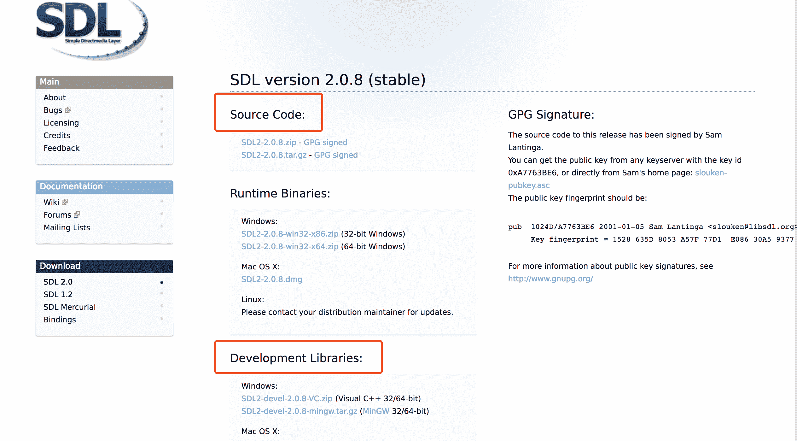
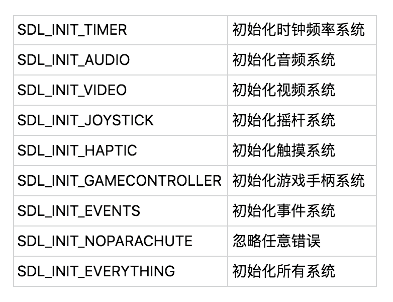
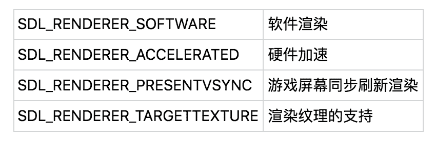
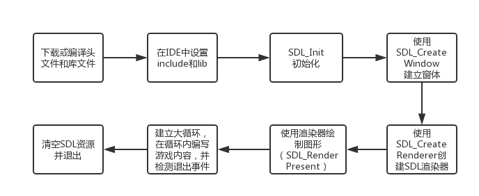

# 第4讲 | 底层绘图接口的妙用

 

上一节，我给你介绍了游戏引擎的概念及其在游戏开发中所起的作用。同时，我也提到了游戏引擎背后的工作方式。在代码层面，游戏引擎是一套对底层绘图、音频、操作系统接口的封装实现。
 

在此基础上，我还举了一个在游戏屏幕上画线条的例子。在这个例子中，**画线的接口函数在背后分解、组合、计算，并将绘制工作交给底层绘图接口。**这个绘图接口，就是今天要讲的内容。
 

## 几种常见的绘图接口

 

前面我已经说过，我会针对 2D 游戏来讲解游戏开发的流程和细节，所以，这里我先介绍几种 2D**绘图接口**（即**API，**全称**Application Programming Interface**）。我选择了 5 种 Windows 下最流行的绘图接口，分别讲解。
 

### 1.OpenGL

 

OpenGL 是老牌的图形图像接口。GL 是 Graphics Library 的缩写。所以，顾名思义，OpenGL 就是开放图形接口的意思。和接下来要讲的 DirectX 一样，OpenGL 也可以创建和渲染 2D、3D 图形。但是，和 DirectX 不同的是，它可以在多种平台下运行，比如 Windows、Linux、macOS 和部分 UNIX，而 DirectX 只能在 Windows 生态下运行。
 

OpenGL 本身只提供图形渲染接口，如果你需要别的功能，比如音频、鼠标、键盘的操作，甚至是创建一个窗体，都需要别的扩展库支持。
 

### 2.DirectX

 

说起 DirectX，这个名字已经如雷贯耳。DirectX 的开发初衷，是为了让游戏开发者能像在 DOS 平台编写游戏一样，在当时新的 Windows 95 平台上，也能一样高效、快速地操纵各种硬件设备。
 

其实，在 DirectX 发布之前，微软已经将 OpenGL 包含在 Windows 系统里面。随着时间的推移，OpenGL 逐渐成为了行业标准，而 DirectX 自然免不了与其展开竞争。
 

这里，我主要介绍一下 DirectX 中的两个核心组件。这两个核心组件的功能与 2D 游戏编程息息相关，你一定得了解一下。
  

第一个是**DirectDraw**。它是早期 DirectX 中掌管 2D 部分的组件。DirectDraw 类似我之后要说的 GDI，支持显存位图，而不是只能将位图存放在内存里，所以 DirectDraw 更贴近硬件。但是在 DirectX 7 版本之后，DirectDraw 被合并到 Direct Graphics 组件中。虽然目前仍有很多人在使用 DirectDraw 的老版本开发包，然而 DirectDraw 已经被微软逐渐淘汰。
 

第二个是**Direct2D**。它是微软推出的最新 2D 组件，它的出现是为了取代 Windows 下的 GDI、GDI+ 和 DirectDraw。Direct2D 能通过硬件加速来绘制 2D 图形，也支持高质量 2D 图形渲染，比如支持 ClearType 呈现的方式、除锯齿、几何位图的绘制和填充等等。
 

### 3.SDL

 

SDL 全称**Simple DirectMedia Layer**，直译就是**简单的直接媒体层**。从严格意义上来讲，SDL 并不算是“独立的”图形渲染接口，因为它将各类操作系统的图形图像渲染接口进行了封装，包装成统一的函数，以此来方便调用。比如，在 Windows 下，它封装了 DirectX 和 GDI+；在 Linux 下，它封装了 Xlib 等等。同时，它也提供了 OpenGL 的调用函数。
 

SDL 不仅仅可以对现有图形图像接口进行封装，它也提供 SDL 官方自己发布的编程接口。比如，SDL_image、图像接口、SDL_net、网络接口等等。后续我将介绍到的 Pygame，其背后就是调用 SDL 编写的。
 

Pygame 是使用 Python 封装的游戏库，你可以很方便地利用 Pygame 进行 2D 游戏的编写，它的背后，调用的就是 SDL 的接口。所以我们将利用 Pygame 来对 2D 游戏开发流程做一个完整的梳理。虽然网上关于 Pygame 的代码和教材很多，但是我们要讲的，**不仅仅是 Pygame 代码是如何编写的，而是要从 Pygame 的代码中，分析 2D 游戏的编写逻辑和编程思想**。在这个过程中，Pygame 只是一个载体。
 

### 4.GDI

 

GDI，全称**Graphics Device Interface**，也是 Windows 下的图形设备接口。它所做的就是处理 Windows 程序的图形输出，负责在 Windows 系统和绘图程序之间进行信息的交换。使用 GDI 的人已经越来越少，从编程的方便性和硬件加速等功能来看，GDI 被 GDI+ 取代是显而易见的。
 

### 5.GDI+

 

在 Windows 下，大部分接触过图形编程的程序员都会用过 GDI+。而 GDI+ 其实就是 GDI 的进阶版本。
 

GDI+ 是有**硬件加速功能**的，而 GDI 没有；GDI 是以 C 语言接口的形式提供的，而 GDI+ 则是 C++ 和托管类的形式提供；从接口代码的层次上说，GDI+ 对程序员更友好，使用起来也更顺手。
 

GDI+ 还提供了**图像处理**的接口，比如提供了 Image、Bitmap 等类，可以用于读取、保存、显示，操作各种类型的图像，比如 BMP、JPG、GIF 等。
 

GDI 和 GDI+ 的**绘图操作**也存在差别。GDI 中存在一个称为“当前坐标”（MoveTo）的位置。“当前坐标”的存在是为了提高绘画的效率。
 

我还拿画线的过程来举例。有一条新的线连着一条老的线画，如果有了“当前坐标”的设置，逻辑上可以避免每次画线都要给出两个点的坐标（开始和结束）；如果每次都以该“当前坐标”做为起始点，线条绘制结束后，线的结束位置就成为“当前坐标”。
 

事实上，这种方式的存在是有历史原因的。有一种说法来自很早的 Logo 语言。这种语言针对儿童进行寓教于乐的编程教育。它的绘画逻辑是，如果有“当前坐标”这个概念，只需要一个递归就可以不停地画线，最终组成一个图形。所以后期很多的绘画接口都沿用这种方式去做。但实际到了 2000 年左右，人们发现这种方式并不方便，因此 GDI+ 取消了这个“当前坐标”。
 

一个原因是不方便；另一个原因是，如果无法确定“当前坐标”，绘图就会出现差错。而用 GDI+ 绘制线条，则可以直接在 DrawLine 函数中指定起始点和结束点的坐标位置。
 

## 如何直接使用绘图接口进行游戏开发？

 

通过上面的介绍，你是否对 Windows 下几大流行的绘图接口有了大致的了解呢？接下来你或许会问，那我了解这些图形接口的编程接口后，是不是就可以直接用这些接口进行游戏的开发呢？
 

答案当然是可以的。由于 SDL 的开发便利性和通用性，所以我拿 SDL 编程接口作为例子，来阐述一下究竟怎样通过图形接口直接进行游戏的开发。
 

从最基础的开始，我们先要从 SDL 的网站下载 SDL 的最新版本，下载网址是： [http://www.libsdl.org/download-2.0.php](http://www.libsdl.org/download-2.0.php) （写作这篇文章的时候，最新的版本是 2.0.8 稳定版）。
 



 

在下载的网站页面，我们可以看到 Source Code 一栏，这是 SDL 的源代码。有一定编程基础的同学可以下载源代码，直接使用 VC++、MinGW 等编译器进行编译，编译完的头文件和库文件直接就可以使用。
 

如果你对编译不熟悉，可以选择下载 Development Libraries，也就是编译完成后的开发包。网站已经将 Windows 下的开发环境分为 VC++32 位版和 64 位版、MinGW32 位版和 64 位版。为了教学方面和统一，也照顾各种平台的用户，我建议使用 MinGW 的 32 位版。因为 64 位 Windows 可以兼容 32 位的应用。至于 MinGW 编译器和 IDE 的下载安装细节，我将会在后续的专栏文章中介绍。
 

下载完成后，将压缩包解压缩到任意目录，头文件和库文件使用解压缩出来的“i686-w64-mingw32”这个目录下的“include”和“lib”。
 

接下来，我们在 IDE 中设置 include 路径和 lib 路径，链接程序的时候需要在 IDE 设置包含库文件 libsdl.a、libsdlmain.a，就可以开始在 IDE 中编写代码了。
 

在开始开发的时候，首先使用 SDL_Init 来进行初始化。用这个方法传入一个 unsigned int 类型的参数，参数列表就像这样：
 



 

其中“初始化所有系统”这个选项，除了“忽略任意错误”外，包含了以上所有不同的初始化系统，一般使用 SDL_INIT_EVERYTHING 即可。
 

随后，我们要使用 SDL_CreateWindows 来创建一个窗体。SDL_CreateWindows 支持六个参数，分别是：窗体名称、在 Windows 屏幕显示的 x 坐标、在 Windows 屏幕显示的 y 坐标、宽、长、显示方式。
 

然后将使用 SDL_CreateRenderer 创建一个 SDL 的渲染器（SDL_Renderer）。渲染器的参数是：
 



 

随后可以使用 SDL_RenderClear 来清空 SDL 渲染器、使用 SDL_RenderPresent 方法将渲染的结果显示出来。然后我们需要建立一个大循环，在这个循环内，你可以把 SDL 支持的图形图像函数或者其他逻辑代码往里面填写，完成游戏的程序内容，具体的操作我会在之后的文章详细介绍。
 

在这个大循环内，我们要用到 SDL_Event 事件系统。在循环内捕捉用户事件，比如要退出这个循环就必须点击右上角的 X 关闭按钮才行。如果你点击了 X 按钮，就会被 while 内的 event 事件捕捉到，并且匹配是不是退出事件，如果是退出事件就退出程序。
 

最终退出程序的时候，使用 SDL_Quit 清除资源退出程序。
 



 

我们结合这张流程图来看一下将这些内容串联起来的代码：
 

```
#include  <SDL.h>int main(int argc,char *args[]){    SDL_Window* window;    SDL_Renderer* render;    SDL_Event e;    bool q = 0;    int sdl=SDL_Init(SDL_INIT_EVERYTHING);
```

初始化完成后，我们要建立窗体，并编写后续的步骤：
 

```
if(0 <= sdl ){        // 当 SDL 初始化完成后创建一个标题为 "SDL Window" 的窗口, 窗口对齐方式为居中对齐，分辨率为 640x480 的窗口        g_pWindow=SDL_CreateWindow("SDL Window",            SDL_WINDOWPOS_CENTERED,SDL_WINDOWPOS_CENTERED,            640,480,SDL_WINDOW_SHOWN);        if(0 != window)            render=SDL_CreateRenderer(window,-1,0);      }    SDL_SetRenderDrawColor(render,0,255,255,255);    SDL_RenderClear(render);    SDL_RenderPresent(render);
```

接下来是游戏主循环的内容：
 

```
while( 0 == q )    {       while( 0 != SDL_PollEvent( &e ) )                {                    // 检测到用户需要退出                    if( e.type == SDL_QUIT )                        q = true;                }    }    SDL_Quit();    return 0;}
```

这个简单的例子说明了如何直接利用 SDL 接口编写游戏。直接利用其他图形接口编写游戏，也基本是这样的步骤。
 

## 小结

 

我来给今天的内容做一个总结，你只需要记住这些内容即可：
 
 
- 绘图接口绘图接口其实就是使用 C/C++ 语言或汇编语言，通过操作系统的底层，调用诸如显卡、内存这些绘图设备，最后做成接口； 
- SDL 拥有统一封装的绘图接口，你可以在各个平台无缝编译和使用。 
 

现在，你是不是对游戏开发的一部分流程有点了然于胸了呢？
 

给你留个小思考题吧。
 

我们提到了直接利用绘图接口编写游戏，请问，如果这样，还需要“游戏引擎”吗？如果需要的话，这个“引擎”应该放在哪里呢？
 

欢迎留言说出你的看法，我在下一节的挑战中等你！
 


