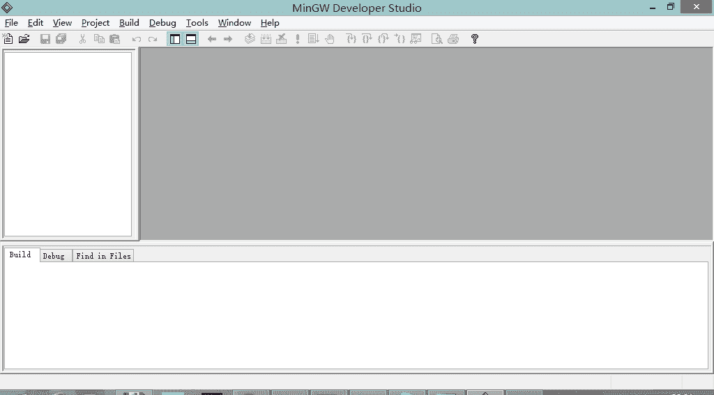
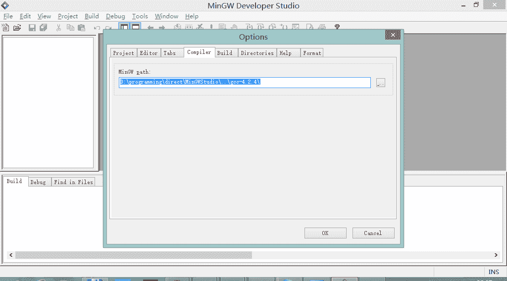
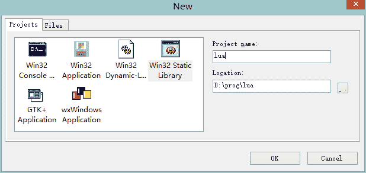
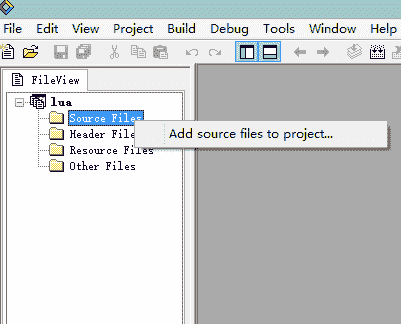
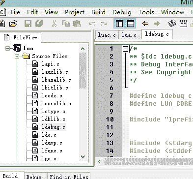
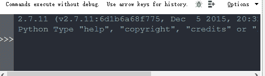

# 第6讲 | 从0开始整理开发流程

 

在第一模块的基础知识中，我已经讲过开发一款游戏需要的一些背景知识。对于 2D 游戏和 3D 游戏的区别、从程序到美术、从 2D、伪 3D 到 3D 等方面，我都进行了逐一地阐述。除此之外，对于任何类型的游戏开发都非常重要的三个概念：游戏引擎、底层绘图接口、地图编辑器，我也进行了一些我个人的解读。
 

有了这些背景知识，这一节，我来带你整理一下整个游戏开发流程以及流程中所需要的工具。
 

## 1. 选择开发环境

 

我们默认是在 Windows 环境下进行开发，至于是什么版本的 Windows 不需要做更多地阐述，你愿意用什么版本就用什么版本，因为几乎所有流行的 Windows 环境都能进行编程工作。至于我为什么选择 Windows 环境进行开发，那是因为：
 
 
- 

首先，在 Windows 环境下，拥有比较方便的**调试工具**。不管是 Python 脚本语言还是 C/C++ 语言，都可以使用图形界面进行调试；
  
- 

其次，Windows 下的**IDE 开发环境**也比其他平台更多，你拥有更多的工具可供选择。另外，在开发游戏的时候，你可以选择 OpenGL、DirectX 或者 SDL 等图形库进行编程。作为游戏开发，DirectX 几乎是不可或缺的标准，而我在第四节讲述底层绘图接口的时候说过，它是由微软提供的游戏编程接口，在 Windows 下提供了更为方便的底层调用。
  
- 

除了 Windows 外，Linux 平台的**图形显卡驱动**几乎是不完善的，无法发挥显卡的最大优势。苹果平台又一家独大，开发人员只能为其定制专一的代码，开发难度比之 Windows 就大了不少。
  
 

## 2. 下载脚本工具

 

在开发过程中，我们需要用到 Python、Lua 或者 Ruby 等脚本工具。我们可以直接用 Python 或者 Ruby 开发简单的游戏模块的 Demo。**由于脚本语言代码的简单和高可读性，所以由脚本语言入手，进行早期示例的代码剖析，是一个不错的选择。**
 

Python 我们可以从 python.org 下载，Lua 我们可以从 lua.org 下载，相应地，Ruby 也可以在 ruby-lang.org 下载。为了考虑兼容性，Python 建议使用 2.7.x 版本。Lua 下载最新的版本即可。Windows 下 Python 的源代码编译并不方便，所以建议下载 MSI 安装包，直接安装即可。因为之后我要使用 Pygame 进行示范，所以建议你使用 32 位的 Python 版本。
 

## 3. 选择编程语言版本

 

在开发的过程中，一定会用到 C/C++ 语言。
 

如果你要使用 VC++ 的话，会涉及购买、安装和配置等情况。为了使这个专栏的内容尽量简洁、可用，我建议使用 Windows 下，移植版本的 GCC 和 G++ 进行编译（也就是 MinGW 移植版），GCC 版本为 4.2.x 或者以上版本。有人说这些版本太老了，我认为，**初学阶段，版本越新，意味着你需要知道的编译器内容和编译器开关就越多，**因此建议你选择较为稳定的 4.2.x 或以上版本。
 

对于 C++ 而言，我们也不需要用到最新的 C++ 标准，比如 C++11 等。对于 C 语言，我们默认使用 C89 或者 C99 都是可以的。简洁、高效、显而易见，是我一向遵从的原则。
 

## 4. 下载编译器

 

关于 C/C++，你可以去 MinGW 官网下载 4.2.x 版本。当然如果你希望使用其他更新的版本也不是不行，你可以直接下载安装器，来获取编译器的版本。下载地址是这个：[https://sourceforge.net/projects/mingw/files/Installer/](https://sourceforge.net/projects/mingw/files/Installer/)
 

你也可以按照你的需求定制下载。如果要成为完整的编译器，必须下载这些内容：
  
 
- 

MinGW (C/C++) Compiler
  
- 

Binutils
  
- 

Windows32 API
  
- 

MinGW Runtime Libraries
  
- 

GNU Debugger (GDB)
  
- 

GNU Make
  
 

一般来讲，使用安装器下载的编译器都是最新版本的，如果你需要下载特定的版本号，你可以在这个网址 [https://sourceforge.net/projects/mingw/files](https://sourceforge.net/projects/mingw/files) 下，找到相应的编译工具目录和对应的版本号。
 

这样，C/C++ 编译器就下载完成了。如果你是自己下载特定版本号的话，需要将所有包解压缩在一个指定的目录下，解压缩出来的目录结构一般有这几个常用子目录：bin、include、lib、share、 local、etc、var。
 

## 5. 选择 C/C++ 和 Python 的 IDE

 

接下来，我们需要一套 IDE 来帮助我们进行 C/C++ 和 Python 的开发。
 

**C/C++ 方面，我选择使用免费的 MinGW Studio 来完成。**MinGW Studio 的界面绝大部分模仿了经典的 VC6 的 IDE 界面。虽然相对于更时髦的收费编译器来说，MinGW Studio 没有特别智能的代码提示，但是可以方便我们完成程序的调试。
 

我们可以通过搜索引擎搜索到并且顺利地下载 MinGW Studio。有一些 IDE 是自带 C/C++ 编译器的，这种包也没有问题。如果你对 C/C++ 这部分设置比较熟悉，你也可以自由选择其他 IDE，比如 DevCpp、CodeLite、CodeBlocks 等等。
 

**至于 Python 方面，我们可以使用 Wing IDE。**这是一个付费项目。也可以使用国内程序员编写的 Ulipad，另一个付费软件 Komodo，用来做 Python、Ruby 的 IDE 都很合适。至于 Wing IDE，我们可以在 wingware.com 下载最新版本。
 

## 6. 带你一起测试编译器的运作

 

首先，我们需要先测试编译器是否运作顺利，所以我选择 Lua 来进行编译。在将来，需要使用 Lua 的时候，必须将之编译为**静态库**或者**可执行文件**。
 

我们打开 MinGW Studio，界面是这样的：
 



 

我们可以在 Edit->Options->Compiler 选项里设置具体的编译器路径，以便让 IDE 找到编译器来开始工作。
 



 
 

一般编译器的路径都会自带 bin 目录，所以设置的目录必须在 bin 目录的上级目录。比如我们设置的 MinGW 编译器路径为 C:\MinGW，那么 bin 目录就是 C:\MinGW\bin，所以在 IDE 的设置下，只需要设置为 C:\MinGW 就可以了。
 

我们将下载到的 Lua5.x.x.tar.gz 解压缩到某个目录。在我写文章的时候，Lua 的最新版本是 5.3.4。在这个目录下，并没有我们所需要的 MinGW Studio 的项目文件，所以我们需要手工建立一个。我们在 File->New->Projects 选项下，建立一个 Win32 Static Library，也就是 Windows 静态库，将名字设为 lua。
 



 
 

然后我们将文件添加到项目里面，在项目虚拟目录里面，点击鼠标右键。
 



 
 

在弹出的选择文件对话框里，选中刚才解压缩出来的 Lua 目录，选择 src 目录下的所有或椎为.c 的文件，随后，我们将 lua.c 排除在外（选中，右键，选择移除出项目）。因为我们制作静态库的时候，可以不用这个文件。
 



 
 

我们可以点击 Build->Build 选项来进行编译，编译完成后，如果编译成功的话，我们会在 Debug 目录下看到一个.a 文件。如果你的项目名叫 lua，那么制作出来的静态库就是 liblua.a，所以个文件就是我们以后要用到**Lua 静态库**。
 

如果你有一定的编程经验的话，可能已经看到，我们现在编译出来的是 Debug，是调试版本，我们暂且不去管它。这个在后面我们会进行详细地探讨，目前我们只需要知道这一系列的使用方式和方法就可以了。
 

我们已经将 Lua 编译完毕了，后续的文章中我会教你使用 Lua 静态库。
 

接下来，我们尝试使用 Python 语言。你可以使用任何一个上述推荐的专业 IDE 来编写 Python 代码。实际上，Python 的 IDE 不需要过多的配置。因为安装在 Windows 机器上后，Python 的路径会被注册到系统。通常 IDE 会自动找到 Python 执行文件，并且，IDE 的 Shell 窗口将会正确地找到 Python 并看到其互动窗口，就像这张图的内容：
 



 
 

现在，我们尝试在 IDE 中编写一小段 Python 测试代码，然后跑一下。程序运行结果就是打印一个 test 字符串。
 

```
import os, sysif __name__ == '__main__':   print 'test'
```

最后，将该文件保存后缀为.py 的文件，这就是 Python 源代码。
 

## 7. 专为 Python 开发的游戏库 Pygame

 

在这里，为你介绍一个专门为 Python 开发的游戏库 Pygame。至于为什么选择 Pygame，我在第四节讲底层绘图接口的时候已经解释了一些。这里再说一下。
 

Pygame 包装了 SDL 的实现。在编写 2D 游戏方面，它的表现可以用三个词来形容：**成熟，稳定，简单**。它把一些细枝末节隐藏在了 Python 语法背后，当然也有 Ruby 语言封装的 RubyGame，但是很多人对于这种魔幻的语言并不是特别了解，所以选择简洁的 Python 语法 +SDL 库封装是最合适的选择。
 

今后我们会编写游戏的示例 Demo，一些轻量级的、游戏的某一部分的说明和介绍，我会使用 Pygame 进行简单的阐述。Windows 版本我们点击这个网址下载这个版本的源代码。 [http://www.pygame.org/ftp/pygame-1.9.1release.zip](http://www.pygame.org/ftp/pygame-1.9.1release.zip) 如果你不愿意下载源代码，也可以根据自己对应的 Python 版本号下载对应的二进制包，支持 Python 2.4 到 3.2 的版本。
 

```
pygame-1.9.1.win32-py2.7.msi 3.1MBpygame-1.9.1release.win32-py2.4.exe 3MBpygame-1.9.1release.win32-py2.5.exe 3MBpygame-1.9.1.win32-py2.5.msi 3MBpygame-1.9.1.win32-py2.6.msi 3MBpygame-1.9.2a0.win32-py2.7.msi 6.4MBpygame-1.9.1.win32-py3.1.msi 3MBpygame-1.9.2a0.win32-py3.2.msi 6.4MB
```

如果你安装的是 64 位 Windows 和 64 位 Python，注意 Pygame 版本和 Python 都需要是 32 位的，才能完美兼容和使用。
 

## 小结

 

好了，这节内容差不多了。我来总结一下。在这一节中：
 
 
- 

我先从各操作系统下的调试工具、IDE 开发环境、显卡驱动等三个方面，分析了为什么选择在 Windows 环境下进行开发；
  
- 

然后，我还带你梳理了一遍开发所需要的语言和工具，并且提供了下载的网址和安装的方法；
  
- 

之后，我还带你测试了 Lua 脚本语言在编译器中的编译并且生成了静态库文件。
  
- 

最后给你介绍了 Pygame，今后将会用到这个 Python 下的 2D 游戏开发引擎。
  
 

最后，给你留一个思考题吧。
 

你可以结合之前几节的内容，思考一下，Pygame 绑定 SDL 绘图接口是如何实现的？
 

欢迎留言说出你的看法，我在下一节的挑战中等你！
 


