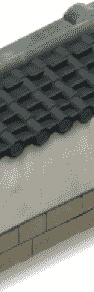
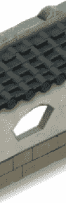
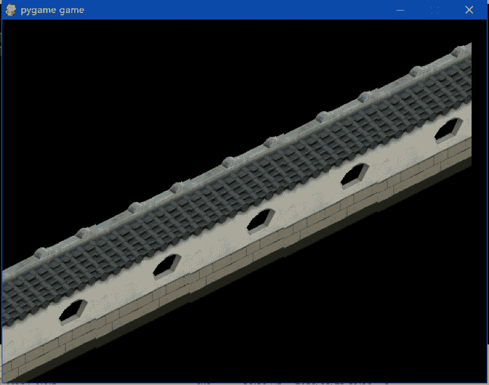
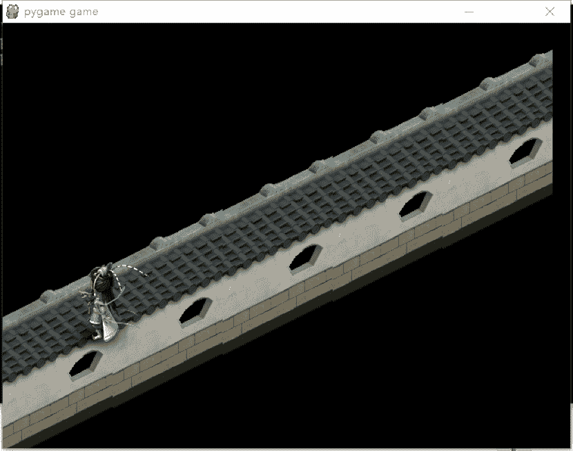
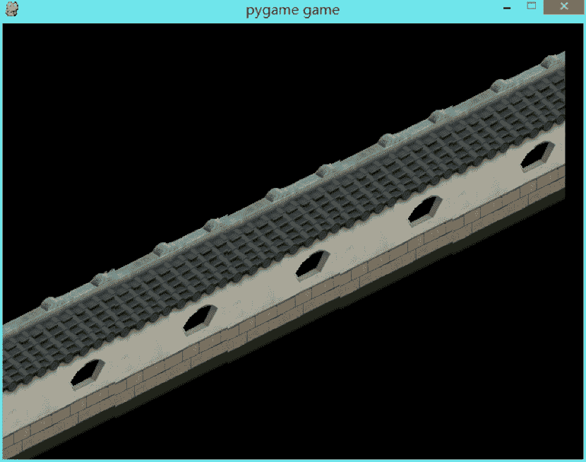

# 第12讲 | 如何设置图像的前后遮挡？

 

我们人的肉眼所观察到的世界是属于 3D 世界，有远近大小之分。一个物件 A 被另一个物件 B 遮挡，物件 A 就会看不到，而在 2D 的世界里，都是平面的，没有实际的高度区分，就算做成了斜 45 度角，也是一种视觉呈现，并没有在计算机内形成高度差。
 

在一般的游戏引擎，或者像 Pygame 这样的游戏库中，基本都是“先绘制的图案先出来”，“后绘制的图案后出来”，而后绘制的图案一定遮挡前面绘制的图案。因为 2D 就是一个平面，从逻辑上讲，按照先后顺序绘制，没有任何问题。
 

但是如果我们现在做的游戏是斜 45 度角的游戏，类似《梦幻西游》视角的，那么人物和建筑物之间就存在遮挡的问题，如果处理不谨慎，就会出现人物浮在建筑物上，或者建筑物把人挡住了。
 

所以在一些 2D 引擎中，会有一个 Z 值的概念，Z 值的概念就是在（X,Y）的基本 2D 位置上，加一个高度的概念。这个高度是一个伪概念，它模仿 3D 的 Z 值，只是作遮挡用。但是我们现在使用 Pygame 来编写游戏的话，并没有 Z 值的概念，所以我们需要想一些办法来解决遮挡的问题。
 

首先，我们从共享资源中抽取一段围墙的图片来进行摆放。
 



 



 

围墙分为两幅图片，都是往右上角延伸的。现在我们需要将这两段围墙连接起来。如果我们像以前的做法，一个图片一个 blit 的话，那是不行的。因为这样需要相当大的代码量，所以我们采取将围墙的代码放入一个 list 中的做法。
 

首先，我们要定义图片和载入图片。
 

```
right_1 = 'right_1.png'right_2 = 'right_2.png'r_1 = pygame.image.load(right_1).convert_alpha()r_2 = pygame.image.load(right_2).convert_alpha()
```

然后，我们写一个循环，将围墙放入一个 list 中。我们想要将这两段围墙每隔一个放置不同的样式，就需要做一些判断。我们将数字除以 2，如果能除尽，就摆放其中一个，否则就摆放另一个。
 

```
total = 10wall = []while total > 0:    if total % 2 == 0:        wall.append(r_1)    else:        wall.append(r_2)    total-=1
```

这样，我们就将围墙的对象分割并且放入到了 list 里面，我们就可以在接下来的代码中使用这个 list，来将围墙拼接出来。
 

在拼接之前，我们还要定义一系列的变量。现在我们已知这个图片的宽度是 62，长度是 195，所以我们需要增加的步长就是“每次拼接加 62 的宽度”。而围墙 1 和围墙 2 在拼接的过程中，是要往右上角倾斜的。经过测量，倾斜的高度是 30，所以每增加一个围墙，就要往 y 轴减去 30 的高度，现在我们要定义初始化的 x 和 y 的起始位置，并且要定义增加步长的 x 值和 y 值，我们可以这么写：
 

```
init_x = 0    init_y = 300    step_x = 62    step_y = -30
```

我们要将这一系列变量放在循环中，因为每循环贴图一次，就需要重新初始化和计算步长，这样看上去就像把一系列墙一直贴在游戏中一样。
 

我们来看一下代码。
 

```
for w in wall:        screen.blit(w, (init_x, init_y))        init_x += step_x        init_y += step_y
```

这段代码的意思是，遍历 wall 这个 list，取出下标并且赋值给 w 变量，每个 w 变量都是一个 surface 对象，这个对象通过 screen.blit 来贴上去，贴上去的位子使用初始 x 和初始 y，然后初始 x 和初始 y 的位置又变化了，每次增加步长 x 和减去步长 y，进行第二次的贴图，然后继续循环贴，这样我们的围墙就开始连贯了起来。
 

我们来看一下贴上去的效果。
 



 
 

可以看到，每隔一段贴一幅图，另一段贴另一幅图，这样一整段的围墙就贴完了。一共有十幅图片，每一副图片的 y 值都向上减去 30。
 

现在我们来总结一下贴这些连贯图片的重点：
 
 
1. 

将内容放入列表或者数组中。为了编程方便，将需要连续贴图的内容放入列表或者数组中就能够减少编程工作量；
  
2. 

计算好贴图的点，能让我们在连续贴图的过程中，只要控制位置变量就可以完成。
  
 

如果我们编写的是地图编辑器，而地图编辑器生成的脚本代码，除非写得非常智能，一般来讲，就是一连串的贴图代码，这样就会有许许多多的 blit 的操作，并不会将相同的元素加入循环或者列表，那是因为脚本代码是电脑生成的，没有更多的优化代码。
 

接下来，我们要将一个人物放上去。这个人物只是摆设，我们只是为了测试图像遮挡的情况。
 

```
player = 'human.png'plr = pygame.image.load(player).convert_alpha()
```

然后我们在循环的围墙贴图的代码之后，放入人物。
 

```
screen.blit(plr, (62, 270))
```

我们将人物故意放在围墙的某一个位置，效果看起来是这样的。
 



 

 这样看上去，人物就站在围墙上面了。看起来他似乎有飞檐走壁的功夫，然而事实上，他应该几乎被围墙挡住，但是这个时候问题就来了。虽然我们可以把 blit 的代码放在显示围墙的 blit 代码之下，让围墙遮挡住人物，但是当游戏在进行的时候，人物要往下走，这时候就需要显示在围墙之外，我们不可能在游戏运行的时候改变代码，这是不可能做到的。所以我们还需要改变代码。
 

事实上，在正式的游戏开发中，我们需要将人物的控制、NPC 的控制等放在不同的线程中去做，而地图则是直接载入地图数据文件。在地图的数据文件中会告诉你，哪些坐标是有物件挡住的，不能走；哪些坐标有哪些物件，你需要走过去的时候被遮挡。但是在我们今天的内容中，为了你能看得更明白，我们将地图和人物的代码都放在游戏的大循环中去做。
 

我们使用代码来模拟 Z 值的作用，虽然在代码中没有体现 Z 值，但是通过代码你可以理解 Z 值的意义。
 

首先我们来定义一个函数，这个函数将 blit 代码抽取出来，然后判断传入的参数是不是 list 类型，如果是的话，就连续贴图，否则就贴一张图。
 

```
def blit_squences(data, x, y):    if isinstance(data, list):        for d in data:            screen.blit(d, (x, y))    else:        screen.blit(data, (x, y))
```

我们利用 Python 的 isinstance 函数，来判断传入的 data 是不是 list 类型。如果是的话，我们就遍历 data，然后将 data 中的内容进行连续贴图。这是为了模拟我们除了贴人物，还要贴围墙。如果判断不是 list 类型的话，则直接贴上 data。
 

然后，我们需要改变在游戏循环内的绘制图片代码。我们需要用 blit_sequences 函数来替代这块代码，然后我们在内部做一个判断，判断人物是不是和围墙的位置重叠了，如果是的话，就贴上人物和围墙。
 

```
for w in wall:        if  init_y == 270:            blit_squences([plr, w], init_x, init_y)        else:            blit_squences(w, init_x, init_y)        init_x += step_x        init_y += step_y
```

在这段代码中，我们看到，我们使用了 blit_sequences 这个函数，替代了原本的 surface.blit 代码。在这段代码中，我们需要判断一个位置，这个位置是围墙的 y 值，如果人物走到了这个位置，那么我们就将人物和围墙对象放入到 blit_sequences 中进行绘制。效果就是，人物被遮挡到了围墙外面。
 





 

这段代码起作用的地方是在 [plr, w] 这部分。我告诉 Pygame，要先绘制 plr 然后再绘制 w，但是如果你换一个位置，就是先绘制 w 再绘制 plr。
 

这一部分是示例代码，正式编写游戏的时候，其实是不太会这么写的。这是为了展示我们如何方便地切换绘制位置。其中，plr 和 w 的 list 部分，事实上就是解释 Z 值所做的工作，如果 plr 的 Z 值高于 w，那么就先绘制 plr，否则就先绘制 w。当然在正式编写类似的游戏的时候，我们需要考虑的是多线程，这些我们将在后续的内容中进行讲解。
 

一般的做法是，我们会在多线程中绘制人物，然后载入地图，我们会在人物走动的过程中，判断地图上的物件，然后进行 Z 值的调整，或许，Z 值最高的是物件本身，比如围墙和建筑物的 Z 值是 100，而人物的 Z 值一直保持在 20，所以每次走到围墙和建筑物这里，总是先绘制人物，再绘制建筑物，这样就起到了遮挡的效果。
 

## 小结

 

这一节内容差不多了，我来总结一下。
 

我们其实就讲了一个内容。在做遮挡的时候，要考虑绘制顺序，先绘制的一定会被后绘制的遮挡。
 

如果做得比较成熟的话，利用 Python，我们需要在外面包裹一层字典。每个物件载入的时候，都告知其 Z 值，然后在绘制的时候，判断 Z 值，安排绘制顺序。
 

现在给你留一个小问题。
 

如果在绘制的过程中，两个人物的 Z 值相同的话，人物碰到一起，会出现什么结果呢？
 

欢迎留言说出你的看法。我在下一节的挑战中等你！
 


