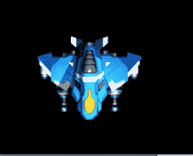
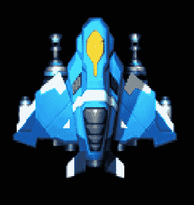
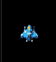
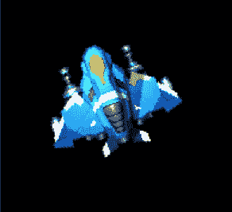
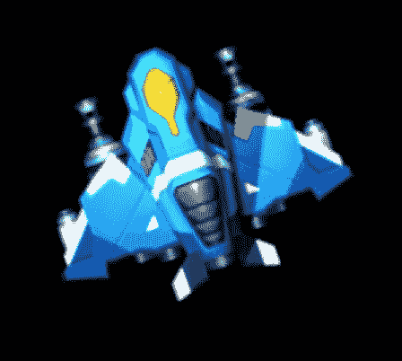
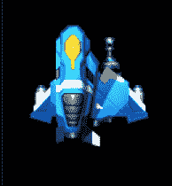
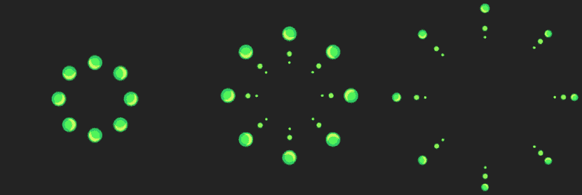

# 第14讲 | 如何设置精灵的变形、放大和缩小？

 

上周四，我给你讲解了图片的遮挡问题。这一节我要和你讲精灵的变形、放大和缩小。如果之前没有做过游戏开发，你肯定会问，什么是精灵？
 

## 什么是精灵？

 

我先来解释一下什么是精灵。精灵当然不是我们传统意义上的什么树林里的精灵。精灵是一个游戏开发中的名词，英文叫 Sprite。
 

>  
> 它多用于游戏中的人物和可移动物品，也可以用于显示鼠标指针和输入的文字。如果屏幕上的可移动物体的尺寸比一个精灵图要大，可由若干个精灵图缩放或者拼接而成。
 

 

从**宏观**的概念讲，精灵就是一幅图片。比如我们之前中讲过的那些飞机图、背景图，这些都可以认为是精灵或者是从精灵中派生出来的。它就是一系列可以变化的图片。这些图片可以变形、放大、缩小，或者是一系列的动画帧等等。
 

从**编程**的角度讲，精灵是一种管理器。在一个精灵的管理器中，可能会有一系列的方法去操作精灵，比如添有加、删除操作，比如有图像的变形、放大、缩小操作，还有系列帧的显示操作等。
 

既然，精灵就是图片，那在“打飞机”中，飞机会随着画面的变化、操作的不同，而有变形、放大以及缩小的状态。我现在就来讲这些操作的实现，需要用到哪些函数，以及这背后都有什么技巧。
 

## 设置变形、放大和缩小需要用到哪些函数？

 

Pygame 中的底层，使用的是 SDL 开发库，这个我们在之前的内容中已经讲过，因此，这些变形、放大缩小等操作，都有对应的 SDL 库。
 

我们要用到的还是之前的飞机图片，为了让你更明确的看清楚，我删除了背景，只呈现飞机的内容。
 

### 翻转函数 flip

 

我们首先要用到的是**函数 flip**。顾名思义，这个函数就是让你对图片进行翻转，你可以翻转成水平的或者垂直的。所以它拥有两个参数，一个是传入 x，一个是传入 y，并且都需要传入**布尔值**。如果传入 x 值为真，那就进行水平镜像翻转，如果 y 值为真，那就进行垂直镜像翻转，两个都为真，两方都进行翻转。这个函数会返回一个 surface。
 

```
pln_t = pygame.transform.flip(pln, 1, 1)screen.blit(pln_t, (40, 350))
```

我们看到的结果是这样：
 



 

原本飞机的头是朝上的，现在进行了水平和垂直的翻转。
 

### 缩放函数 scale

 

我们再来看一下**缩放的函数 scale**。scale 的参数是这样：
 

```
scale(Surface, (width, height), DestSurface =None)
```

其中第一个参数是绘制对象，第二个参数是缩放大小，第三个参数一般不太使用，指的是目标对象。
 

```
pln_t = pygame.transform.scale(pln, (220,220))screen.blit(pln_t, (20, 150))
```

我们在代码中，将 pln 这个对象放大到 220×220（飞机原本大小为 195×62），然后看一下效果。
 



 

你看，飞机变大了。我们再尝试修改一下代码。
 

```
pln_t = pygame.transform.scale(pln, (20,20))
```



 

飞机就变小了。所以，**scale 函数**的作用是，**只要你传入参数的 width 和 height 值大于原本精灵的长宽值，就变大，否则就变小。**
 

类似，我们还有一个**函数 scale2x**，你只需要填入绘制对象即可，函数会帮你进行两倍扩大，不需要你计算原本的长宽值并且乘以 2。
 

### 旋转函数 rotate

 

我们再来看一下**rotate 旋转函数**。它提供一个参数 angle，也就是你需要旋转的角度，正负值都可以。
 

我们来看一下代码。
 

```
pln_t = pygame.transform.rotate(pln, 20)
```

我们看到的效果就像这样。
 



 
 

这样飞机就朝左侧旋转了 20 度。 相似的，也有整合的函数**rotozoom**。它该函数提供了旋转和扩大的功能。
 

如果代码这么写：
 

```
pln_t = pygame.transform.rotozoom(pln, 20, 2)
```

我们能看到的效果就是这样：
 



 
 

### 剪切函数 chop

 

接下来的是**函数 chop**，这个函数提供了图像剪切的功能。我们需要传入一个绘制对象以及一个 rect 矩形，这样就可以将输入的矩形的内容剪切出来。
 

```
pln_t = pygame.transform.chop(pln, [20,150,25,155])    screen.blit(pln_t, (20, 150))
```

我们看一下代码的内容，我们在 blit 的时候，将 pln_t 放置在 (20,150) 的位置上，所以我们在 chop 的时候，将剪裁 [20,150,25,155] 这样一个矩形进行裁切。
 

然后我们来看一下效果。
 



  
 这么多函数，是不是容易记不住？我来给这一部分做个总结：
 

**对于精灵的所有放大、缩小或者变换的函数，都在 pygame.transform 模块里。它提供了一系列 2D 精灵的变换操作，包括旋转角度、缩小放大、镜像、描边、切割等功能，让你很方便地能够在游戏中随心所欲地对处理 2D 精灵。**
 

## Pygame 中的 Sprite

 

我们再来看一下 Pygame 本身，Pygame 本身就提供有 Sprite 模块，Sprite 模块提供了 Sprite 类，事实上，Pygame 的精灵类最方便的功能就是将某些序列帧的图片，做成动画，并且保存在 Sprite 的组（group）里面。在 Pygame 里面，Sprite 是一个轻量级的模块，我们需要做的是要将这个模块继承下来，并且重载某些方法。
 

### 类 explode

 

我们现在有一副图片，效果是打击到某个点，开始爆开图案。
 



 
 

这幅图片一共三帧，是一个标准的精灵动画。那么我们需要做的，就是先将这幅图片导入到精灵类当中。我们做一个类 explode：
 

```
class explode(pygame.sprite.Sprite):
```

这个类继承自 Sprite 类，然后我们定义一个初始化函数，并且首先调用上层基类的初始化。
 

```
  def __init__(self, target, frame, single_w, single_h, pos=(0,0)):        pygame.sprite.Sprite.__init__(self)
```

在这个类当中，我们看到了函数的定义内容，第一个参数**self**，我就不过多解释了；**target**是我们需要载入的目标图片；**frame**是我们需要告诉这个类，我们这个动画有几帧；**single_w, single_h** 代表了我们每一帧动画的长宽。在这里，我们的每一格动画是 262×262。**pos**是我们告诉屏幕，将这个动画放置在屏幕的什么位置。
 

接下来，这是我编写的初始化代码：
 

```
def __init__(self, target, frame, single_w, single_h, pos=(0,0)):         pygame.sprite.Sprite.__init__(self)         self.image = pygame.image.load(target).convert_alpha()         self.main_image = self.image         self.frame = frame         self.rect = self.image.get_rect()         self.count = 0         self.single_w, self.single_h = single_w, single_h         self.rect.topleft = pos
```

大部分代码你应该都能理解，但是有几个点，我要特殊说明一下。
 

第一个是**main_image**。这个是保存主 image 图片。我们在后续的切换帧的时候，需要在 main_image 中切割后面几帧，并且呈现在屏幕上，这样就会在视觉效果中呈现动画效果。**count**是每一帧的当前计数。在这里我们一共拥有三帧，这三帧我们记录在 self.frame 里，是总的帧数。
 

### 重载函数 update

 

接下来，我们来看一下 update 代码。
 

```
 def update(self):         if self.count < self.frame-1:             self.count += 1         else:             self.count = 0         self.image = self.main_image.subsurface([self.count*self.single_w, 0, self.single_w,self.single_h])
```

**Update**是一个重载函数。事实上，在 update 函数里，需要判断帧数、当前循环的计数等等。但是，为了能让你能更直观容易地感受代码做了什么内容，所以我直接使用 self.count 来做帧数的计数。
 

进入函数后，我们使用 self.count 来和 self.frame 的总帧数进行对比。如果帧数不足以切换，那就加 1，否则就置为 0。判断结束后，我们就将 image 变成下一帧的内容。
 

其中，subsurface 的意思是传入一个 rect 值，并且将这个值的 surface 对象复制给 image 对象，并且呈现出来。
 

这时候，我们需要将这些内容放入到 group 中。
 

```
exp = explode('explode.png', 3, 262,262, (100,100))group = pygame.sprite.Group()group.add(exp)
```

首先，exp 就是我们定义的 explode 类的对象，我们分别传入的内容是图片、帧数、单个帧的宽度、单个帧的高度，并且将这个精灵显示在屏幕的位置。
 

随后，我们定义一个叫作 group 的对象，并且将 exp 对象填入 group 中。随后，我们在大循环内，写一串代码。
 

```
group.update()    group.draw(screen)
```

这个 update，调用的就是**exp.update 函数**。draw 就是在 screen 中绘制我们填入 group 中的内容。由于动画在文章中无法显示，所以我就不将图片放入到文章中来了。
 

在精灵类中，我们除了动画的呈现，还有碰撞效果的制作。这属于更为复杂的层面，后续的内容，我将会用简单的方式来呈现碰撞的实现。
 

当然，Sprite 类还有更为高阶的用法，除了碰撞，还有 Layer（层）的概念。group 的添加精灵，事实上是没有次序概念的，所以哪个精灵在前，哪个在后是不清楚的，到了这个时候，你可以使用 OrderUpdates、LayerUpdates 这些类，其中 LayerUpdates 拥有众多方法可以调用，这样就会有分层的概念。
 

## 小结

 

这一节，你需要记住这几个重点。
 
 
- 

精灵的变形、缩放以及 pygame 中关于精灵类的一些简单的操作。
  
- 

你可以直观地感受到，精灵类和 group 类配合起来使用是一件很方便的事情，也就是说，我们忽略了 blit 的这些方法，直接在 group 中，进行 update 和 draw 就可以一次性做完很多的工作。
  
- 

如果我们单独编写精灵的序列帧动画函数，也不是不行，但是你可能需要编写相当多的代码来代替 Sprite 和 group 类的工作。
  
 

现在留一个小问题给你。
 

结合精灵的变形、放大和缩小，再结合 Pygame 精灵类的内容，要在 update 重载函数里绘制动画帧效果，并且不停地放大、缩小，该怎么实现呢？
 

欢迎留言说出你的看法。我在下一节的挑战中等你！
 


