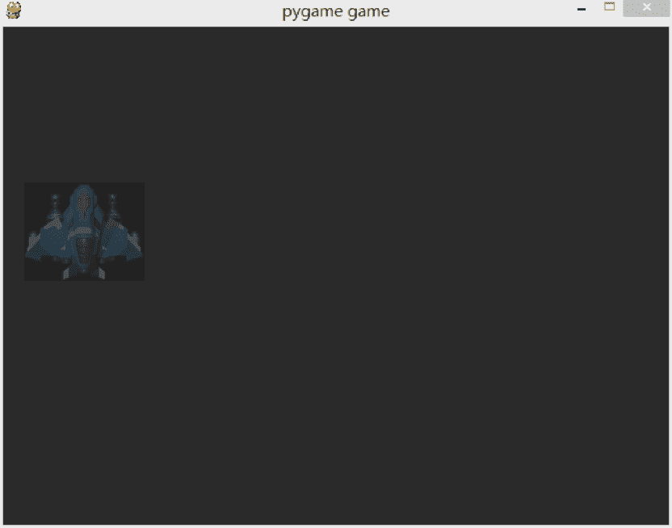
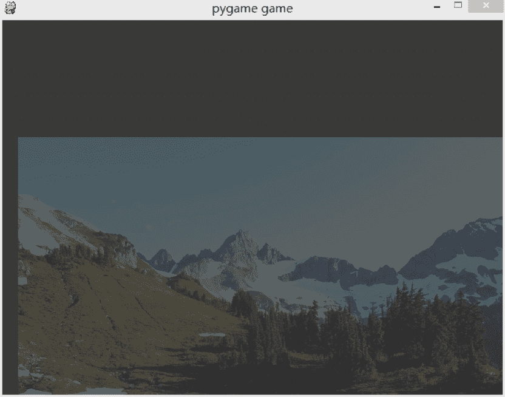
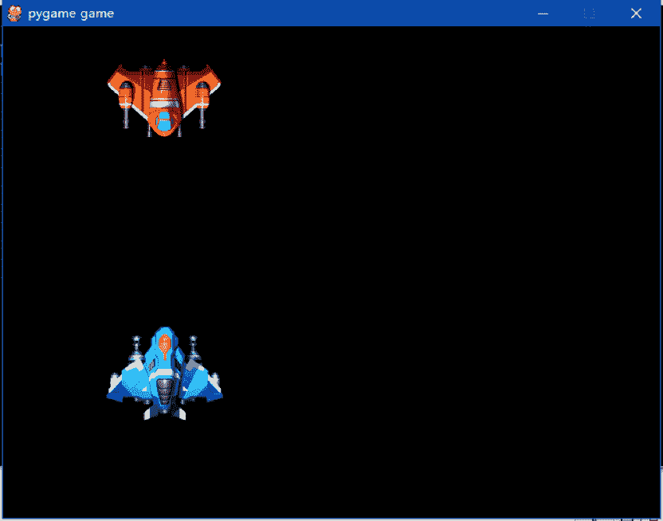
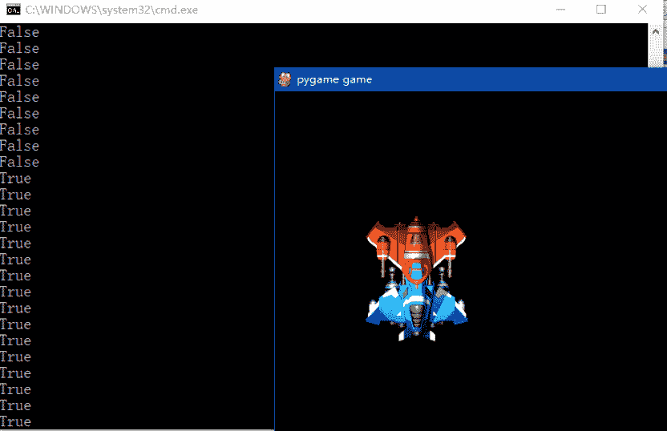

# 第15讲 | 如何设置淡入淡出和碰撞检测？

 

我们在前一节，学习了精灵的变形、放大和缩小，并且学习了如何使用精灵类和组的概念来管理精灵，制成动画。今天，我将带你学习淡入淡出和碰撞热点的判断。
 

所谓的**淡入淡出**，就是英文的**fade-in**和**fade-out**。淡入淡出在电影、游戏、CG、操作系统、手机 UI、应用等等各种地方随处可见。那究竟什么是淡入淡出呢？它在游戏中究竟如何实现呢？在我们的打飞机游戏中，什么时候会用到这个操作呢？
 

## 什么是淡入淡出？

 

不知道你有没有注意，在我们玩过的打飞机游戏中，当每一关游戏开始的时候，都会有个游戏画面逐渐出现的过程。短短几秒，从无到有，整个画面就呈现在你眼前了。同样，每一关结束的时候，也会有个画面逐渐消失的过程。
 

从**画面效果**讲，这个画面从有到逐渐屏幕变暗，直到消失，或者反过来，由暗逐渐变亮，到完全进入画面的过程，就叫做淡入淡出。从**声音**角度讲，也存在淡入淡出，比如音乐从无声到逐渐有声，或者从有声到逐渐无声。
 

**在 Pygame 中并不存在“画面的淡入淡出”这样的函数，需要我们自己去实现这样的功能。**
 

首先，如果我们想给这张图片进行淡入淡出的处理的话，就需要对它进行 alpha 混合处理。我们在前面谈到过 alpha 混合，你可以理解成半透明，但是 alpha 混合究竟是什么呢？
 

**alpha 混合**就是将一部分被遮盖的图像进行半透明处理。在游戏引擎或者游戏库中，图像的 alpha 值是可以被修改的。每动态修改一次 alpha 值，就会让图像更透明或者更不透明。通过制作出 alpha 效果，我们可以在游戏中实现各种绚丽的效果。
 

一般来讲，底层图形接口的颜色为 32 位的值，包含 RGB 以及 A（alpha），其中红色 R、绿色 G 和蓝色 B 各为 8 位，alpha 也为 8 位，所以合起来是 32 位的颜色值。
 

但是如果不存在 A 通道，那么就是 24 位的颜色值。每个颜色值都有 256 个级别的值，从程序角度是从 0 到 255，而支持 alpha 通道的图片格式有 png、tiff 等。但是如果没有带 alpha 透明通道的图，我们也可以在程序中设置它的 alpha 值来做透明。
 

如果是 Pygame，在 load image 函数的时候，不要处理 alpha，也就是不要调用 convert_alpha 函数。具体为什么呢？我后面给你揭晓。
 

## 如何做出淡入淡出效果？

 

我们在没有背景图片载入的时候，做淡入淡出效果，就不是使用 alpha 通道了，而是需要用**fill 函数**来填充背景色。
 

如果背景色是（0,0,0），也就是纯黑的话，那么就需要将（0,0,0）逐渐变成（255,255,255）来变成纯白，或者你自己定义一个 RGB 值来完成最终淡出后的背景色。
 

我们现在来看一下这段代码。
 

```
pln = pygame.image.load(plane).convert()a=0while True：pln.set_alpha(a)screen.blit(pln, (20, 150))if a > 255:    a=0screen.fill([a,a,a])a += 1
```

这段代码中，我们开始载入飞机图片。注意一下，我们没有用 convert_alpha。如果我们用了 convert_alpha，就会出现设置的 alpha 值没有任何作用。因为，在载入的时候，已经处理了 alpha 值了。
 

随后，我们定义一个变量 a，这个 a 既作用在 screen.fill 上，将 fill 的 RGB 值进行变换，也作用在 set_alpha 这个函数里，这个函数将图片的 surface 进行 alpha 值的设置，最后 blit 出来，呈现在屏幕上。
 

我们呈现的效果就是这样。
 



 

其他图片也可以做 alpha 混合，我们将最早的背景 jpg 图片传入，进行 alpha 半透明调整，效果是这样的。
 



 

## 如何设置碰撞检测？

 

说完了 alpha 混合，我们现在要来学习一下碰撞相关的内容。这个很好理解，飞机相撞了，就要用到碰撞。
 

事实上，在游戏中，碰撞属于物理引擎的一部分。特别是在 3D 游戏当中，物理引擎是独立于图形引擎的一个模块。程序员需要将图形引擎的对象填入到物理引擎中，计算出碰撞的结果，然后再返回给图形引擎，给出画面效果。做得精致的 2D 游戏也有独立的物理引擎，专门检测碰撞、计算重力等等。
 

但是在今天我们的课程中，我将使用浅显易懂，用你最能看懂的代码来解释碰撞是怎么回事。
 

**事实上，我们今天要讲到的碰撞是两个图片相交之间的碰撞检测，这并不算物理检测，而是图片检测。**
 

既然我们要检测的是图片，那么哪些前置信息是我们需要知道的呢？
 

首先，我们肯定要知道这两张需要碰撞图片的长宽，才能计算图片是否相交。在计算图片相交的时候，我们首先要知道它**所在位置的 x 轴的起点**，然后要知道它的**图片宽度**，然后我们要知道**图片位置的 y 起点**，以及它的**图片长度**，这样我们就得到了图片的长宽。
 

我们用上面的主角飞机图片和敌人飞机图片来做演示。
 



 

让两架飞机面对面，敌人的飞机从上往下飞，主角飞机从下往上飞。如果两架飞机碰到，我将在后台的命令行窗口显示一些字符串。
 

### 定义碰撞函数

 

接下来，我们来看一下，如何定义这个碰撞函数。
 

```
def collide(a, axy,  b, bxy):    a_x1, a_x2 = axy[0], axy[0]+a.get_width()    a_y1, a_y2 = axy[1], axy[1]+a.get_height()    b_x1, b_x2 = bxy[0], bxy[0]+b.get_width()    b_y1, b_y2 = bxy[1], bxy[1]+b.get_height()    a1, a2 = range(a_x1, a_x2) , range(a_y1, a_y2)    b1, b2 = range(b_x1, b_x2) , range(b_y1, b_y2)      ct = 0    for a in a1:        if a in b1:            ct = 1            break    for a in a2:        if a in b2:            if ct == 1:                return True    return False
```

我们来仔细地看一下这段函数。
 

首先，**collide 函数**拥有四个参数。第一个参数是第一幅图片的对象，第二个参数接收一个元组，接收第一幅图片所在的 x 轴和 y 轴，第三个参数是第二幅图片的对象，第四个参数接收一个元组，接收第二幅图片所在的 x 轴和 y 轴。
 

随后，代码进入一个**得到长宽**的过程。
 

a_x1 获取 a 图片对象所在屏幕的 x 点的起始位置，这个位置由第二个参数的元组下标 0 提供，a_x2 获取 a 图片对象所在屏幕的 x 点的终止位置（事实上是它的宽度），由于有 x 轴的起始坐标的关系，所以需要起始坐标加上图片宽度，才是它真实的 x 坐标结束点。
 

a_y2 获取 a 图片对象所在屏幕的 y 点的起始位置，这个由第二个参数的元组下标 1 提供，a_y2 获取 a 图片对象所在屏幕 y 点的终止位置，其实是它的长度，和前面的 x 轴一样，需要加上 y 轴所在屏幕的位置，才是真正的 y 轴的结束点。
 

和 a 图片是一个道理，b 图片我就不作具体阐述了。
 

接下来，我们需要知道整个图片所在的屏幕点，那么我们就需要用到**range 函数**。
 

Python 的 range 函数，是自动形成的一串整数列表。它的函数原型是这样的。
 

```
range(start, stop, [step])
```

其中步长 step 可以省略。因为默认是 1，所以如果在 range 中输入了开始和结束，就会形成一个列表。如果省略了 stop，就会从 0 开始计数，形成一串列表。比如 range(5)，那就会形成 0，1，2，3，4。
 

我们在 range 中形成了一串列表，其中 a1 对应的是，a 图片 x 值的起始点到终止点的列表，a2 对应的是 a 图片 y 值的起始点到终止点的列表。接下来的 b1 和 b2 就不做阐述了，和 a1 是相同的代码逻辑。
 

### 碰撞的检测

 

随后，我们就需要进行碰撞的检测了。
 

首先，我们先要判断 a 图片 x 轴的列表数字里面，是不是存在 b 图片的 x 轴的数字。如果存在，那么就把计数加 1，跳出循环。
 

接下来，我们再判断 a 图片的 y 轴的列表数字里面，是不是存在 b 图片的 y 轴的数字。如果存在，那么就返回为真（True），就说明碰撞检测成功了。如果计数等于 0 或者计数等于 1 但是并没有通过 y 轴的列表检测，那么就返回假（False）。
 

我们来看一下传入参数的代码。
 

```
y1, y2 = 1, 1  screen.blit(pln, (100, 300 + y1))  screen.blit(enm, (100, 20 + y2))  print collide(pln, (100,300+y1), enm, (100,20+y2))  y1-=1  y2+=1
```

我们在 blit 绘制的时候，y 轴加入了一个变量，就是 y1 和 y2。其中主角的飞机 pln 对象，y 轴始终减 1，敌人的飞机 enm，始终加 1，为的就是让两架飞机对向飞过来并且检测碰撞。
 

我们将 pln 和 enm 以及它们所在的位置，分别传入 collide 函数，进行检测。我们将在命令行后台打印 True 或者 False。如果是 False 就是没有碰撞，如果是 True 就是碰撞了。
 



 
 

当两架飞机碰到的时候，True 就出现了，那是因为 x 轴和 y 轴都有不同程度的重叠。所以在 collide 函数里面，就返回了 True。
 

另外，在 Pygame 里，精灵类当中也有碰撞检测的类可以提供使用，但是，**使用碰撞检测类可以用来进行球形的判断，而不能用于矩形图片之间的判断**。 这是更为高级和复杂的用法，在这里不做更深的阐述了。
 

## 小结

 

今天，我和你讲解了淡入淡出以及碰撞的热点检测。我们需要设置 Alpha 混合和背景填充，来实现淡入淡出，而普通图像碰撞的检测，则是通过判断图像 x 轴和 y 轴是否重叠来实现。
 

给你留个小问题吧。
 

如果给你一张图片，需要判断精准的碰撞，比如碰到机翼，或者碰到某一个非矩形的位置，你该如何判断碰撞结果？
 

欢迎留言说出你的看法。我在下一节的挑战中等你！
 


