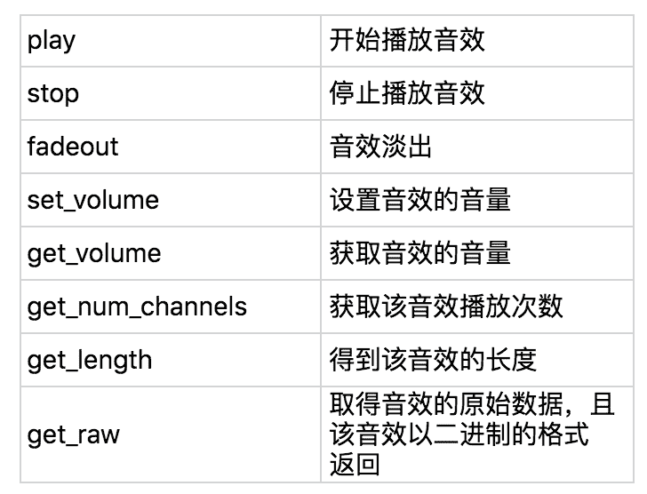
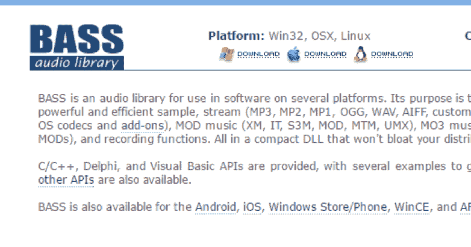

# 第18讲 | 如何载入背景音乐和音效？

 

好的音乐总是伴随着游戏一起，一直被玩家所记忆。在游戏中播放音乐和音效并不是什么困难的事情，但是究竟什么时候播放什么音效，具体怎么实现，这恐怕就需要一些技巧了。比如，我今天要讲的，我们可以和某些函数捆绑在一起实现。
 

Pygame 支持 mp3、ogg、wav 音频和音效的播放。音乐的模块都在 pygame.mixer 中，这里面包括音乐和音效。
 

我们在使用音频部分模块的时候，需要先初始化一次。
 

```
pygame.mixer.init()
```

 

这个初始化应该在 pygame.init() 的初始化之后。
 

我们来看一下具体的函数，这些函数，存在在 pygame.mixer.Sound 模块下。
 



 

我们再来看一下 Pygame.mixer.music 音乐模块。我们可以尝试一下载入音频并且播放。
 

```
pygame.mixer.music.load('bgm.mp3')pygame.mixer.music.set_volume(0.5)pygame.mixer.music.play()s1 = pygame.mixer.Sound('a.wav') s1.set_volume(0.5)s2 = pygame.mixer.Sound('b.wav')s2.set_volume(0.5)
```

 

我来解释一下这段代码。
 

刚开始，我们载入了一个名叫 bgm 的 mp3 文件，告诉程序需要载入这个文件，然后调整音量到 0.5，随后就是 play，也就是播放，播放是在程序的后台播放，然后程序会接着跑到下面的代码行。
 

随后，我们使用 Sound 模块，Sound 模块初始化会载入 a.wav，然后返回一个对象，这个对象设置音量为 0.5，随后再初始化一次，载入 b.wav，然后设置音量为 0.5。
 

到这里为止，我们已经将所有的初始化、设置都在游戏的循环外做好了。
 

随后，我们需要结合前几节的内容，在循环里面，对飞机碰撞进行声音的操作，比如出现爆炸声的时候，播放什么声音；碰撞结束，播放另一种的声音。
 

```
if True == collide(pln, (100,300+y1), enm, (100,20+y2)):s1.play()else:  s2.play()for event in pygame.event.get():   if event.type == QUIT:     pygame.quit()   if event.type == KEYDOWN:     if event.key == K_p:       pygame.mixer.music.pause()     if event.key == K_r:       pygame.mixer.music.unpause()
```

 

首先，我们使用**collide 函数**。这在前面几章有过详细的说明。
 

这是一段检测飞机碰撞的代码，如果飞机碰撞了的话，就会返回 True，如果返回 True 的话，我们就播放 s1 音频，否则就播放 s2 音频。当然，这个 s2 音频可能会一直在播放（因为一直没有碰撞）。
 

随后就是**事件监测**，如果检测到 K_p，就是按下键盘 p，就让音乐停止，使用 pause 函数；如果按下 r 键，就恢复播放。
 

我们在 Pygame 上的操作已经基本结束了，但是，音频和音效的内容并没有结束。
 

在游戏编程中，我们需要嵌入音频和音效，特别是在没有 Pygame 的时候，如果有一些游戏引擎没有提供音频库的话，我们就需要自己使用第三方的音频库。虽然可以使用耳熟能详的 ffmpeg，但是感觉有点大材小用了，所以我们需要一个专门的音频库。
 

在这里，我推荐**BASS 音频库**。你可以去 [http://www.un4seen.com](http://www.un4seen.com) 下载开发库。这个音频库是不开源的，如果你只是自己开发游戏玩玩，非商业目的，就可以使用。如果是商业使用，那就需要购买证书。
 



 

在这个页面上，我们点击 download 按钮，就会下载最新版本的开发库。解压缩下来，会出现对应几个语言的开发目录。
 

其中 bass.dll 文件是动态链接库，要使用的话，可以在 c 文件夹下，使用 lib 库和 bass.h 进行头文件包含进行编程。
 

我们来看一下，如何使用 C/C++ 语言加入 Bass 引擎的代码。
 

```
BASS_Init(-1, 44100, 0, hwnd, NULL);HSTREAM s = BASS_StreamCreateFile(false, "a.mp3", 0, 0, 0);BASS_ChannelPlay(s, false);BASS_StreamFree(s)
```

 

首先，我们将 BASS 库初始化，初始化的参数是：设备、输出比率、标志位（比如 8 位音质、立体声、3D 等等）、Windows 句柄。你也可以输入 0。最后一个是 clsid，就是用于初始化 DirectSound 的类的 ID，一般会使用 NULL。
 

随后，开始从文件建立一个流，BASS_StreamCreateFile 函数，返回一个 HSTREAM。HSTREAM 其实是一个 DWORD 类型。
 

这个函数里的参数，我也解释一下。
 
 
-  

第一个参数是内存。如果传入 true 的话，就将这个流保存在内存中；否则的话，就不保存在内存中。
  
-  

第二个参数是音频文件名。这个参数和第一个参数会联动。当第一个参数保存在内存中的时候，就填入内存地址，否则就填入文件名。
  
-  

第三个参数是偏移量，也就是文件从哪里开始播放。当然这个参数只在第一个参数为 false，不保存在内存的情况下起作用。
  
-  

第四个参数是长度，如果填入 0，就是所有长度。
  
-  

最后一个是标志位，填入的是创建模式，比如是循环播放方式，还是软件解码模式等等。
  
 

接下来就是开始播放，第一个填入的是刚才返回的流的句柄，第二个参数是是否重新开始播放。最后一个就是播放完后进行回收资源，删除句柄。
 

```
float v; DWORD r;BASS_SetConfig(BASS_CONFIG_GVOL_STREAM, 100);v = BASS_GetVolume();v = 200;BASS_SetVolume(v);r = BASS_ChannelIsActive(s);if(r == BASS_ACTIVE_PAUSED)...else if(r == BASS_ACTIVE_PLAYING)...else if(r == BASS_ACTIVE_STOPPED)...else if (r == BASS_ACTIVE_STALLED)  ..
```

 

接下来就是调整音量以及获取播放的状态功能。
 

其中 BASS_SetConfig 中，第一个参数是选项，第二个参数是调整音量的值，BASS_CONFIG_GVOL_STREAM 的意义是全局的流的音量。
 

随后我们就开始取得音量，BASS_GetVolume 是获取系统的音量，并不是流的音量，第五行代码就是设置系统音量。
 

接下来，我们就要获取播放的状态。在 BASS_ChannelIsActive 的函数内填入流的句柄，随后获取返回值，然后使用返回值进行比较，其中 BASS_ACTIVE_PAUSED，就是播放状态暂停，BASS_ACTIVE_PLAYING 是正在播放中或者录音状态，BASS_ACTIVE_STOPPED 是停止状态，或者流句柄并不是有效的，BASS_ACTIVE_STALLED 是停滞状态。
 

一般的原因是，播放的状态缺少样本数据，流的播放停滞了，如果数据足够播放的话，就会自动恢复。
 

BASS 库还有许许多多的函数和功能，就不在这里过多阐述了。
 

## 小结

 

我来总结一下。今天我们讲解了 Pygame 中音频和音效的播放。你应该记住这些东西。
 
 
-  

在 Pygame 中，播放音乐是不需要进行多线程控制的。它本身就会在后台进行播放。
  
-  

所有的音乐和音效都在 pygame.mixer 模块中，如果载入的是音乐，就使用 music 模块；如果载入的是音效，就使用 Sound 模块。
  
-  

随后我们介绍了 BASS 音频库。这几乎是最专业的音频库了。由于是 C 接口，所以通用多种语言，你可以使用.NET 或者 VB 等语言来应用。当然如果要进行后台播放、多个频道播放等功能，你需要编写多线程的代码，并没有 Pygame 那么轻松，这里面很多事情需要自己去做。
  
 

现在给你留一个小问题。
 

在 pygame.mixer.music 模块中，如何播放一首音乐后立刻播放另外一首音乐？
 

欢迎留言说出你的看法。我在下一节的挑战中等你！
 


