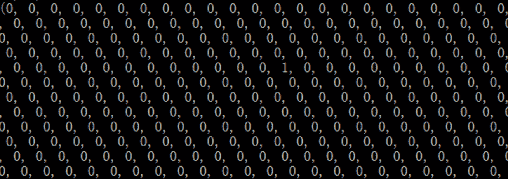
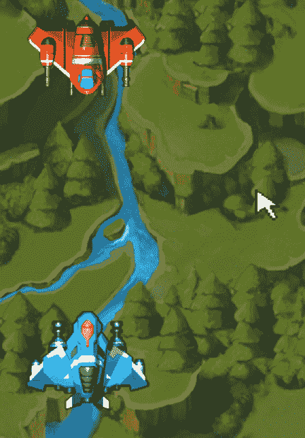

# 第21讲 | 如何用鼠标和键盘来操作游戏？

 

**如果一款游戏不能用鼠标和键盘操作，那我们只能当动画来看。**
 

所以在一款游戏中，鼠标和键盘的操作是必不可少的，有时候甚至鼠标和键盘都要同时操作，比如 FPS 游戏，比如即时战略等等。鼠标和键盘的操作在 Pygame 中需要进行实时检测，这个上一节我有提到过，然后我们就可以对游戏画面进行操作。
 

我们在 Pygame 中有两种方式可以检测和编写键盘事件，一种是使用**event 事件**操作，一种是使用**keypressed 函数**来进行键盘的判断操作。
 

我们先来尝试一下使用事件进行操作的键盘事件。我们在之前的代码中，已经使用事件来判断是不是退出，我们来看如下代码：
 

```
for event in pygame.event.get():        if event.type == QUIT:            pygame.quit()  
```

 

在这段代码里面，event.type 的类型如果是 QUIT 的话，就让 pygame 退出，那么举一反三，我们也可以在里面写上如下代码：
 

```
if event.type == KEYDOWN:    if event.key == pygame.K_w:        .....
```

 

在这里，我们判断事件的类型是 KEYDOWN，也就是键盘按下的事件，随后我们再在下面的代码里, 判断 event 所返回键盘 key 值，是 pygame.K_w，这个 K_w 是 pygame 里面定义的虚拟键盘的按键，代表的是 Key 值为键盘 w 的按键，所以你只要按下 w 键，就会出现对应的操作。
 

我们来写下一系列的操作代码，在编写代码之前，我们首先要来定义一下规则。
 

我们的目的，是要让主角的飞机移动起来，所谓的飞机的移动，我们在前面几篇课程里面都有阐述。如果我们要让飞机在画面上移动起来，就需要修正飞机的 x 轴和 y 轴。
 

相应的，如果飞机往左侧飞，就需要减少飞机的 x 轴；如果飞机往右侧飞，就要增加飞机的 x 轴；如果往上面飞，就要减少飞机的 y 轴；如果往底下飞，就要增加飞机的 y 轴。我们先理清楚了这些内容之后，就可以编写键盘操作代码了。
 

我们先来修正飞机的 x 轴和 y 轴。我们要在游戏的循环之外，定义两个变量 xx 和 yy，以修正键盘操作后的飞机坐标。
 

```
xx = 0yy = 0  
```

 

在定义完了这些内容后，我们再来看看按键的定义。
 

```
if event.type == KEYDOWN:            if event.key == pygame.K_w:                yy -= 1            if event.key == pygame.K_s:                yy += 1            if event.key == pygame.K_a:                xx -= 1            if event.key == pygame.K_d:                xx += 1
```

 

首先，和普通的游戏一样，我们将电脑键盘上的 WSAD 按键用作上下左右的操作按键，所以我们判断了一系列的按键值，比如 K_w，K_s 等等，然后我们看到，xx, yy 的一系列操作，然后我们进行飞机的贴图和操作：
 

```
screen.blit(pln, (100+xx, 300+yy))
```

 

我们看到，基础坐标值是（100，300）。我们经过键盘操作，对 xx 和 yy 进行位置的修正。到这里为止，我们可以看到，只要我们按下 WSAD 中的任意一个按键，飞机就会往指定的位置移动。
 

所以如果你认为到这里按键的内容就结束了，那就错了，就像我们今天开头所说的，Pygame 下的键盘类，还有另外一种方式可以检测，你可以考虑下面的代码。
 

```
key = pygame.key.get_pressed()    if key[pygame.K_w]:        yy -= 1    if key[pygame.K_s]:        yy += 1    if key[pygame.K_a]:        xx -= 1    if key[pygame.K_d]:        xx += 
```

 

是的，我们看到了 pygame.key.get_pressed(); 函数。这个函数返回一个 Key 值。和 event 事件不同的是，我们直接可以在每一次循环内进行判断。返回的 Key 是一个 tuple 类型，在里面存放了各种按键对应的值。如果没有按键，所有值都是 0；如果有按键，其中一个值是 1。
 

再来看接下来的代码，如果 key 值的 tuple 里正好是 pygame.K_w 的话，那么判断结果就是真，我们来将这个内容打印出来看一下。
 

```
print key
```

 

我们打印了 key，并且按下 w 按键，随后，我们可以在游戏界面命令行看到如下内容输出：
 



  
 找到那个 1 没有？那个 1，就是对应的 K_w 值，在 key[pygame.K_w] 判断的时候，返回一个 1，也就是 True，那么就产生 yy-=1 的操作。接下来就是类似的代码了，我就不再作重复的阐述了。
 

看到这里，或许你就要问了，那有很多的游戏都有组合键，比如我按下 Ctrl 键，再按下 w 键，就会出现对应的操作，这又该怎么实现呢？
 

你思考一下，我们是不是可以把两个按键写在同一个判断语句下？是的，你没有猜错，确实可以这么写，这就是**组合键**的效果。
 

```
if key[pygame.K_w] and key[pygame.K_LCTRL]:    yy -= 2 
```

 

在这里我们看到，只要同时按下了 w 和左侧 CTRL，（LCTRL 的意思是 Left Control，就是左侧 Control 的意思），那么 yy 的坐标值就减去 2，我们操作一下就知道结果了。所以，组合键可以在同一个判断里面，使用 and 连接起来。
 

然后，事情并没有到这里结束，请你将这些代码写在自己的电脑里，并做一下实验，第一种方式是事件判断，第二种方式是按键判断。这两种方式的区别是什么？
 

看到区别了吗？如果你按照我说的去做，你会发现，第一种方式，只要按下一个键，飞机就会往指定方向移动一格，然而如果你一直按着这个键，飞机是不会移动的，要等你再按下键盘才行。而第二种方式，只要你一直按着这个键，飞机就会一直不停往指定位置移动。
 

问题究竟出在哪里呢？
 

问题在于，事件判断首先判断了 KEYDOWN，当你按下按键的时候，KEYDOWN 已经被判断了，随后我们再进入 event 的按键类型的判断，但是如果你这时候一直按着键盘，KEYDOWN 事件并没有被唤起，所以一直按着按键并没有起到作用，所以你要按下键盘，松开，再按下一次，飞机才会移动。
 

而第二种方式，在循环里面，只要键盘按下去，就会一直返回一个 tuple 给 key，然后在继续做判断，所以，我们只要一直按着键盘，一直会做判断，直到按下的键盘是 WSAD 为止。
 

接下来，我们要做一下鼠标的操作。鼠标的操作我们在前几次的课程中也进行了介绍，我们再来温习一遍，并且添加一些新的内容进去。
 

我们今天要把一幅图片贴在鼠标的位置，并且随着鼠标的移动而移动，我们先来看下列代码：
 

```
mouse = 'mouse.png'mouse_cursor = pygame.image.load(mouse).convert_alpha()mouse_scale = pygame.transform.scale(mouse_cursor, (40, 40)) While True:    # 获取 x, y 值    x-= mouse_scale.get_width() / 2    y-= mouse_scale.get_height() / 2    screen.blit(mouse_scale, (x, y))    ...
```

 

首先我们要定义的一幅图片名叫 mouse.png，随后载入图片并且处理 alpha 混合，这在我们先前的课程中都有过阐述。
 

随后我们看到了一个叫 pygame.transform.scale 的函数。这个函数的意思是，我们要重新将 mouse 这个 surface 进行缩放，其中缩放的大小长宽是（40，40），并且返回一个新的 surface。
 

随后在循环里，我们获取到这个 surface 的中心点，也就是计算需要绘制鼠标的 x，y 值，我们需要得到图片的长宽，并且除以 2，最后 blit 开始贴图，我们看到的效果是这样的。
 



 

那么我们如果要判断鼠标的按键怎么办呢？我们来温习一下上一次所讲的内容，鼠标的按键，也是类似的判断方式：
 

```
x, y = pygame.mouse.get_pos()  if pygame.mouse.get_pressed()[0]:      .... 
```

 

前面那段代码用到的 x，y 的值，在这里进行代码获取。
 

我们看到，pygame.mouse.get_pos() 函数，获取两个值，x 和 y 坐标，后面一段代码就是获取鼠标点击的内容，其中 get_pressed 函数下标 0 返回是不是左键点击，下标 1 返回是不是中键点击，下标 2 返回是不是右键点击，最后再做出判断。
 

## 小结

 

今天的内容基本到这里了，我带你将内容梳理并总结一下。
 
 
1.  

首先是键盘事件判断，这里会出现按一下键盘做一下操作的情况，问题出在 KEYDOWN 事件判断上。但是如果你需要一直按键的判断，可以使用 get_pressed 函数。
  
2.  

组合键可以写在同一个判断下，使用 and 连起来做判断。
  
3.  

get_pressed 会返回一个 tuple，里面存放了所有的 key 值，只要判断 key 值是不是为 True 就是判断了有没有按键。
  
4.  

鼠标操作也可以使用 get_pressed 函数，也是返回 tuple，其中下标 0、1、2 分别代表了左、中、右三个按键。
  
 

最后，给你留一个小问题。
 

如果将组合键写在第一个按键的判断下，会出现什么情况？
 

```
if key[pygame.K_LCTRL]:    if key[pygame.K_w]:        ...
```

 

欢迎留言说出你的看法，我在下一节的挑战中等你！
 


