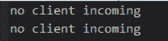
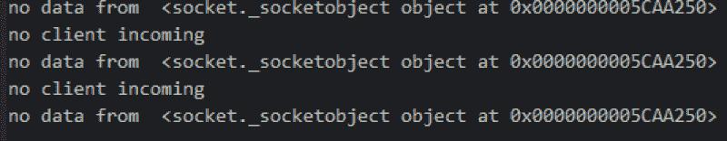

# 第33讲 | 如何判断心跳包是否离线？

 

在初学网络，编写过阻塞和非阻塞网络代码的时候，有一个问题，那就是在非阻塞的情况下，不知道对方的网络何时断开。
 

因为在非阻塞的情况下，如果没有接收到消息，recv 的数值一直会是 0。如果以这个来判断，显然是错误的。而在阻塞情况下，只要对方一断开，接收到 0 就说明断开了，那么我们怎么才能在非阻塞的情况下确定连接是断开还是没断开呢？
 

我们可以采用离线超时的方案来判断对方连接是否断开。那什么是离线超时呢？
 

我们都知道，人累了就要休息。你在休息的时候，有没有注意过这么一个现象，那就是你在快要睡着的时候，忽然脚会蹬一下，或者人会抽一下，这是为什么呢？
 

有一种说法流传很广，说，其实大脑是在不停地检测人有没有“死”，所以发送神经信号给手和腿。抽动一下，检验其是否死亡。这个就有点儿像我们检测超时，看看有没有反应。
 

现在我们先看一段 Python 代码，让它运行起来。
 

```
import socketimport time def server_run():   clients = []   my_server = socket.socket(socket.AF_INET, socket.SOCK_STREAM)   my_server.setsockopt(socket.SOL_SOCKET, socket.SO_REUSEADDR, 1)   my_server.bind(("", 1024))   my_server.listen(256)   my_server.setblocking(False)   
```

 

这是我节选的一部分代码。其中，在函数 server_run 里面，我们先定义了一个 clients，这是一个列表，用于后面保存客户端连接用。my_server 获得 socket 句柄，并且将之设置为 TCP 模式，随后我们绑定地址为本地（bind 函数），端口号为 1024，并且开始侦听，随后我们看到 setblocking 函数，将之设置为非阻塞模式。
 

```
while True:      time.sleep(1)      try:         client, addr = my_server.accept()         print client         client.setblocking(False)         clients.append(client)      except Exception as e:         print "no client incoming"      for cli in clients:         try:            data = cli.recv(1024)            if data:               print data            else:               cli.close()               clients.remove(cli )          except Exception as e:            print "no data from ", cli   my_server.close()
```

 

在一个大循环内，我们做了如下几件事情：第一个是 accept，只要有客户端进来，我们就 accept，如果没有客户端进来，一直等待状态下，就打印 no client incoming 字符串，如果有客户端进入的话，就直接将新客户端放入列表。
 

我们在启动函数的时候，如果没有客户端连接，就会出现这样的字样：
 



 

然后我们使用 Windows 下的 telnet 命令来模拟客户端。输入 telnet 127.0.0.1 1024，服务器端代码会出现这样的字符串：
 


 

我们打印新的客户端连接的对象地址，并且将新的客户端连接句柄放入列表里面。随后，循环进入到了取出新客户端列表，并且做出判断，每次接收 1024 字节。如果没有，则显示 no data from <xxxx 地址 >；如果有，那就显示输入的字符串。
 

好了，现在我们打开 Windows 任务管理器，找到拥有 telnet 的程序，并且“杀死”它。
 


 

随后，我们会发现，命令行提示符出现了如下内容的字符串：
 



 

按照道理，服务器不是应该断开连接了吗？它应该能知道客户端断开了不是吗？
 

错，服务器端根本不知道对方已经被“杀死”了，所以它的状态仍然在接收中。由于是 TCP 握手，除非你正常将 telnet 程序关闭，才会让服务器端正常接收到客户端关闭的消息，否则，你永远不知道对方已经退出连接了。
 

所以**心跳包的作用**就在这里，心跳包**允许你每隔多少毫秒发送数据给服务器端，告诉服务器我还活着，否则服务器就当它已经死了，确认超时，并且退出**。
 

事实上，在 TCP/IP 的协议层中，本身是存在心跳包的设计的，就是 TCP 协议中的 SO_KEEPALIVE。
 

系统默认是设置 2 小时的心跳频率。需要用 setsockopt 选项将 SOL_SOCKET.SO_KEEPALIVE 设置为 1，打开，并且可以设置三个参数 tcp_keepalive_time，tcp_keepalive_probes，tcp_keepalive_intvl，分别表示连接闲置多久开始发 keepalive 的 ACK 包、发几个 ACK 包不回复就当连接端“死”了。
 

这种心跳检测包是属于 TCP 协议底层的检测机制，上层软件只是解析显示网口的有用数据包，收到心跳包报文属于 TCP 协议层的数据，一般软件不会将它直接在应用层显示出来，所以用户是看不到的。以太网中的心跳包可以通过以太网抓包软件分析 TCP/IP 协议层的数据流看到。报文名称是 TCP Keep-Alive。
 

当然，我们也可以做应用层的心跳包检测，我们在编写游戏服务器的时候，就可以自定义心跳服务，TCP 层的心跳服务是为了保持存活的，但是应用层的心跳，则是拥有更明确或者其他的目的（比如对方是否还活着）。
 

我们专门独立一台服务器做心跳服务器，连接客户端和真正的游戏逻辑服务器，那么我们希望逻辑服务器的同步率和心跳服务器统一，也就是说，**心跳服务器负责的就是发送心跳包和客户端数据给逻辑服务器**，逻辑服务器每一次获取数据，也是从心跳服务器获得的，那么心跳服务器能做的事情就会变得很多。
 

为了调试方便，我们可以利用心跳服务器，将客户端传送过去的数据包存储在本地磁盘上。如果应用或者游戏在测试的时候，就可以看到那些发送的内容，甚至可以回滚任意时段的数据内容，这样调试起来就相对方便，而不需要客户端大费周章地不停演练重现出现的错误。代码看起来是这样：
 

```
 def SendToServer(is_save = 0):      package = socket.recv(recv_len)      ticktock()      if is_save:          SaveToDisk(package)      server_socket.send(package)
```

 

在逻辑服务器内部，每一次接收数据，都根据心跳服务包的心跳来接收，这样做的好处就是，可以随时调整心跳的频率，而不需要调整逻辑服务器的代码。
 

在应用层的心跳模式下，我们会有两种策略需要进行选择。
 

我们假定把逻辑运算设为 A，心跳时间（比如代码的 Sleep 或者挂起）设为 B。
 

第一种是运算时间 A 和心跳时间 B 相对固定。也就是说，不管 A 运算多久，B 一定是固定挂起多久。
 

第二种策略是运算时间 A 和心跳时间 B 是实时调整。A 运算时间长，挂起时间就短，如果 A 运算时间加上 B 挂起时间超过约定心跳总时间，那 B 就不挂起，直接进行另一个 A 运算。这两种策略究竟哪种好呢？
 

在 CPU 负载并不是那么严重的情况下，策略二是比较好的选择。
 

假设心跳 Sleep 时间是 1000ms，运行时间规定为 2000ms。如果运行时间小于等于 2000ms 的话，Sleep 时间不变；如果运行时间超过 2000ms 的话，那么 Sleep 时间就等于 Sleep 时间 - (运行时间 - 2000ms)。
 

这样一来，平均心跳有了保障，但是在运算量加大的时候，Sleep 时间已经完全被运行时间所占据，那么心跳 Sleep 时间就会减少到最少甚至不存在，CPU 的负载就会变得很高，这种时候就需要用到策略一。
 

你可以这么理解。策略一是说，不管我们的运行时间多久，Sleep 时间始终是一致的 1000ms，这种方式保证了服务器一定会进行心跳，而不会导致负载过高等情况。
 

当然这只是一种简单的模型，在进行大规模运算，或者有多台服务器的时候，我们可以将两种方式合并起来进行策略交互。任务不繁重的时候采用策略二，当服务器发现任务一直很多且超过 Sleep 时间几次，就切换到策略一，这样可以保证心跳时间基本一致。
 

我们可以将心跳服务和逻辑服务分开运行，而是否放在同一台物理机并不是首要的问题，这样心跳服务器只提供心跳包，而逻辑服务通过心跳包自动判断并且调整运行频率。
 

## 小结

 

好了，我给今天的内容做一个总结。
 
 
-  

判断非阻塞模型的网络是否断开，可以使用心跳包和计算超时的方式进行断开操作，比如 30 秒没收到心跳包，则可以强制关闭 Socket 句柄断开。
  
-  

心跳包是一种服务器之间交互的方法，也可以用作服务器数据调试和回滚的策略方案。心跳包有两种策略，第一种就是运算时间 A 和心跳时间 B 相对固定，第二种策略是运算时间 A 和心跳时间 B 是实时调整。CPU 的负载很高的时候用策略一，CPU 负载并不是那么严重的情况下，策略二是比较好的选择。
  
 

最后，给你留一个思考题吧。
 

如果编写的是阻塞方式的服务器代码，心跳包还有存在的意义吗？
 

欢迎留言说出你的看法。我在下一节的挑战中等你！
 


