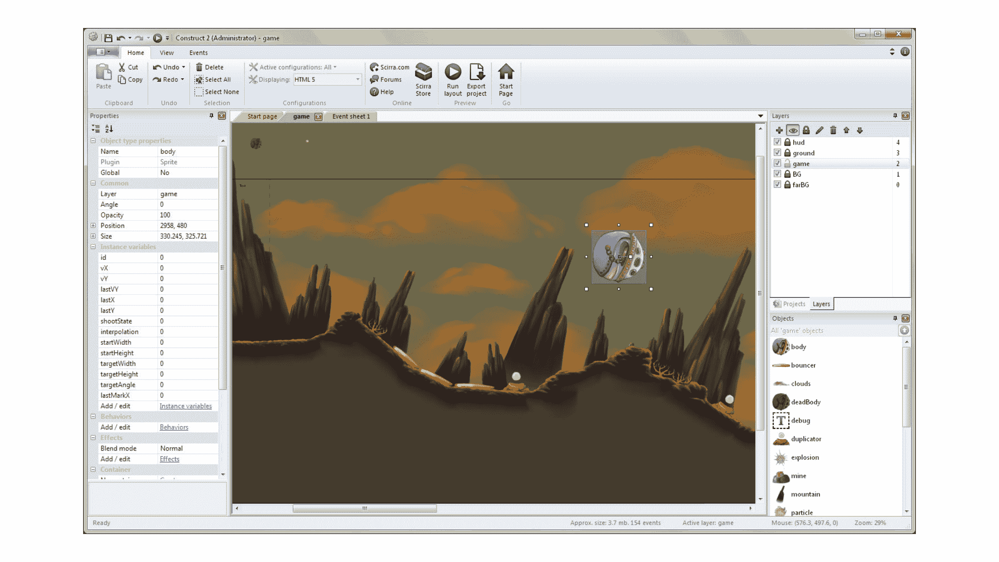

# 第13讲 | 热点剖析（二）：如何选择一款HTML5引擎？

 

上周六，我详细介绍了[HTML5 技术相比 Flash 技术的优势](https://time.geekbang.org/column/article/9298)，相信你已经对 HTML5 技术有一个大致的了解。下周六，我会带你编写一个 HTML5 游戏，在这之前，我们需要先了解几种常见的 HTML5 游戏引擎。
 

一些比较成熟的引擎，比如 Cocos2d-JS、白鹭等，它们都提供有系列化的工具，比如编辑器、IDE 等周边。但是其实**大部分 HTML5 游戏引擎都只有图形引擎**而已，比如 legend.js。而且很多 HTML5 引擎只是个人编写的开源引擎，所以漏洞还是比较多的。
 

HTML5 游戏引擎在编写的时候，除非用 DOM（Document Object Model）纯原生编写，绝大部分都是使用 JavaScript 编写的。但是为了考虑各种程序员的需求，现在也有使用 TypeScript、CoffeeScript、LiveScript 等语言编写的 HTML5 引擎。
 

## 几款常见的 HTML5 游戏引擎

 

我们现在来看一下几款常见的 HTML5 游戏引擎。
 

### Construct 2

 

这是一款收费的引擎，当然也有免费的版本，但是免费的版本不可用于商业用途。那么既然是商用引擎，那它一定会比免费开源的产品更加完善和易用。这里有一幅 Construct 2 的截图，你可以看一下它的界面。
 

 
 

我们可以清晰地看到，这个界面类似 Office 的操作界面。左侧是物件的**属性**，比如长宽高等；右侧上方是物件的**层**，包括背景、物件；右侧下方是**物件选择器**，你可以选择各种物件摆放到编辑器内。这种类型的编辑器，在成熟的商业引擎中比较常见，但是由于编写编辑器的人力物力成本，所以免费的引擎一般不提供这种成熟的编辑器。
 

从**使用**角度，我总结了一下它的特点，大概有这几条，供你自己制作 HTML5 游戏的时候选择：
 
 
- 

可以设计任何类型的 2D 游戏，而且不需要编程的技能（可以由事件系统控制）；
  
- 

使用简单的拖拽和事件系统就可以设计游戏逻辑；
  
- 

拥有一个物理引擎，可以用来计算运动、旋转和碰撞反映；
  
- 

可以在 iOS、Android、Windows Store 等多个平台上发布游戏；
  
- 

拥有很完备的文档和教程案例。
  
 

在**软件**方面，它拥有一个非常直观的编辑器，可以开发高级的视觉效果，可以支持视差滚动的游戏，并且在编辑器中集成了调试器和 profiler。做出来的游戏支持多人游戏，也支持 2D 的阴影，还支持 JS SDK 的插件。
 

Construct 2 的不同版本，对应的功能也不相同。
 

第一个是**免费版本**的，它的使用没有时间限制，你可以使用 100 个事件、4 个图层和 2 个着色器，随意导出成 HTML5 网页游戏，但是这些编写出来的游戏不可以用作商业用途。
 

第二个是**个人版**或者**教育版**：这个版本移除了免费版本的限制，甚至可以将项目导出至 iOS、Android 或者其他平台。如果你用作商业用途，可以允许你在商业用途中获得最高 5000 美元的收入。它可以使用调试器观察 tab、profiler 和事件断点，还可以制作多人游戏，在应用程序内可以嵌入内购功能。
 

最后一个是**商业版本。**所有特点与个人版本相同，但是没有上面说的那些限制。
 

**Construct 2 的缺点就是相关的中文教程不是很多，需要你自己去摸索。但是它支持多平台，简单易用，还提供了很强悍的事件系统，可以不通过代码来控制逻辑，所以不需要编程知识就可以使用。**
 

### 白鹭引擎

 

白鹭引擎是我们国内自己研发的 HTML5 引擎。最初，它也是一套图形引擎，后来资本化之后，白鹭引擎就开始着手将引擎变成一套解决方案。
 

它不仅提供 HTML5 游戏引擎，也提供了各种周边工具和产品。除了图形引擎之外，它还提供了可视化编辑工具（Egret Wing）、动画制作工具（Dragon Bones）、HTML5 游戏加速器（Egret Runtime）。
 

**可视化编辑工具**提供了代码调试功能。可以在文件中打断点、单步调试、跳入和跳出、查看局部变量、添加观察表达式等。当然你也可以自己编写扩展程序，可以对任何语言进行调试。可以让开发者用 Node.js + HTML 来开发 IDE 的扩展插件，然后实现各种提升效率的工具。
 

你还可以自定义语法高亮、智能提示和调试。它还内置了版本控制系统 Git，集成命令行工具，可以同时打开多个命令行标签，执行需要的命令。
 

它甚至可以在 Wing 中直接运行 Vim。它还内置多种主流的代码配色方案，满足大部分开发者配色习惯。开发者还可以自己编写配色扩展，你可以根据自己习惯，定制你的 IDE。
 

白鹭的**动画制作工具**提供了动画和动漫的解决方案，打通了动画设计和游戏开发的工作流，也支持导出各种动画格式，提供了可交互动态漫画编辑器模式。你甚至不需要动画基础，轻松实现丰富特效。DragonBones 可以输出多种格式，视频、网页、动画数据，可以用于几乎目前所有的主流游戏引擎和编程语言，提供了各个平台的运行库。
 

另外，还有一个**HTML5 加速器**，这是一款支持 3D 的 HTML5 游戏加速器，解决低端机对 HTML5 标准支持不佳、体验差的弊端，加速器可以适配不同的系统让 HTML5 游戏效果媲美原生游戏，解决设备不统一，移动应用市场的设备、操作系统和屏幕的不统一的问题很严重， 已成为 HTML5 游戏开发者面临的难题，适配也成为美工最头痛的问题。
 

另外，越来越多的游戏和应用使用移动 QQ、微信、微博等客户端作为入口。 不同客户端软件所携带的浏览器内核不同， 也直接影响 HTML5 游戏在平台上的表现。
 

而 HTML5 加速器直接支持 HTML5 游戏运行所需的底层功能，解决了屏幕适配和性能问题，并且也从渠道角度解决了 HTML5 游戏接入流程复杂， 定制化功能多的问题，实现一次接入，随时上线。
 

我们再来讲讲白鹭引擎本身。白鹭引擎支持 2D、3D 游戏，引擎本身采用模块化设计，egret 也实现了脏矩阵方法，可以很大提升渲染性能。**脏矩阵**，简单描述就是，系统只渲染动画变化的部分，不变化的部分并不进行渲染更新。
 

**白鹭引擎本身的功能和周边工具都很强大，中文教程和论坛也比较成熟，且支持 2D、3D 游戏的制作，现在也支持直接编写最流行的微信小游戏。**在商业化方面，白鹭是做的比较成功的，所以现在的用户也非常多。
 

### Cocos2d-JS

 

最后，我们来说一下 Cocos2d-JS。
 

Cocos2d-JS 是 Cocos2d-x 的一个分支，只要对 HTML5 游戏有所了解的话，基本都听说过 Cocos2d-JS，很多开发人员也会选择 Cocos2d-JS 来进行开发 HTML5 游戏。
 

根据官方说法，它跨全平台，采用 JavaScript 语言，可发布到包括 Web、iOS、Android、Windows Phone8、Mac、Windows 等平台，引擎基于 MIT 开源协议，完全开源、免费、易学易用，拥有活跃的社区支持。
 

**Cocos2d-JS 让 2D 的游戏编程门槛更低，使用更加容易和高效。和其他类似游戏引擎相比，它定义了更加清晰的 2D 游戏编程的基本组件、易学易用的 API，并且具备原生性能的脚本绑定技术，实现游戏的跨原生平台发布，开发效率更高，使用简单。**
 

它本身融合了 Cocos2d-HTML5 和 Cocos2d-x JavaScript Bindings（JSB），支持 Cocos2d-x 的所有核心特性并提供更简单易用的 JavaScript 风格 API，基于 Cocos2d-JS 的框架，可以方便地使用 JavaScript 语言进行游戏开发，快速构建原型进行测试和验证。
 

由于 Cocos2d-html5 的 API 和 Cocos2d-x JSB 的 API 高度一致，开发出来的游戏不用修改代码或者修改少量代码就可打包为原生性能表现的混合游戏，发布到原生应用市场，这就是一次编码全平台部署的效果。
 

## 小结

 

这一节，我给你介绍了最流行的三款 HTML5 游戏引擎。
 

其中一款是商业引擎，另外两款可以自由使用。从难易角度讲，Construct 2 拥有更方便的开发体验；从流行度讲，Cocos2d-JS 和白鹭都属于国内最流行的 HTML5 游戏引擎。
 

你可以根据自己的需求来选择，**如果美术熟悉 Cocos2d-JS，或者想要快速上手 2D 游戏，可以选择 Cocos2d-JS；如果对编程不太熟练，可以选择 Construct 2；如果是拥有完整流程的开发公司，Cocos2d-JS 和白鹭都可以选择**。
 

最后，给你留一个小问题吧。
 

现在流行的微信小游戏，目前只支持 3M 左右的大小，否则就审核不过，那么如果在游戏资源大的情况下，有什么方案可以让游戏维持在 3M 大小呢？
 

欢迎留言说出你的看法。我在下一节的挑战中等你！
 

