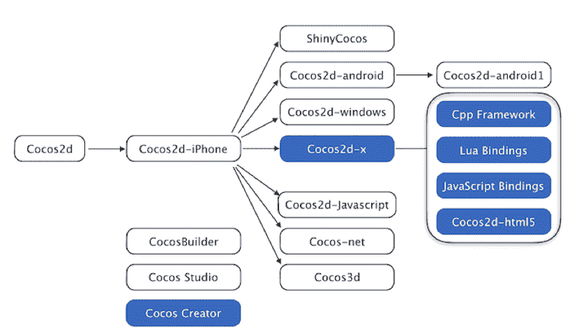
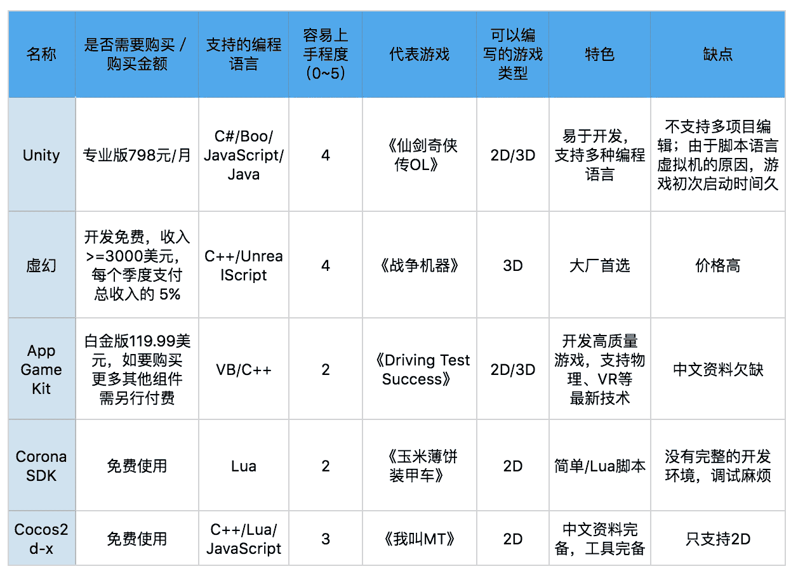

# 第22讲 | 热点剖析（五）：如何选择移动端的游戏引擎？

 

上一次，我和你探讨了[移动端游戏的一些区别和特点](https://time.geekbang.org/column/article/10423)，我特别介绍了 libGDX 这款游戏引擎。因为这款游戏引擎是多平台的，且各种第三方工具都很完备，比如物理引擎、特效、2D 骨骼动画工具等等，所以 libGDX 目前已经被越来越多的公司和个人接受和使用。
 

在苹果端，我们也讲到了，苹果公司推出的 SpriteKit 游戏开发框架，在苹果体系下，使用 XCode 就可以很方便地使用 SK 工具开发出好玩的 2D 移动游戏。
 

从目前最新的游戏引擎的趋势看，一次编码、到处兼容已经成为了市场的主流，多种语言、一次打包（多种语言都可以编写相同的代码，然后配合打包成目标平台的游戏），也是程序员喜闻乐见的一种编程方式。
 

如果你准备编写移动端的游戏，或者你已经是 app 程序员，有编码经验但是想要转型游戏程序员，那么你要对移动端的游戏引擎有一定的了解，才能开始你的游戏编程之旅。
 

## 五种常见的移动端引擎

 

我今天介绍五种常见的移动端引擎，分别是 Unity、虚幻、App Game Kit、Corona SDK、Cocos2d-x。
 

### Unity

 

和虚幻之类有名的游戏引擎一样，Unity 最初是从 3D 网页引擎的样子进化成现在这样的。Unity 普通版是 400 美元，但是 Pro 版本要 1500 多美元，但是如果你购买 Pro 版的话会得到更强大的功能和编辑器等等。Unity 不仅支持电脑和移动端多平台，还支持游戏机甚至掌上游戏机，比如我们熟知的 PS 系列和 PSV 之类的，比如《杀出重围》《神庙逃亡》等，都是使用 Unity 引擎制作的。
 

Unity 的**编程**可以使用 C#、JavaScript、Java、Boo 等脚本语言。对于 Flash，Unity 已经放弃支持这个平台了。事实上，Unity 在版本 4.0 之前是可以支持将游戏转换为 Flash 平台的，4.0 后已经不支持转成 Flash 游戏了。至于 Flash 被各家放弃的原因我在之前的文章已经讲过，这里就不多说了。
 

Unity 拥有大量的所见即所得的编程**界面开发工具**。比如支持 3D 骨骼和动画的导入、贴图的材质可以转换为自身的 U3D 格式等等。
 

在**底层**方面，它支持 OpenGL 以及 DX 系列。它自带的物理引擎、粒子系统，性能也极其高效，还支持网络系统，所以你可以使用 Unity 来编写单机或者网络游戏。
 

### 虚幻

 

这个大佬级别的引擎，你一定不陌生。它现在已经支持在移动平台使用了。虚幻有免费版本和付费版本，但是只有付费版本你可以获取引擎全部的 C++ 源代码。最为可贵的是，出品虚幻的 Epic 公司有发布[完整](http://study.163.com/course/introduction/185001.htm)[的](http://study.163.com/course/introduction/185001.htm)[教学视频](http://study.163.com/course/introduction/185001.htm)，而开发人员也能从网络社区获取大量的学习资源。
 

这款引擎不仅仅在游戏引擎技术方面比较优秀，运营方面、市场方面，在行业内都是属于前列。耳熟能详的《蝙蝠侠》《阿卡姆之城》等等用的都是虚幻引擎。
 

虚幻引擎有完整的**数据属性编辑功能**。关卡设计人员可以自由地对游戏中的物件进行设置，也可以通过脚本编写的形式进行优化设置。关于关卡编辑器的功能，我在[之前的文章](https://time.geekbang.org/column/article/8670)中有详细介绍。
 

虚幻的**资源管理器**可以进行快速准确地查找、观看，并对游戏开发中的各种资源进行整理组织。地图编辑器可以让美术开发人员自由地对地形进行升降调节。更强大的是，它可以通过带有 alpha 通道的笔刷对地图的层进行融合修饰，可以在地图编辑中生成碰撞数据和位移贴图，你看到的可以说是游戏场景的一种演示版也不为过。
 

它的编辑器还为美术制作人员提供了完整的模型、骨骼和动画数据导出工具，并可以编辑游戏事件所需要的声音文件、剧情脚本。
 

### App Game Kit

 

我个人认为，App Game Kit 比较适合刚进阶的游戏开发者。这款引擎使用非常容易上手，你可以去它的[官网](https://www.appgamekit.com/)看最新发布的消息。有一款 Driving Test Success 的应用就是使用 AGK 编写的，当然这是一个商业化的付费引擎。这款游戏引擎也支持树莓派上编程，可谓是各个平台都兼容。
 

### Corona SDK

 

如果你深入学习过或者接触过移动端游戏开发的话，你一定知道这款游戏引擎。这款引擎不仅仅是跨平台支持，甚至还支持 Kindle 电子书这类的平台。
 

它的编程语言为 Lua，我们在之后的文章会介绍 Lua 和 C 语言的绑定，我在这里只是简单说一下。相对于别的语言来说，Lua 更加轻量级，对初学者来说也更容易上手。
 

Corona SDK 的客户除了个人，也有很多知名的大厂，比如日本的南梦宫等等。当然收费也并不便宜，专业版就接近 600 美元，企业版接近 1000 美元，当然如果是企业用户的话，这点投入比之自己编写引擎来说，划算得多。
 

### 

 

Cocos2d-x
 

国内的朋友对这款引擎非常熟悉，与此同时，它的同胞兄弟 Cocos2d 系列，我也在[前面](https://time.geekbang.org/column/article/9702)做过一些介绍。
 

很多人以为 Cocos2d-x 是中国人编写的。事实上 Cocos2d 的作者是一个叫 Richardo 的阿根廷人。Cocos 是在阿根廷的一个叫 Los Cocos 的地方诞生的。由于 Richardo 的学习曲线是汇编、C/C++、Python，所以这个时候 Cocos 版本是 Python 的。他们将研究成果在 PyCon 2008 和 EuroPython 2008 上都做了展示。
 

2008 年的时候，他们抓住 iPhone 发布的机遇，在 2008 年 6 月宣布支持 iPhone，然后沿用了 Python 版本的 Cocos2d 相同的设计思维，用 Object-C 重新编写了 iPhone 版的 Cocos2d 并且发布了 0.1 版。智能手机刚起步的时候，iPhone 用户数量明显多过安卓，所以 Cocos2d 刚开始就笼络了大批 iPhone 开发者，随后又有了安卓版。所以，现在用 Cocos2d 引擎编写的游戏，几乎随处可见。
 

在 2009 年的时候，Cocos 团队编写了 Cocos2d 的 World Editor，Cocos2d-Python。这个编辑器用起来非常方便，随后 Cocos2d 的各种平台和各种语言的移植版本也逐渐被各类程序员拿去开发并且出现在开源社区。
 

我们可以看到几个主流语言的绑定版本：
 
 
-  

Ruby 版本：ShinyCocos
  
-  

安卓版本：Cocos2d-Android
  
-  

.NET 版本：CocosNet（Mono based）
  
-  

Windows 版本
  
 

这里有一幅来自它的官网的产品分支图，你可以比较清晰地了解 Cocos2d 的各个分支。
 

  
 同时经过几年的努力，Cocos 系列也拥有了非常优秀的编辑器，例如 SpriteSheet Editors（精灵序列图编辑器）、Particle Editors（粒子编辑器）、Font Editors（字体编辑器）、Tilemap Editors（瓦片地图编辑器）。
 

CocosStudio 这款工具集套件于 2012 年发布，它是 Cocos2d-x 团队官方推出的游戏开发工具。CocoStudio 根据开发团队自己在游戏开发中的经验，为移动游戏开发者和团队定做了这么一套集成工具，用意在降低游戏开发的门槛，提高开发效率；当然最主要还是为了 Cocos2d-x 占领游戏引擎市场。
 

## 如何选择引擎？

 

今天我介绍了这五款引擎，在开发的过程中，究竟该如何选择呢？如果接触游戏开发不久的话，你肯定还是会有点懵。 **其实只要有选择，就有取舍，你只要明确自己的需求，然后结合自己的需求和引擎自身的特性，来对比选择就可以了。** 这里我把这五种引擎的一些特点，总结了一下，列了一个表格。你在选择的时候，可以作为参考。
 

 

首先，如果我们只是编写 2D 游戏，那么 Cocos 系列一定符合你的预期，而且能方便地制作出跨平台的游戏。
 

如果我们编写的是 3D 游戏，如果是商业购买多话，那么 Unity 和虚幻一定是不错的选择。在财力足够的情况下，选择这两个大厂级别的游戏引擎，一定会让你满意。
 

但是如果你需要编写休闲的、规模不大的游戏，那么 Corona、App Game Kit 就可以用。
 

## 小结

 

我们总结一下今天的内容。
 
 
-  

首先，移动平台的游戏引擎有一个最大的特点，游戏引擎已经逐渐演变成跨平台能力的游戏引擎，如果不这么做，很块就会被别的竞争对手所淘汰，我们先前讲到的 HTML5 游戏引擎，都可以编译出不同的跨平台的目标代码。
  
-  

其次，移动游戏引擎，要挑选适合自己的才行，引擎规模有大有小，做出来的游戏质量也都不同。游戏开发大厂，可以选择虚幻引擎；中等公司可以选择 Unity；个人团队可以选择 Cocos2d 或者 App Game Kit；个人开发者或者轻量级开发可以选择 Corona SDK。
  
 

最后，给你留一个小思考题吧。
 

如果用移动平台的游戏引擎编写移动应用，是否可以实现呢？
 

欢迎留言说出你的看法。我在下一节的挑战中等你！
 

