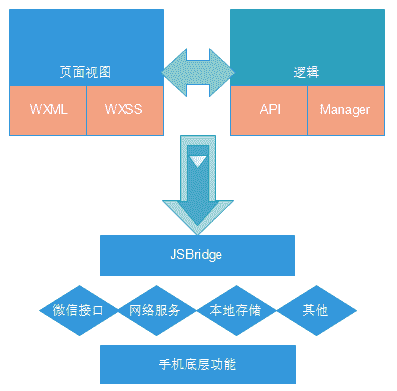

# 第28讲 | 热点剖析（七）：谈谈微信小游戏的成功点

 

在定下这个专栏目录的时候，微信小游戏仅仅出现了唯一一款《跳一跳》。在写下这篇文章的时候，微信小游戏已经在小程序领域占据了绝大部分的江山。大量开发者涌入微信小游戏，为微信生态、为微信小程序的生态增添了无数可能性。作为游戏开发者，免不了要被挤入这场战斗。今天我们就来了解一下微信小程序和小游戏背后的技术，来看看它们成功的背后，有哪些技术上的支持和创新。
 

## 微信小游戏的技术创新

 

最早以前，微信小游戏有 3M 程序大小的限制，而到了现在，这个大小限制已经上升到了 8M，这使得微信小游戏从轻量级的休闲游戏，逐渐往中级、重量级的方向发展。游戏的品质和操作性也有了质的提升。
 

小游戏的体积为什么会有限制呢？因为体积较小的话，我们可以从服务器快速拉取资源数据来开启游戏。现在，微信平台本身已经可以做到 20M 的体积限制，只是微信并不愿意开放地太快，因为开发者有一个循序渐进的过程，微信平台本身的战略规划也有一个循序渐进的过程。
 

我在之前的热点剖析部分，分析过 HTML5 技术发展以及 HTML5 游戏引擎，**其实微信小游戏、小程序，甚至微信本身都是基于 HTML5 技术的，而微信小游戏用的其实就是 HTML5 技术，只是在小游戏中运用的是 Canvas 2D 的 API 和 WebGL 1.0 的 API。**
 

毕竟微信小游戏也属于小程序的范畴，所以我们先来看一下微信小程序。
 

微信小程序用的是基于 WebView 的技术。所谓的 WebView，你可以理解为在手机中内置一款高性能 WebKit 内核的浏览器，然后将这个浏览器核心封装成 SDK，供接口方调用。这个浏览器核心没有地址栏和导航栏，只是单纯的在软件需要的地方展示一个网页界面。
 

微信小程序本身分为页面的视图层和逻辑层。页面的视图层运用的是 WXML 和 WXSS，它们是两种腾讯修改过的 HTML 和 CSS 技术；而逻辑层则分为 Manager 和 API。视图层和逻辑层都呼叫了 JSBridge 技术，更下层则是一些网络服务、离线存储，再下层则是系统层。具体的结构，你可以看我画的这幅图。
 

 

微信小游戏脱胎于微信小程序。小游戏兼顾传统 HTML5 技术和小程序技术，但是小游戏却没有用到 WebView 技术，而是修改了 HTML5 规范的一些接口内容，成为腾讯自己的内容。也就是说，同一款游戏，如果要在微信小游戏和普通网站都能运行，需要编写两套代码。
 

那么你或许就要问了，为什么微信要自己开发一套 Web 体系而不用 Web 本身的标准体系呢，这样不是增加了前端程序员的工作量吗？如果说都是一套 Web 体系的话，大家不就可以皆大欢喜，到这里可以用，移植到那儿也可以用。
 

同样的问题，我们是不是可以这么问，为什么苹果公司要自己研发 iOS 系统，用最早最成熟的塞班系统不是挺好，诺基亚用得也挺不错。为什么谷歌要开发一套 Go 语言，现成的 Java、Python 不也挺好，都挺成熟，为什么一定要开发新的东西，让工程师入坑呢？
 

有很多人说，自己开发一套体系是因为微信下的棋很大，野心很大，你可以这么理解，我们今天从技术本身来看看，事情是什么样的。
 

我们从以下几个方面来看为什么微信要自己定义一套体系。
 
 
1.  

**可以自定义 Web 标准**。为什么要自定义 Web 标准呢？我们从结果来看，自然是为了提升用户体验。而从技术层面讲，这和 Web 兼容性有关。Web 标准本身是个庞大的体系。所以如果既要全部兼容 Web 体系又要按照自己的意愿去实现功能，这是很难做到的事情。比如，如果微信本身的小程序浏览器会重塑一套渲染规则，比如播放视频的时候自动屏蔽广告、按钮默认变成椭圆形等等，因此，自定义 Web 标准，可以去做更多的事情。
  
2.  

**可以自定义开发标准**。微信扔掉了 Web 兼容性以及标准 HTML5 的内容之后，就开始自定义开发标准了，所以微信强制要求开发者按照某种编码规则来编写代码，从而解决了在普通 Web 编程中“如果不用某种规则来编码，就会出现兼容性问题”的难题，这样，就从源头上解决了这个问题。事实上，这也是“强制约束开发者写出素质较高的代码”。
  
3.  

**可以有比 HTML5 更强的功能**。完全兼容标准 HTML5 的话，并非不可能，如果你熟悉前端开发的话，就会知道这个坑会有多大。因为首先 HTML5 不具备很多功能，比如获取手机设备信息、获取手机罗盘、地图定位等等。但如果用自定义的体系，加上从微信作为 App 本身具有的底层获取功能，就完全可以做到了。
  
4.  

**防止刷流量、刷广告**。在防止垃圾 HTML5 页面出现的这件事情上，微信做了大量的工作，比如你应该经常可以看到的，如果出现单纯的 IP 地址的页面，微信就给出提示，询问你是否跳转，或者提示你可以举报诱导分享等等，当然这都不能完全避免垃圾 HTML5 页面出现在微信生态下，所以在小程序自定义规则的情况下，你只能按照定义规则来开发，如果想钻空子，最后小程序和小游戏的上线还有一道人工审核的关卡，所以想要出现垃圾 HTML5 页面的情况几乎是不可能出现的。
  
5.  

**方便后续优化**。由于微信自己那一套体系是高层次抽象层，所以微信小程序团队可以在用户完全没有感知的情况下进行底层优化，而上层不用修改任何代码就可以了。
  
 

所以说，微信小游戏其实是基于 HTM5 技术，并在此之上，充分结合自己的需求和产品特性，添加了自己的创新。
 

## 微信小游戏成功的原因

 

微信小游戏建立在微信本体上，因此微信能获取到的移动端的**底层功能**小游戏基本都能一并获取，比如网络连接、内部存储等等，而 HTML5 做不到这点。微信可以获取底层平台的接口且并不需要授权，因为微信安装上去后已经获取了手机的权限，小游戏想要或者一部分权限是很容易的事情，相比 HTML5 游戏要从浏览器获取权限那就是很麻烦的一件事情。
 

其次，因为微信本身作为**流量入口**，对于小游戏的传播是一个极大的便利，独立开发者或者中小游戏开发公司，如果前期没有推广资源和推广渠道，那么通过微信本身这个巨大的流量入口，就可以获取相比传统 HTML5 游戏更好的效果。
 

除此之外，传统 HTML5 小游戏可以包装成 App 的外壳做成 App 的形式供人下载，因此又多了一个获客途径。到了后期，苹果公司加大了对于 HTML5 应用和游戏包装成 App 这种形式的审核力度，加上网页机制的运行效率限制，HTML5 套壳程序比原生应用的体验感也更差。
 

传统 HTML5 游戏发布之后，如果需要更新，则需要重新上传一次网页代码。如果用户端还需要重新刷新网页，甚至清除浏览器缓存等复杂的操作，如果做成 App 套壳，那就更需要在各个渠道市场上传一遍程序，这在效率上就慢了一截。而微信作为平台本身，更新游戏后，你重新获取只需要上传到微信平台就可以了，获取新游戏，刷新网页缓存，微信一并帮你做了。
 

传统 HTML5 游戏的**广告接入**，是非常麻烦的一件事情，你需要去和广告商去做分成机制、对接广告接口等等。如果是微信小游戏，你只需要对接微信自己的广告渠道就可以，可以说是一键就能对接几种广告机制，广告分成也是透明的、公开的。
 

微信平台本身拥有**打击拷贝游戏**的能力，如果有一款游戏被抄袭了，你可以投诉，如果发现属实，微信就会将抄袭的游戏下架，这样一来，就保护了原创游戏，激发广大开发者创作出更好的游戏，给微信带来更好的游戏生态。当然这里所谓的原创机制，是指的微信小游戏本身生态下的原创，因为作为成熟的游戏生态来讲，已经基本不存在狭义上的“原创”这两个字了。
 

## 小结

 

这节内容差不多了，我们来总结一下。我和你讲了这样几个内容。
 
 
-  

微信小游戏、小程序都是基于 HTML5 技术的，而微信小游戏的技术就是 HTML5 技术，只是在小游戏中运用的框架并不是普通的 HTML5 的框架。
  
-  

微信小程序用的是基于 WebView 的技术；小游戏却没有用到 WebView 技术，而是修改了 HTML5 规范的一些接口内容，成为腾讯自己的内容。
  
-  

微信平台之所以要自定义自己的一套体系，比如 Web 标准、开发标准等等，是因为可以结合微信本身的特性，在此基础上制作出更契合腾讯生态的产品，一句话就是，为了方便自己开发、优化和管理。
  
-  

微信小游戏基于微信的底层获取功能、广告接入优势和打击拷贝的能力，塑造了一个更好的微信小程序生态。
  
 

## 延伸阅读

 

>  
> 腾讯微信高级工程师、后端高级工程师·邹伟，从技术层面分析，利用微信的开放能力[《如何开发一款小游戏》](http://www.infoq.com/cn/presentations/how-to-develop-a-hot-game?utm_source=presentations_about_game_development&utm_medium=link&utm_campaign=game_development)。
 

 

>  
> 腾讯游戏云资深架构师余国良的演讲[《](http://www.infoq.com/cn/presentations/architecture-design-and-development-of-wechat-games?useSponsorshipSuggestions=true&utm_source=presentations_about_architecture-design&utm_medium=link&utm_campaign=architecture-design)[微信小游戏的架构设计与开发](http://www.infoq.com/cn/presentations/architecture-design-and-development-of-wechat-games?useSponsorshipSuggestions=true&utm_source=presentations_about_architecture-design&utm_medium=link&utm_campaign=architecture-design)[》](http://www.infoq.com/cn/presentations/architecture-design-and-development-of-wechat-games?useSponsorshipSuggestions=true&utm_source=presentations_about_architecture-design&utm_medium=link&utm_campaign=architecture-design)。
 

 

>  
> Layabox 合伙人李明，从应用角度讲述[《LayaAir 引擎一键发布微信小游戏的技术分享》](http://www.infoq.com/cn/presentations/technology-sharing-of-one-key-to-release-wechat-games-by-layaair-engine?utm_source=presentations_about_game_development&utm_medium=link&utm_campaign=game_development)。
 

 

希望这些分享对你有帮助。最后，给你留一个小问题吧。
 

迄今为止，你最喜欢玩的一款微信小游戏是什么？它吸引你的点是什么？
 

欢迎留言说出你的看法。我在下一节的挑战中等你！
 

