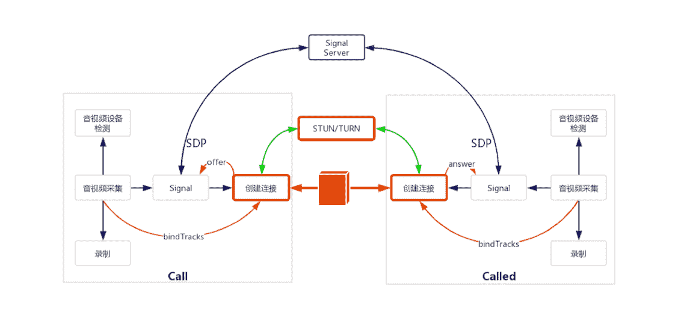
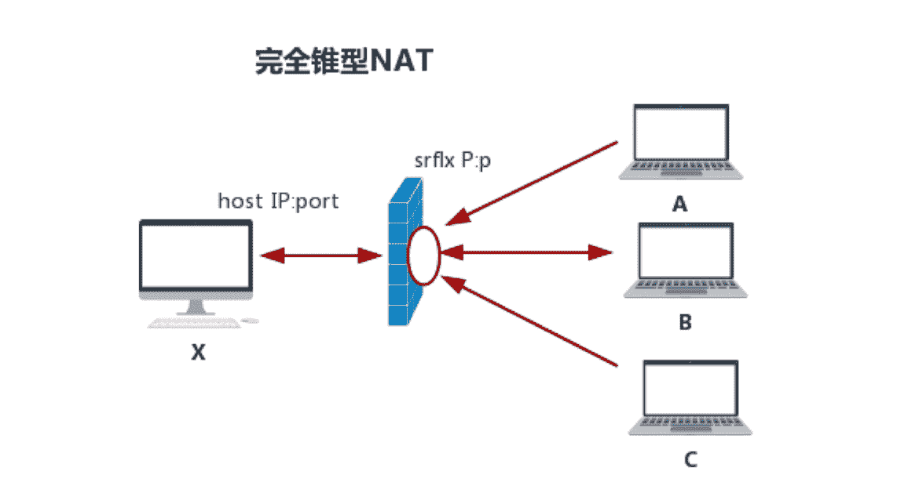
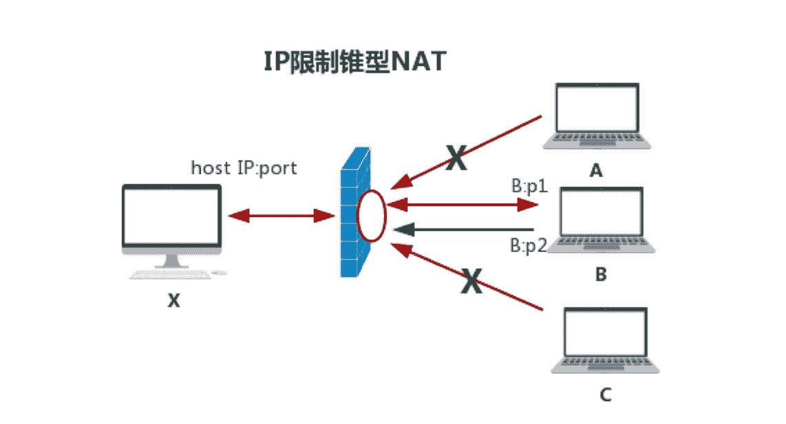
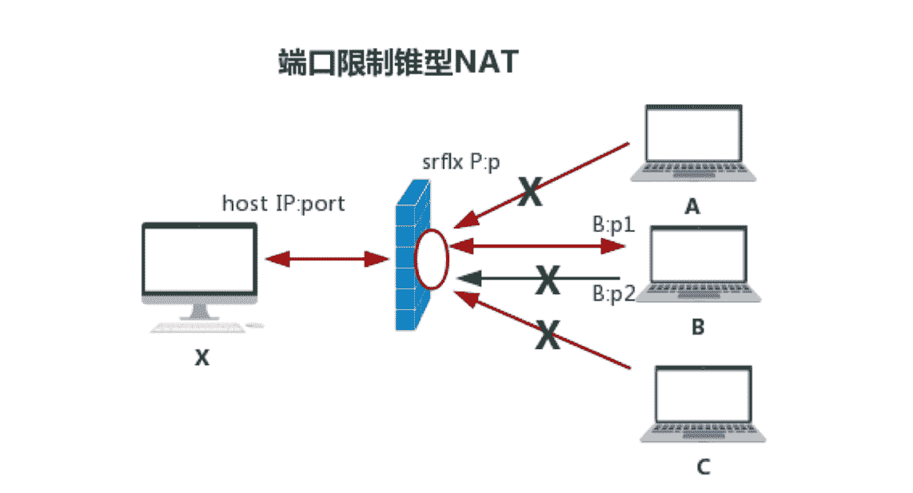
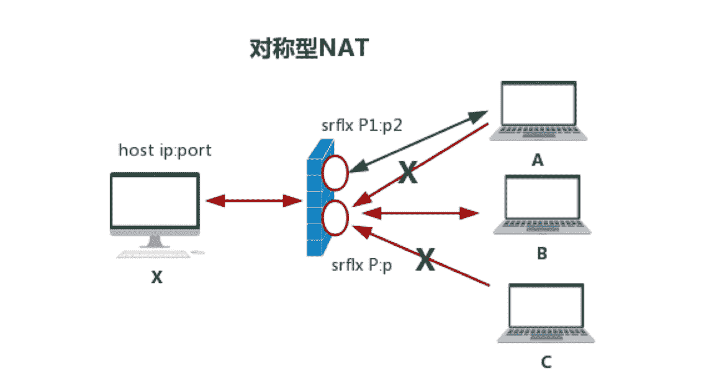
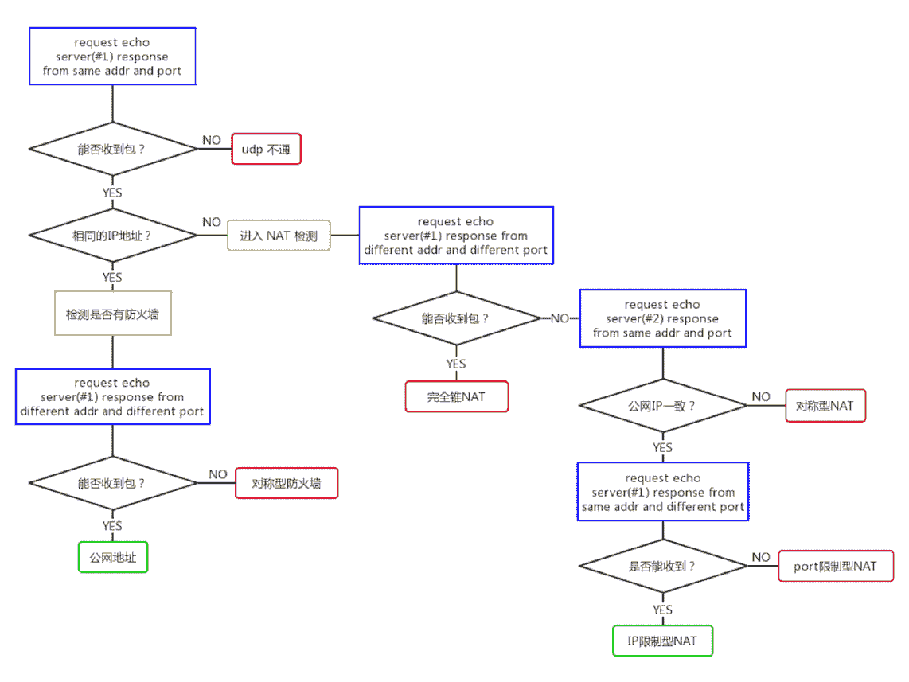

# 10 | WebRTC NAT穿越原理

 

在 WebRTC 中， NAT 穿越是非常重要的一部分内容，也是比较有深度、比较难以理解的一部分知识。当然，等你学完本文，并完全理解了这部分知识后，你也会特别有成就感！

在我们真实的网络环境中，NAT 随处可见，而它的出现主要是出于两个目的。**第一个是解决 IPv4 地址不够用的问题**。在 IPv6 短期内无法替换 IPv4 的情况下，如何能解决 IP 地址不够的问题呢？人们想到的办法是，让多台主机共用一个公网 IP 地址，然后在内部使用内网 IP 进行通信，这种方式大大减缓了 IPv4 地址不够用的问题。**第二个是解决安全问题**，也就是主机隐藏在内网，外面有 NAT 挡着，这样的话黑客就很难获取到该主机在公网的 IP 地址和端口，从而达到防护的作用。

不过凡事有利也有弊，NAT 的引入确实带来了好处，但同时也带来了坏处。如果没有 NAT，那么每台主机都可以有一个自己的公网 IP 地址，这样每台主机之间都可以相互连接。可以想象一下，如果是那种情况的话，互联网是不是会更加繁荣？因为有了公网 IP 地址后，大大降低了端与端之间网络连接的复杂度，我们也不用再费这么大力气在这里讲 NAT 穿越的原理了。

如果从哲学的角度来讲，“世上的麻烦都是自己找的”，这句话还是蛮有道理的。

## 在 WebRTC 处理过程中的位置

下面我们来看一下本文在 WebRTC 处理过程中所处的位置吧。通过下面这张图，你可以清楚地了解到本文我们主要讲解的是传输相关的内容。



WebRTC 处理过程图

## NAT 的种类

随着人们对 NAT 使用的深入，NAT 的设置也越来越复杂。尤其是各种安全的需要，对 NAT 的复杂性起到了推波助澜的作用。

经过大量研究，现在 NAT 基本上可以总结成 4 种类型：**完全锥型、IP 限制锥型、端口限制锥型和对称型**。

下面我们就对这 4 种类型的 NAT 做下详细介绍。

### 1. 完全锥型 NAT



完全锥型 NAT 图

完全锥型 NAT 的特点是，当 host 主机通过 NAT 访问外网的 B 主机时，就会在 NAT 上打个“洞”，所有知道这个“洞”的主机都可以通过它与内网主机上的侦听程序通信。

实际上，这里**所谓的“打洞”就是在 NAT 上建立一个内外网的映射表**。你可以将该映射表简单地认为是一个 4 元组，即：

```
{	内网 IP，	内网端口，	映射的外网 IP，	映射的外网端口}
```

在 NAT 上有了这张映射表，所有发向这个“洞”的数据都会被 NAT 中转到内网的 host 主机。而在 host 主机上侦听其内网端口的应用程序就可以收到所有的数据了，是不是很神奇？

还是以上面那张图为例，如果 host 主机与 B 主机“打洞”成功，且 A 与 C 从 B 主机那里获得了 host 主机的外网 IP 及端口，那么 A 与 C 就可以向该 IP 和端口发数据，而 host 主机上侦听对应端口的应用程序就能收到它们发送的数据。

如果你在网上查找 NAT 穿越的相关资料，一定会发现大多数打洞都是使用的 UDP 协议。之所以会这样，是因为**UDP 是无连接协议**，它没有连接状态的判断，也就是说只要你发送数据给它，它就能收到。而 TCP 协议就做不到这一点，它必须建立连接后，才能收发数据，因此大多数人都选用 UDP 作为打洞协议。

### 2. IP 限制锥型 NAT



IP 限制锥型 NAT 图

IP 限制锥型要比完全锥型 NAT 严格得多，它主要的特点是，host 主机在 NAT 上“打洞”后，NAT 会对穿越洞口的 IP 地址做限制。只有登记的 IP 地址才可以通过，也就是说，**只有 host 主机访问过的外网主机才能穿越 NAT**。

而其他主机即使知道“洞”的位置，也不能与 host 主机通信，因为在通过 NAT 时，NAT 会检查 IP 地址，如果发现发来数据的 IP 地址没有登记，则直接将该数据包丢弃。

所以，IP 限制锥型 NAT 的映射表是一个 5 元组，即：

```
{	内网 IP，	内网端口，	映射的外网 IP，	映射的外网端口，	被访问主机的 IP}
```

还是以上图为例，host 主机访问 B 主机，那么只有 B 主机发送的数据才能穿越 NAT，其他主机 A 和 C 即使从 B 主机那里获得了 host 主机的外网 IP 和端口，也无法穿越 NAT。因为 NAT 会对通过的每个包做检测，当检查发现发送者的 IP 地址与映射表中的“被访问主机的 IP”不一致，则直接将该数据包丢弃。

需要注意的是，**IP 限制型 NAT 只限制 IP 地址**，如果是同一主机的不同端口穿越 NAT 是没有任何问题的。

### 3. 端口限制锥型



端口限制锥型 NAT 图

端口限制锥型比 IP 限制锥型 NAT 更加严格，它主要的特点是，不光在 NAT 上对打洞的 IP 地址做了限制，而且还对具体的端口做了限制。因此，端口限制型 NAT 的映射表是一个 6 元组，其格式如下：

```
{	内网 IP，	内网端口，	映射的外网 IP，	映射的外网端口，	被访问主机的 IP,	被访问主机的端口}
```

在该 6 元组中，不光包括了 host 主机内外网的映射关系，还包括了**要访问的主机的 IP 地址及提供服务的应用程序的端口地址**。

如上图所示，host 主机访问 B 主机的 p1 端口时，只有 B 主机的 p1 端口发送的消息才能穿越 NAT 与 host 主机通信。而其他主机，甚至 B 主机的 p2 端口都无法穿越 NAT。

从上面的情况你应该看出来了，从完全锥型 NAT 到端口限制型 NAT，一级比一级严格。但其实端口型 NAT 还不是最严格的，最严格的是接下来要讲解的对称型 NAT。

### 4. 对称型 NAT



对称型 NAT 图

**对称型 NAT 是所有 NAT 类型中最严格的一种类型**。通过上图你可以看到，host 主机访问 B 时它在 NAT 上打了一个“洞”，而这个“洞”只有 B 主机上提供服务的端口发送的数据才能穿越，这一点与端口限制型 NAT 是一致的。

但它与端口限制型 NAT 最大的不同在于，如果 host 主机访问 A 时，它会在 NAT 上重新开一个“洞”，而不会使用之前访问 B 时打开的“洞”。也就是说对称型 NAT 对每个连接都使用不同的端口，甚至更换 IP 地址，而端口限制型 NAT 的多个连接则使用同一个端口，这对称型 NAT 与端口限制型 NAT 最大的不同。上面的描述有点抽象，你要好好理解一下。

它的这种特性为 NAT 穿越造成了很多麻烦，尤其是对称型 NAT 碰到对称型 NAT，或对称型 NAT 遇到端口限制型 NAT 时，基本上双方是无法穿越成功的。

以上就是 NAT 的 4 种类型，通过对这 4 种 NAT 类型的了解，你就很容易理解 NAT 该如何穿越了。

## NAT 类型检测

通过上面的介绍，相信你会很容易判断出 NAT 是哪种类型，但对于每一台主机来说，它怎么知道自己是哪种 NAT 类型呢？



NAT 类型检测图

上面这张图清楚地表达了主机进行 NAT 类型检测的流程。其中蓝框是几个重要的检测点，通过这几个检测点你就可以很容易地检测出上面介绍的 4 种不同类型的 NAT 了。

接下来，我们就对上面这张图做下详细的解释。**这里需要注意的是，每台服务器都是双网卡的，而每个网卡都有一个自己的公网 IP 地址**。

### 第一步，判断是否有 NAT 防护

 
1. 主机向服务器 #1 的某个 IP 和端口发送一个请求，服务器 #1 收到请求后，会通过同样的 IP 和端口返回一个响应消息。 
2. 如果主机收不到服务器 #1 返回的消息，则说明用户的网络**限制了 UDP 协议，直接退出**。 
3. 如果能收到包，则判断返回的主机的外网 IP 地址是否与主机自身的 IP 地址一样。如果一样，说明主机就是一台**拥有公网地址的主机**；如果不一样，就跳到下面的步骤 6。 
4. 如果主机拥有公网 IP，则还需要进一步判断其防火墙类型。所以它会再向服务器 #1 发一次请求，此时，服务器 #1 从另外一个网卡的 IP 和不同端口返回响应消息。 
5. 如果主机能收到，说明它是一台没有防护的公网主机；如果收不到，则说明有**对称型的防火墙**保护着它。 
6. 继续分析第 3 步，如果返回的外网 IP 地址与主机自身 IP 不一致，说明主机是处于 NAT 的防护之下，此时就需要对主机的 NAT 防护类型做进一步探测。 

### 第二步，探测 NAT 环境

 
1. 在 NAT 环境下，主机向服务器 #1 发请求，服务器 #1 通过另一个网卡的 IP 和不同端口给主机返回响应消息。 
2. 如果此时主机可以收到响应消息，说明它是在一个**完全锥型 NAT**之下。如果收不到消息还需要再做进一步判断。 
3. 如果主机收不到消息，它向服务器 #2（也就是第二台服务器）发请求，服务器 #2 使用收到请求的 IP 地址和端口向主机返回消息。 
4. 主机收到消息后，判断从服务器 #2 获取的外网 IP 和端口与之前从服务器 #1 获取的外网 IP 和端口是否一致，如果不一致说明该主机是在**对称型 NAT**之下。 
5. 如果 IP 地址一样，则需要再次发送请求。此时主机向服务器 #1 再次发送请求，服务器 #1 使用同样的 IP 和不同的端口返回响应消息。 
6. 此时，如果主机可以收到响应消息说明是**IP 限制型 NAT**，否则就为**端口限制型 NAT**。 

至此，主机所在的 NAT 类型就被准确地判断出来了。有了主机的 NAT 类型你就很容易判断两个主机之间到底能不能成功地进行 NAT 穿越了。

再后面的事件就变得比较容易了，当你知道了 NAT 类型后，如何进行 NAT 穿越也就水到渠成了呢！

## 小结

通过上面的介绍，我想你应该已经对 NAT 的 4 种类型了然于胸了。理解了 NAT 的 4 种类型，同时又清楚了主机如何去判断自己的 NAT 类型之后，你应该自己就可以想清楚不同 NAT 类型之间是如何进行 NAT 穿越的了。

了解了 NAT 穿越的理论知识，你就很容易理解 WebRTC 底层是如何进行音视频数据传输了吧？WebRTC 中媒体协商完成之后，就会对 Candidate pair 进行连通性检测，其中非常重要的一项工作就是进行 NAT 穿越。

它首先通过上面描述的方法进行 NAT 类型检测，当检测到双方理论上是可以通过 NAT 穿越时，就开始真正的 NAT 穿越工作，如果最终真的穿越成功了，通信双方就通过该连接将音视频数据源源不断地发送给对方。最终，你就可以看到音视频了。

## 思考时间

为什么对称型 NAT 与对称型 NAT 之间以及对称型 NAT 与端口限制型 NAT 之间无法打洞成功呢？如果打洞失败，你又该如何让通信双方实现互联呢？

欢迎在留言区与我分享你的想法，也欢迎你在留言区记录你的思考过程。感谢阅读，如果你觉得这篇文章对你有帮助的话，也欢迎把它分享给更多的朋友。


