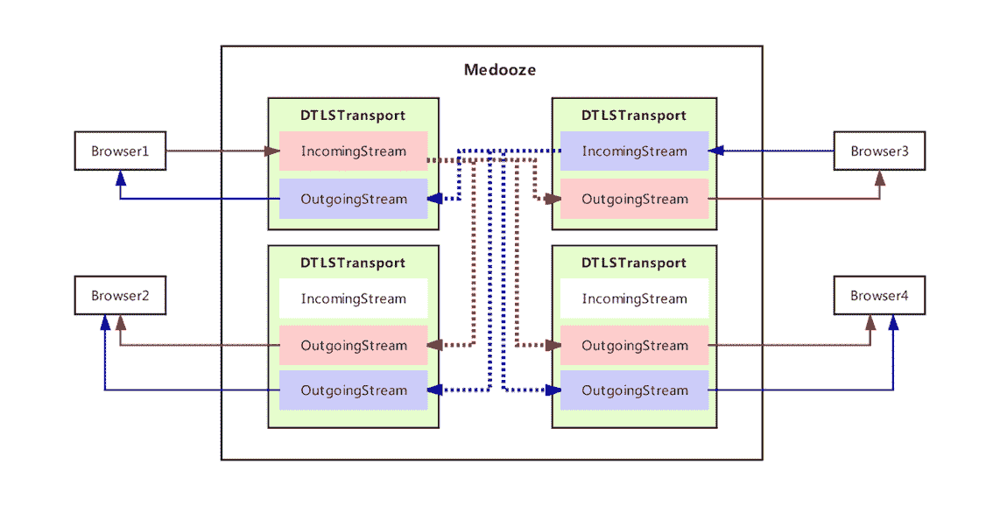
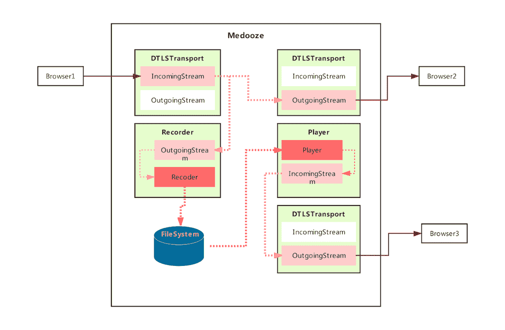
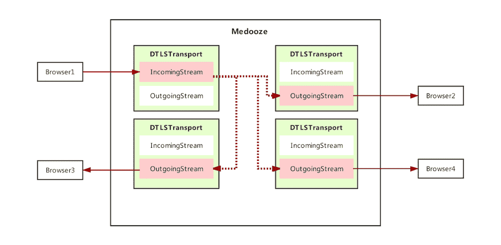
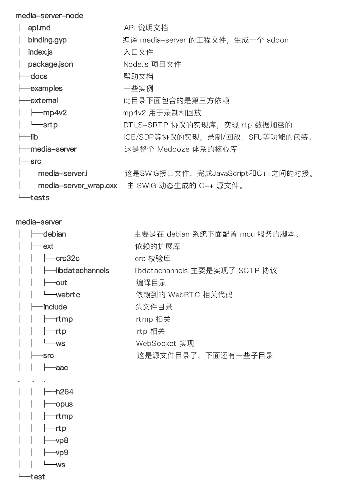
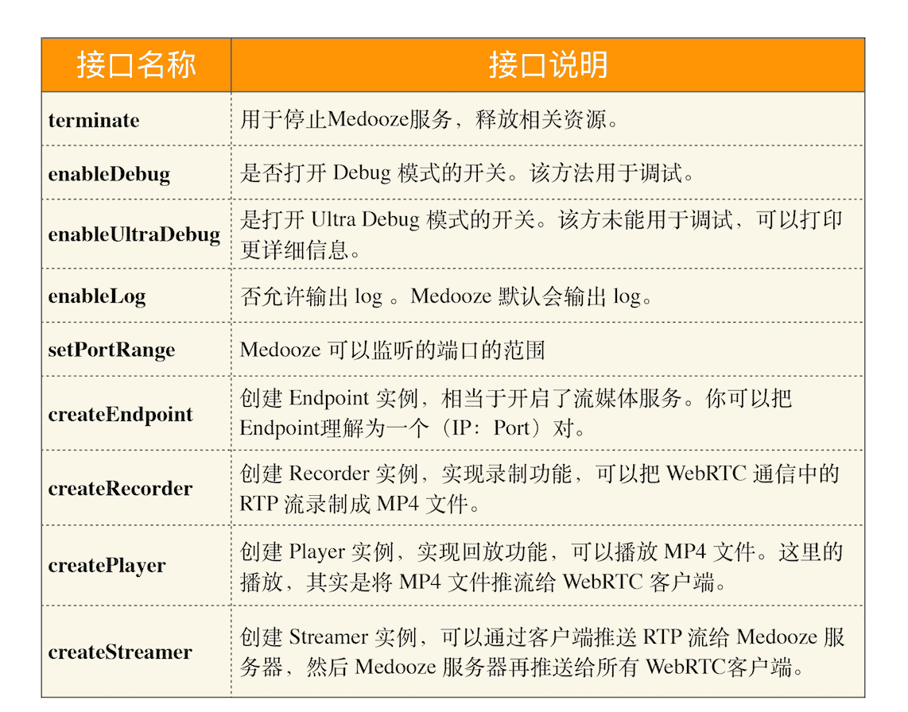
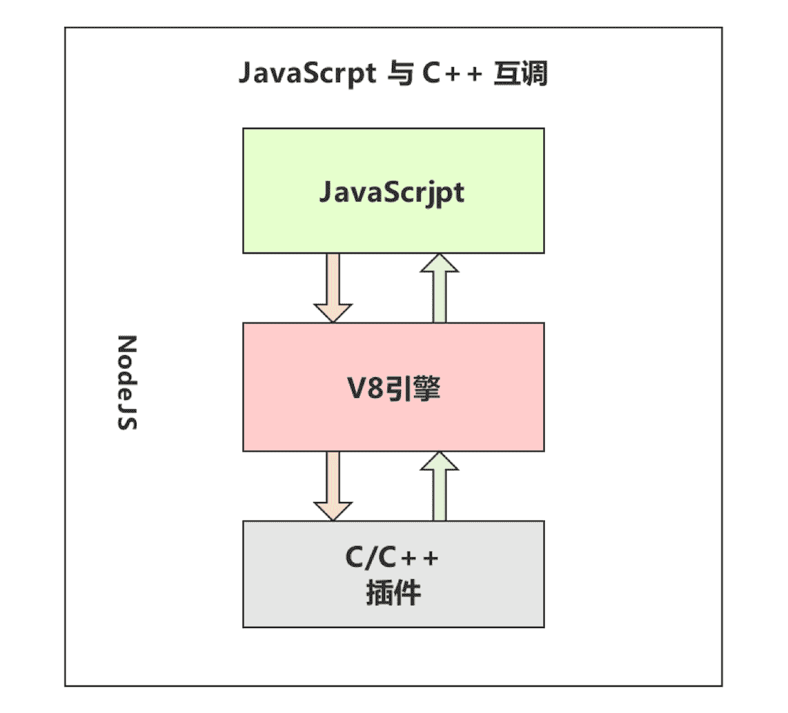
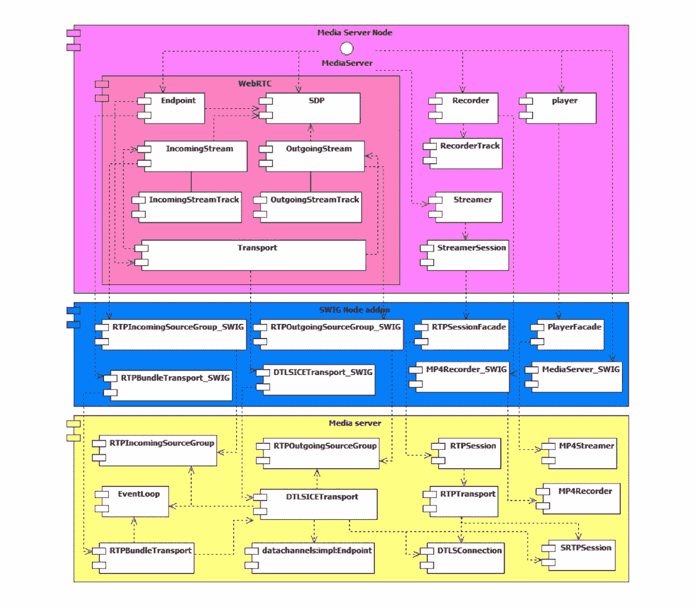
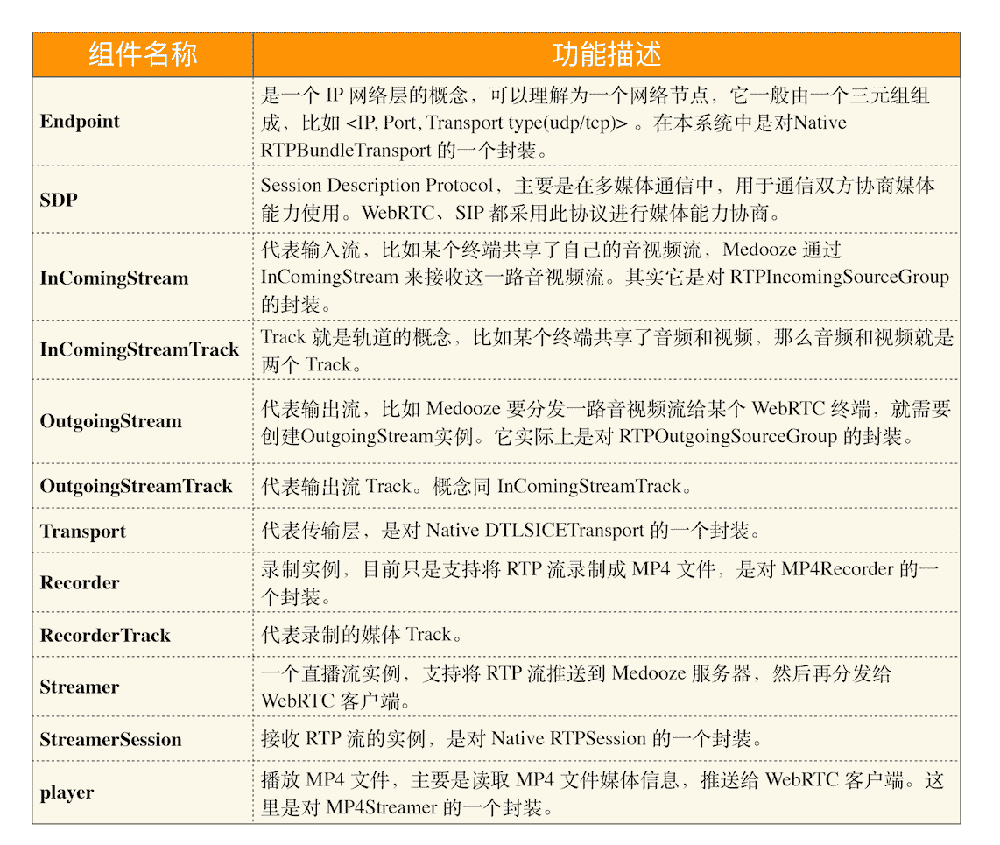
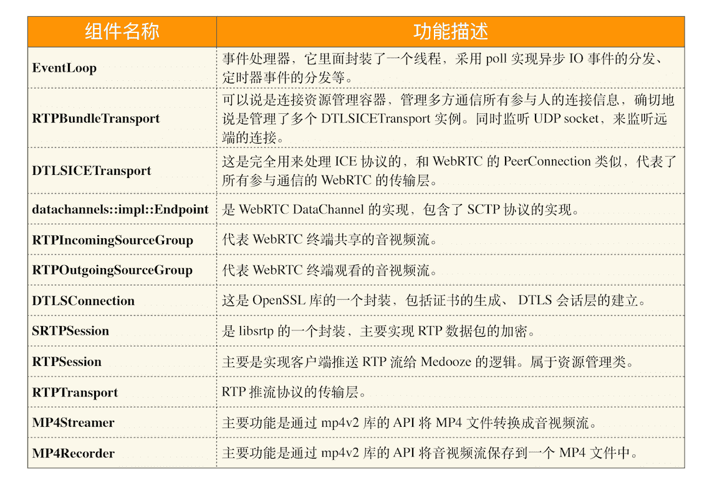

# 27 | 让我们一起探索Medooze的具体实现吧（上）

 

在咱们专栏的第一模块，我向你介绍了如何使用 WebRTC 进行实现音视频互动。随着 Google 对 WebRTC 的大力推广，目前主流的浏览器都支持了 WebRTC。WebRTC 最主要的功能就是提供端对端的音视频通信，其可以借助 STUN/TURN 服务器完成 NAT 穿越，实现两个端点之间的直接通信。

1 对 1 的实时通信无疑是 WebRTC 最主要的应用场景，但你是否想过 WebRTC 可以通过浏览器实现多人音视频会议呢？更进一步，你是否想过 WebRTC 可以实现一些直播平台中上万人甚至几十万人同时在线的场景呢？

如果你对上面的问题感兴趣，那本文将让你对上面问题有个全面的了解，接下来就让我们一起开启本次神秘之旅吧！

## 流媒体服务器 Medooze

正如我们在[《25 | 那些常见的流媒体服务器，你该选择谁？》](https://time.geekbang.org/column/article/134284)一文中介绍的，要实现多个浏览器之间的实时音视频通信（比如音视频会议），那么就一定需要一个支持 WebRTC 协议的流媒体服务器。目前，有很多开源的项目支持 WebRTC 协议， Medooze 就是其中之一。

Medooze 的功能十分强大，通过它你既可以实现 SFU 类型的流媒体服务器，也可以实现 MCU 类型的流媒体服务器。而且，它还支持多种媒体流接入，也就是说，你除了可以通过浏览器（WebRTC）向 Medooze 分享音视频流之外，还可以使用 FFmpeg/VLC 等工具将 RTMP 协议的音视频流推送给 Meoodze。更加神奇的是，无论是 WebRTC 分享的音视频流还是 RTMP 格式的音视频流通过 Medooze 转发后，浏览器就可以将 FFmpeg/VLC 推的流显示出来，而 VLC 也可以将 WebRTC 分享的音视频显示出来，这就是 Medooze 的强大之处。

接下来，我们将从 Medooze 的 SFU 模型、录制回放模型和推流模型这三个方面向你全面、详细地介绍 Medooze。

### 1. Medooze 的 SFU 模型

SFU 模型的概念我们已经在[《24 | 多人音视频实时通讯是怎样的架构？》](https://time.geekbang.org/column/article/132863)一文中做过介绍了，这里就不再赘述了！下面这张图是 Medooze 实现 SFU 服务器的大体结构图：



Medooze SFU 模型结构图

图的最外层标有 Browser 的模块表示浏览器，在本图中就是表示基于浏览器的 WebRTC 终端。

图的中间标有 Medooze 的模块是服务器，实现了 SFU 功能。其中 DTLSICETransport 既是传输层（控制 socket 收发包），也是一个容器，在该容器中可以放 IncomingStream 和 OutgoingStream。

 
- IncomingStream，代表某客户端共享的音视频流。 
- OutgoingStream，代表某个客户端需要观看的音视频流。 

你也可以把它们直接当作是两个队列，IncomingStream 是输入队列，OutgoingStream 是输出队列。

有了上面这些概念，那我们来看看在 Medooze 中从一端进来的音视频流是怎么中转给其他人的。

 
- 首先，Browser 1 推送音视频流给 Medooze，Medooze 通过 DTLSICETransport 接收音视频数据包，然后将它们输送到 IncomingStream 中。 
- 然后，Medooze 再将此流分发给 Browser 2、Browser 3、Browser 4 的 OutgoingStream。 
- 最后，Medooze 将 OutgoingStream 中的音视频流通过 DTLSICETransport 传输给浏览器客户端，这样 Browser 2、Browser 3、Browser 4 就都能看到 Browser 1 共享的音视频流了。 

同理，Browser 3 推送的音视频流也是按照上面的步骤操作，最终分发到其他端，其他端也就看 / 听到 Browser 3 的音视频了。

通过以上步骤就实现了多人之间的音视频互动。

### 2. 录制回放模型

下图是 Medooze 的录制回放模型：



录制回放模型

这张图是一个典型的音视频会议中服务器端录制的模型。下面我们就来看看它运转的过程：

 
- Browser 1 推送音视频流到 Medooze，Medooze 使用 IncomingStream 代表这一路流。 
- Medooze 将 IncomingStream 流分发给参会人 Browser 2 的 OutgoingStream，并同时将流分发给 Recorder。 
- Recorder 是一个录制模块，将实时 RTP 流转换成 MP4 格式，并保存到磁盘。 

通过以上步骤，Medooze 就完成了会议中实时录制的功能。

如果，用户想回看录制好的多媒体文件，那么只需要按以下步骤操作即可：

 
- 首先，告诉 Medooze 的 Player 模块，之前录制好的 MP4 文件存放在哪个路径下。 
- 接着，Player 从磁盘读取 MP4 文件，并转换成 RTP 流推送给 IncomingStream。 
- 然后，Medooze 从 IncomingStream 获取 RTP 流， 并分发给 Browser 3 的 OutgoingStream。 
- 最后，再经过 DTLSICETransport 模块传给浏览器。 

这样就可以看到之前录制好的音视频了。

### 3. 推流模型

下面是 Medooze 的推流模型：



推流模型

通过前面的讲解，再理解这个模型就非常简单了。下面让我们来看一下推流的场景吧：

 
- 首先，用 VLC 播放器推送一路 RTP 流到 Medooze。 
- 然后，Medooze 将此流分发给 Browser 2、Browser 3、Browser 4。 

没错，Medooze 推流的场景就是这么简单，只需要通过 FFMPEG/VLC 向 Medooze 的某个房间推一路 RTP 流，这样加入到该房间的其他用户就可以看到推送的这路音视频流了。

学习了上面的知识后，你是不是对 Medooze 的基本功能以及运行流程已经了然于胸了呢？现在是不是迫切地想知道 Medooze 内部是如何实现这些功能的？那么下面我们就来分析一下 Medooze 的架构。

## Medooze 架构分析

由于 Medooze 是一个复杂的流媒体系统，所以在它的开源目录下面有很多子项目来支撑这个系统。其中一个核心项目是 media-server，它是 C++ 语言实现的，主要是以 API 的形式提供诸多流媒体功能，比如 RTMP 流、RTP 流、录制、回放、WebRTC 的支持等。另外一个项目是 media-server-node，此项目是 Node.js 实现的，将 media-server 提供的 C++ API 包装成 JavaScript 接口，以利于通过 Node.js 进行服务器业务控制逻辑的快速开发。

接下来，我们就以 media-server-node 作为切入点，对此服务展开分析。

### 1. 源码目录结构

media-server-node 是基于 Node.js 的一个项目，在实际开发过程中，只需要执行下面的命令就可以将 media-server-node 编译安装到你的系统上。

```
npm install media-server-node --save
```

这里我们对 media-server-node 源码目录结构做一个简要的说明，一方面是给你一个大概的介绍，另一方面也做一个铺垫，便于我们后续的分析。



通过对上面源码目录结构的分析，你可以看出它的结构还是蛮清晰的，当你要分析每一块的具体内容时，直接到相应的目录下查看具体实现就好了。

目录结构介绍完后，我们再来看看 Medooze 暴露的几个简单接口吧！

### 2. 对外接口介绍

media-server-node 采用了 JavaScript ES6 的语法，各个模块都是导出的，所以每一个模块都可以供应用层调用。这里主要讲解一下 MediaServer 模块暴露的接口：



如果你对 JavaScript 非常精通的话，你可能会觉得这几个接口实在太简单了，但 Medooze 设计这些接口的理念就是尽量简单，这也符合我们定义接口的原则。对于这些接口的使用我们会在后面的文章中做讲解，现在你只需要知道这几个接口的作用是什么就好了。

### 3. Medooze 结构

讲到 Medooze 结构，也许稍微有点儿抽象、枯燥，不是那么有意思，不过只要你多一点点耐心按照我的思路走，一定可以将其理解的。

在正式讲解 Medooze 结构之前，我们还需要介绍一个知识点：在 Node.js 中，JavaScript 与 C++ 是如何相互调用的呢？知道其原理对你理解 Medooze 的运行机制有非常大的帮助，所以这里我做一些简单的介绍。JavaScript 与 C++ 调用关系图如下：



JavaScript 与 C++ 调用关系图

我们都知道 Node.js 解析 JavaScript 脚本使用的是 Google V8 引擎，实际上 V8 引擎就是连接 JavaScript 与 C/C++ 的一个纽带，你也可以把它理解为一个代理。

在 Node.js 中，我们可以根据自己的需要，按 V8 引擎的规范为它增加 C/C++ 模块，这样 Node.js 就可以将我们写好的 C++ 模块注册到 V8 引擎中了。注册成功之后，V8 引擎就知道我们这个模块都提供了哪些服务（API）。

此时，JavaScript 就可以通过 V8 引擎调用 C/C++ 编写的接口了。接口执行完后，再将执行的结果返回给 JavaScript。以上就是 JavaScript 与 C/C++ 相互调用的基本原理。

了解了上面的原理后，咱们言归正传，还是回到我们上面讲的 Medooze 整体结构这块知识上来。从大的方面讲， Medooze 结构可以分为三大部分，分别是:

 
- **media server node**，主要是 ICE 协议层的实现，以及对 Media server Native API 的封装。 
- **SWIG node addon**，主要是实现了 Node.js JavaScript 和 C++ Native 之间的融合，即可以让 JavaScript 直接调用 C/C++ 实现的接口。 
- **media server**，是 Medooze 流媒体服务器代码的实现，比如 WebRTC 协议栈、网络传输、编解码的实现等，都是在该模块实现的。 

让我们看一下 Medooze 整体结构中三个核心组件的作用，以及它们之间的相互依赖关系。如下图所示：



组件关系图

从这张图我们可以知道，Medooze 的整体结构也是蛮复杂的，但若仔细观察，其实也不是很难理解。下面我们就来详细描述一下这张图吧！

 
- 图中标有 WebRTC 的组件实现了 WebRTC 协议栈，它是用于实现多方音视频会议的。 
- Recorder 相关的组件是实现录制的，这里录制格式是 MP4 格式。 
- Player 相关组件是实现录制回放的，可以将 MP4 文件推送到各个浏览器，当然是通过 WebRTC 协议了。 
- Streamer 相关组件是接收 RTP 流的，你可以通过 VLC 客户端推送 RTP 流给 Medooze，Medooze 然后再推送给各个浏览器。 

接下来，针对这些组件我们再做一个简要说明，不过这里我们就只介绍 Media server node 和 Media server 两大组件。由于 SWIG node addon 是一个 C++ Wrapper，主要用于 C/C++ 与 JavaScript 脚本接口之间的转换，所以这里就不对它进行说明了。

需要注意的是，上图中的每一个组件基本是一个 Node.js 模块或者是一个 C++ 类，也有极个别组件是代表了几个类或者模块，比如 SDP 其实是代表整个 SDP 协议的实现模块。

**Media server node 组件**中每个模块的说明如下：



了解了 Media server node 组件中的模块后，接下来我们再来看看 **Media server 组件**中每个模块的作用，说明如下：



## 什么是 SWIG

SWIG（Simplified Wrapper and Interface Generator ），是一个将 C/C++ 接口转换成其他脚本语言（如 JavaScript、Ruby、Perl、Tcl 和 Python）的接口转换器，可以将你想暴露的 C/C++ API 描述在一个后缀是 *.i 的文件里面，然后通过 SWIG 编译器就可以生成对应脚本语言的 Wrapper 程序了，这样对应的脚本语言（如 JavaScript）就可以直接调用 Wrapper 中的 API 了。

生成的代码可以在脚本语言的解释器平台上执行，从而实现了脚本语言调用 C/C++ 程序 API 的目的。SWIG 只是代码生成工具，它不需要依赖任何平台和库。

至于更详细的信息，你可以到 SWIG 的官网查看，地址在这里：[http://www.swig.org/](http://www.swig.org/) 。

## 小结

本文讲解了 Medooze 的 SFU 模型、录制回放模型、推流模型等内容，并且介绍了 Medooze 的整体结构和核心组件的功能等。通过以上内容的讲解，你应该对 WebRTC 服务器有一个初步认知了。

除此之外，文章中也提到了 WebRTC 流媒体服务器的传输需要基于 DTLS-SRTP 协议以及 ICE 等相关识。这些知识在后面的文章中我们还会做更详细的介绍。

## 思考时间

通过上面的描述，你可以看到 Medooze 是作为一个模块加入到 Node.js 中来提供流媒体服务器能力的，那么这种方式会不会因为 Node.js 的性能而影响到 Medooze 流媒体服务的性能呢？

欢迎在留言区与我分享你的想法，也欢迎你在留言区记录你的思考过程。感谢阅读，如果你觉得这篇文章对你有帮助的话，也欢迎把它分享给更多的朋友。


