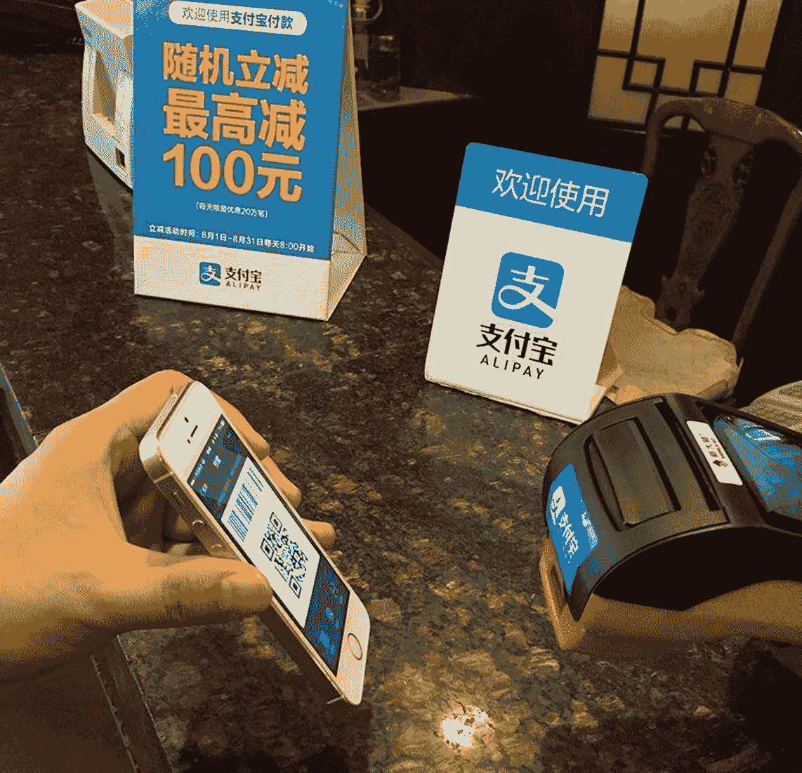
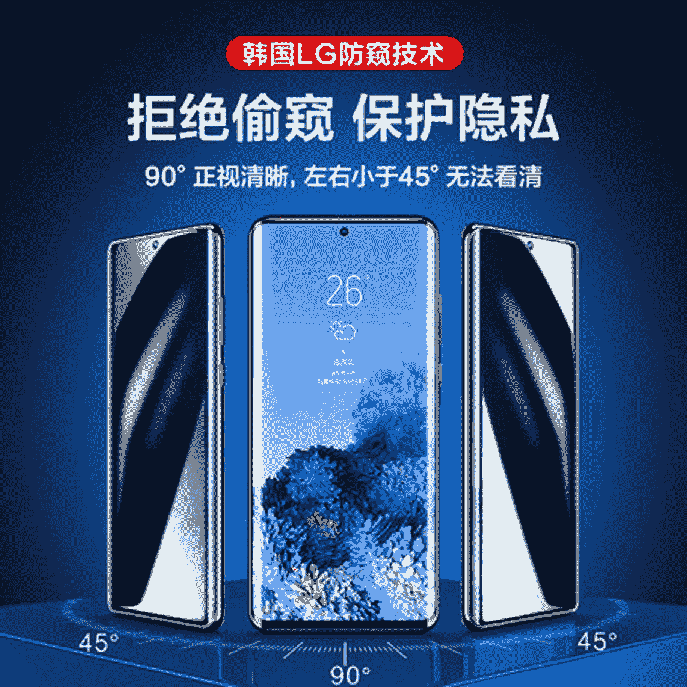
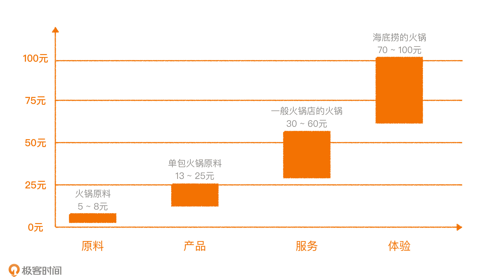
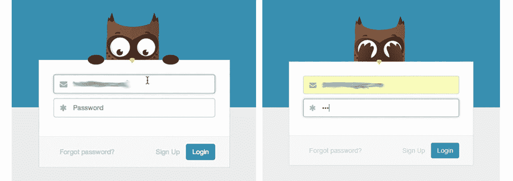
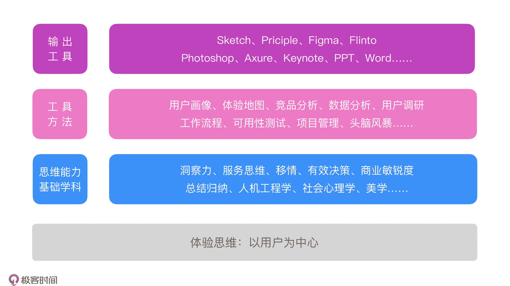
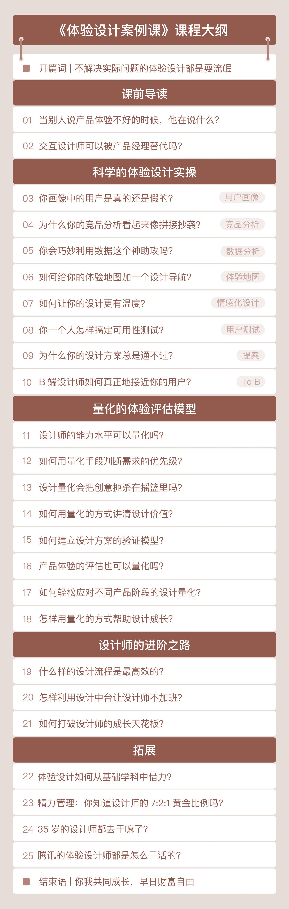
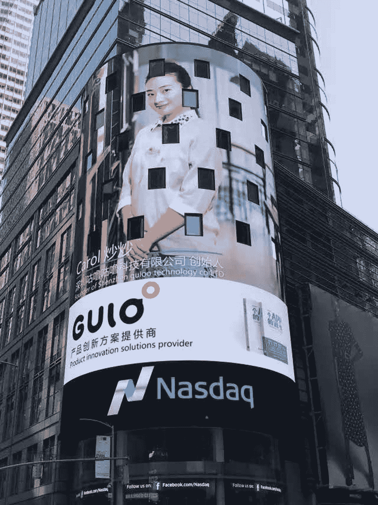

# 开篇词 | 不解决实际问题的体验设计都是耍流氓

 

你好，我是炒炒。

现在，你可能还不认识我，但我还是很高兴你能点进来，来了解用户体验设计这门课。在课程开始之前，我想先让你思考这样一个问题，到底什么是用户体验设计？为了让你更好理解，我来给你举几个例子。

有一年，我在英国的一家保健品店购买保健品。到了该付钱的时候，我发现收银台上有个小指示牌，上面写着“支付宝支付随机减钱”，我就打开手机，准备用支付宝支付。

但是，我发现我的手机突然没有网络信号了，就当我思考怎么办时，店员告诉我，只要出示支付宝付款码就可以，在无网络的情况下，也可以进行支付。我马上打开支付宝，进行了订单支付。

你看，这是不是一种很好的用户体验？

与这个例子形成鲜明对比的，就是共享充电宝的体验设计。如今共享充电宝满大街都是，你随便去一个大商场、火车站、餐饮店，都可以快速地找到一个充电宝充电。是不是感觉还挺方便的？

但是，如果你的手机要是一点电量都没有，直接关机，你是很难靠扫描二维码租到一个共享充电宝的。这一点，共享充电宝真就被人吐槽过，其实只要在每个出租机旁边预留一根多头充电线就可以，既可以帮到有需要的用户，还能帮助提升产品的美誉度。

共享充电宝就是一个没有考虑到一部分极端情况的体验的例子。

还有，在地铁上，我们经常只要眼睛一瞥，就可以看到隔壁陌生人在手机上在干啥，能看见他们跟人聊天、看股票，还有刷电视的，甚至，有时候还会看到令双方都很尴尬的情侣吵架信息。

于是，就有人发明了一种隐私手机贴膜，只要我们把这个膜贴到手机屏幕上，就只有我们的正视视角才能清晰地看见屏幕内容。周围的人，再伸长脖子，也看不见。

你看，一个小小的手机膜就解决了一个用户体验的问题。

所以，什么是用户体验设计？**就是发现用户的一个问题，然后去想办法、想方案，去解决它，解决这个问题的路径就是体验设计。**

## 体验设计的价值

在现在这个社会，我们无法预知科技会进步到什么程度，但如果只追求表面上的多功能和高性能，恐怕无法获得可持续的竞争力，因为用户追求的是使用这个产品时的综合体验。

比如说餐饮，过去我们只要求吃饱，所以对商家的要求就是量要大、价格要低。现在时代不一样了，要求不仅仅是吃饱了，我们还想吃好、吃爽，最好还能吃出点意境来。

火锅界的“王牌网红”海底捞，就有自己的一套解决方案。用户从靠近海底捞的门店开始，就会进入服务员热情的目光里。要是排队，还有各种小零食，碰到有小朋友，还会教小朋友折五角星。

咱们按经济价值来计算火锅底料的价格，和其他价值相比，体验的价格优势格外显著。

从海底捞出来的用户，没有人觉得海底捞的服务是不好的。

1. 老人会觉得，虽然火锅没那么正宗，但是服务真好，服务员都好热情，下次还来；
2. 小朋友会觉得，有游乐场，还送礼物，服务员非常和蔼可亲，下次还来；
3. 白领会觉得，服务相比其他的火锅店来说，真的很不错，下次还来。

就这样，海底捞通过用户的口口相传，口碑就上来了，业绩也上来了。下次吃火锅，你第一反应还是去吃海底捞。**这就是体验设计的价值，抓住用户，成就商业**。

其实，体验设计的范围特别广，大到火锅餐饮业，小到家里的一个角落，体验设计都能为产品增色。**有人与物互动的地方，就有体验。**

再来看一个经典小例子，下面是一个用户登录的界面。当用户输入自己的用户名时，网站的小吉祥物会盯着输入框，但是当输入到密码的时候，小吉祥物就会捂住自己的眼睛。

毕竟在我们看来，密码是需要保密的。是不是很有趣，这也是体验设计 。

还有最近很火的罗翔，和其他老师不同，罗翔老师将枯燥无味、朴实无华的刑法基本概念与幽默诙谐、令人印象深刻的段子结合在了一起，大受同学们欢迎。这样做，不仅传播和普及了法律知识，还打造了个人 IP，这就是从用户出发，加强用户体验的力量！

以上这些统统都是体验设计的范畴。无论设计的大小，哪怕行业不同，但体验设计的底层逻辑都是一样的，就是让用户觉得自然、舒服，甚至还有点小惊喜。

从这个角度来看，可以说，**体验是未来商业的成功密码。**

## 体验设计的目标

既然体验设计这么重要，我们怎么才能做出好的体验设计？

其实，目前用户体验设计已经有了一整套科学的底层思维方式，有成系统的操作工具和方法，帮助我们完成产品的体验设计。市面上，也有很多相关的书籍和资料。

但是，很多人在又多又杂的信息面前，却忘了最重要的一点，体验设计的目标到底是什么？

举个例子，我们在工作中，经常会听到有人吐槽说体验不好 、丑，然后建议换个 icon 或者换个颜色，认为这样就会解决体验不好的问题。

我有一次做一个产品大版本改版，口号是打造极致用户体验。但是，在功能上，却没有变化，主要就是换了个皮肤颜色，还花了很多的资源去做功能平移工作。

在被用户吐槽的流程冗长、功能冗余这些实际问题上，未曾改变分毫。结果可想而知，数据只在刚上线的时候发生过波动，后来产品的数据表现就“稳若磐石”，跟改版之前没有质的变化。

如果极致用户体验只是 UI 设计师换个颜色，界面美化下就能做到的话，就有点草率了。你可能觉得这个例子有点离谱，但是这却是很多用户体验设计都会犯的错误。

是他们水平不够吗？是他们技艺不佳吗？都不是，是因为他们没有关注实际问题，**所有不解决实际问题的用户体验设计都是耍流氓**。一个好的体验设计一定是解决了实际问题的，体验设计的目标就应该以解决问题为主。**想学好体验设计，就要先从解决实际问题这个目标开始。**

## 这门课要讲什么？

所以，这门课程，我会从实际问题出发，带你一步步深入学习体验设计，我会给你梳理出一整套从基础到进阶的体验设计方法论。如何入门？如何精进？在这里，你都会找到答案。

首先，在课前导读部分，我会基于解决实际问题这个目标，拆解出工作中一些熟悉的场景，来定义出什么是不好的用户体验，什么是好的用户体验，让你对**用户的体验**这件事有个认识。接着，我们会探讨交互设计师和产品经理的区别，从而对**专业分工和协同**有个清晰的把握。

接下来，第二个模块，我会从体验工具、设计思路到如何提案等体验设计中**八个关键步骤**出发，讲解**科学的体验设计实操**，结合我的个人案例，给你提供可落地、可借鉴的高手思路和经验。

学完这个部分，你就可以掌握用户画像、体验地图、竞品分析、数据分析等工具的有效用法，会更熟练地通过设计工具找到产品的设计方向，少走弯路、少掉坑。

在第三个模块，我会系统化地给你讲解**设计量化**的知识。设计量化是近几年在用户体验设计领域里一个新兴发展的名词。作为一种科学的方法，设计量化可以帮助设计师通过量化指标来证明设计的价值，帮助自身有计划地成长，科学地提升产品的体验。

我总结了一套系统的体验设计量化体系给你，可以称得上是**行业里第一套这么完整又系统的设计量化知识体系**。学完这个部分，你就可以轻松地利用量化的方式评估自己的专业水平、评估需求、评估设计价值并说服老板，也能够更科学合理地评估设计的投入产出比。

第四个模块，我会跟你分享**设计工作中的流程与效率**问题。在这个过程中，你会有自己的反思，有自己的精进，你会找到一种提高自己工作效率的方法，一种打破自我成长天花板的方法。

最后，我还会跟你聊一聊几个有趣的话题，比如说 35 岁的设计师都去干嘛了？腾讯的体验设计师是怎么干活的？等等，这部分主要是为了让你不局限于自己的一方天地，拓宽你的视野。

如果你是一名**体验设计师**，你在听完这个课程后，可以与我一起，科学地、体系化地复盘一下体验设计的前因后果，不再感觉体验设计像一门玄学一样；你会掌握可落地的设计量化的全套知识体系，通过大量的实战案例会帮助你找到设计能力提升的有效途径，实现升职加薪。

如果你是一名**设计管理者**，你在听完这个课程后，你会找到高效管理设计项目和提升团队设计师能力的一些小技巧，提升设计团队的整体效能；同时你也能够有理有据地讲清楚体验设计的价值，向你的上级证明设计的重要性价值。

如果你是一名**老板**，希望你在听完这个课程后，能够科学评估设计的投入产出比，把设计团队的价值最大化，让设计为业务带来更多的增值。

## 我是谁？

说了这么多，现在你可以来认识一下我了。

我叫炒炒，现在是一家银行的客户体验设计团队负责人。在过去的 12 年里，我一直从事体验行业工作，拥有手机、纯互联网、咨询、银行跨行业的工作经验，服务过腾讯、平安等大型企业。

至今，一共参与制作了 15 款 App、10 + 个后端服务系统、一本杂志、其中千万级别的 App 有 5 个，比如腾讯微博、应用宝、QQ 家园、腾讯充值等。出版过图书《一个 APP 的诞生》《设计职场的三种打开方式》。其中，《一个 APP 的诞生》这本书还幸运地登上了纳斯达克的广告屏。

当时，这本书真的帮助到了很多读者，有刚毕业的学生、还有想转行到互联网行业的人，以及许许多多的职场新人。这本书让那些在互联网产品体验设计这条路上，不知道该怎么入行，或者片面地认为体验设计就是 UI 设计的小伙伴们，重新认识了体验设计。

今天，我开了这门课，有幸再一次来跟你分享我在体验设计领域的经验和思考。

希望学完这门课程后，不仅可以让你入门用户体验设计，还会让你进阶体验设计、跨过职业成长的门槛、突破设计职场的瓶颈，更重要的是，培养你的体验思维意识。

不过，这门课不会让你学完就变成用户体验行业的专家，只是给了你一个学习的指导路径，分享给你一些案例，让你知道什么是好的体验设计，怎样科学地看待体验设计。要想成为专家，还需要千百次的刻意练习以及复盘思考，不断在实践中提升。

但是，我有信心和你一同进步，你准备好了吗？
