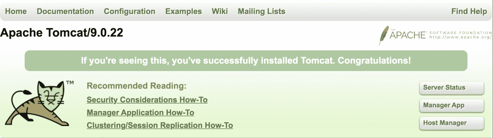
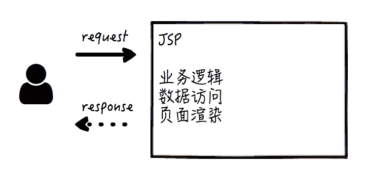
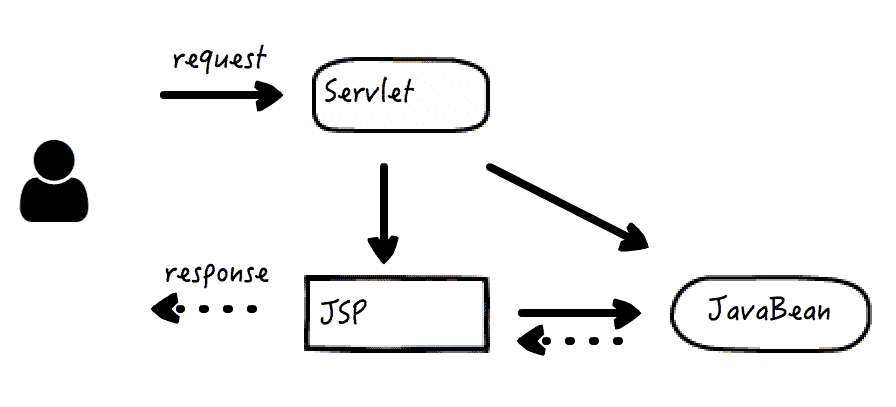
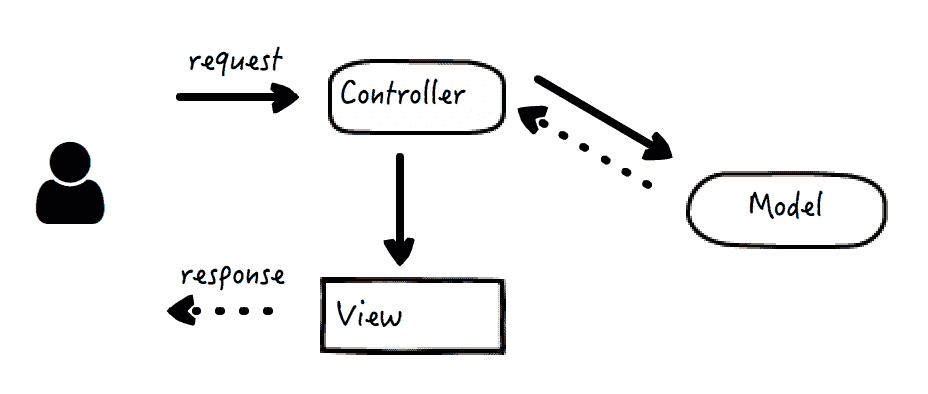
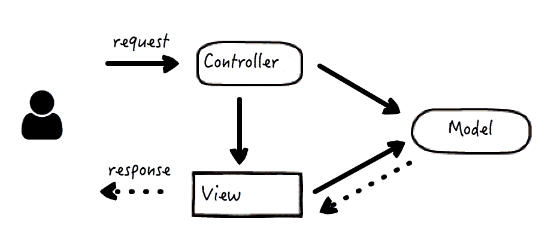
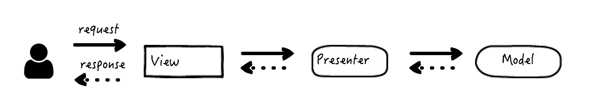
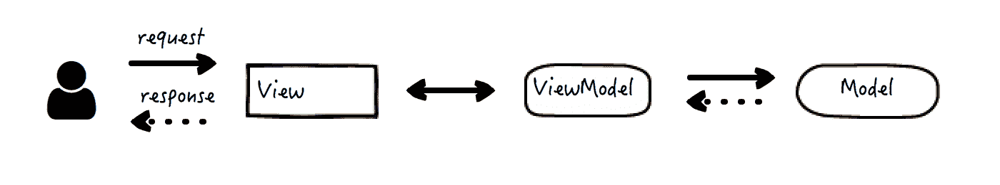

# 07 | 解耦是永恒的主题：MVC框架的发展

 

你好，我是四火。

欢迎进入第二章，本章我们将围绕 MVC 这个老而弥坚的架构模式展开方方面面的介绍，对于基于 Web 的全栈工程师来说，它是我们知识森林中心最茂密的一片区域，请继续打起精神，积极学习和思考。

无论是在 Web 全栈还是整个软件工程领域，有很多东西在本质上是相通的。比如我们在前一章提到的“权衡”（trade-off），我们后面还会反复提到。MVC 作为贯穿本章的主题，今天我们就通过它来引出另一个关键词——解耦。

## JSP 和 Servlet

在我们谈 MVC 之前，先来讲一对好朋友，JSP 和 Servlet。说它们是好朋友，是因为它们经常一起出现，而事实上，它们还有更为紧密的联系。

### 1. 概念介绍

如果你有使用 Java 作为主要语言开发网站的经历，那么你一定听过别人谈论 JSP 和 Servlet。其中，Servlet 指的是服务端的一种 Java 写的组件，它可以接收和处理来自浏览器的请求，并生成结果数据，通常它会是 HTML、JSON 等常见格式，写入 HTTP 响应，返回给用户。

至于 JSP，它的全称叫做 Java Server Pages，它允许静态的 HTML 页面插入一些类似于“<% %>”这样的标记（scriptlet），而在这样的标记中，还能以表达式或代码片段的方式，嵌入一些 Java 代码，在 Web 容器响应 HTTP 请求时，这些标记里的 Java 代码会得到执行，这些标记也会被替换成代码实际执行的结果，嵌入页面中一并返回。这样一来，原本静态的页面，就能动态执行代码，并将执行结果写入页面了。

 
- 第一次运行时，系统会执行编译过程，并且这个过程只会执行一次：JSP 会处理而生成 Servlet 的 Java 代码，接着代码会被编译成字节码（class 文件），在 Java 虚拟机上运行。 
- 之后每次就只需要执行运行过程了，Servlet 能够接受 HTTP 请求，并返回 HTML 文本，最终以 HTTP 响应的方式返回浏览器。 

这个过程大致可以这样描述：

>  
> 编译过程：JSP 页面 → Java 文件（Servlet）→ class 文件（Servlet）  
 运行过程：HTTP 请求 + class 文件（Servlet）→ HTML 文本
 

### 2. 动手验证

为了更好地理解这个过程，让我们来实际动手操作一遍。

首先，你需要安装两样东西，一样是 [JDK（Java Development Kit）8](https://www.oracle.com/technetwork/java/javase/downloads/jdk8-downloads-2133151.html)，是 Java 的软件开发包；另一样是 [Apache Tomcat 9](https://tomcat.apache.org/download-90.cgi)，它是一款 Web 容器，也是一款 Servlet 容器，因此无论是静态的 HTML 页面，还是动态的 Servlet、JSP，都可以部署在上面运行。

你可以使用安装包安装，也可以使用包管理工具安装（比如 Mac 下使用 Homebrew 安装）。如果你的电脑上已经安装了，只是版本号不同，也是没有问题的。

安装完成以后，打开一个新的命令行窗口，执行一下 java --version 命令，你应该能看到类似以下信息：

```
java -versionjava version "1.8.0_162"Java(TM) SE Runtime Environment (build 1.8.0_162-b12)Java HotSpot(TM) 64-Bit Server VM (build 25.162-b12, mixed mode)
```

这里显示了 JRE（Java Runtime Environment，Java 运行时环境）的版本号，以及虚拟机的类型和版本号。

同样地，执行 catalina version，你也能看到 Tomcat 重要的环境信息：

```
catalina versionUsing CATALINA_BASE: ...Using CATALINA_HOME: ...Using CATALINA_TMPDIR: ...（以下省略其它的环境变量，以及服务器、操作系统和 Java 虚拟机的版本信息）
```

其中，CATALINA_HOME 是 Tomcat 的“家”目录，就是它安装的位置，我们在下面要使用到它。

好，现在启动 Tomcat：

```
catalina run
```

在浏览器中访问 [http://localhost:8080/](http://localhost:8080/)，你应该能看到 Tomcat 的主页面：



接着，我们在 ${CATALINA_HOME}/webapps/ROOT 下建立文件 hello_world.jsp，写入：

```
Hello world! Time: <%= new java.util.Date() %>
```

接着，访问 [http://localhost:8080/hello_world.jsp](http://localhost:8080/hello_world.jsp)，你将看到类似下面这样的文本：

```
Hello world! Time: Sat Jul 27 20:39:19 PDT 2019
```

嗯，代码被顺利执行了。可是根据我们学到的原理，我们应该能找到这个 JSP 文件生成的 Java 和 class 文件，它们应该藏在某处。没错，现在进入如下目录 ${CATALINA_HOME}/work/Catalina/localhost/ROOT/org/apache/jsp，你可以看到这样几个文件：

```
index_jsp.javahello_005fworld_jsp.javaindex_jsp.classhello_005fworld_jsp.class
```

你看，前两个 Java 文件就是根据 JSP 生成的 Servlet 的源代码，后两个就是这个 Servlet 编译后的字节码。以 index 开头的文件就是 Tomcat 启动时你最初看到的主页面，而以 hello 开头的这两个文件则完全来自于我们创建的 hello_world.jsp。

现在你可以打开 hello_005fworld_jsp.java，如果你有 Java 基础，那么你应该可以看得懂其中的代码。代码中公有类 hello_005fworld_jsp 继承自 HttpJspBase 类，而如果你查看 [Tomcat 的 API 文档](https://tomcat.apache.org/tomcat-9.0-doc/api/org/apache/jasper/runtime/HttpJspBase.html)，你就会知道，原来它进一步继承自 HttpServlet 类，也就是说，这个自动生成的 Java 文件，就是 Servlet。

在 117 行附近，你可以找到我们写在 JSP 页面中的内容，它们以流的方式被写入了 HTTP 响应：

```
out.write("Hello world! Time: ");out.print( new java.util.Date() );out.write('\n');
```

通过自己动手，我想你现在应该更加理解 JSP 的工作原理了。你看，JSP 和 Servlet 并不是完全独立的“两个人”，**JSP 实际工作的时候，是以 Servlet 的形式存在的**，也就是说，前者其实是可以转化成后者的。

### 3. 深入理解

好，那么问题来了，我们为什么不直接使用 Servlet，而要设计出 JSP 这样的技术，让其在实际运行中转化成 Servlet 来执行呢？

最重要的原因，**从编程范型的角度来看，JSP 页面的代码多是基于声明式（Declarative），而 Servlet 的代码则多是基于命令式（Imperative）**，这两种技术适合不同的场景。这两个概念，最初来源于编程范型的分类，声明式编程，是去描述物件的性质，而非给出指令，而命令式编程则恰恰相反。

比方说，典型的 JSP 页面代码中，只有少数一些 scriptlet，大部分还是 HTML 等格式的文本，而 HTML 文本会告诉浏览器，这里显示一个按钮，那里显示一个文本输入框，随着程序员对代码的阅读，可以形象地在脑海里勾勒出这个页面的样子，这也是声明式代码的一大特点。全栈工程师经常接触到的 HTML、XML、JSON 和 CSS 等，都是声明式代码。你可能注意到了，这些代码都不是使用编程语言写的，而是使用标记语言写的，但是，编程语言其实也有声明式的，比如 Prolog。

再来说命令式代码，在 Servlet 中，它会一条一条语句告诉计算机下一步该做什么，这个过程就是命令式的。我们绝大多数的代码都是命令式的。声明式代码是告诉计算机“什么样”，而不关注“怎么做”；命令式代码则是告诉计算机“怎么做”，而不关注“什么样”。

为什么需要两种方式？因为人的思维是很奇特的，**对于某些问题，使用声明式会更符合直觉，更形象，因而更接近于人类的语言；而另一些问题，则使用命令式，更符合行为步骤的思考模式，更严谨，也更能够预知机器会怎样执行**。

计算机生来就是遵循命令执行的，因此声明式的 JSP 页面会被转化成一行行命令式的 Servlet 代码，交给计算机执行。可是，你可以想象一下，如果 HTML 那样适合声明式表述的代码，程序员使用命令式来手写会是怎样的一场噩梦——代码将会变成无趣且易错的一行行字符串拼接。

## MVC 的演进

我想你一定听过 MVC 这种经典的架构模式，它早在 20 世纪 70 年代就被发明出来了，直到现在，互联网上的大多数网站，都是遵从 MVC 实现的，这足以见其旺盛的生命力。MVC 模式包含这样三层：

 
- 控制器（Controller），恰如其名，主要负责请求的处理、校验和转发。 
- 视图（View），将内容数据以界面的方式呈现给用户，也捕获和响应用户的操作。 
- 模型（Model），数据和业务逻辑真正的集散地。 

你可能会想，这不够全面啊，这三层之间的交互和数据流动在哪里？别急，MVC 在历史上经历了多次演进，这三层，再加上用户，它们之间的交互模型，是逐渐变化的。哪怕在今天，不同的 MVC 框架的实现在这一点上也是有区别的。

### 1. JSP Model 1

JSP Model 1 是整个演化过程中最古老的一种，请求处理的整个过程，包括参数验证、数据访问、业务处理，到页面渲染（或者响应构造），全部都放在 JSP 页面里面完成。JSP 页面既当爹又当妈，静态页面和嵌入动态表达式的特性，使得它可以很好地容纳声明式代码；而 JSP 的 scriptlet，又完全支持多行 Java 代码的写入，因此它又可以很好地容纳命令式代码。



### 2. JSP Model 2

在 Model 1 中，你可以对 JSP 页面上的内容进行模块和职责的划分，但是由于它们都在一个页面上，物理层面上可以说是完全耦合在一起，因此模块化和单一职责无从谈起。和 Model 1 相比，Model 2 做了明显的改进。

 
- JSP 只用来做一件事，那就是页面渲染，换言之，JSP 从全能先生转变成了单一职责的页面模板； 
- 引入 JavaBean 的概念，它将数据库访问等获取数据对象的行为封装了起来，成为业务数据的唯一来源； 
- 请求处理和派发的活交到纯 Servlet 手里，它成为了 MVC 的“大脑”，它知道创建哪个 JavaBean 准备好业务数据，也知道将请求引导到哪个 JSP 页面去做渲染。 



通过这种方式，你可以看到，原本全能的 JSP 被解耦开了，分成了三层，这三层其实就是 MVC 的 View、Model 和 Controller。于是殊途同归，MVC 又一次进入了人们的视野，今天的 MVC 框架千差万别，原理上却和这个版本基本一致。

上面提到了一个概念 JavaBean，随之还有一个常见的概念 POJO，这是在 Java 领域中经常听到的两个名词，但有时它们被混用。在此，我想对这两个概念做一个简短的说明。

 
- JavaBean 其实指的是一类特殊的封装对象，这里的“Bean”其实指的就是可重用的封装对象。它的特点是可序列化，包含一个无参构造器，以及遵循统一的 getter 和 setter 这样的简单命名规则的存取方法。 
- POJO，即 Plain Old Java Object，还是最擅长创建软件概念的 Martin Fowler 的杰作。它指的就是一个普通和简单的 Java 对象，没有特殊限制，也不和其它类有关联（它不能继承自其它类，不能实现任何接口，也不能被任何注解修饰）。 

所以，二者是两个类似的概念，通常认为它们之间具备包含关系，即 JavaBean 可以视作 POJO 的一种。但它们二者也有一些共性，比如，它们都是可以承载实际数据状态，都定义了较为简单的方法，概念上对它们的限制只停留在外在表现（即内部实现可以不“plain”，可以很复杂，比如 JavaBean 经常在内部实现中读写数据库）。

### 3. MVC 的一般化

JSP Model 2 已经具备了 MVC 的基本形态，但是，它却对技术栈有着明确限制——Servlet、JSP 和 JavaBean。今天我们见到的 MVC，已经和实现技术无关了，并且，在 MVC 三层大体职责确定的基础上，其中的交互和数据流动却是有许多不同的实现方式的。

不同的 MVC 框架下实现的 MVC 架构不同，有时即便是同一个框架，不同的版本之间其 MVC 架构都有差异（比如 ASP.NET MVC），在这里我只介绍最典型的两种情况，如果你在学习的过程中见到其它类型，请不要惊讶，重要的是理解其中的原理。

**第一种：**



上图是第一种典型情况，这种情况下，用户请求发送给 Controller，而 Controller 是大总管，需要主动调用 Model 层的接口去取得实际需要的数据对象，之后将数据对象发送给需要渲染的 View，View 渲染之后返回页面给用户。

在这种情况下，Controller 往往会比较大，因为它要知道需要调用哪个 Model 的接口获取数据对象，还需要知道要把数据对象发送给哪个 View 去渲染；View 和 Model 都比较简单纯粹，它们都只需要被动地根据 Controller 的要求完成它们自己的任务就好了。

**第二种：**



上图是第二种典型情况，请和第一种比较，注意到了区别没有？这种情况在更新操作中比较常见，Controller 调用 Model 的接口发起数据更新操作，接着就直接转向最终的 View 去了；View 会调用 Model 去取得经过 Controller 更新操作以后的最新对象，渲染并返回给用户。

在这种情况下，Controller 相对就会比较简单，而这里写操作是由 Controller 发起的，读操作是由 View 发起的，二者的业务对象模型可以不相同，非常适合需要 CQRS（Command Query Responsibility Segregation，命令查询职责分离）的场景，我在 [第 08 讲] 中会进一步介绍 CQRS。

### 4. MVC 的变体

MVC 的故事还没完，当它的核心三层和它们的基本职责发生变化，这样的架构模式就不再是严格意义上的 MVC 了。这里我介绍两种 MVC 的变体：MVP 和 MVVM。

MVP 包含的三层为 Model、View 和 Presenter，它往往被用在用户的界面设计当中，和 MVC 比起来，Controller 被 Presenter 替代了。

 
- Model 的职责没有太大的变化，依然是业务数据的唯一来源。 
- View 变成了纯粹的被动视图，它被动地响应用户的操作来触发事件，并将其转交给 Presenter；反过来，它的视图界面被动地由 Presenter 来发起更新。 
- Presenter 变成了 View 和 Model 之间的协调者（Middle-man），它是真正调度逻辑的持有者，会根据事件对 Model 进行状态更新，又在 Model 层发生改变时，相应地更新 View。 



MVVM 是在 MVP 的基础上，将职责最多的 Presenter 替换成了 ViewModel，它实际是一个数据对象的转换器，将从 Model 中取得的数据简化，转换为 View 可以识别的形式返回给 View。View 和 ViewModel 实行双向绑定，成为命运共同体，即 View 的变化会自动反馈到 ViewModel 中，反之亦然。关于数据双向绑定的知识我还会在 [第 10 讲] 中详解。



## 总结思考

今天我们学习了 JSP 和 Servlet 这两个同源技术的本质，它们是分别通过声明式和命令式两种编程范型来解决同一问题的体现，接着围绕解耦这一核心，了解了 MVC 的几种形式和变体。

 
- JSP Model 1：请求处理的整个过程，全部都耦合在 JSP 页面里面完成； 
- JSP Model 2：MVC 分别通过 JavaBean、JSP 和 Servlet 解耦成三层； 
- MVC 的常见形式一：数据由 Controller 调用 Model 来准备，并传递给 View 层； 
- MVC 的常见形式二：Controller 发起对数据的修改，在 View 中查询修改后的数据并展示，二者分别调用 Model； 
- MVP：Presenter 扮演协调者，对 Model 和 View 实施状态的更新； 
- MVVM：View 和 ViewModel 实行数据的双向绑定，以自动同步状态。 

好，现在提两个问题，检验一下今天的学习成果：

 
- 我们介绍了 JSP 页面和 Servlet 在编程范型上的不同，这两个技术有着不同的使用场景，你能举出例子来说明吗？ 
- 在介绍 MVC 的一般化时，我介绍了两种典型的 MVC 各层调用和数据流向的实现，你工作或学习中使用过哪一种，还是都没使用过，而是第三种？ 

MVC 是本章的核心内容，在这之后的几讲中我会对 MVC 逐层分解，今天的内容先打个基础，希望你能真正地理解和消化，这将有助于之后的学习。欢迎你在留言区和我讨论！

## 扩展阅读

 
- 【基础】专栏文章中的例子有时会涉及到 Java 代码，如果你对 Java 很不熟悉，可以参考廖雪峰 Java 教程中“[快速入门](https://www.liaoxuefeng.com/wiki/1252599548343744/1255883772263712)”的部分，它很短小，但是覆盖了专栏需要的 Java 基础知识。 
- 【基础】W3Cschool 上的 [Servlet 教程](https://www.w3cschool.cn/servlet/)和 [JSP 教程](https://www.w3cschool.cn/jsp/)，如果你对这二者完全不了解，那我推荐你阅读。在较为系统的教程中，这两个算较为简洁的，如果觉得内容较多，可以挑选其中的几个核心章节阅读。 
- 如果你顺利地将文中介绍的 Tomcat 启动起来了，并且用的也是 9.x 版本，那么你可以直接访问 [http://localhost:8080/examples/](http://localhost:8080/examples/)，里面有 Tomcat 自带的很多典型和带有源码的例子，有 JSP 的例子，也有 Servlet 的例子，还有 WebSocket 的例子（由于我们前一章已经学过了 WebSocket，这里你应该可以较为顺利地学习）。 


