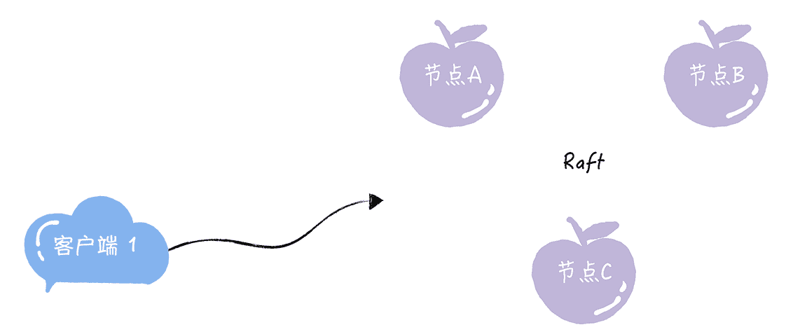
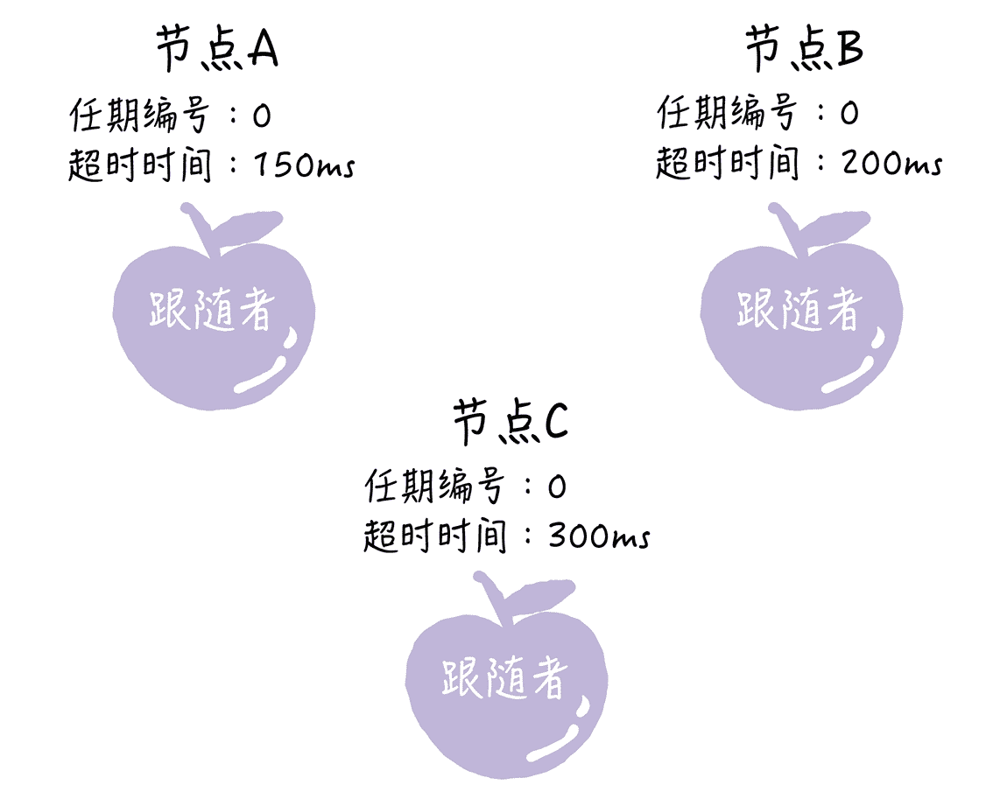
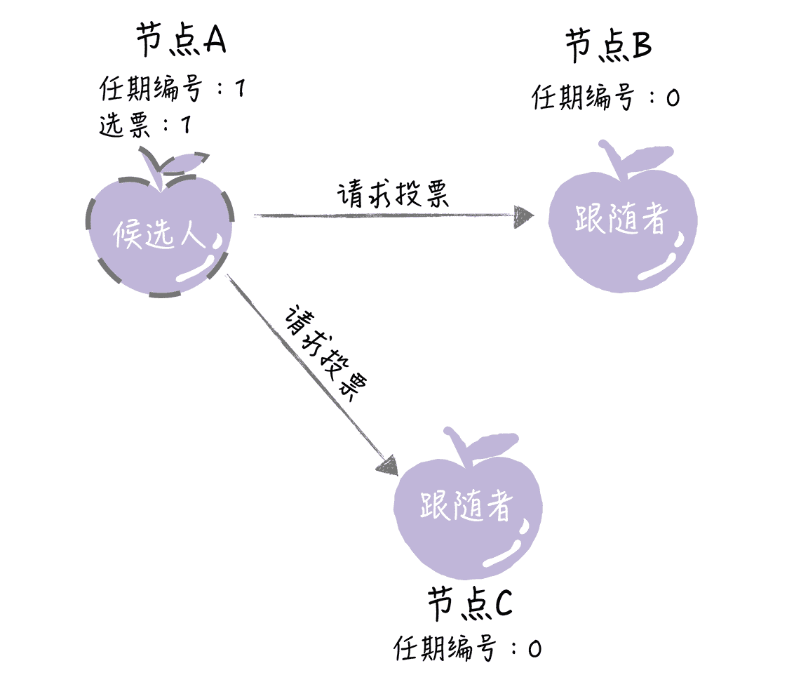
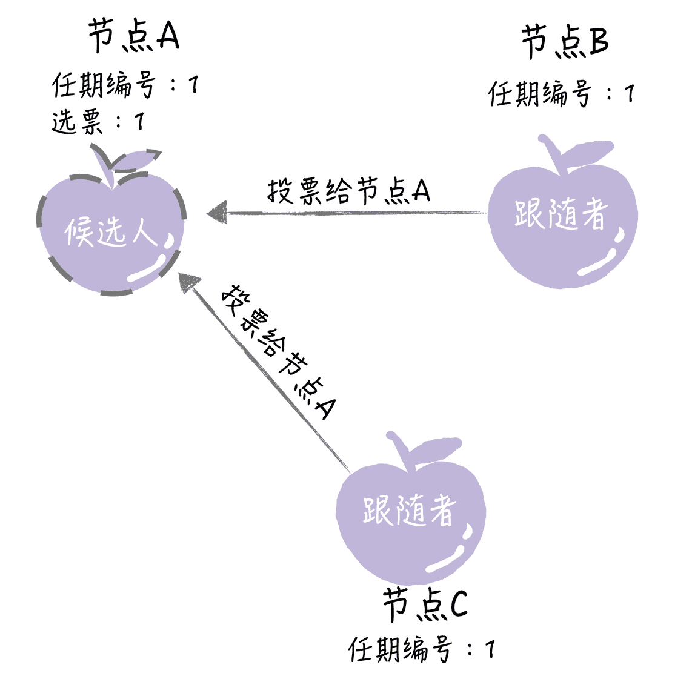
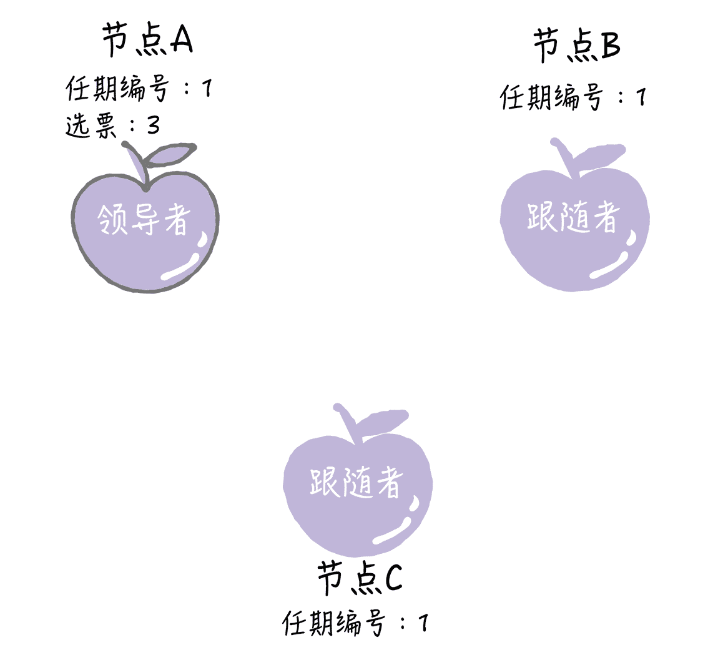
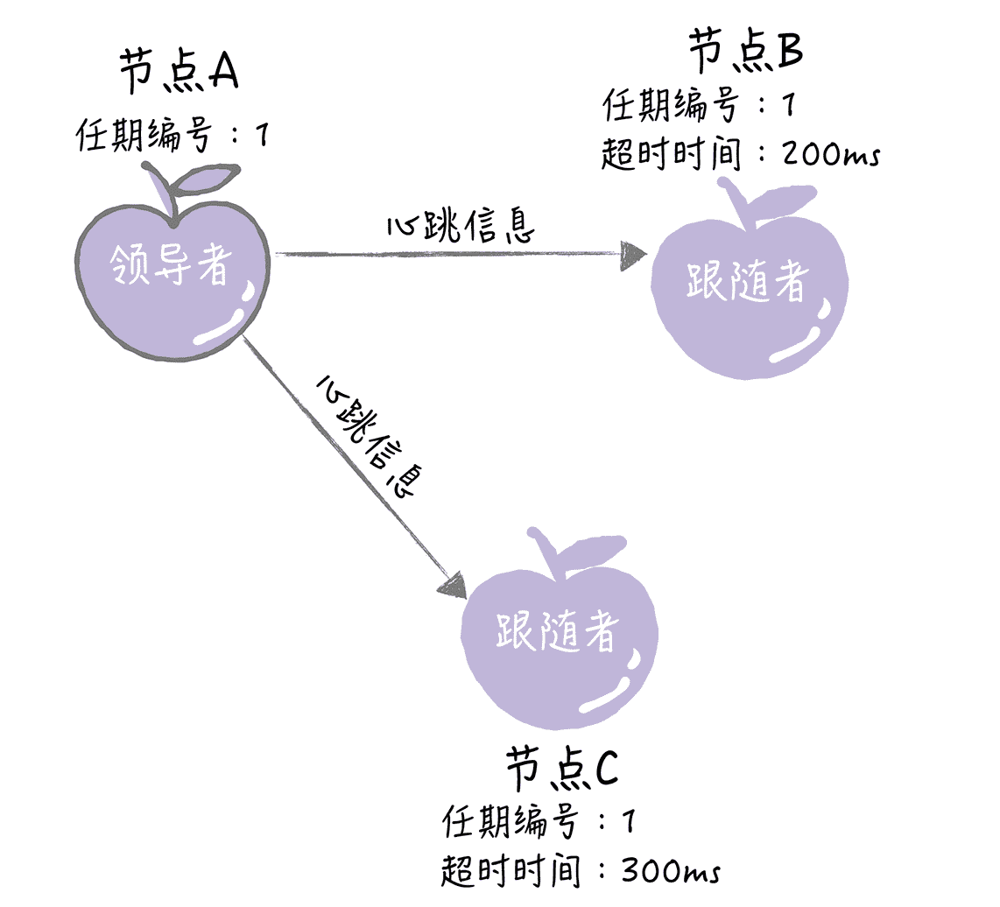
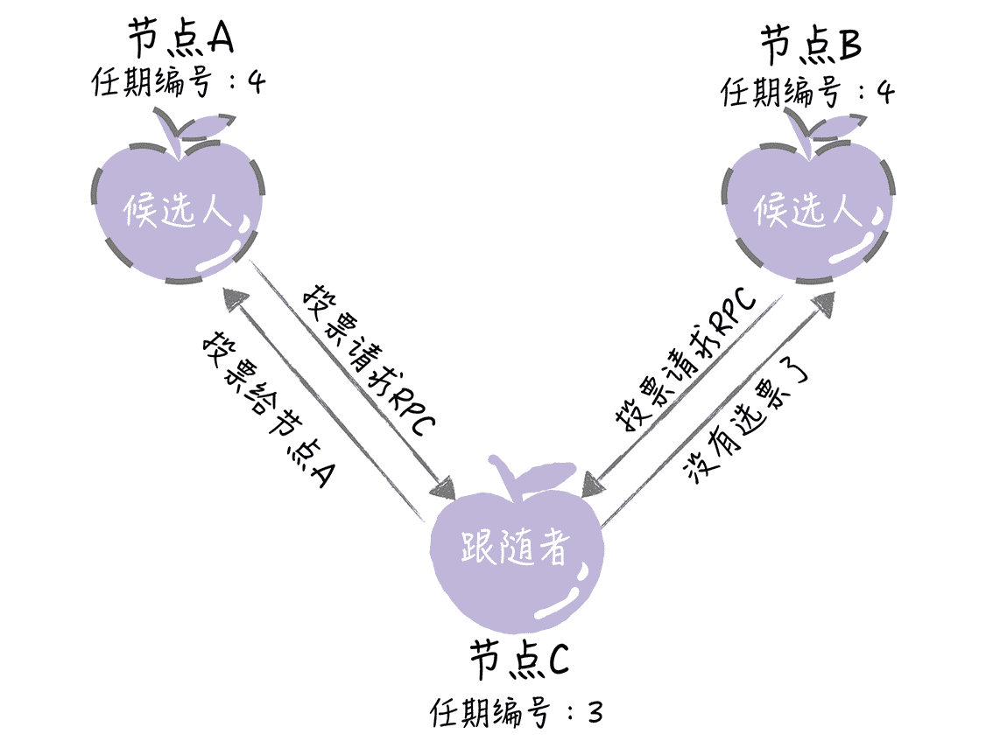
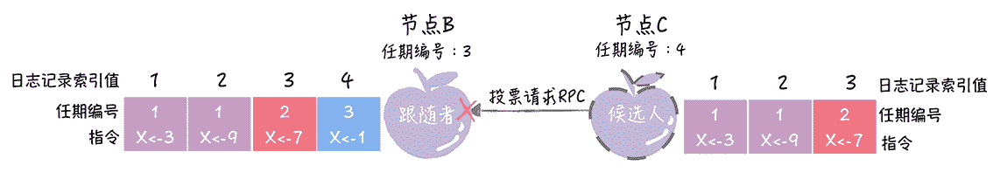

# 07 | Raft算法（一）：如何选举领导者？

 

你好，我是韩健。

通过前两节课，我带你打卡了 Paxos 算法，今天我想和你聊聊最常用的共识算法，Raft 算法。

Raft 算法属于 Multi-Paxos 算法，它是在兰伯特 Multi-Paxos 思想的基础上，做了一些简化和限制，比如增加了日志必须是连续的，只支持领导者、跟随者和候选人三种状态，在理解和算法实现上都相对容易许多。

**除此之外，Raft 算法是现在分布式系统开发首选的共识算法。**绝大多数选用 Paxos 算法的系统（比如 Cubby、Spanner）都是在 Raft 算法发布前开发的，当时没得选；而全新的系统大多选择了 Raft 算法（比如 Etcd、Consul、CockroachDB）。

对你来说，掌握这个算法，可以得心应手地处理绝大部分场景的容错和一致性需求，比如分布式配置系统、分布式 NoSQL 存储等等，轻松突破系统的单机限制。

**如果要用一句话概括 Raft 算法，我觉得是这样的：从本质上说，Raft 算法是通过一切以领导者为准的方式，实现一系列值的共识和各节点日志的一致。**这句话比较抽象，我来做个比喻，领导者就是 Raft 算法中的霸道总裁，通过霸道的“一切以我为准”的方式，决定了日志中命令的值，也实现了各节点日志的一致。

我会用三讲的时间，分别以领导者选举、日志复制、成员变更为核心，讲解 Raft 算法的原理，在实战篇中，会带你进一步剖析 Raft 算法的实现，介绍基于 Raft 算法的分布式系统开发实战。那么我希望从原理到实战，在帮助你掌握分布式系统架构设计技巧和开发实战能力的同时，加深你对 Raft 算法的理解。

在课程开始之前，我们先来看一道思考题。

假设我们有一个由节点 A、B、C 组成的 Raft 集群（如图所示），因为 Raft 算法一切以领导者为准，所以如果集群中出现了多个领导者，就会出现不知道谁来做主的问题。在这样一个有多个节点的集群中，在节点故障、分区错误等异常情况下，Raft 算法如何保证在同一个时间，集群中只有一个领导者呢？带着这个问题，我们正式进入今天的学习。

既然要选举领导者，那要从哪些成员中选举呢？除了领导者，Raft 算法还支持哪些成员身份呢？这部分内容是你需要掌握的，最基础的背景知识。

## 有哪些成员身份？

成员身份，又叫做服务器节点状态，**Raft 算法支持领导者（Leader）、跟随者（Follower）和候选人（Candidate） 3 种状态。**为了方便讲解，我们使用不同的图形表示不同的状态。在任何时候，每一个服务器节点都处于这 3 个状态中的 1 个。

1. 跟随者：就相当于普通群众，默默地接收和处理来自领导者的消息，当等待领导者心跳信息超时的时候，就主动站出来，推荐自己当候选人。
2. 候选人：候选人将向其他节点发送请求投票（RequestVote）RPC 消息，通知其他节点来投票，如果赢得了大多数选票，就晋升当领导者。
3. 领导者：蛮不讲理的霸道总裁，一切以我为准，平常的主要工作内容就是 3 部分，处理写请求、管理日志复制和不断地发送心跳信息，通知其他节点“我是领导者，我还活着，你们现在不要发起新的选举，找个新领导者来替代我。”

**需要你注意的是，Raft 算法是强领导者模型，集群中只能有一个“霸道总裁”。**

## 选举领导者的过程

那么这三个成员是怎么选出来领导者的呢？为了方便你理解，我以图例的形式演示一个典型的领导者选举过程。

首先，在初始状态下，集群中所有的节点都是跟随者的状态。

Raft 算法实现了随机超时时间的特性。也就是说，每个节点等待领导者节点心跳信息的超时时间间隔是随机的。通过上面的图片你可以看到，集群中没有领导者，而节点 A 的等待超时时间最小（150ms），它会最先因为没有等到领导者的心跳信息，发生超时。

这个时候，节点 A 就增加自己的任期编号，并推举自己为候选人，先给自己投上一张选票，然后向其他节点发送请求投票 RPC 消息，请它们选举自己为领导者。

如果其他节点接收到候选人 A 的请求投票 RPC 消息，在编号为 1 的这届任期内，也还没有进行过投票，那么它将把选票投给节点 A，并增加自己的任期编号。

如果候选人在选举超时时间内赢得了大多数的选票，那么它就会成为本届任期内新的领导者。

节点 A 当选领导者后，他将周期性地发送心跳消息，通知其他服务器我是领导者，阻止跟随者发起新的选举，篡权。

讲到这儿，你是不是发现领导者选举很容易理解？与现实中的议会选举也蛮类似？当然，你可能还是对一些细节产生一些疑问：

1. 节点间是如何通讯的呢？
2. 什么是任期呢？
3. 选举有哪些规则？
4. 随机超时时间又是什么？

## 选举过程四连问

老话说，细节是魔鬼。这些细节也是很多同学在学习 Raft 算法的时候比较难掌握的，所以我认为有必要具体分析一下。咱们一步步来，先来看第一个问题。

#### 节点间如何通讯？

在 Raft 算法中，服务器节点间的沟通联络采用的是远程过程调用（RPC），在领导者选举中，需要用到这样两类的 RPC：

1. 请求投票（RequestVote）RPC，是由候选人在选举期间发起，通知各节点进行投票；

2. 日志复制（AppendEntries）RPC，是由领导者发起，用来复制日志和提供心跳消息。

我想强调的是，日志复制 RPC 只能由领导者发起，这是实现强领导者模型的关键之一，希望你能注意这一点，后续能更好地理解日志复制，理解日志的一致是怎么实现的。

#### 什么是任期？

我们知道，议会选举中的领导者是有任期的，领导者任命到期后，要重新开会再次选举。Raft 算法中的领导者也是有任期的，每个任期由单调递增的数字（任期编号）标识，比如节点 A 的任期编号是 1。任期编号是随着选举的举行而变化的，这是在说下面几点。

1. 跟随者在等待领导者心跳信息超时后，推举自己为候选人时，会增加自己的任期号，比如节点 A 的当前任期编号为 0，那么在推举自己为候选人时，会将自己的任期编号增加为 1。
2. 如果一个服务器节点，发现自己的任期编号比其他节点小，那么它会更新自己的编号到较大的编号值。比如节点 B 的任期编号是 0，当收到来自节点 A 的请求投票 RPC 消息时，因为消息中包含了节点 A 的任期编号，且编号为 1，那么节点 B 将把自己的任期编号更新为 1。

我想强调的是，与现实议会选举中的领导者的任期不同，Raft 算法中的任期不只是时间段，而且任期编号的大小，会影响领导者选举和请求的处理。

1. 在 Raft 算法中约定，如果一个候选人或者领导者，发现自己的任期编号比其他节点小，那么它会立即恢复成跟随者状态。比如分区错误恢复后，任期编号为 3 的领导者节点 B，收到来自新领导者的，包含任期编号为 4 的心跳消息，那么节点 B 将立即恢复成跟随者状态。
2. 还约定如果一个节点接收到一个包含较小的任期编号值的请求，那么它会直接拒绝这个请求。比如节点 C 的任期编号为 4，收到包含任期编号为 3 的请求投票 RPC 消息，那么它将拒绝这个消息。

在这里，你可以看到，Raft 算法中的任期比议会选举中的任期要复杂。同样，在 Raft 算法中，选举规则的内容也会比较多。

#### 选举有哪些规则

在议会选举中，比成员的身份、领导者的任期还要重要的就是选举的规则，比如一人一票、弹劾制度等。“无规矩不成方圆”，在 Raft 算法中，也约定了选举规则，主要有这样几点。

1. 领导者周期性地向所有跟随者发送心跳消息（即不包含日志项的日志复制 RPC 消息），通知大家我是领导者，阻止跟随者发起新的选举。
2. 如果在指定时间内，跟随者没有接收到来自领导者的消息，那么它就认为当前没有领导者，推举自己为候选人，发起领导者选举。
3. 在一次选举中，赢得大多数选票的候选人，将晋升为领导者。
4. 在一个任期内，领导者一直都会是领导者，直到它自身出现问题（比如宕机），或者因为网络延迟，其他节点发起一轮新的选举。
5. 在一次选举中，每一个服务器节点最多会对一个任期编号投出一张选票，并且按照“先来先服务”的原则进行投票。比如节点 C 的任期编号为 3，先收到了 1 个包含任期编号为 4 的投票请求（来自节点 A），然后又收到了 1 个包含任期编号为 4 的投票请求（来自节点 B）。那么节点 C 将会把唯一一张选票投给节点 A，当再收到节点 B 的投票请求 RPC 消息时，对于编号为 4 的任期，已没有选票可投了。

1. 当任期编号相同时，日志完整性高的跟随者（也就是最后一条日志项对应的任期编号值更大，索引号更大），拒绝投票给日志完整性低的候选人。比如节点 B、C 的任期编号都是 3，节点 B 的最后一条日志项对应的任期编号为 3，而节点 C 为 2，那么当节点 C 请求节点 B 投票给自己时，节点 B 将拒绝投票。

我想强调的是，选举是跟随者发起的，推举自己为候选人；大多数选票是指集群成员半数以上的选票；大多数选票规则的目标，是为了保证在一个给定的任期内最多只有一个领导者。

其实在选举中，除了选举规则外，我们还需要避免一些会导致选举失败的情况，比如同一任期内，多个候选人同时发起选举，导致选票被瓜分，选举失败。那么在 Raft 算法中，如何避免这个问题呢？答案就是随机超时时间。

#### 如何理解随机超时时间

在议会选举中，常出现未达到指定票数，选举无效，需要重新选举的情况。在 Raft 算法的选举中，也存在类似的问题，那它是如何处理选举无效的问题呢？

其实，Raft 算法巧妙地使用随机选举超时时间的方法，把超时时间都分散开来，在大多数情况下只有一个服务器节点先发起选举，而不是同时发起选举，这样就能减少因选票瓜分导致选举失败的情况。

我想强调的是，**在 Raft 算法中，随机超时时间是有 2 种含义的，这里是很多同学容易理解出错的地方，需要你注意一下：**

1. 跟随者等待领导者心跳信息超时的时间间隔，是随机的；

2. 当没有候选人赢得过半票数，选举无效了，这时需要等待一个随机时间间隔，也就是说，等待选举超时的时间间隔，是随机的。

## 内容小结

以上就是本节课的全部内容了，本节课我主要带你了解了 Raft 算法的特点、领导者选举等。我希望你明确这样几个重点。

1. Raft 算法和兰伯特的 Multi-Paxos 不同之处，主要有 2 点。首先，在 Raft 中，不是所有节点都能当选领导者，只有日志最完整的节点，才能当选领导者；其次，在 Raft 中，日志必须是连续的。
2. Raft 算法通过任期、领导者心跳消息、随机选举超时时间、先来先服务的投票原则、大多数选票原则等，保证了一个任期只有一位领导，也极大地减少了选举失败的情况。
3. 本质上，Raft 算法以领导者为中心，选举出的领导者，以“一切以我为准”的方式，达成值的共识，和实现各节点日志的一致。

在本讲，我们使用 Raft 算法在集群中选出了领导者节点 A，那么选完领导者之后，领导者需要处理来自客户的写请求，并通过日志复制实现各节点日志的一致（下节课我会重点带你了解这一部分内容）。

## 课堂思考

既然我提到，Raft 算法实现了“一切以我为准”的强领导者模型，那么你不妨思考，这个设计有什么限制和局限呢？欢迎在留言区分享你的看法，与我一同讨论。

最后，感谢你的阅读，如果这篇文章让你有所收获，也欢迎你将它分享给更多的朋友。
