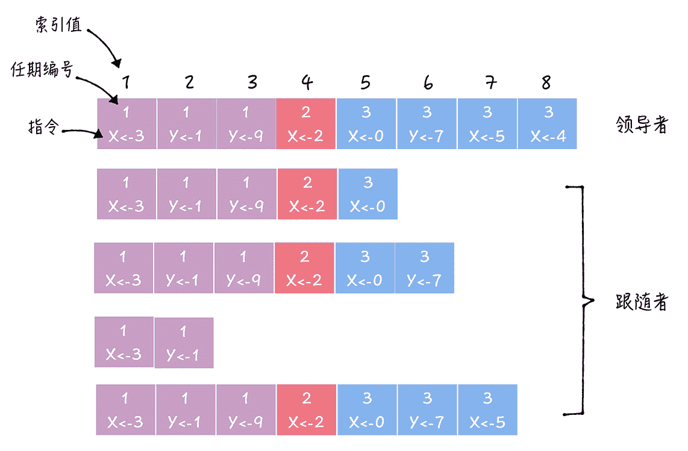
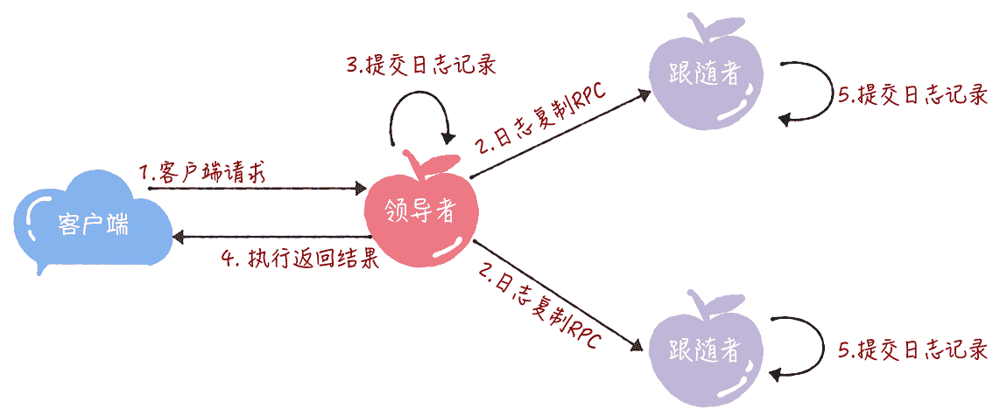
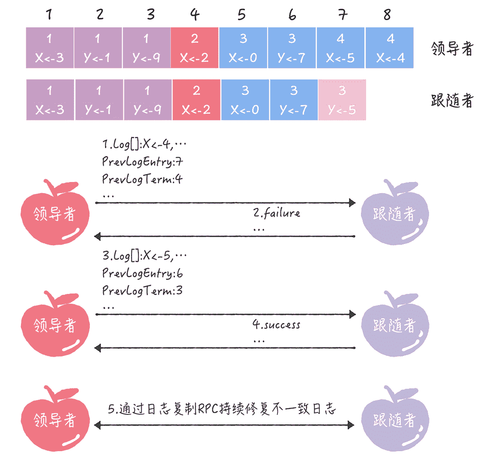

# 08 | Raft算法（二）：如何复制日志？

 

你好，我是韩健。

通过上一讲的学习，你应该知道 Raft 除了能实现一系列值的共识之外，还能实现各节点日志的一致，不过你也许会有这样的疑惑：“什么是日志呢？它和我的业务数据有什么关系呢？”

想象一下，一个木筏（Raft）是由多根整齐一致的原木（Log）组成的，而原木又是由木质材料组成，所以你可以认为日志是由多条日志项（Log entry）组成的，如果把日志比喻成原木，那么日志项就是木质材料。

在 Raft 算法中，副本数据是以日志的形式存在的，领导者接收到来自客户端写请求后，处理写请求的过程就是一个复制和提交日志项的过程。

那 Raft 是如何复制日志的呢？又如何实现日志的一致的呢？这些内容是 Raft 中非常核心的内容，也是我今天讲解的重点，我希望你不懂就问，多在留言区提出你的想法。首先，咱们先来理解日志，这是你掌握如何复制日志、实现日志一致的基础。

## 如何理解日志？

刚刚我提到，副本数据是以日志的形式存在的，日志是由日志项组成，日志项究竟是什么样子呢？

其实，日志项是一种数据格式，它主要包含用户指定的数据，也就是指令（Command），还包含一些附加信息，比如索引值（Log index）、任期编号（Term）。那你该怎么理解这些信息呢？

1. 指令：一条由客户端请求指定的、状态机需要执行的指令。你可以将指令理解成客户端指定的数据。
2. 索引值：日志项对应的整数索引值。它其实就是用来标识日志项的，是一个连续的、单调递增的整数号码。
3. 任期编号：创建这条日志项的领导者的任期编号。

从图中你可以看到，一届领导者任期，往往有多条日志项。而且日志项的索引值是连续的，这一点你需要注意。

讲到这儿你可能会问：不是说 Raft 实现了各节点间日志的一致吗？那为什么图中 4 个跟随者的日志都不一样呢？日志是怎么复制的呢？又该如何实现日志的一致呢？别着急，接下来咱们就来解决这几个问题。先来说说如何复制日志。

## 如何复制日志？

你可以把 Raft 的日志复制理解成一个优化后的二阶段提交（将二阶段优化成了一阶段），减少了一半的往返消息，也就是降低了一半的消息延迟。那日志复制的具体过程是什么呢？

首先，领导者进入第一阶段，通过日志复制（AppendEntries）RPC 消息，将日志项复制到集群其他节点上。

接着，如果领导者接收到大多数的“复制成功”响应后，它将日志项提交到它的状态机，并返回成功给客户端。如果领导者没有接收到大多数的“复制成功”响应，那么就返回错误给客户端。

学到这里，有同学可能有这样的疑问了，领导者将日志项提交到它的状态机，怎么没通知跟随者提交日志项呢？

这是 Raft 中的一个优化，领导者不直接发送消息通知其他节点提交指定日志项。因为领导者的日志复制 RPC 消息或心跳消息，包含了当前最大的，将会被提交的日志项索引值。所以通过日志复制 RPC 消息或心跳消息，跟随者就可以知道领导者的日志提交位置信息。

因此，当其他节点接受领导者的心跳消息，或者新的日志复制 RPC 消息后，就会将这条日志项提交到它的状态机。而这个优化，降低了处理客户端请求的延迟，将二阶段提交优化为了一段提交，降低了一半的消息延迟。

为了帮你理解，我画了一张过程图，然后再带你走一遍这个过程，这样你可以更加全面地掌握日志复制。

1. 接收到客户端请求后，领导者基于客户端请求中的指令，创建一个新日志项，并附加到本地日志中。
2. 领导者通过日志复制 RPC，将新的日志项复制到其他的服务器。
3. 当领导者将日志项，成功复制到大多数的服务器上的时候，领导者会将这条日志项提交到它的状态机中。
4. 领导者将执行的结果返回给客户端。
5. 当跟随者接收到心跳信息，或者新的日志复制 RPC 消息后，如果跟随者发现领导者已经提交了某条日志项，而它还没提交，那么跟随者就将这条日志项提交到本地的状态机中。

不过，这是一个理想状态下的日志复制过程。在实际环境中，复制日志的时候，你可能会遇到进程崩溃、服务器宕机等问题，这些问题会导致日志不一致。那么在这种情况下，Raft 算法是如何处理不一致日志，实现日志的一致的呢？

## 如何实现日志的一致？

在 Raft 算法中，领导者通过强制跟随者直接复制自己的日志项，处理不一致日志。也就是说，Raft 是通过以领导者的日志为准，来实现各节点日志的一致的。具体有 2 个步骤。

1. 首先，领导者通过日志复制 RPC 的一致性检查，找到跟随者节点上，与自己相同日志项的最大索引值。也就是说，这个索引值之前的日志，领导者和跟随者是一致的，之后的日志是不一致的了。
2. 然后，领导者强制跟随者更新覆盖的不一致日志项，实现日志的一致。

我带你详细地走一遍这个过程（为了方便演示，我们引入 2 个新变量）。

1. PrevLogEntry：表示当前要复制的日志项，前面一条日志项的索引值。比如在图中，如果领导者将索引值为 8 的日志项发送给跟随者，那么此时 PrevLogEntry 值为 7。
2. PrevLogTerm：表示当前要复制的日志项，前面一条日志项的任期编号，比如在图中，如果领导者将索引值为 8 的日志项发送给跟随者，那么此时 PrevLogTerm 值为 4。

1. 领导者通过日志复制 RPC 消息，发送当前最新日志项到跟随者（为了演示方便，假设当前需要复制的日志项是最新的），这个消息的 PrevLogEntry 值为 7，PrevLogTerm 值为 4。
2. 如果跟随者在它的日志中，找不到与 PrevLogEntry 值为 7、PrevLogTerm 值为 4 的日志项，也就是说它的日志和领导者的不一致了，那么跟随者就会拒绝接收新的日志项，并返回失败信息给领导者。
3. 这时，领导者会递减要复制的日志项的索引值，并发送新的日志项到跟随者，这个消息的 PrevLogEntry 值为 6，PrevLogTerm 值为 3。
4. 如果跟随者在它的日志中，找到了 PrevLogEntry 值为 6、PrevLogTerm 值为 3 的日志项，那么日志复制 RPC 返回成功，这样一来，领导者就知道在 PrevLogEntry 值为 6、PrevLogTerm 值为 3 的位置，跟随者的日志项与自己相同。
5. 领导者通过日志复制 RPC，复制并更新覆盖该索引值之后的日志项（也就是不一致的日志项），最终实现了集群各节点日志的一致。

从上面步骤中你可以看到，领导者通过日志复制 RPC 一致性检查，找到跟随者节点上与自己相同日志项的最大索引值，然后复制并更新覆盖该索引值之后的日志项，实现了各节点日志的一致。需要你注意的是，跟随者中的不一致日志项会被领导者的日志覆盖，而且领导者从来不会覆盖或者删除自己的日志。

## 内容小结

本节课我主要带你了解了在 Raft 中什么是日志、如何复制日志、以及如何处理不一致日志等内容。我希望你明确这样几个重点。

1. 在 Raft 中，副本数据是以日志的形式存在的，其中日志项中的指令表示用户指定的数据。
2. 兰伯特的 Multi-Paxos 不要求日志是连续的，但在 Raft 中日志必须是连续的。而且在 Raft 中，日志不仅是数据的载体，日志的完整性还影响领导者选举的结果。也就是说，日志完整性最高的节点才能当选领导者。
3. Raft 是通过以领导者的日志为准，来实现日志的一致的。

学完本节课你可以看到，值的共识和日志的一致都是由领导者决定的，领导者的唯一性很重要，那么如果我们需要对集群进行扩容或缩容，比如将 3 节点集群扩容为 5 节点集群，这时候是可能同时出现两个领导者的。这是为什么呢？在 Raft 中，又是如何解决这个问题的呢？我会在下一讲带你了解。

## 课堂思考

我提到，领导者接收到大多数的“复制成功”响应后，就会将日志提交到它自己的状态机，然后返回“成功”响应客户端。如果此时有个节点不在“大多数”中，也就是说它接收日志项失败，那么在这种情况下，Raft 会如何处理实现日志的一致呢？欢迎在留言区分享你的看法，与我一同讨论。

最后，感谢你的阅读，如果这篇文章让你有所收获，也欢迎你将它分享给更多的朋友。
