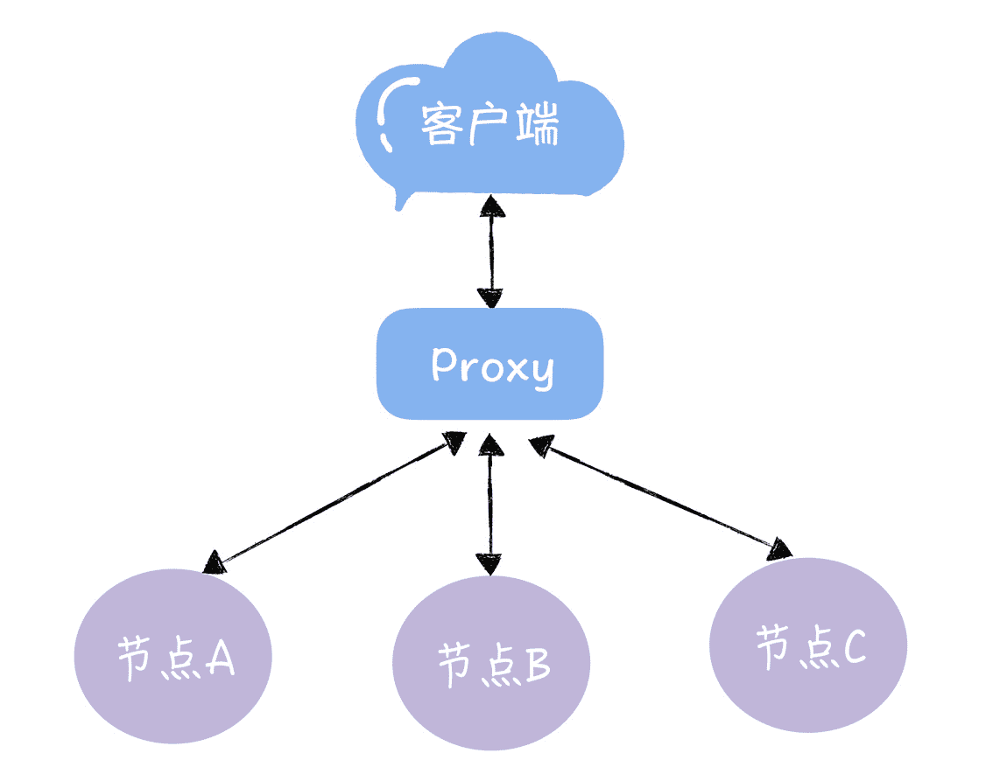
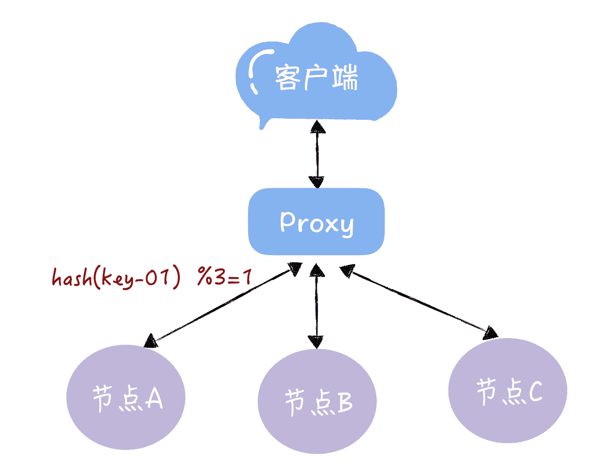
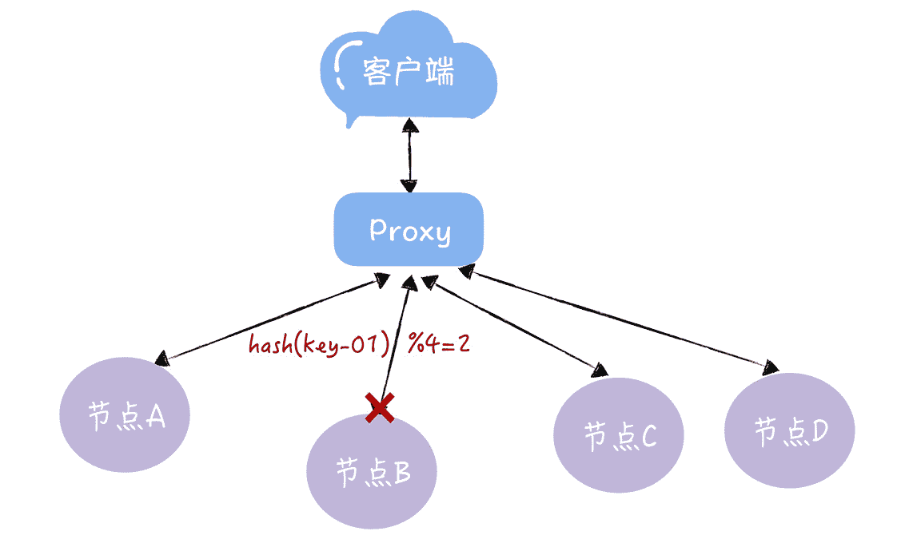
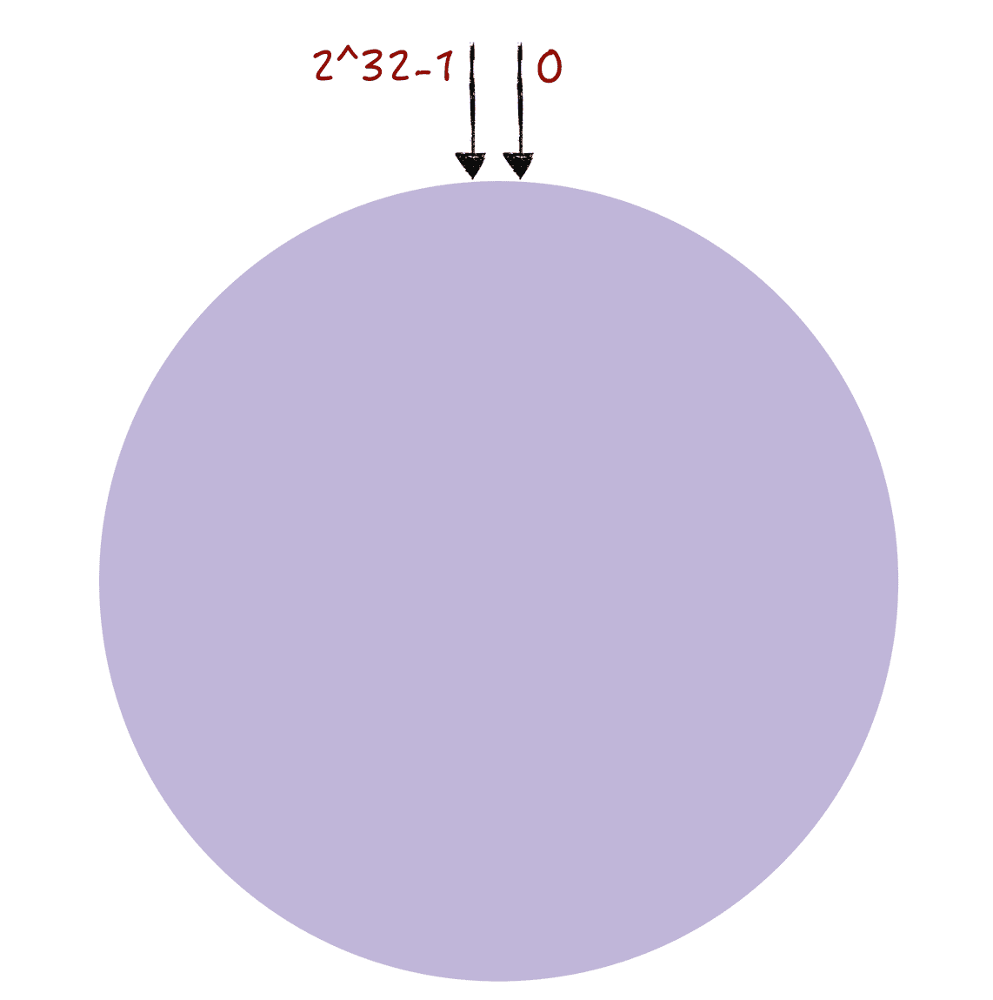
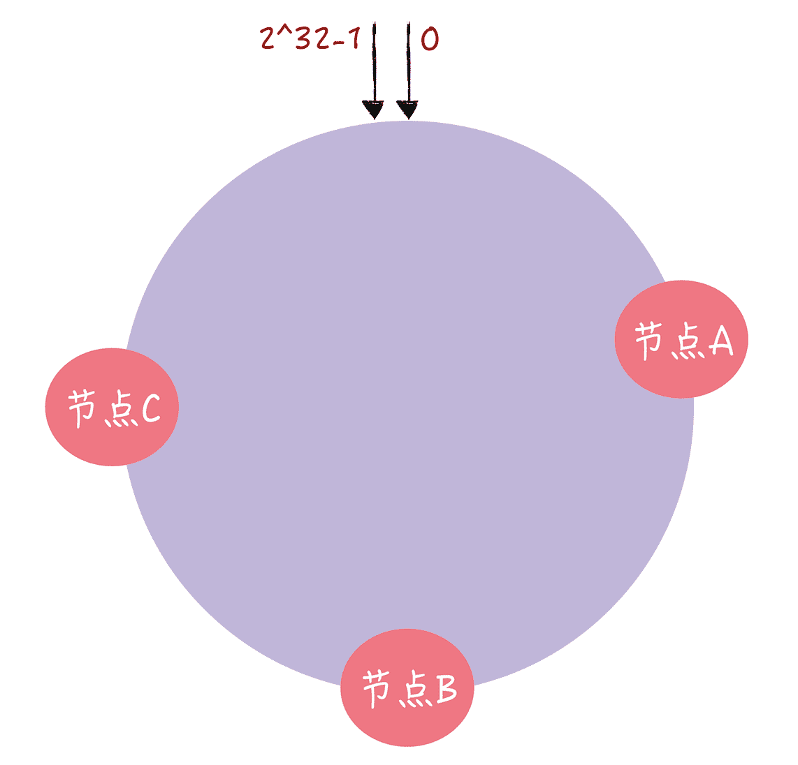
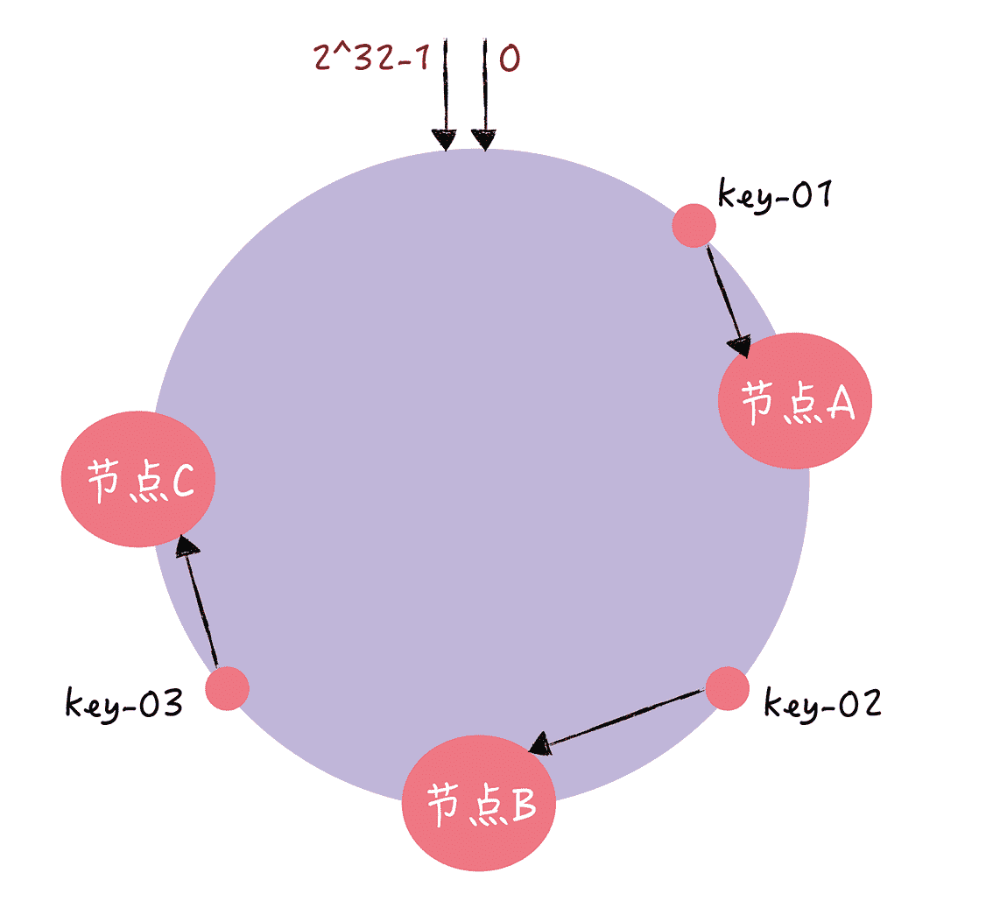
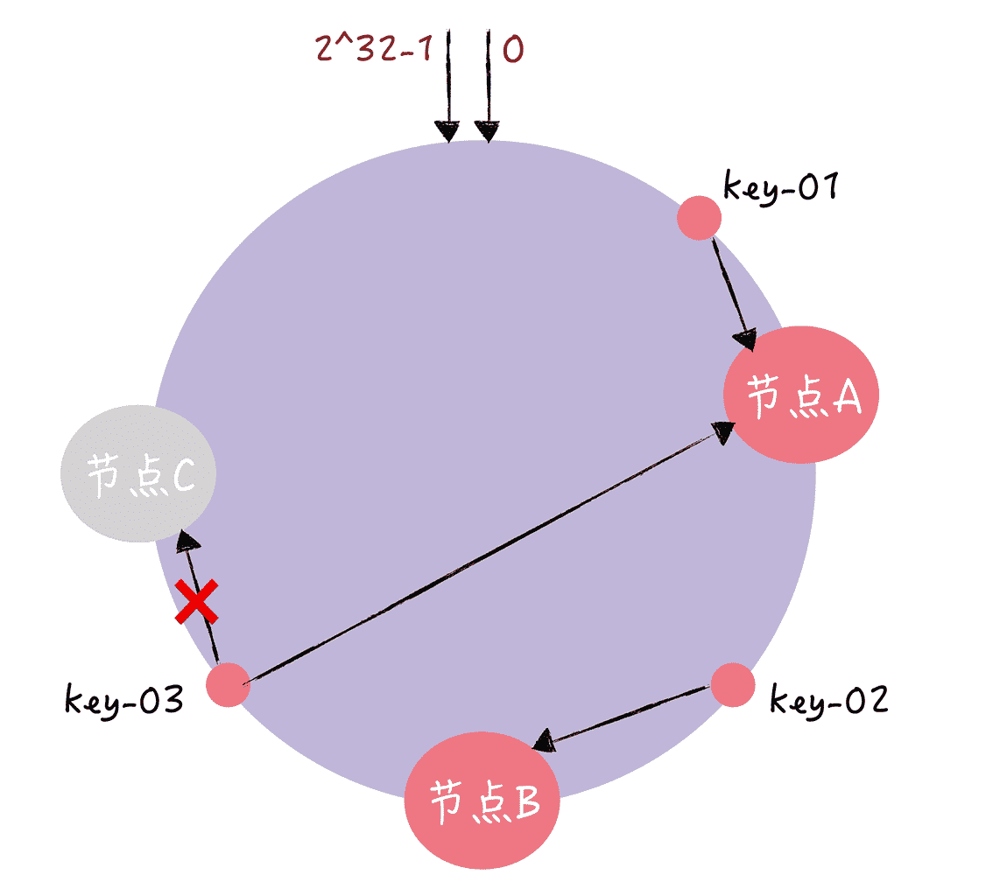
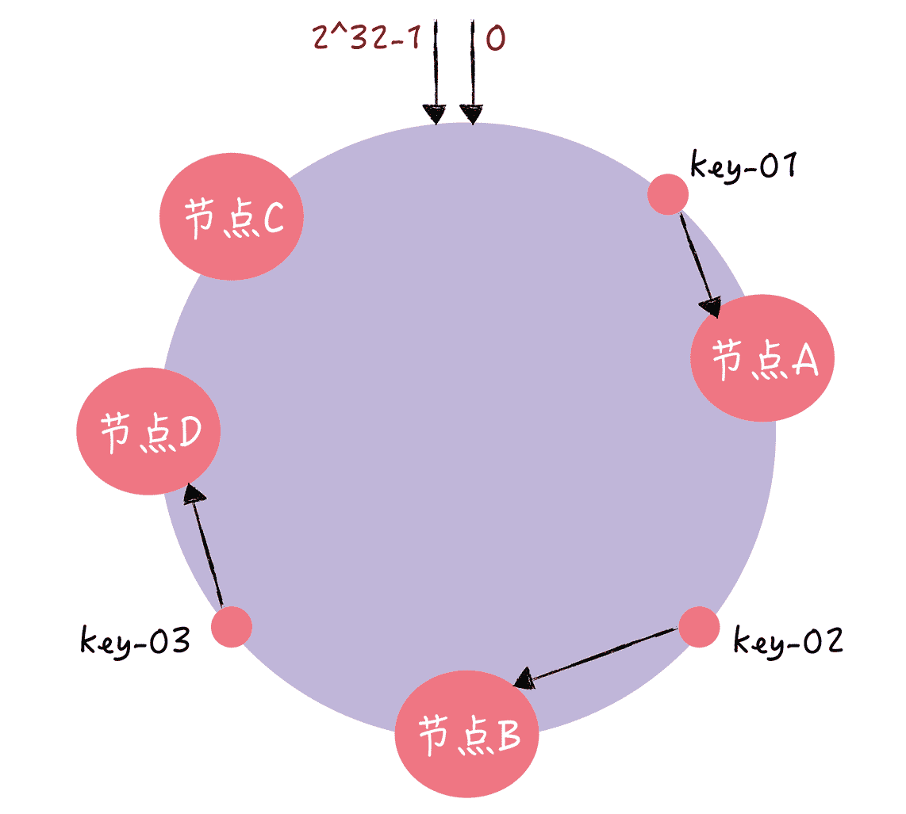
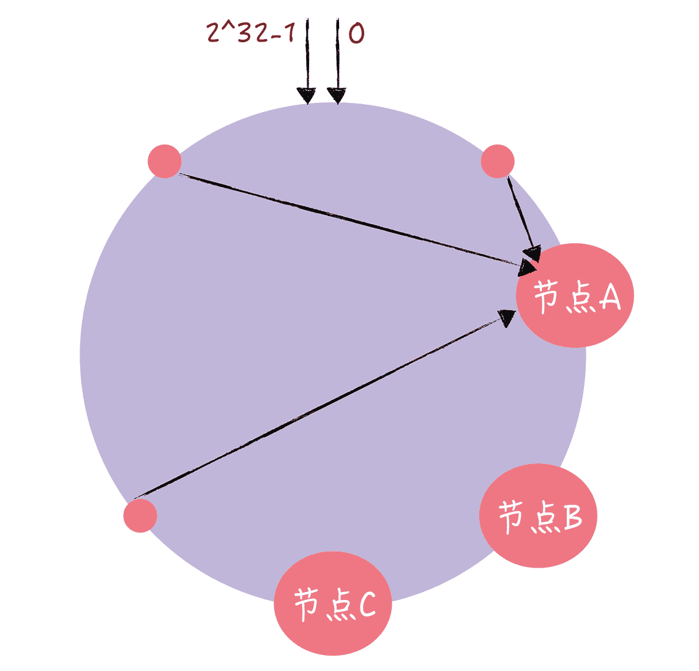
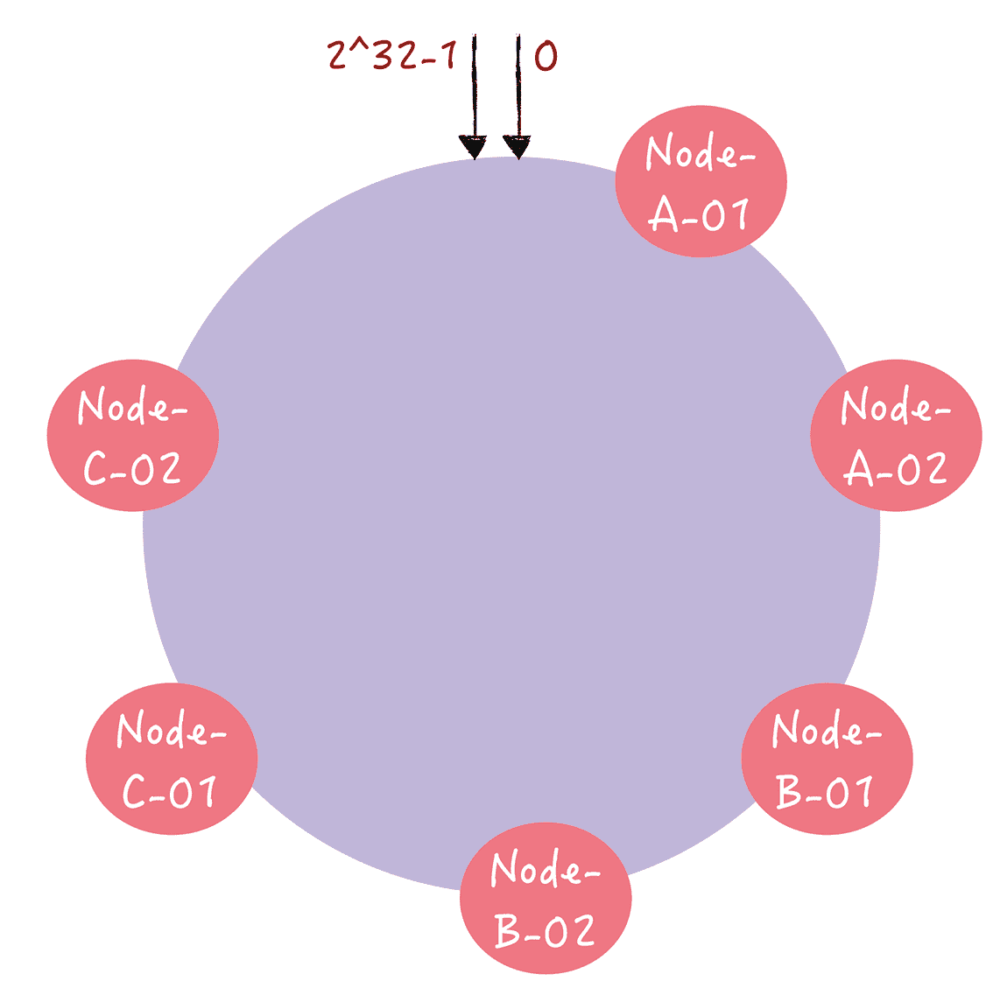

# 10 | 一致哈希算法：如何分群，突破集群的“领导者”限制？

 

你好，我是韩健。

学完前面几讲后，有些同学可能有这样的疑问：如果我们通过 Raft 算法实现了 KV 存储，虽然领导者模型简化了算法实现和共识协商，但写请求只能限制在领导者节点上处理，导致了集群的接入性能约等于单机，那么随着业务发展，集群的性能可能就扛不住了，会造成系统过载和服务不可用，这时该怎么办呢？

其实这是一个非常常见的问题。在我看来，这时我们就要通过分集群，突破单集群的性能限制了。

说到这儿，有同学可能会说了，分集群还不简单吗？加个 Proxy 层，由 Proxy 层处理来自客户端的读写请求，接收到读写请求后，通过对 Key 做哈希找到对应的集群就可以了啊。

是的，哈希算法的确是个办法，但它有个明显的缺点：当需要变更集群数时（比如从 2 个集群扩展为 3 个集群），这时大部分的数据都需要迁移，重新映射，数据的迁移成本是非常高的。那么如何解决哈希算法，数据迁移成本高的痛点呢？答案就是一致哈希（Consistent Hashing）。

为了帮你更好地理解如何通过哈希寻址实现 KV 存储的分集群，我除了会带你了解哈希算法寻址问题的本质之外，还会讲一下一致哈希是如何解决哈希算法数据迁移成本高这个痛点，以及如何实现数据访问的冷热相对均匀。

对你来说，学完本讲内容之后，不仅能理解一致哈希的原理，还能掌握通过一致哈希实现数据访问冷热均匀的实战能力。

老规矩，在正式开始学习之前，我们先看一道思考题。

假设我们有一个由 A、B、C 三个节点组成（为了方便演示，我使用节点来替代集群）的 KV 服务，每个节点存放不同的 KV 数据：



图1

那么，使用哈希算法实现哈希寻址时，到底有哪些问题呢？带着这个问题，让我们开始今天的内容吧。

## 使用哈希算法有什么问题？

通过哈希算法，每个 key 都可以寻址到对应的服务器，比如，查询 key 是 key-01，计算公式为 hash(key-01) % 3 ，经过计算寻址到了编号为 1 的服务器节点 A（就像图 2 的样子）。



图2

但如果服务器数量发生变化，基于新的服务器数量来执行哈希算法的时候，就会出现路由寻址失败的情况，Proxy 无法找到之前寻址到的那个服务器节点，这是为什么呢？

想象一下，假如 3 个节点不能满足业务需要了，这时我们增加了一个节点，节点的数量从 3 变化为 4，那么之前的 hash(key-01) % 3 = 1，就变成了 hash(key-01) % 4 = X，因为取模运算发生了变化，所以这个 X 大概率不是 1（可能 X 为 2），这时你再查询，就会找不到数据了，因为 key-01 对应的数据，存储在节点 A 上，而不是节点 B：



图3

同样的道理，如果我们需要下线 1 个服务器节点（也就是缩容），也会存在类似的可能查询不到数据的问题。

而解决这个问题的办法，在于我们要迁移数据，基于新的计算公式 hash(key-01) % 4 ，来重新对数据和节点做映射。需要你注意的是，数据的迁移成本是非常高的。

为了便于你理解，我举个例子，对于 1000 万 key 的 3 节点 KV 存储，如果我们增加 1 个节点，变为 4 节点集群，则需要迁移 75% 的数据。

```
$ go run ./hash.go  -keys 10000000 -nodes 3 -new-nodes 4  
74.999980%
```

**从示例代码的输出，你可以看到，迁移成本是非常高昂的，这在实际生产环境中也是无法想象的。**

那我们如何通过一致哈希解决这个问题呢？

## 如何使用一致哈希实现哈希寻址？

一致哈希算法也用了取模运算，但与哈希算法不同的是，哈希算法是对节点的数量进行取模运算，而一致哈希算法是对 2^32 进行取模运算。你可以想象下，一致哈希算法，将整个哈希值空间组织成一个虚拟的圆环，也就是哈希环：



图4

从图 4 中你可以看到，哈希环的空间是按顺时针方向组织的，圆环的正上方的点代表 0，0 点右侧的第一个点代表 1，以此类推，2、3、4、5、6……直到 2^32-1，也就是说 0 点左侧的第一个点代表 2^32-1。

在一致哈希中，你可以通过执行哈希算法（为了演示方便，假设哈希算法函数为“c-hash()”），将节点映射到哈希环上，比如选择节点的主机名作为参数执行 c-hash()，那么每个节点就能确定其在哈希环上的位置了：



图5

当需要对指定 key 的值进行读写的时候，你可以通过下面 2 步进行寻址：

1. 首先，将 key 作为参数执行 c-hash() 计算哈希值，并确定此 key 在环上的位置；
2. 然后，从这个位置沿着哈希环顺时针“行走”，遇到的第一节点就是 key 对应的节点。

为了帮助你更好地理解如何通过一致哈希进行寻址，我举个例子。假设 key-01、key-02、key-03 三个 key，经过哈希算法 c-hash() 计算后，在哈希环上的位置就像图 6 的样子：



图6

那么根据一致哈希算法，key-01 将寻址到节点 A，key-02 将寻址到节点 B，key-03 将寻址到节点 C。讲到这儿，你可能会问：“老韩，那一致哈希是如何避免哈希算法的问题呢？”

别着急，接下来我分别以增加节点和移除节点为例，具体说一说一致哈希是如何避免上面的问题的。假设，现在有一个节点故障了（比如节点 C）：



图7

你可以看到，key-01 和 key-02 不会受到影响，只有 key-03 的寻址被重定位到 A。一般来说，在一致哈希算法中，如果某个节点宕机不可用了，那么受影响的数据仅仅是，会寻址到此节点和前一节点之间的数据。比如当节点 C 宕机了，受影响的数据是会寻址到节点 B 和节点 C 之间的数据（例如 key-03），寻址到其他哈希环空间的数据（例如 key-01），不会受到影响。

那如果此时集群不能满足业务的需求，需要扩容一个节点（也就是增加一个节点，比如 D）：



图8

你可以看到，key-01、key-02 不受影响，只有 key-03 的寻址被重定位到新节点 D。一般而言，在一致哈希算法中，如果增加一个节点，受影响的数据仅仅是，会寻址到新节点和前一节点之间的数据，其它数据也不会受到影响。

让我们一起来看一个例子。使用一致哈希的话，对于 1000 万 key 的 3 节点 KV 存储，如果我们增加 1 个节点，变为 4 节点集群，只需要迁移 24.3% 的数据：

```
$ go run ./consistent-hash.go  -keys 10000000 -nodes 3 -new-nodes 4  
24.301550% 
```

**你看，使用了一致哈希后，我们需要迁移的数据量仅为使用哈希算法时的三分之一，是不是大大提升效率了呢？**

总的来说，使用了一致哈希算法后，扩容或缩容的时候，都只需要重定位环空间中的一小部分数据。**也就是说，一致哈希算法具有较好的容错性和可扩展性。**

**需要你注意的是，在哈希寻址中常出现这样的问题：**客户端访问请求集中在少数的节点上，出现了有些机器高负载，有些机器低负载的情况，那么在一致哈希中，有什么办法能让数据访问分布的比较均匀呢？答案就是虚拟节点。

在一致哈希中，如果节点太少，容易因为节点分布不均匀造成数据访问的冷热不均，也就是说大多数访问请求都会集中少量几个节点上：



图9

你能从图中看到，虽然有 3 个节点，但访问请求主要集中的节点 A 上。**那如何通过虚拟节点解决冷热不均的问题呢？**

其实，就是对每一个服务器节点计算多个哈希值，在每个计算结果位置上，都放置一个虚拟节点，并将虚拟节点映射到实际节点。比如，可以在主机名的后面增加编号，分别计算 “Node-A-01”“Node-A-02”“Node-B-01”“Node-B-02”“Node-C-01”“Node-C-02”的哈希值，于是形成 6 个虚拟节点：



图10

你可以从图中看到，增加了节点后，节点在哈希环上的分布就相对均匀了。这时，如果有访问请求寻址到“Node-A-01”这个虚拟节点，将被重定位到节点 A。你看，这样我们就解决了冷热不均的问题。

最后我想说的是，可能有同学已经发现了，当节点数越多的时候，使用哈希算法时，需要迁移的数据就越多，使用一致哈希时，需要迁移的数据就越少：

```
$ go run ./hash.go  -keys 10000000 -nodes 3 -new-nodes 4  
74.999980%  
$ go run ./hash.go  -keys 10000000 -nodes 10 -new-nodes 11  
90.909000%  
  
$ go run ./consistent-hash.go  -keys 10000000 -nodes 3 -new-nodes 4  
24.301550%  
$ go run ./consistent-hash.go  -keys 10000000 -nodes 10 -new-nodes 11  
6.479330% 
```

从示例代码的输出中你可以看到，当我们向 10 个节点集群中增加节点时，**如果使用了哈希算法，需要迁移高达 90.91% 的数据，使用一致哈希的话，只需要迁移 6.48% 的数据。**

我希望你能注意到这个规律，使用一致哈希实现哈希寻址时，可以通过增加节点数降低节点宕机对整个集群的影响，以及故障恢复时需要迁移的数据量。后续在需要时，你可以通过增加节点数来提升系统的容灾能力和故障恢复效率。

## 内容小结

以上就是本节课的全部内容了，本节课我主要带你了解了哈希算法的缺点、一致哈希的原理等内容。我希望你明确这样几个重点。

1. 一致哈希是一种特殊的哈希算法，在使用一致哈希算法后，节点增减变化时只影响到部分数据的路由寻址，也就是说我们只要迁移部分数据，就能实现集群的稳定了。
2. 当节点数较少时，可能会出现节点在哈希环上分布不均匀的情况。这样每个节点实际占据环上的区间大小不一，最终导致业务对节点的访问冷热不均。需要你注意的是，这个问题可以通过引入更多的虚拟节点来解决。

最后我想说的是，一致哈希本质上是一种路由寻址算法，适合简单的路由寻址场景。比如在 KV 存储系统内部，它的特点是简单，不需要维护路由信息。

## 课堂思考

Raft 集群具有容错能力，能容忍少数的节点故障，那么在多个 Raft 集群组成的 KV 系统中，如何设计一致哈希，实现当某个集群的节点出现了故障时，整个系统还能稳定运行呢？欢迎在留言区分享你的看法，与我一同讨论。

最后，感谢你的阅读，如果这篇文章让你有所收获，也欢迎你将它分享给更多的朋友。
