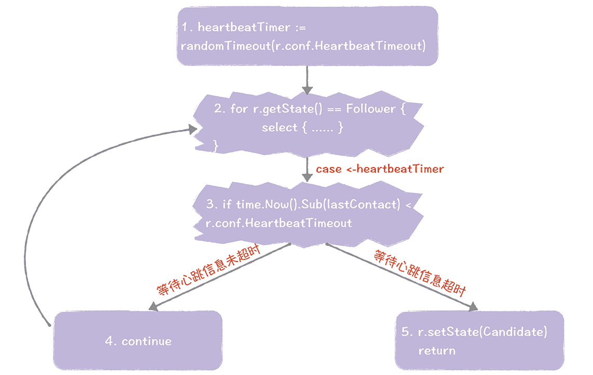
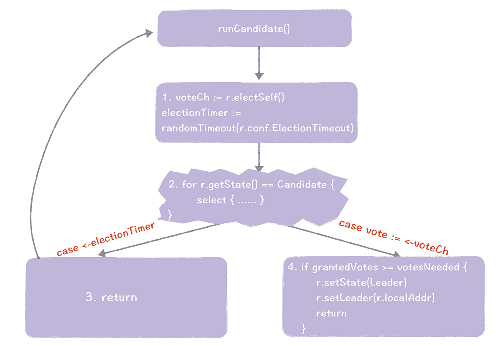
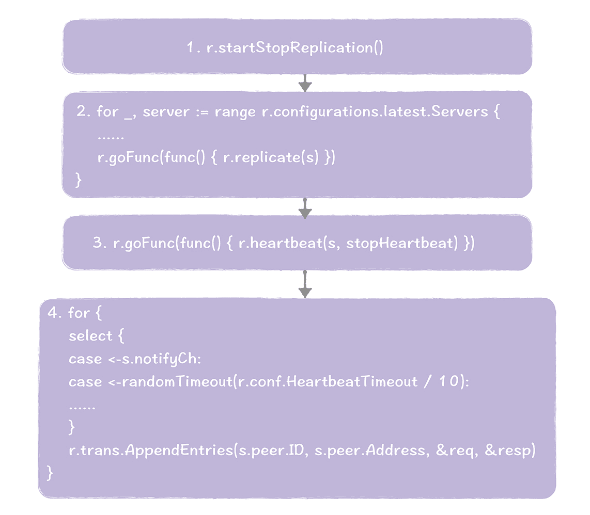
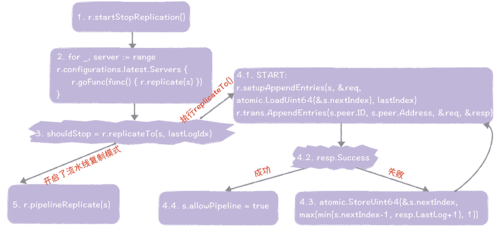
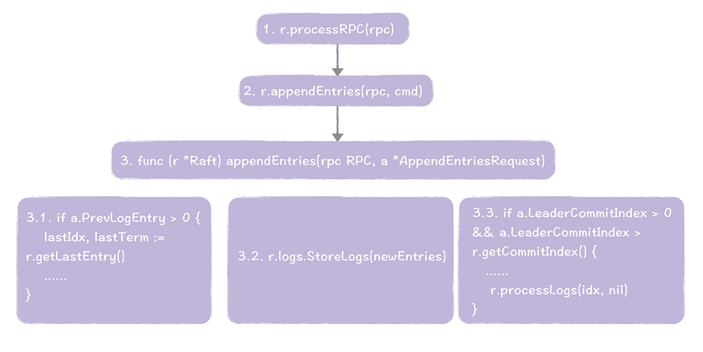

# 17 | Hashicorp Raft（一）：如何跨过理论和代码之间的鸿沟？

 

你好，我是韩健。

很多同学在开发系统的时候，都会有这样的感觉：明明自己看了很多资料，掌握了技术背后的原理，可在开发和调试的时候还是很吃力，这是为什么呢？

答案很简单，因为理论和实践本来就是两回事，实践不仅需要掌握 API 接口的用法，还需要理解 API 背后的代码实现。

所以，如果你在使用 Raft 开发分布式系统的时候，仅仅阅读 Raft 论文或者 Raft 实现的 API 手册，是远远不够的。你还要吃透 API 背后的代码实现，“不仅知其然，也要知其所以然”，这样才能“一切尽在掌握中”，从而开发实现能稳定运行的分布式系统。那么怎么做才能吃透 Raft 的代码实现呢？

要知道，任何 Raft 实现都承载了两个目标：实现 Raft 算法的原理，设计易用的 API 接口。所以，你不仅要从算法原理的角度理解代码实现，而且要从场景使用的角度理解 API 接口的用法。

而我会用两节课的时间，**从代码实现和接口使用两个角度，**带你循序渐进地掌握当前流行的一个 Raft 实现：Hashicorp Raft（以最新稳定版 v1.1.1 为例）。希望你在这个过程中集中注意力，勾划重点，以便提高学习效率，吃透原理对应的技术实现，彻底掌握 Raft 算法的实战技巧。

本节课，我会从算法原理的角度，聊一聊 Raft 算法的核心功能（领导者选举和日志复制）在 Hashicorp Raft 中是如何实现的。（如果 Raft 算法的原理你已经忘得差不多了，那你可以先回顾下 7～9 讲，加深印象之后，再进入今天的学习。）

## Hashicorp Raft 如何实现领导者选举？

**在我看来，阅读源码的关键，在于找到代码的入口函数，**比如在 Golang 代码中，程序的入口函数一般为 main() 函数，那么领导者选举的入口函数是哪个呢？

我们知道，典型的领导者选举在本质上是节点状态的变更。具体到 Hashicorp Raft 源码中，领导者选举的入口函数 run()，在 raft.go 中以一个单独的协程运行，来实现节点状态变迁，就像下面的样子：

```
func (r *Raft) run() {  
        for {  
                select {  
                // 关闭节点  
                case <-r.shutdownCh:  
                        r.setLeader("")  
                        return  
                default:  
                }  
  
                switch r.getState() {  
                // 跟随者  
                case Follower:  
                        r.runFollower()  
                // 候选人  
                case Candidate:  
                        r.runCandidate()  
                // 领导者  
                case Leader:  
                        r.runLeader()  
                }  
        }  
}
```

从上面这段代码中，你能看到，Follower（跟随者）、Candidate（候选人）、Leader（领导者）三个节点状态对应的功能，都被抽象成一个函数，分别是 runFollower()、runCandidate() 和 runLeader()。

### 数据结构

在07 讲中，我们先学习了节点状态，不过主要侧重理解节点状态的功能作用（比如说，跟随者相当于普通群众，领导者是霸道总裁），并没有关注它在实际代码中是如何实现的，所以我们先来看看在 Hashicorp Raft 中是如何实现节点状态的。

节点状态相关的数据结构和函数，是在 state.go 中实现的。跟随者、候选人和领导者的 3 个状态，是由 RaftState 定义的，一个无符号 32 位的只读整型数值（uint32）：

```
type RaftState uint32  
const (  
        // 跟随者  
        Follower RaftState = iota  
        // 候选人  
        Candidate  
        // 领导者  
        Leader  
        // 关闭状态  
        Shutdown  
)
```

需要注意的是，**也存在一些需要使用字符串格式的节点状态的场景（比如日志输出），**这时你可以使用 RaftState.String() 函数。

你应该还记得，每个节点都有属于本节点的信息（比如任期编号），那么在代码中如何实现这些信息呢？这就要说到 raftState 数据结构了。

raftState 属于结构体类型，是表示节点信息的一个大数据结构，里面包含了只属于本节点的信息，比如节点的当前任期编号、最新提交的日志项的索引值、存储中最新日志项的索引值和任期编号、当前节点的状态等，就像下面的样子：

```
type raftState struct {  
        // 当前任期编号  
        currentTerm uint64  
  
        // 最大被提交的日志项的索引值  
        commitIndex uint64  
  
        // 最新被应用到状态机的日志项的索引值  
        lastApplied uint64  
  
        // 存储中最新的日志项的索引值和任期编号    
        lastLogIndex uint64  
        lastLogTerm  uint64  
  
        // 当前节点的状态  
        state RaftState  
  
        ......  
}
```

节点状态与节点信息的定义就是这么简单，这里我就不多说了。而在分布式系统中要实现领导者选举，更重要的一层内容是实现 RPC 消息，因为领导者选举的过程，就是一个 RPC 通讯的过程。

在理论篇中我说过，Raft 算法中支持多种 RPC 消息（比如请求投票 RPC 消息、日志复制 RPC 消息）。所以接下来我们看一看，在 Hashicorp Raft 中又是怎样实现 RPC 消息的。又因为在一个 RPC 消息中，最重要的部分就是消息的内容，所以我们先来看一看 RPC 消息对应的数据结构。

RPC 消息相关的数据结构是在 commands.go 中定义的，比如，日志复制 RPC 的请求消息，对应的数据结构为 AppendEntriesRequest。而 AppendEntriesRequest 是一个结构体类型，里面包含了 Raft 算法论文中约定的字段，比如以下这些内容。

1. Term：当前的任期编号。
2. PrevLogEntry：表示当前要复制的日志项，前面一条日志项的索引值。
3. PrevLogTerm：表示当前要复制的日志项，前面一条日志项的任期编号。
4. Entries：新日志项。

具体的结构信息，就像下面的样子：

```
type AppendEntriesRequest struct {  
        // 当前的任期编号，和领导者信息（包括服务器ID和地址信息）  
        Term   uint64  
        Leader []byte  
  
        // 当前要复制的日志项，前面一条日志项的索引值和任期编号  
        PrevLogEntry uint64  
        PrevLogTerm  uint64  
  
        // 新日志项  
        Entries []*Log  
  
        // 领导者节点上的已提交的日志项的最大索引值  
        LeaderCommitIndex uint64  
}
```

我建议你可以采用上面的思路，对照着算法原理去学习其他 RPC 消息的实现，这样一来你就能掌握独立学习的能力了。其他 RPC 消息的数据结构我就不一一描述了（如果你遇到问题，可以在留言区留言）。

现在，你已经了解了节点状态和 RPC 消息的格式，掌握了这些基础知识后，我们继续下一步，看看在 Hashicorp Raft 中是如何进行领导者选举的。

### 选举领导者

首先，在初始状态下，集群中所有的节点都处于跟随者状态，函数 runFollower() 运行，大致的执行步骤，就像下图的样子：



我带你走一遍这五个步骤，便于你加深印象。

1. 根据配置中的心跳超时时长，调用 randomTimeout() 函数来获取一个随机值，用以设置心跳超时时间间隔。
2. 进入到 for 循环中，通过 select 实现多路 IO 复用，周期性地获取消息和处理。如果步骤 1 中设置的心跳超时时间间隔发生了超时，执行步骤 3。
3. 如果等待心跳信息未超时，执行步骤 4，如果等待心跳信息超时，执行步骤 5。
4. 执行 continue 语句，开始一次新的 for 循环。
5. 设置节点状态为候选人，并退出 runFollower() 函数。

当节点推举自己为候选人之后，函数 runCandidate() 执行，大致的执行步骤，如图所示：



同样的，我们走一遍这个过程，加深一下印象。

1. 首先调用 electSelf() 发起选举，给自己投一张选票，并向其他节点发送请求投票 RPC 消息，请求他们选举自己为领导者。然后调用 randomTimeout() 函数，获取一个随机值，设置选举超时时间。
2. 进入到 for 循环中，通过 select 实现多路 IO 复用，周期性地获取消息和处理。如果发生了选举超时，执行步骤 3，如果得到了投票信息，执行步骤 4。
3. 发现了选举超时，退出 runCandidate() 函数，然后再重新执行 runCandidate() 函数，发起新一轮的选举。
4. 如果候选人在指定时间内赢得了大多数选票，那么候选人将当选为领导者，调用 setState() 函数，将自己的状态变更为领导者，并退出 runCandidate() 函数。

当节点当选为领导者后，函数 runLeader() 就执行了：



整个过程，主要有 4 个步骤。

1. 调用 startStopReplication()，执行日志复制功能。
2. 然后启动新的协程，调用 replicate() 函数，执行日志复制功能。
3. 接着在 replicate() 函数中，启动一个新的协程，调用 heartbeat() 函数，执行心跳功能。
4. 在 heartbeat() 函数中，周期性地发送心跳信息，通知其他节点，我是领导者，我还活着，不需要你们发起新的选举。

其实，在 Hashicorp Raft 中实现领导者选举并不难，你只要充分理解上述步骤，并记住，领导者选举本质上是节点状态变迁，跟随者、候选人、领导者对应的功能函数分别为 runFollower()、runCandidate()、runLeader()，就可以了。

## Hashicorp Raft 如何复制日志？

学习08讲之后，你应该知道了日志复制的重要性，因为 Raft 是基于强领导者模型和日志复制，最终实现强一致性的。那么你该如何学习日志复制的代码实现呢？和学习“如何实现领导者选举”一样，你需要先了解了日志相关的数据结构，阅读日志复制相关的代码。

学习了理论篇后，你应该还记得日志复制是由领导者发起的，跟随者来接收的。可能有同学已经想到了，领导者复制日志和跟随者接收日志的入口函数，应该分别在 runLeader() 和 runFollower() 函数中调用的。赞！理解正确！

1. 领导者复制日志的入口函数为 startStopReplication()，在 runLeader() 中，以 r.startStopReplication() 形式被调用，作为一个单独协程运行。
2. 跟随者接收日志的入口函数为 processRPC()，在 runFollower() 中以 r.processRPC(rpc) 形式被调用，来处理日志复制 RPC 消息。

不过，在分析日志复制的代码实现之前，咱们先来聊聊日志相关的数据结构，便于你更好地理解代码实现。

### 数据结构

08 讲中我提到过，一条日志项主要包含了 3 种信息，分别是指令、索引值、任期编号，而在 Hashicorp Raft 实现中，日志对应的数据结构和函数接口是在 log.go 中实现的，其中，日志项对应的数据结构是结构体类型的，就像下面的样子：

```
type Log struct {  
        // 索引值  
        Index uint64  
  
        // 任期编号  
        Term uint64  
  
        // 日志项类别  
        Type LogType  
  
        // 指令  
        Data []byte  
  
        // 扩展信息  
        Extensions []byte  
}
```

我强调一下，与协议中的定义不同，日志项对应的数据结构中，包含了 LogType 和 Extensions 两个额外的字段：

1. LogType 可用于标识不同用途的日志项，比如，使用 LogCommand 标识指令对应的日志项，使用 LogConfiguration 表示成员变更配置对应的日志项。
2. Extensions 可用于在指定日志项中存储一些额外的信息。**这个字段使用的比较少，在调试等场景中可能会用到，你知道有这么个字段就可以了。**

说完日志复制对应的数据结构，我们分步骤看一下，在 Hashicorp Raft 中是如何实现日志复制的。

### 领导者复制日志

日志复制是由领导者发起，在 runLeader() 函数中执行的，主要有这样几个步骤。



1. 在 runLeader() 函数中，调用 startStopReplication() 函数，执行日志复制功能。
2. 启动一个新协程，调用 replicate() 函数，执行日志复制相关的功能。
3. 在 replicate() 函数中，调用 replicateTo() 函数，执行步骤 4，如果开启了流水线复制模式，执行步骤 5。
4. 在 replicateTo() 函数中，进行日志复制和日志一致性检测，如果日志复制成功，则设置 s.allowPipeline = true，开启流水线复制模式。
5. 调用 pipelineReplicate() 函数，采用更高效的流水线方式，进行日志复制。

在这里我强调一下，在什么条件下开启了流水线复制模式，很多同学可能会在这一块儿产生困惑，因为代码逻辑上有点儿绕。**你可以这么理解，是在不需要进行日志一致性检测，复制功能已正常运行的时候，开启了流水线复制模式，**目标是在环境正常的情况下，提升日志复制性能，如果在日志复制过程中出错了，就进入 RPC 复制模式，继续调用 replicateTo() 函数，进行日志复制。

### 跟随者接收日志

领导者复制完日志后，跟随者会接收日志并开始处理日志。跟随者接收和处理日志，是在 runFollower() 函数中执行的，主要有这样几个步骤。



1. 在 runFollower() 函数中，调用 processRPC() 函数，处理接收到的 RPC 消息。
2. 在 processRPC() 函数中，调用 appendEntries() 函数，处理接收到的日志复制 RPC 请求。
3. appendEntries() 函数，是跟随者处理日志的核心函数。在步骤 3.1 中，比较日志一致性；在步骤 3.2 中，将新日志项存放在本地；在步骤 3.3 中，根据领导者最新提交的日志项索引值，来计算当前需要被应用的日志项，并应用到本地状态机。

讲到这儿，你应该可以了解日志复制的代码实现了吧。关于更多的 Raft 原理的代码实现，你可以继续阅读源码来学习，如果在学习过程中有疑问，欢迎给我留言。

## 内容小结

本节课我主要带你了解了如何从算法原理的角度理解 Hashicorp Raft 实现，有几个重点我想强调一下：

1. 跟随者、候选人、领导者 3 种节点状态都有分别对应的功能函数，当需要查看各节点状态相关的功能实现时（比如，跟随者如何接收和处理日志），都可以将对应的函数作为入口函数，来阅读代码和研究功能实现。
2. raft.go 是 Hashicorp Raft 的核心代码文件，大部分的核心功能都是在这个文件中实现的，平时可以多研究这个文件中的代码，直到彻底吃透，掌握。
3. 在 Hashicorp Raft 中，支持两种节点间通讯机制，内存型和 TCP 协议型，其中，内存型通讯机制，主要用于测试，2 种通讯机制的代码实现，分别在文件 inmem_transport.go 和 tcp_transport.go 中。
4. Hashicorp Raft 实现，是常用的 Golang 版 Raft 算法的实现，被众多流行软件使用，如 Consul、InfluxDB、IPFS 等，相信你对它并不陌生。其他的实现还有Go-Raft、LogCabin、Willemt-Raft等，不过我建议你在后续开发分布式系统时，优先考虑 Hashicorp Raft，因为 Hashicorp Raft 实现，功能完善、代码简洁高效、流行度高，可用性和稳定性被充分打磨。

最后，关于如何高效地阅读源码，我还想多说一说。在我看来，高效阅读源码的关键在于抓住重点，要有“底线”，不要芝麻和西瓜一把抓，什么都想要，最终陷入到枝节琐碎的细节中出不来。什么是重点呢？我认为重点是数据结构和关键的代码执行流程，比如在 Hashicorp Raft 源码中，日志项对应的数据结构、RPC 消息对应的数据结构、选举领导者的流程、日志复制的流程等，这些就是重点。

有的同学可能还有疑问：在阅读源码的时候，如果遇到不是很明白的代码，该怎么办呢？我建议你可以通过打印日志或 GDB 单步调试的方式，查看上下文中的变量的内容、代码执行逻辑等，帮助理解。

## 课堂思考

在 Hashicorp Raft 实现中，我讲了如何实现选举领导者，以及如何复制日志等，那么在 Hashicorp Raft 中，网络通讯是如何实现的呢？欢迎在留言区分享你的看法，与我一同讨论。

最后，感谢你的阅读，如果这篇文章让你有所收获，也欢迎你将它分享给更多的朋友。
