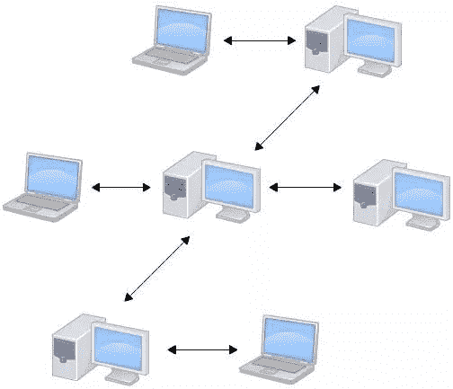
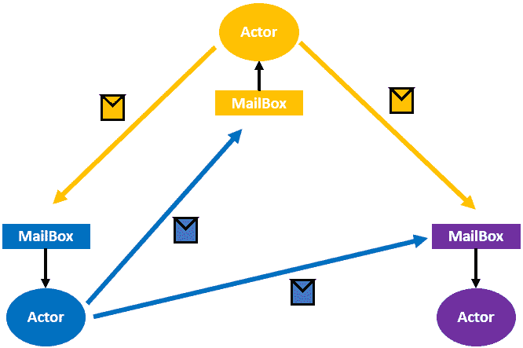
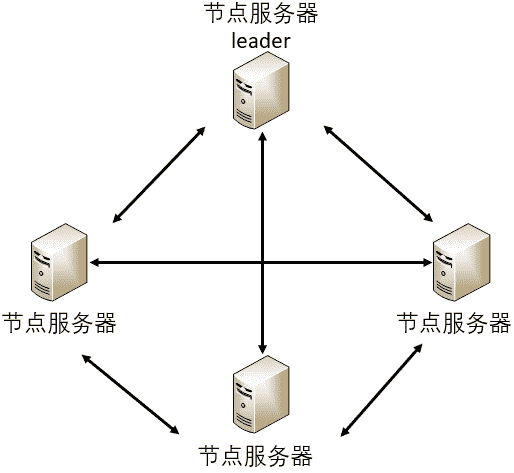
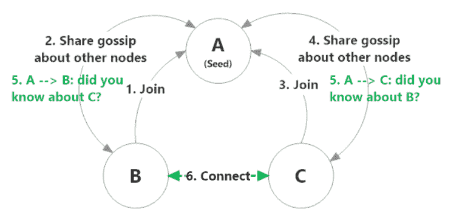
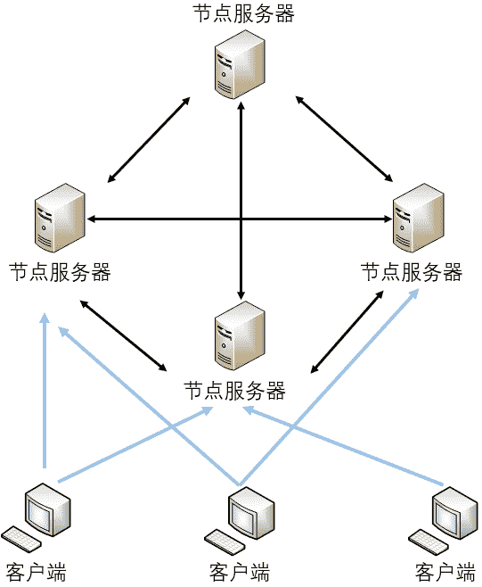
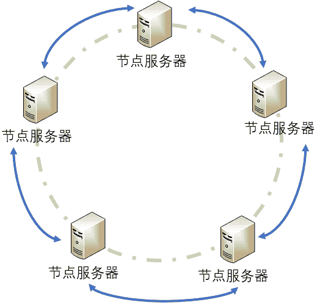
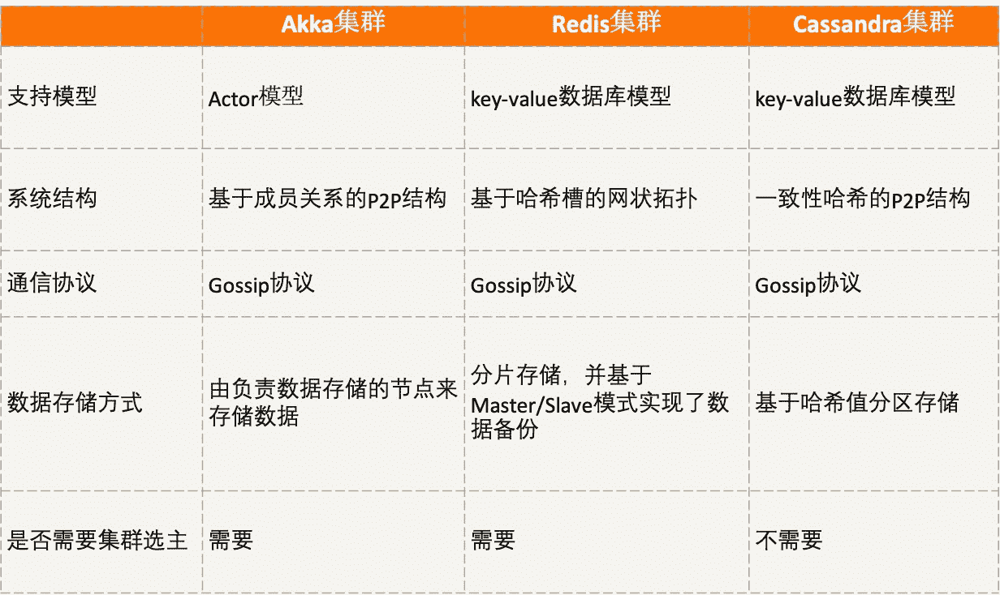
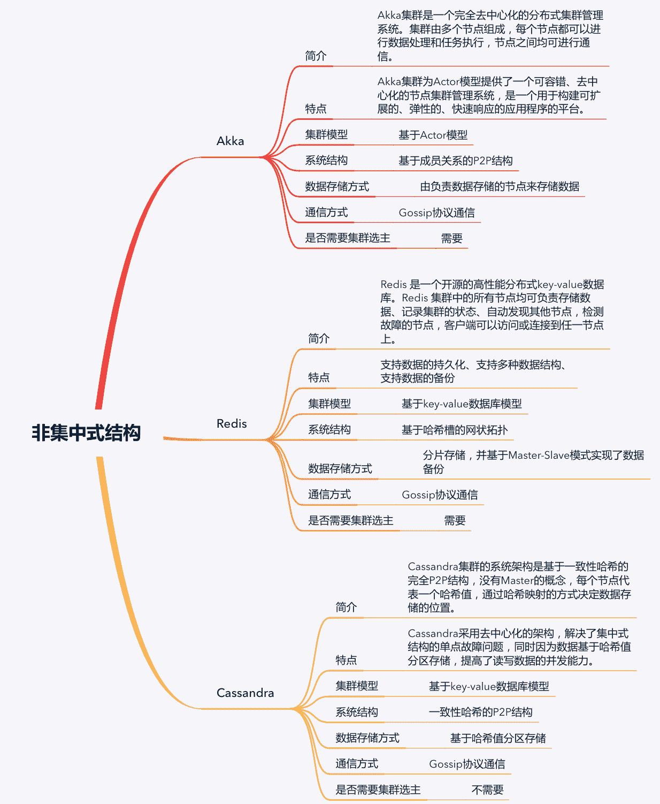

# 10 | 分布式体系结构之非集中式结构：众生平等

 

你好，我是聂鹏程。今天，我来继续带你打卡分布式核心技术。

在上一篇文章中，我带你了解了分布式体系结构中的集中式结构。虽然很多云上的管理都采用了集中式结构，但是这种结构对中心服务器性能要求很高，而且存在单点瓶颈和单点故障问题。

为了解决这个问题，分布式领域中又出现了另一经典的系统结构，即非集中式结构，也叫作分布式结构。那什么是非集中式结构呢，它的原理是什么样的，又有哪些集群采用了这种结构呢？

今天，我们就一起打卡非集中式结构，揭开它的神秘面纱吧。

## 什么是非集中式结构？

在非集中式结构中，服务的执行和数据的存储被分散到不同的服务器集群，服务器集群间通过消息传递进行通信和协调。

也就是说，在非集中式结构中，没有中央服务器和节点服务器之分，所有的服务器地位都是平等（对等）的，也就是我们常说的“众生平等”。这样一来，相比于集中式结构，非集中式结构就降低了某一个或者某一簇计算机集群的压力，在解决了单点瓶颈和单点故障问题的同时，还提升了系统的并发度，比较适合大规模集群的管理。

所以近几年来，Google、 Amazon、Facebook、阿里巴巴、腾讯等互联网公司在一些业务中也相继采用了非集中式结构。

接下来，我将为你介绍 3 种典型的非集中式架构系统，包括 Akka 集群、Redis 集群和 Cassandra 集群，来帮助你深入理解非集中式架构。

## Akka 集群

在介绍 Akka 集群的结构之前，我带你了解一下什么是 Akka 框架吧。

Akka 框架基于 Actor 模型，提供了一个用于构建可扩展的、弹性的、快速响应的应用程序的平台。其中，Actor 是一个封装了状态和行为的对象，它接收消息并基于该消息执行计算。Actor 之间互相隔离，不共享内存，但 Actor 之间可通过交换消息（mail）进行通信（每个 Actor 都有自己的 MailBox）。

比如，在分布式系统中，一个服务器或一个节点可以视为一个 Actor，Actor 与 Actor 之间采用 mail 进行通信，如下图所示：

可以看到，Actor 发送的 Mail 消息会存储在接收方的 MailBox 中。默认情况下，接收方按照 mail 到达的先后顺序，从 MailBox 中提取 mail 消息，并进行相应的计算处理。

>  
> 备注：关于 Actor 模型更详细的内容，我会在第 17 篇文章中会与你讲述。
 

显然，Actor 模型为系统并发度提供了非常好的解决方案，且是一个异步的、非阻塞的、高性能的事件驱动编程模型。Akka 集群充分利用了 Actor 模型的优势，提供了一个非集中式架构的集群管理模块，用来构建可扩展的、弹性的分布式应用程序。

Akka 集群负责 Actor 模型底层的节点管理，包括故障检测、节点加入 / 退出集群等。也就是说，Akka 集群为 Actor 模型提供了一个可容错、去中心化的节点集群管理系统，来保证 Actor 的运行和 Actor 之间的通信。

如下图所示，Akka 集群是一个完全去中心化的分布式集群管理系统。一个集群由多个节点组成，每个节点都可以进行数据处理和任务执行，节点之间均可进行通信。节点有 Leader 节点和非 Leader 节点之分。与非 Leader 节点相比，**Leader 节点只是增加了负责节点的加入和移除集群的功能**，所以并不会影响非集中式结构中节点的平等关系。

可以看到，Akka 集群的两个重点是数据传输和集群组建及管理，所以接下来我将从这两个方面与你介绍 Akka 集群。

**首先，我们看一下数据传输。**在 Akka 集群中，节点是对等的，也就是说每个节点是可以并发处理的，因此必然存在数据传输和一致性的问题。

比如，我们要针对数据进行操作，将 X=1 修改为 X=2。现在集群中节点 1 进行了修改使得 X=2，但其他节点上还是 X=1，因此节点 1 需要将 X=2 的消息告知其他节点，以保证最终集群中所有节点上均为 X=2。

其实，这个问题就是分布式共识问题。我已经在第 5 篇文章“[分布式共识：存异求同](https://time.geekbang.org/column/article/144548)”中，与你介绍了 PoW、PoS 和 DPoS 三种达成共识的方法，你可以再复习下相关内容。

**Akka 集群主要采用的是谁的时间戳最新（也就是数据最新），就以谁为准的原则。**在这里我要重点与你讲述的是，如何将 X=2 这个消息传输给集群中的每个节点。

Akka 集群采用了**Gossip 协议**，该协议是最终一致性协议。它的原理是每个节点周期性地从自己维护的集群节点列表中，随机选择 k 个节点，将自己存储的数据信息发给这 k 个节点，接收到该信息的节点采用前面讲的共识原则，对收到的数据和本地数据进行合并，这样迭代几个周期后，集群中所有节点上的数据信息就一致了。

这就好比我们生活中的“谣言传播”一样，用户 A 告诉用户 B“商场新开了一家火锅店”，用户 B 收到信息后再告诉用户 C，然后用户 C 再告诉用户 D。这样，用户 A、B、C、D 最终都知道了这个消息。

**接下来，我们看一下集群组建及管理。**下图展示了 Akka 集群的创建过程。在创建集群时，节点被分为三种类型，即：

 
- 种子节点。使用静态配置文件方式或者系统运行时指定方式，可以生成种子节点；种子节点是普通节点加入集群的联系点，可以自动接收新加入集群的节点的信息。 
- 首种子节点。首种子节点是配置文件中的第一个种子节点，其功能是集群第一次启动时，首种子节点启动起来，集群才能组建成功，保证集群第一次创建时只有一个集群。如下图 A 节点，就是 Akka 集群的首种子节点。 
- 普通节点。可以向种子节点或集群中的任意节点发送 Join 消息，请求加入集群。如下图的 B 和 C 节点，通过向 A 节点发送 Join 消息，从而加入到 Akka 集群。 

>  
> 备注：图片引自[https://getakka.net/articles/clustering/cluster-overview.html](https://getakka.net/articles/clustering/cluster-overview.html)
 

Akka 集群的每个节点启动后，读取配置文件获取种子节点列表，然后开始组建集群：

 
- 如果本节点为首种子节点，则把自己加入到集群列表中，即以自己为中心构建集群； 
- 如果本节点为种子节点，则向首种子节点请求加入集群，当首种子节点回复同意消息后，可以加入集群，否则不可加入集群； 
- 如果本节点为普通节点，则可以向任一种子节点（包括首种子节点）请求加入集群，收到同意后，则加入集群，否则不可加入集群。 

加入首种子节点或种子节点的节点信息，会通过 Gossip 协议的传播方式传播给当前已加入的所有节点，以完成集群组建。当集群组建完成后，就不存在种子节点与普通节点之分了，每个节点均可执行 Actor 应用程序。

Akka 集群可以构建可扩展的、弹性的分布式应用程序，因此在 JVM 中应用了 Akka 框架，从而实现并发编程。目前，豌豆荚、蘑菇街等公司采用了 Akka 集群。

**到这里，我们小结一下吧**。Akka 集群是一个完全去中心化的集群管理系统，当集群组建完成后，每个节点均可执行 Actor 应用程序，因此支持并发操作。但，这个并发操作引入了数据同步和一致性问题，所以 Akka 集群采用了 Gossip 协议进行数据同步，通过谁的时间戳最新就以谁为准，来解决一致性问题。

在实际业务场景中，除了面向应用程序平台的分布式集群管理之外，分布式数据存储也是一个非常重要的话题。在这其中，分布式数据存储中的集群管理便是一个关键因素。那么接下来，我就以开源数据库 Redis 的集群管理系统为例，与你展开介绍吧。

## Redis 集群

Redis 是一个开源的高性能分布式 key-value 数据库，应用广泛，其特征主要表现为：

 
- 支持数据的持久化，可以将内存中的数据保存在磁盘中，重启时可以再次加载并使用； 
- 支持多种数据结构，不仅支持简单的 key-value 类型的数据，同时还提供 list、set、hash 等数据结构的存储； 
- 支持数据的备份，即 Master/Slave 模式的数据备份。 

Redis 的这些特征均是为数据存储进行服务的，数据可分片存储在不同的 Redis 节点上，多个 Redis 节点间可共享数据，而提供这项能力的就是 Redis 集群。

Redis 集群中不存在中央节点，是典型的去中心化结构，每个节点均可与其他节点通信。所有节点均可负责存储数据、记录集群的状态（包括键值到正确节点的映射），客户端可以访问或连接到任一节点上。集群节点同样能自动发现其他节点，检测故障的节点，并在需要的时候在从节点中推选出主节点。Redis 集群的架构图如下所示。

当然，节点之间的数据传输仍采用了 Gossip 协议，来保证集群中数据的最终一致性。

Redis 集群中的节点用于数据存储，所以**在设计时，需要考虑数据的可靠性和分片存储问题**。

对于可靠性的问题，集群中每个节点均存在主备，也就是说每台服务器上都运行两个 Redis 服务，分别为主备，主故障后，备升主。

而对于数据的分片存储问题，Redis 集群引入了**哈希槽**的概念。Redis 集群内置了 16384 个哈希槽，每个节点负责一部分哈希槽。当客户端要存储一个数据或对象时，对该对象的 key 通过 CRC16 校验后对 16384 取模，也就是 HASH_SLOT = CRC16(key) mod 16384 来决定哈希槽，从而确定存储在哪个节点上。

比如，当前集群有 3 个节点，那么:

 
- 节点 A 包含 0 到 5500 号哈希槽； 
- 节点 B 包含 5501 到 11000 号哈希槽； 
- 节点 C 包含 11001 到 16383 号哈希槽。 

Redis 集群采用集群分片方式实现了数据的分片存储，从而将 Redis 的写操作分摊到了多个节点上，提高了写并发能力。

**到这里，我们小结一下。**Redis 集群是一个非集中式集群管理系统，没有中心节点，不会因为某个节点造成性能瓶颈，每个节点均支持数据存储，且采用分片存储方式，提高了写的并发能力。同时，每个节点的设计采用主备设计，提高了数据的可靠性。

鉴于这些优点，Redis 已被 Twitter、Uber、GitHub、Instagaram 等公司采用。

除了 Redis 外，还有一个开源分布式 key-value 数据库系统 Cassandra。接下来，我就再与你分享下 Cassandra 集群的设计，以加深你对非集中式架构的理解。

## Cassandra 集群

与 Redis 类似，Cassandra 也支持数据的分布式存储和操作。因此，Cassandra 的集群架构与数据分片存储方案，与 Redis 集群类似。

如下图所示，Cassandra 集群的系统架构是基于一致性哈希的完全 P2P 结构，没有 Master 的概念，所有节点都是同样的角色，彻底避免了因为单点问题导致的系统不稳定。Cassandra 集群节点间的状态同步，也是通过 Gossip 协议来进行 P2P 通信的。

集群中的每个节点，都可以存储数据，并接收来自客户端的请求。**Cassandra 集群数据存储与 Redis 的不同之处是，**Redis 集群每个节点代表一部分哈希槽，一个哈希槽代表一个哈希值区间，而 Cassandra 集群中每个节点代表一个哈希值。

在 Cassandra 集群中，每次客户端随机选择集群中的一个节点来请求数据，对应接收请求的节点将对应的 key 在一致性哈希环上定位出是哪些节点应该存储这个数据，然后将请求转发到对应的节点上，并将对应若干节点的查询反馈返回给客户端。

目前，Cassandra 集群因为完全去中心化的结构模式，已经被 Apple、Comcast、Instagram、Spotify、eBay、Netflix 等公司使用。

**到这里，我们小结一下吧。**Cassandra 采用去中心化的架构，解决了集中式结构的单点故障问题，同时因为数据基于哈希值分区存储，提高了读写数据的并发能力。在 Cassandra 集群中，没有 Master 的概念，每个节点代表一个哈希值，通过哈希映射的方式决定数据存储的位置。集群间的状态同步通过 Gossip 协议来进行 P2P 的通信。

## 对比分析

好了，以上就是 Akka 集群、Redis 集群和 Cassandra 集群的主要内容了。为了便于理解与记忆，我将这 3 个集群的主要特征梳理为了一张表格，如下所示：

## 知识扩展：如何优化 Gossip 协议中的重复消息问题？

非集中式结构的通信协议采用了 Gossip 协议。而 Gossip 是一种谣言传播协议，每个节点周期性地从节点列表中选择 k 个节点，将本节点存储的信息传播出去，直到所有节点信息一致，即算法收敛了。

这里有个问题，如果每次都是随机选择 k 个节点的话，势必会存在重复选择同样节点的可能，增加消息量。你觉得这个问题是否可以优化，又应该如何优化呢？

首先，这个问题肯定是可以优化的。解决方案是，每个节点记录当前传输的消息且还未达到收敛的时候，已经发送给了哪些节点，然后每次选择时从没有发送过的节点列表中随机选择 k 个节点，直到所有节点均被传输或集群收敛为止。这样，一方面减少了重复消息量，另一方面加快了收敛速度。

## 总结

集中式结构虽然易于理解，但容易出现单点瓶颈和单点故障等问题，而非集中结构才是超大规模分布式系统的首选结构。所以今天，我以 Akka 集群、Redis 集群和 Cassandra 集群的结构为例，与你详细介绍了非集中式架构。

Akka 集群是一个完全去中心化的集群管理系统，节点之间都是 P2P 的连接模式，通过 Gossip 协议来进行通信，节点之间有角色划分，负责数据存储的节点会进行存储数据。

Redis 集群也是 P2P 的网状连接模式，但是基于 key-value 的数据库模型，每个节点都可以执行数据的计算和存储。此外，Redis 集群引入了哈希槽的概念，来解决数据的分片存储问题。

Cassandra 集群的结构是一致性哈希的 P2P，节点会构成一个环结构，通过哈希映射来选择对应的节点。

好了，到最后，我再以一个思维导图为你总结一下这三个集群核心知识点，以方便你理解与记忆。

虽然这三种集群的节点组织结构各有不同，但节点之间都是通过 Gossip 协议来传递信息的。因此，在实现过程中，集群的消息传输、节点的功能等，在不同的分布式系统中都是类似的，而难点主要在于集群结构的设计。

由于 Akka 集群、Redis 集群和 Cassandra 集群都是典型的非集中式集群组织结构，目前应用已经非常广泛了，所以有很多的实现案例可供你借鉴了。对于具体集群使用配置可参考相应的官网手册，讲得比较全和细。

相信你通过对今天的学习以后，很快就可以上手非集中式架构的集群管理应用和实践了。加油，挑战一下自己吧！

## 思考题

边缘计算中边缘设备的管理，你认为适合非集中式结构还是集中式结构呢，原因又是什么呢？

我是聂鹏程，感谢你的收听，欢迎你在评论区给我留言分享你的观点，也欢迎你把这篇文章分享给更多的朋友一起阅读。我们下期再会！

