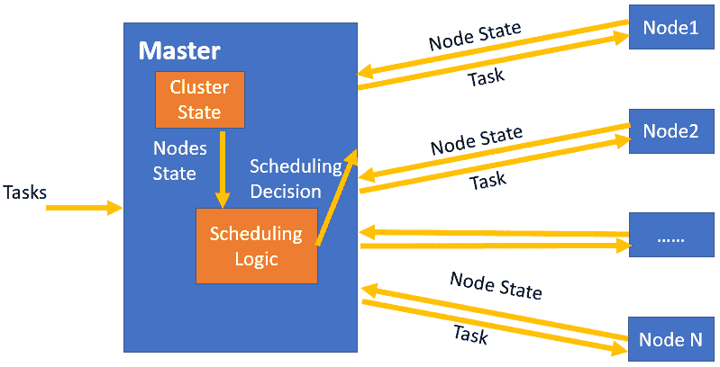
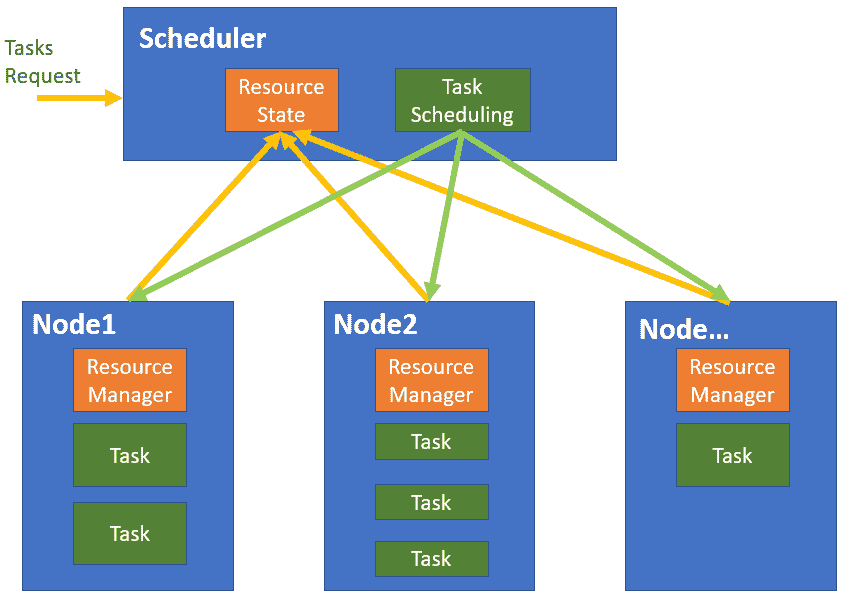
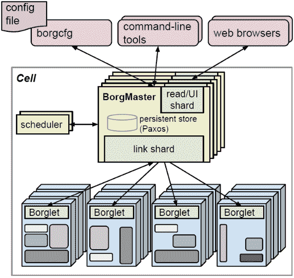
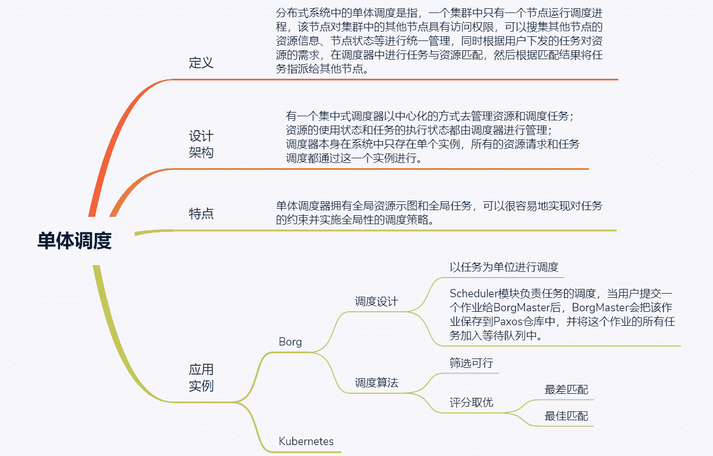

# 11 | 分布式调度架构之单体调度：物质文明、精神文明一手抓

 

你好，我是聂鹏程。今天，我来继续带你打卡分布式核心技术。

在前两篇文章中，我和你分析了云资源管理的集中式架构和非集中式架构。可以看出，分布式系统架构的目的是，将多个服务器资源管理起来，寻找合适的服务器去执行用户任务。

那，什么是合适的服务器呢？衡量一个服务器是否合适会涉及很多条件或约束，比如在一些场景下，任务存在优先级，那当我们需要执行多个任务的时候，通常需要满足优先级高的任务优先执行的条件。但在这些条件中，服务器资源能够满足用户任务对资源的诉求是必须的。

而为用户任务寻找合适的服务器这个过程，在分布式领域中叫作**调度**。在分布式系统架构中，调度器就是一个非常重要的组件。它通常会提供多种调度策略，负责完成具体的调度工作。

当然，不同的分布式架构的调度器原理也不一样，最常见或最直观的是单体调度，就是任务和分布式系统中的空闲资源直接进行匹配调度。也就是说，调度器同时管理任务和资源，如果把资源比作“物质文明”，把任务比作“精神文明”，那么单体调度就是“物质文明和精神文明一手抓”。

接下来，我带你一起打卡分布式调度架构之单体调度。

首先，让我们先了解一下什么是单体调度。

## 什么是单体调度？

分布式系统中的单体调度是指，一个集群中只有一个节点运行调度进程，该节点对集群中的其他节点具有访问权限，可以搜集其他节点的资源信息、节点状态等进行统一管理，同时根据用户下发的任务对资源的需求，在调度器中进行任务与资源匹配，然后根据匹配结果将任务指派给其他节点。

**单体调度器拥有全局资源视图和全局任务，可以很容易地实现对任务的约束并实施全局性的调度策略**。目前很多集群管理系统采用了单体调度设计，比如我们[第 9 篇文章](https://time.geekbang.org/column/article/148187)中讲到的 Google Borg、Kubernetes 等。

如下图所示，图中展示了一个典型的单体调度框架。Master 节点上运行了调度进程（负责资源管理、Tasks 和资源匹配）；Node 1，Node 2，…， Node N 对应着我们在第 9 篇文章中讲的 Master/Slave 架构中的 Slave 节点。

Slave 节点会将 Node State 上报给 Master 节点的 Cluster State 模块，Cluster State 模块用于管理集群中节点的资源等状态，并将节点的资源状态传送给 Scheduling Logic 模块，以便 Scheduling Logic 模块进行 Tasks 与资源匹配，并根据匹配结果将 Task 发送给匹配到的节点。

## 单体调度设计

在集群管理中，单体调度模块称为“Scheduler”或“单体调度器”。单体调度器也叫作集中式调度器，指的是使用中心化的方式去管理资源和调度任务。

也就是说，调度器本身在系统中以单实例形式存在，所有的资源请求和任务调度都通过这个实例进行。集中式调度器的常见模型，如下图所示。可以看到，在这一模型中，资源的使用状态和任务的执行状态都由调度器进行管理。

在 Borg 和 Kubernetes 这两个集群管理系统中，Scheduler 是它们的核心。而 Kubernetes 又是 Borg 的开源版本。所以接下来，我就以 Borg 为例，与你讲述它的调度器是如何设计的，才能保证在上万台机器规模的集群上，运行来自几千个不同应用的几十万个作业。

## Borg 调度设计

调度的初衷是为作业或任务寻找合适的资源，也就是说作业或任务是调度的对象。那么作业和任务到底是什么呢？下面，我带你先了解一下作业和任务的概念以及关系。

**我们先来看看作业和任务的定义分别是什么吧。**

一个 Borg 作业的属性包括名称、拥有者和任务个数。作业可以有一些约束来强制其任务运行在有特定属性的机器上，比如处理器架构、操作系统版本、是否有外网 IP 地址等。这些约束可以是硬性的也可以是柔性的，其中柔性约束表示偏好，而非需求。一个作业只在一个集群中运行。

而一个任务对应的是一组 Linux 进程，运行在一台机器上的一个容器内或直接运行在节点上。任务也有一些属性，比如资源需求量、在作业中的序号等。

那么，**作业和任务是什么关系呢？**

概括来说，一个作业可以包含多个任务。作业类似于用户在一次事务处理或计算过程中要求计算机所做工作的总和，而任务就是一项项具体的工作，二者属于包含关系。

一个作业中的任务大多有相同的属性，但也可以被覆盖 ，比如特定任务的命令行参数、各维度的资源（比如，CPU 核、内存、硬盘空间、硬盘访问速度、TCP 端口等）。

多个任务可以在多台机器上同时执行，从而加快作业的完成速度，提高系统的并行程度。而具体将哪个任务分配给哪个机器去完成，就是调度器要做的事儿了。

接下来，我就与你讲述下 Borg 的 Scheduler 组件，来帮助你理解 Borg 内部的任务调度流程，以加深你对单体调度的理解。其实，很多框架比如 Hadoop、Spark 等都是采用了单体调度设计，它们整体的思想类似，所以我希望通过对 Borg 调度的讲解，能够帮助你理解你所在业务中的调度逻辑。

我们先来回忆下 Borg 的系统架构图吧。

Scheduler 负责任务的调度，当用户提交一个作业给 BorgMaster 后，BorgMaster 会把该作业保存到 Paxos 仓库中，并将这个作业的所有任务加入等待队列中。调度器异步地扫描等待队列，将任务分配到满足作业约束且有足够资源的计算节点上。

这里我要再强调一下，**调度是以任务为单位的，而不是以作业为单位**。调度器在扫描队列时，按照任务的优先级从高到低进行选择，同优先级的任务则以轮询的方式处理，以保证用户间的公平，并避免队首的大型作业阻塞队列。

接下来，我们再看看调度器的核心部分，也就是调度算法吧。

## Borg 调度算法

Borg 调度算法的核心思想是“筛选可行，评分取优”，具体包括两个阶段：

 
- **可行性检查**，找到一组可以运行任务的机器（Borglet）； 
- **评分**，从可行的机器中选择一个合适的机器（Borglet）。 

**首先，我们看一下可行性检查**。在可行性检查阶段，调度器会找到一组满足任务约束，且有足够可用资源的机器。比如，现在有一个任务 A 要求能部署的节点是节点 1、节点 3 和节点 5，并且任务资源需求为 0.5 个 CPU、2MB 内存。根据任务 A 的约束条件，可以先筛选出节点 1、节点 3 和节点 5，然后根据任务 A 的资源需求，再从这 3 个节点中寻找满足任务资源需求的节点。

这里需要注意的是，每个节点上的可用资源，包括已经分配给低优先级任务但可以抢占的资源。

**然后，我们看看评分阶段。**

在评分阶段，调度器确定每台可行机器的适宜性。Borg 根据某一评分机制，对可行性检查阶段中筛选出的机器进行打分，选出最适合调度的一台机器。

在评分过程中，我们可以制定多种评价指标，比如考虑如何最小化被抢占的任务数、尽量选择已经下载了相同 package 的机器、目标任务是否跨域部署、在目标机器上是否进行高低优先级任务的混合部署等。 根据不同的考虑因素，可以定制不同的评分算法。

**其中，常见的评分算法，包括“最差匹配”和“最佳匹配”两种。**

Borg 早期使用修改过的 E-PVM 算法来评分，该算法的核心是将任务尽量分散到不同的机器上。该算法的问题在于，它会导致每个机器都有少量的无法使用的剩余资源，因此有时称其为“**最差匹配**”（worst fit）。

比如，现在有两个机器，机器 A 的空闲资源为 1 个 CPU 和 1G 内存、机器 B 的空闲资源为 0.8 个 CPU 和 1.2G 内存；同时有两个任务，Task1 的资源需求为 0.4 个 CPU 和 0.3G 内存、Task2 的资源需求为 0.3CPU 和 0.5G 内存。按照最差匹配算法思想，Task1 和 Task2 会分别分配到机器 A 和机器 B 上，导致机器 A 和机器 B 都存在一些资源碎片，可能无法再运行其他 Task。

与之相反的是“**最佳匹配**”（best fit），即把机器上的任务塞得越满越好。这样就可以“空”出一些没有用户作业的机器（它们仍运行存储服务），来直接放置大型任务。

比如，在上面的例子中，按照最佳匹配算法的思想，Task1 和 Task2 会被一起部署到机器 A 或机器 B 上，这样未被部署的机器就可以用于执行其他大型任务了。

但是，如果用户或 Borg 错误估计了资源需求，紧凑的装箱操作会对性能造成巨大的影响。比如，用户估计它的任务 A 需要 0.5 个 CPU 和 1G 内存，运行该任务的服务器上由于部署了其他任务，现在还剩 0.2 个 CPU 和 1.5G 内存，但用户的任务 A 突发峰值时（比如电商抢购），需要 1 个 CPU 和 3G 内存，很明显，初始资源估计错误，此时服务器资源不满足峰值需求，导致任务 A 不能正常运行。

所以说，最佳匹配策略不利于有突发负载的应用，而且对申请少量 CPU 的批处理作业也不友好，因为这些作业申请少量 CPU 本来就是为了更快速地被调度执行，并可以使用碎片资源。还有一个问题，这种策略有点类似“把所有鸡蛋放到一个篮子里面”，当这台服务器故障后，运行在这台服务器上的作业都会故障，对业务造成较大的影响。

因此，这两个评分算法各有利弊。在实践过程中，我们往往会根据实际情况来选择更适宜的评分算法。比如，对于资源比较紧缺，且业务流量比较规律，基本不会出现突发情况的场景，可以选择最佳匹配算法；如果资源比较丰富，且业务流量会经常出现突发情况的场景，可以选择最差匹配算法。

Borg 的设计是支持高优先级抢占低优先级任务的，也就是说如果评分后选中的机器上没有足够的资源来运行新任务，Borg 会抢占低优先级的任务，从最低优先级逐级向上抢占，直到可用资源足够运行该任务。被抢占的任务放回到调度器的等待队列里，而不会被迁移或使其休眠。

当然有很多调度框架是支持用户根据自己的场景自定义调度策略的，比如优先级策略、亲和性策略、反亲和性策略等。

## 知识扩展：多个集群 / 数据中心如何实现单体调度呢？

今天这篇文章中，我与你讲述的单体调度，其实是针对一个集群或一个数据中心的，那么多个集群或多个数据中心，能不能基于单体调度实现呢？

答案是肯定的，这就是**集群联邦**的概念了。

所谓集群联邦，就是将多个集群联合起来工作，核心思想是增加一个控制中心，由它提供统一对外接口，多个集群的 Master 向这个控制中心进行注册，控制中心会管理所有注册集群的状态和资源信息，控制中心接收到任务后会根据任务和集群信息进行调度匹配，选择到合适的集群后，将任务发送给相应的集群去执行。

集群联邦的概念，其实就是单体调度的分层实现。如果你对集群联邦感兴趣的话，推荐你看一下 Kubernetes 的集群联邦设计和工作原理。

## 总结

今天，我以 Borg 为例，与你讲述了单体调度架构的设计及调度算法。

单体调度是指一个集群中只有一个节点运行调度进程，该调度进程负责集群资源管理和任务调度，也就是说单体调度器拥有全局资源视图和全局任务。

单体调度的特征，可以总结为以下四点：

 
- 单体调度器可以很容易实现对作业的约束并实施全局性的调度策略，因此适合批处理任务和吞吐量较大、运行时间较长的任务。 
- 单体调度系统的状态同步比较容易且稳定，这是因为资源使用和任务执行的状态被统一管理，降低了状态同步和并发控制的难度。 
- 调度算法只能全部内置在核心调度器当中，因此调度框架的灵活性和策略的可扩展性不高。 
- 单体调度存在单点故障的可能性。 

现在，我再用一个思维导图为你总结一下今天的主要内容，以方便你理解记忆。

单体调度器虽然具有单点瓶颈或单点故障问题，但因为其具有全局资源视图和全局任务，简单易维护，被很多公司广泛采用，比如 Google、阿里、腾讯等公司。另外，我们今天介绍的 Borg 集群管理系统，以及其开源版 Kubernetes 集群管理系统，使用的都是单体调度结构。

单体调度结构虽然结构单一，但是其调度算法可以扩展甚至自定义，也就是说你可以根据业务特征，自定义调度策略，比如优先级策略、亲和性策略等。

学完了关于单体调度的知识后，赶紧上手试试，定制一个独特的调度算法或设计一个特定的单体调度器吧。如果你在这个过程中遇到了什么问题，就留言给我吧。

## 思考题

你能和我分享下，Google Borg 是采用什么技术实现的资源隔离吗？

我是聂鹏程，感谢你的收听，欢迎你在评论区给我留言分享你的观点，也欢迎你把这篇文章分享给更多的朋友一起阅读。我们下期再会！

