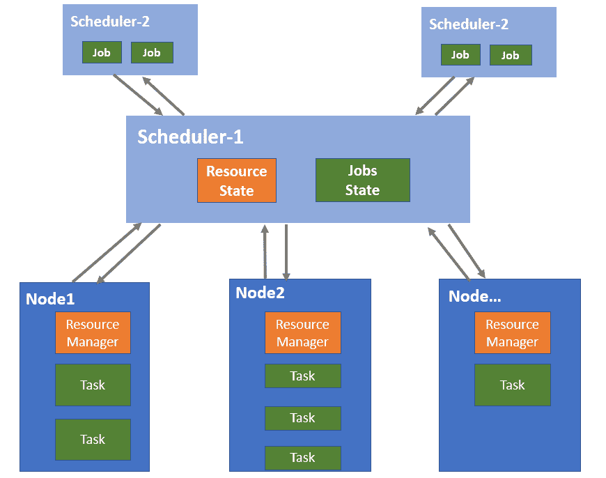
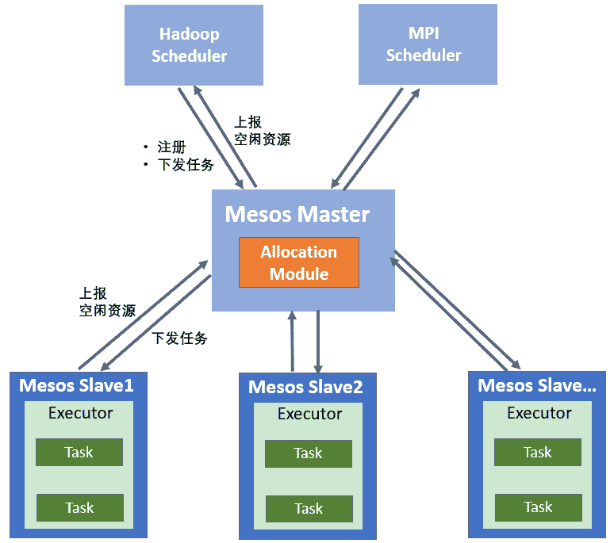
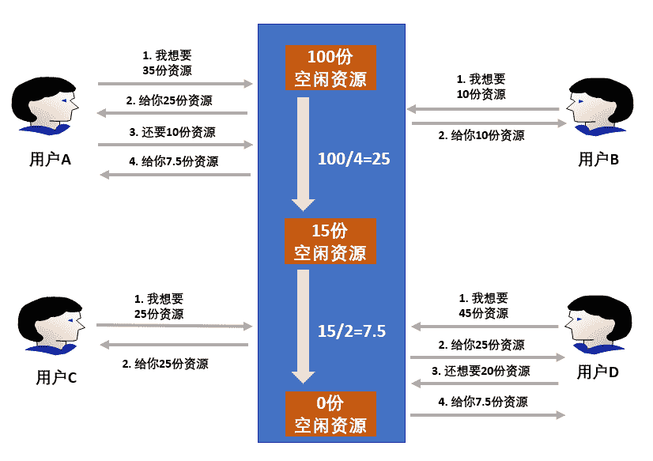
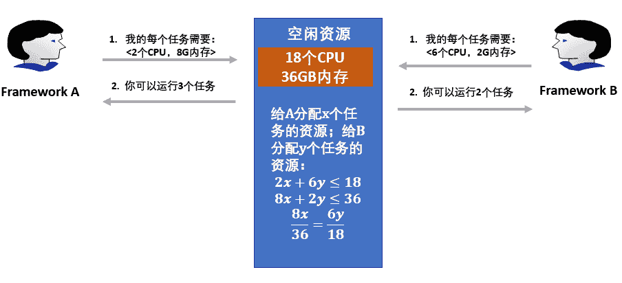
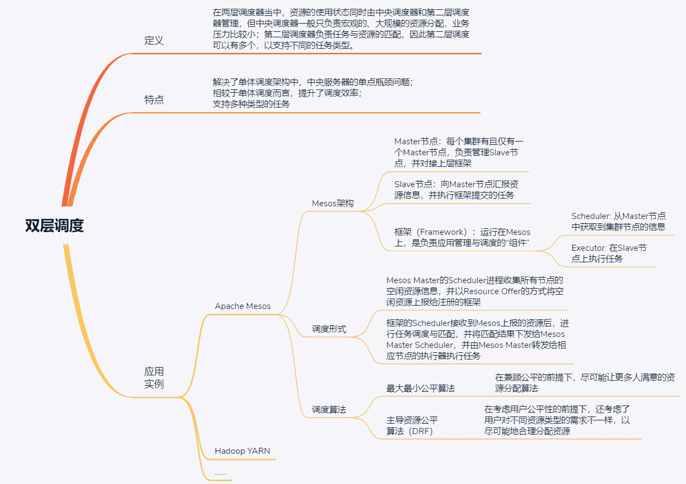

# 12 | 分布式调度架构之两层调度：物质文明、精神文明两手抓

 

你好，我是聂鹏程。今天，我来继续带你打卡分布式核心技术。

我在上一篇文章中，与你分享了单体调度。单体调度的核心是，所有节点的资源以及用户的任务均由中央服务器统一管理和调度。因此，中央服务器很容易成为单点瓶颈，会直接导致其支持的调度规模和服务类型受限。

于是两层调度就出现了。那么，到底什么是两层调度呢，它是如何设计的，又有哪些调度算法呢？接下来，就和我一起打卡分布式调度架构的两层调度，去探寻这些问题的答案吧。

## 什么是两层调度？

在单体调度架构中，中央服务器的单点瓶颈问题，会限制调度的效率和支持的任务类型。中央服务器的性能会限制调度的效率，很好理解，但为什么会限制支持的任务类型呢？

简单地说，这是因为不同的服务具有不同的特征，对调度框架和计算的要求都不一样。比如说，你的业务最开始时只有批处理任务，后来发展到同时还包括流数据任务，但批处理任务是处理静态数据，流数据任务却是处理实时数据。显然，单体调度框架会随着任务类型增加而变得越来越复杂，最终出现扩展瓶颈。

那么，为了提升调度效率并支持多种类型的任务，最直接的一个想法就是，能不能把资源和任务分开调度，也就是说一层调度器只负责资源管理和分配，另外一层调度器负责任务与资源的匹配呢。

很显然，这个解决方案是可以的。这种调度架构，就是我们通常所说的**两层调度**。如果我们还是把资源比作物质文明、把任务比作精神文明的话，两层调度就可以理解为“物质文明与精神文明两手抓”。

两层调度结构对应的就是两层调度器，资源的使用状态同时由中央调度器和第二层调度器管理，中央调度器从整体上进行资源的管理与分配，将资源分配到第二层调度器；再由第二层调度器负责将资源与具体的任务配对，因此第二层调度可以有多个调度器，以支持不同的任务类型。

如下图所示，Scheduler-1 表示第一层调度，负责收集和管理集群中的资源信息；Scheduler-2 表示第二层调度，Scheduler-1 会将集群资源发送给 Scheduler-2，然后 Scheduler-2 根据任务的资源需求和 Scheduler-1 发送的资源信息进行任务匹配和调度。



两层调度器中的第一层调度器仍是一个经简化的中央调度器，通常放在分布式集群管理系统中，而第二层调度则是由各个应用程序框架完成。两层调度器的职责分别是：第一层调度器负责管理资源并向框架分配资源，第二层调度器接收分布式集群管理系统中第一层调度器分配的资源，然后根据任务和接收到的资源进行匹配。

采用两层调度结构的集群管理系统有很多，典型代表是 Apache Mesos 和 Hadoop YARN。我在[第 9 篇文章](https://time.geekbang.org/column/article/148187)中讲述 Mesos 的体系结构时，和你分析了它采用的是典型的两层调度。那么今天，我就继续以 Mesos 为例，带你学习两层调度的架构设计和对应的分配算法吧。

## 两层调度设计

由于 Mesos 只负责底层资源的管理和分配，并不涉及存储、 任务调度等功能，因此 Mesos 要实现类似 Borg 那样的资源与任务管理，还需要上层框架的配合。

具体到两层调度架构上，Mesos 本身实现的调度器为第一层调度，负责资源管理，然后将第二层任务调度交给了框架完成。接下来，我们就具体看看吧。

### 两层调度架构

以 Mesos 为基础的分布式资源管理与调度框架包括两部分，即 Mesos 资源管理集群和框架。

 
- 资源管理集群是由一个 Master 节点和多个 Slave 节点组成的集中式系统。每个集群有且仅有一个 Master 节点，负责管理 Slave 节点，并对接上层框架；Slave 节点向 Master 节点周期汇报资源状态信息，并执行框架提交的任务。 
- 框架（Framework）运行在 Mesos 上，是负责应用管理与调度的“组件”，比如 Hadoop、Spark、MPI 和 Marathon 等，不同的框架用于完成不同的任务，比如批处理任务、实时分析任务等。框架主要由调度器（Scheduler）和执行器（Executor）组成，调度器可以从 Master 节点获取集群节点的信息 ，执行器在 Slave 节点上执行任务。 

从上述的架构描述可以看出，Mesos 是一个典型的双层调度框架。Mesos Master 上有一个调度器（也就是 Allocation Module），负责管理并分配集群中的所有资源，是第一层调度。框架上负责任务的管理与调度的调度器，是第二层调度，如下图所示。



接下来，我们再看看 Mesos 两层调度的基本原理吧。

 
- 框架向 Mesos Master 注册； 
- Mesos Slave 节点定期或周期向 Mesos Master 上报本节点的空闲资源； 
- Mesos Master 的 Scheduler 进程收集所有节点的空闲资源信息，并以 Resource Offer 的方式将空闲资源发送给注册的框架； 
- 框架的 Scheduler 接收到 Mesos 发送的资源后，进行任务调度与匹配，匹配成功后，将匹配结果下发给 Mesos Master，并由 Mesos Master 转发给相应节点的执行器执行任务。 

可以看出，Mesos 实现双层调度时，采用 Resource Offer 机制衔接了第一层和第二层调度。**Resource Offer 机制**指的是，Mesos Master 主动将节点空闲资源，以类似发放（Offer）的方式发给每个框架，如果框架需要则使用，不需要则还回。

也就是说，通过 Resource Offer 机制，第一层调度将资源主动告知第二层调度，然后第二层调度进行具体的任务匹配，从而实现了任务调度与资源管理的分离，Mesos Master 通过资源分配算法决定给各个 Framework 提供多少资源，而 Framework 则决定接受哪些资源，以及哪些任务使用这些资源运行。这样一来，一个两层调度架构就实现了。

在 Mesos 的两层调度中，Framework 第二层调度器中的任务与资源匹配的调度策略很常见，也有很多文章做了比较深入的分析了，所以如果你想要深入研究的话，可以参考下 Hadoop、Spark 等的调度策略，这里我就不多说了。

接下来，我们重点看下 Mesos 第一层调度算法，理解其如何为框架分配资源，以支持多用户多框架。

### 资源分配算法

Mesos 的资源分配算法解决的问题是，决策需要将当前可用资源分配给哪些框架以及分配多少。接下来，我将重点与你介绍两种主要的资源分配算法，即：最大最小公平算法（Max-min Fairness，MMF）和主导资源公平算法（Dominant Resource Fairness，DRF）。

**首先，我们看看最大最小公平算法。**这是一种在兼顾公平的前提下，尽可能让更多人满意的资源分配算法。为什么这么说呢？因为这个算法有 3 个主要原则：

 
- 按照用户对资源需求量递增的顺序进行空闲资源分配； 
- 不存在用户得到的资源超过自己需求的情况； 
- 对于分配的资源不满足需求的用户，所获得的资源是相等的。 

在执行资源分配时，最大最小公平算法按照上述 3 条原则进行多次迭代，每次迭代中资源均平均分配，如果还有剩余资源，就进入下一次迭代，一直到所有用户资源得到满足或集群资源分配完毕，迭代结束。

接下来，我们通过一个具体的例子来看看最大最小公平算法的资源分配流程吧。

假设，现在有总量为 100 的空闲资源，有 4 个用户 A、B、C、D 对该资源的需求量分别为（35，10，25，45），分配流程如下所示：

 
1. 按照用户对资源的需求量升序排列，则 4 个用户的需求量为（B:10，C:25，A:35，D:45）。 
2. 平均分配空闲资源。资源空闲总量 100，除以用户数 4，则平均空闲资源量为 25；按照第一步中需求量分配后，用户资源需求量为（0，0，10，20），且用户 B 由于资源需求量小于 25，因此会剩余资源。此时空闲资源量为 15，资源需求人数为 2。 
3. 重复第二步，平均分配资源，15/2=7.5，即分别为用户 A 和 D 分配 7.5 份资源，此时用户资源需求量为（0，0，2.5，12.5），空闲资源量为 0，资源需求人数为 2。 
4. 所有资源已分配完，算法终止。 

最大最小公平算法的执行流程，如下图所示。



在这个案例中，最大最小公平算法是由于所有资源全部分配完才终止的。至此，对于需求量为（10，25，35，45）的用户们来说，分配到的资源是（10，25，32.5，32.5）。这个算法的另外一个结束条件是，资源分配满足了所有用户的资源需求，即当没有用户有资源需求时，算法也会终止。

**接下来，我们再看看主导资源公平算法。**

最大最小公平算法采用了绝对公平的方式分配资源，会导致大量的资源浪费，比如用户需求量为 35 和 45 的用户 A 和用户 D，均分配了 32.5 的空闲资源，但由于资源不满足需求，这两个用户均无法使用。

而主导资源公平算法在考虑用户公平性的前提下，还考虑了用户对不同资源类型的需求，以尽可能地合理分配资源。也就是说，同样的资源量，主导资源公平算法可以尽可能地满足更多的用户。

在 Mesos 中，框架对资源的需求往往包括对 CPU、内存等多种类型资源的需求。针对多种资源的需求，主导资源公平算法首先计算已经分配给用户的每一种资源的占用率（Resource Share），比如已经分配的 CPU 占总资源量的多少，已经分配的内存占总资源量的多少。所有资源占用率中的最大值称作该**用户的主导资源占用率**，而主导资源占用率对应的资源就是用户的主导资源。

我们通过一个具体的案例，看看如何判断用户的主导资源吧。如下图所示，假设系统中的资源共包括 18 个 CPU 和 36 GB 内存，有两个 Framework（Framework A 和 Framework B）分别运行了两种任务，假设 Framework A 运行内存密集型任务，Framework B 运行 CPU 密集型任务，且每个任务所需要的资源量是一致的，分别是 <2 CPU, 8 GB> 和 <6 CPU, 2 GB>。



第一步：计算资源分配量。

假设 x 和 y 分别是 Framework A 和 Framework B 分配的任务数，那么 Framework A 消耗的资源为{2x CPU，8x GB}，Framework B 消耗的资源数为{6y CPU，2y GB}，分配给两个 Framework 的总资源量为（2x+6y）个 CPU 和（8x+2y）GB 内存。

第二步：确定主导资源。

对于 Framework A 来说，每个任务要消耗总 CPU 资源的 2/18，总内存资源的 8/36，所以 Framework A 的主导资源为内存；对于 Framework B 来说，每个任务要消耗总 CPU 资源的 6/18 和总内存资源的 2/36，因而 Framework B 的主导资源为 CPU。

第三步：DRF 算法的核心是平衡所有用户的主导资源占用率，尽可能试图最大化所有用户中最小的主导资源占用率。通过求解下列公式，可以计算出 Framework A 和 Framework B 分配的任务数，并且要在满足公式的条件下，使得 x 和 y 越大越好。

```
2x+6y≤188x+2y≤368x/36=6y/18
```

通过求解可以得出：x=3，即 Framework A 可以运行 3 个任务；y=2，即 Framework B 可以运行 2 个任务。这样分配的话，每个 Framework 获取了相同比例的主导资源，即：A 获取了 2/3 的内存，B 获取了 2/3 的 CPU，从而在主导资源上体现了调度算法的公平性。

在实际任务分配过程中，主导资源率是根据已经分配给 Framework 的资源，占集群中总资源量的多少进行计算的，并且在每次分配过程中，会选择主导资源最小的 Framework 进行分配，也就是试图最大化所有用户中最小的主导资源占用率。

如果你想深入研究主导资源公平算法的话，可参考“[Dominant Resource Fairness: Fair Allocation of Multiple Resource Types](https://cs.stanford.edu/~matei/papers/2011/nsdi_drf.pdf)”这篇论文。

**现在，我来对比下这两种调度算法吧。**

最大最小公平算法适用于单一类型的资源分配场景，而主导资源公平算法适用于多种类型资源混合的场景。并且，最大最小公平算法从公平的角度出发，为每个用户分配不多于需求量的资源；而主导资源公平算法从任务出发，目的在于尽量充分利用资源使得能够执行的任务越多越好。

## 知识扩展：两层调度如何保证不同的业务不会互相干扰？

类似 Mesos 这样的两层调度机制，可以同时支持多个框架和多种类型的业务，那么如何保证这些业务运行时不会互相干扰呢？

首先，我们思考一下什么情况下会存在业务运行时相互干扰呢。答案就是，当多个业务运行在同一台机器上，共同使用 CPU、内存，以及系统环境时会存在相互干扰。

要解决这个问题，我想你肯定会问，不同的业务能在独立的环境中运行吗？也就是说，隔离不同的业务资源和环境，应该就不会存在相互干扰了吧。不错，解决这个问题的办法就是资源隔离，就好比我们现在接触的虚拟机一样，在同样的服务器上安装多个虚拟机，不同的用户在不同的虚拟机上运行，这些用户互不干扰。在 Mesos 中，实现这种资源隔离的是**容器**。

容器的实质是进程，该进程运行于属于自己的独立的命名空间，可以拥有自己的 root 文件系统、自己的网络配置、自己的进程空间，甚至是自己的用户 ID 空间。Mesos 支持的容器，包括 Linux 自带的 cgroups 和 Docker。

所以说，Mesos 正是用容器隔离开了不同的业务，使得它们运行时不会互相干扰。

## 总结

今天，我以 Mesos 为例，与你讲述了两层调度的架构设计和资源分配算法。我们一起总结下今天的核心内容吧。

两层调度是一种资源和任务分开调度的设计，也就是说一层调度器只负责资源的管理和分配，另外一层调度器负责任务与资源的匹配。

在 Mesos 中，第一层资源调度由 Mesos 提供，第二层任务调度由框架提供，Mesos 将资源以 Resource Offer 的形式发放给框架调度器，框架调度器根据任务需求和得到的资源信息进行任务匹配调度，为此提高了调度的并发性。

而关于第一层的调度算法，通常有最大最小公平算法和主导资源公平算法等。

两层调度的一个问题是，由于第二层调度只能获得部分资源视图，因此无法实现全局最优调度。

最后，我将今天这篇文章的核心知识点梳理为了一张思维导图，以方便你理解与记忆。



两层调度提供了多租户多框架的支持，如果你的业务类型比较多或者面向的是不同的租户的话，建议你采用两层调度框架。

相信你通过这篇文章可以看到，在分布式领域中，同时支持多种框架、支持多种类型任务调度的调度机制，并没有那么神秘，只要你静下心来弄明白这篇文章的调度机制，以后遇到类似的调度机制，就可以做到心中有数了。

不得不说，Mesos 的两层调度设计得非常巧妙，并且 Mesos 支持你自己写一个调度器注册到 Mesos 作为第二层调度。赶快动手实践一下吧，[Mesos 的官网](http://mesos.apache.org/)提供了相应的案例，方便你入门，加油，相信你一定可以！

## 思考题

你觉得，Mesos 双层调度机制容易导致资源碎片问题吗？原因又是什么呢？

我是聂鹏程，感谢你的收听，欢迎你在评论区给我留言分享你的观点，也欢迎你把这篇文章分享给更多的朋友一起阅读。我们下期再会！


