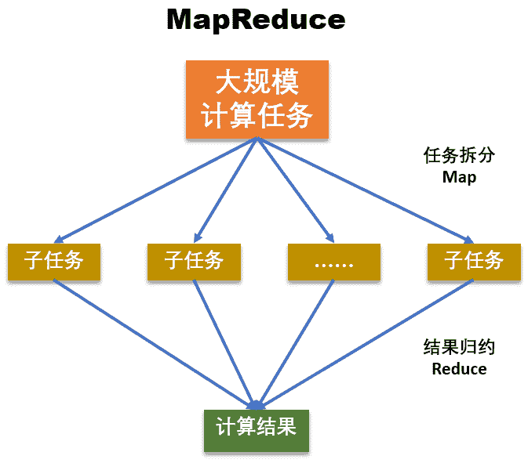
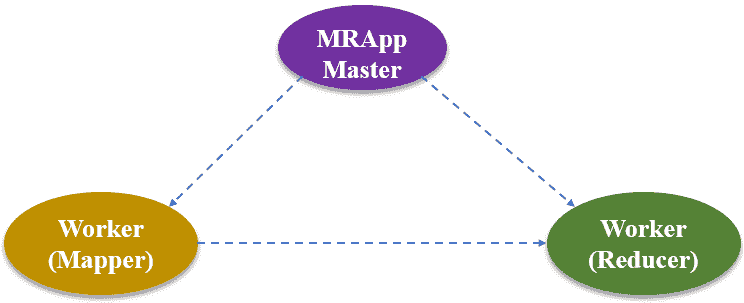
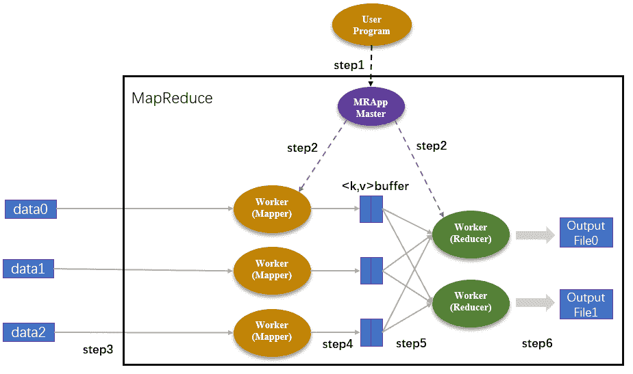
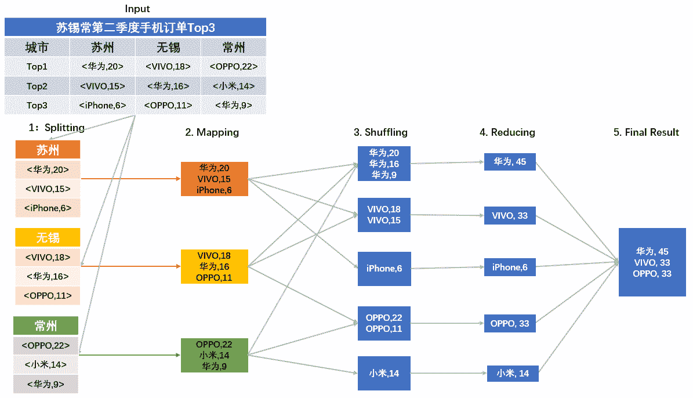
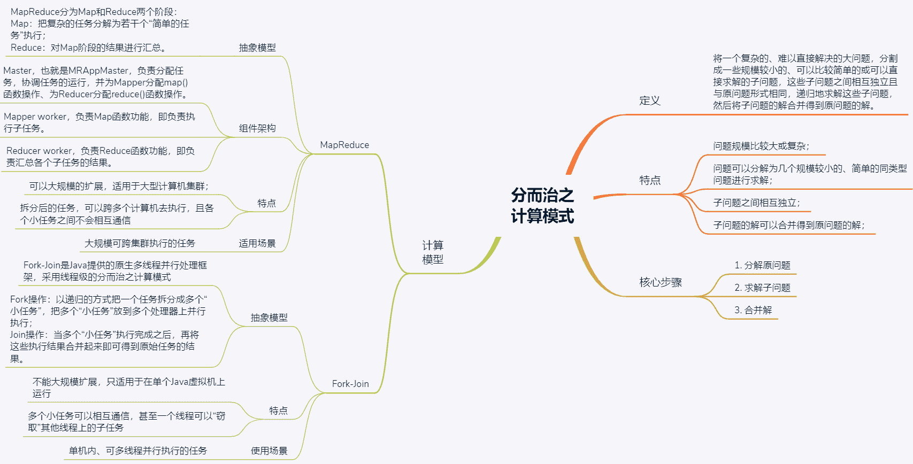

# 15 | 分布式计算模式之MR：一门同流合污的艺术

 

你好，我是聂鹏程。今天，我来继续带你打卡分布式核心技术。

我在第 12 篇文章中与你介绍两层调度时提到，Mesos 的第二层调度是由 Framework 完成的。这里的 Framework 通常就是计算框架，比如 Hadoop、Spark 等。用户基于这些计算框架，可以完成不同类型和规模的计算。

那么，在接下来的 4 篇文章，我们就要进入“第三站：分布式计算技术”了。在这一站，我将与你详细介绍分布式领域中的 4 种计算模式，包括 MapReduce、Stream、Actor 和流水线。而今天这篇文章，我们就先从 MR 模式开始吧。

Hadoop 这个框架主要用于解决海量数据的计算问题。那么，它是如何做到海量数据计算的呢？你可能会想，既然是海量数据，规模这么大，那就分成多个进程，每个进程计算一部分，然后汇总一下结果，就可以提升运算速度了。其实，整个计算流程，我们可以很形象地用一个词来解释，就是“同流合污“。

没错，就是这种想法，在分布式领域中就叫作 MR 模式，即 Map Reduce 模式。接下来，我们就一起揭开 MR 模式的神秘面纱吧。

## 什么是分而治之？

分而治之（Divide-and-Conquer），是计算机处理问题的一个很重要的思想，简称为分治法。

顾名思义，分治法就是将一个复杂的、难以直接解决的大问题，分割成一些规模较小的、可以比较简单的或直接求解的子问题，这些子问题之间相互独立且与原问题形式相同，递归地求解这些子问题，然后将子问题的解合并得到原问题的解。

比如，现在要统计全中国的人口数，由于中国的人口规模很大，如果让工作人员依次统计每个省市的人口数，工作量会非常大。在实际统计中，我们通常会按照省分别统计，比如湖南省的工作人员统计湖南省的人口数，湖北省的工作人员统计湖北省的人口数等，然后汇总各个省的人口数，即可得到全国人口数。

这，就是一个非常好的分而治之的例子。

当然，这种分治的思想还广泛应用于计算机科学的各个领域中，分布式领域中的很多场景和问题也非常适合采用这种思想解决，并为此设计出了很多计算框架。比如，Hadoop 中的 MapReduce。

那么，**在分布式领域，具体有哪些问题适合采用分治法呢？**要回答这个问题，我们先看下适合分治法的问题具有哪些特征吧。

1. 问题规模比较大或复杂，且问题可以分解为几个规模较小的、简单的同类型问题进行求解；
2. 子问题之间相互独立，不包含公共子问题；
3. 子问题的解可以合并得到原问题的解。

根据这些特征，我们可以想到，诸如电商统计全国商品数量时，按区域或省市进行统计，然后将统计结果合并得到最终结果等大数据处理场景，均可以采用分治法。

同时，根据这些特征，我们可以推导出，**采用分治法解决问题的核心步骤是**：

1. 分解原问题。将原问题分解为若干个规模较小，相互独立，且与原问题形式相同的子问题。
2. 求解子问题。若子问题规模较小且容易被解决则直接求解，否则递归地求解各个子问题。
3. 合并解，就是将各个子问题的解合并为原问题的解。

接下来，我们就一起看看分布式系统中分治法的原理和应用吧。

## 分治法的原理

分布式原本就是为处理大规模应用而生的，所以基于分布式系统，如何分而治之地处理海量数据就是分布式领域中的一个核心问题。

Google 提出的 MapReduce 分布式计算模型（Hadoop MapReduce 是 Google 的开源实现），作为分治法的典型代表，最开始用于搜索领域，后来被广泛用于解决各种海量数据的计算问题。下面，我将以 MapReduce 为例，带你了解分治法的抽象模型、工作原理和实践应用。

### 抽象模型

如下图所示，MapReduce 分为 Map 和 Reduce 两个核心阶段，其中 Map 对应“分”，即把复杂的任务分解为若干个“简单的任务”执行；Reduce 对应着“合”，即对 Map 阶段的结果进行汇总。

在第一阶段，也就是 Map 阶段，将大数据计算任务拆分为多个子任务，拆分后的子任务通常具有如下特征：

1. 相对于原始任务来说，划分后的子任务与原任务是同质的，比如原任务是统计全国人口数，拆分为统计省的人口数子任务时，都是统计人口数；并且，子任务的数据规模和计算规模会小很多。
2. 多个子任务之间没有依赖，可以独立运行、并行计算，比如按照省统计人口数，统计河北省的人口数和统计湖南省的人口数之间没有依赖关系，可以独立、并行的统计。

第二阶段，也就是 Reduce 阶段，第一阶段拆分的子任务计算完成后，汇总所有子任务的计算结果，以得到最终结果。也就是，汇总各个省统计的人口数，得到全国的总人口数。

### MapReduce 工作原理

那么，在 MapReduce 里，各个组件是如何分工完成一个复杂任务的呢？为了解答这个问题，我先带你了解一下 MapReduce 的组件结构。

如上图所示，MapReduce 主要包括以下三种组件：

1. Master，也就是 MRAppMaster，该模块像一个大总管一样，独掌大权，负责分配任务，协调任务的运行，并为 Mapper 分配 map() 函数操作、为 Reducer 分配 reduce() 函数操作。
2. Mapper worker，负责 Map 函数功能，即负责执行子任务。
3. Reducer worker，负责 Reduce 函数功能，即负责汇总各个子任务的结果。

基于这三种组件，MapReduce 的工作流程如下所示：

程序从 User Program 开始进入 MapReduce 操作流程。其中图中的“step1，step2，…，step6”表示操作步骤。

step1：User Program 将任务下发到 MRAppMaster 中。然后，MRAppMaster 执行任务拆分步骤，把 User Program 下发的任务划分成 M 个子任务（M 是用户自定义的数值）。假设，MapReduce 函数将任务划分成了 5 个，其中 Map 作业有 3 个，Reduce 作业有 2 个；集群内的 MRAppMaster 以及 Worker 节点都有任务的副本。

step2：MRAppMaster 分别为 Mapper 和 Reducer 分配相应的 Map 和 Reduce 作业。Map 作业的数量就是划分后的子任务数量，也就是 3 个；Reduce 作业是 2 个。

step3：被分配了 Map 作业的 Worker，开始读取子任务的输入数据，并从输入数据中抽取出 <key, value> 键值对，每一个键值对都作为参数传递给 map() 函数。

step4：map() 函数的输出结果存储在环形缓冲区 kvBuffer 中，这些 Map 结果会被定期写入本地磁盘中，被存储在 R 个不同的磁盘区。这里的 R 表示 Reduce 作业的数量，也是由用户定义的。在这个案例中，R=2。此外，每个 Map 结果的存储位置都会上报给 MRAppMaster。

step5：MRAppMaster 通知 Reducer 它负责的作业在哪一个分区，Reducer 远程读取相应的 Map 结果，即中间键值对。当 Reducer 把它负责的所有中间键值对都读过来后，首先根据键值对的 key 值对中间键值对进行排序，将相同 key 值的键值对聚集在一起，从而有利于 Reducer 对 Map 结果进行统计。

step6：Reducer 遍历排序后的中间键值对，将具有相同 key 值的键值对合并，并将统计结果作为输出文件存入负责的分区中。

从上述流程可以看出，**整个 MapReduce 的工作流程主要可以概括为 5 个阶段**，即：Input（输入）、Splitting（拆分）、Mapping（映射）、Reducing（化简）以及 Final Result（输出）。

所有 MapReduce 操作执行完毕后，MRAppMaster 将 R 个分区的输出文件结果返回给 User Program，用户可以根据实际需要进行操作。比如，通常并不需要合并这 R 个输出文件，而是将其作为输入交给另一个 MapReduce 程序处理。

### MapReduce 实践应用

通过上述的流程描述，你大概已经知道 MapReduce 的工作流程了。接下来，我和你分享一个电商统计用户消费记录的例子，再帮你巩固一下 MapReduce 的功能吧。

需要注意的是，为了方便理解，我对下面用的数据做了一定的处理，并不完全是真实场景中的数据。

每隔一段时间，电商都会统计该时期平台的订单记录，从而分析用户的消费倾向。在不考虑国外消费记录的前提下，全国范围内的订单记录已经是一个很大规模的工程了。

在前面的文章中我也提到过，电商往往会在每个省份、多个城市分布式地部署多个服务器，用于管理某一地区的平台数据。因此，针对全国范围内的消费统计，可以拆分成对多个省份的消费统计，并再一次细化到统计每一个城市的消费记录。

为方便描述，假设我们现在要统计苏锡常地区第二季度手机订单数量 Top3 的品牌。我们来看看具体的统计步骤吧。

1. 任务拆分（Splitting 阶段）。根据地理位置，分别统计苏州、无锡、常州第二季度手机订单 Top3 品牌，从而将大规模任务划分为 3 个子任务。
2. 通过循环调用 map() 函数，统计每个品牌手机的订单数量。其中，key 为手机品牌，value 为手机购买数量（单位：万台）。如下图 Mapping 阶段所示（为简化描述，图中直接列出了统计结果）。
3. 与前面讲到的计算流程不同的是，Mapping 阶段和 Reducing 阶段中间多了一步 Shuffling 操作。Shuffling 阶段主要是读取 Mapping 阶段的结果，并将不同的结果划分到不同的区。在大多数参考文档中，Mapping 和 Reducing 阶段的任务分别定义为映射以及归约。但是，在映射之后，要对映射后的结果进行排序整合，然后才能执行归约操作，因此往往将这一排序整合的操作单独放出来，称之为 Shuffling 阶段。
4. Reducing 阶段，归并同一个品牌的购买次数。
5. 得到苏锡常地区第二季度 Top3 品牌手机的购买记录。

由上述流程可以看出，**Map/Reduce 作业和 map()/reduce() 函数是有区别的**：

1. Map 阶段由一定数量的 Map 作业组成，这些 Map 作业是并发任务，可以同时运行，且操作重复。Map 阶段的功能主要由 map() 函数实现。每个 Map 作业处理一个子任务（比如一个城市的手机消费统计），需要调用多次 map() 函数来处理（因为城市内不同的居民倾向于不同的手机）。
2. Reduce 阶段执行的是汇总任务结果，遍历 Map 阶段的结果从而返回一个综合结果。与 Reduce 阶段相关的是 reduce() 函数，它的输入是一个键（key）和与之对应的一组数据（values），其功能是将具有相同 key 值的数据进行合并。Reduce 作业处理一个分区的中间键值对，期间要对每个不同的 key 值调用一次 reduce() 函数。在完成 Map 作业后，每个分区中会存在多个临时文件；而执行完 Reduce 操作后，一个分区最终只有一个输出文件。

## 知识扩展：Fork-Join 计算模式是什么意思呢？

MapReduce 是一种分而治之的计算模式，在分布式领域中，除了典型的 Hadoop 的 MapReduce(Google MapReduce 的开源实现)，还有 Fork-Join。你知道 Fork-join 是什么吗？

Fork-Join 是 Java 等语言或库提供的原生多线程并行处理框架，采用线程级的分而治之计算模式。它充分利用多核 CPU 的优势，以递归的方式把一个任务拆分成多个“小任务”，把多个“小任务”放到多个处理器上并行执行，即 Fork 操作。当多个“小任务”执行完成之后，再将这些执行结果合并起来即可得到原始任务的结果，即 Join 操作。

虽然 MapReduce 是进程级的分而治之计算模式，但与 Fork-Join 的核心思想是一致的。因此，Fork-Join 又被称为 Java 版的 MapReduce 框架。

但，MapReduce 和 Fork-Join 之间有一个本质的区别：

1. Fork-Join 不能大规模扩展，只适用于在单个 Java 虚拟机上运行，多个小任务虽然运行在不同的处理器上，但可以相互通信，甚至一个线程可以“窃取”其他线程上的子任务。
2. MapReduce 可以大规模扩展，适用于大型计算机集群。通过 MapReduce 拆分后的任务，可以跨多个计算机去执行，且各个小任务之间不会相互通信。

## 总结

所谓分而治之，就是将一个复杂的、难以直接解决的大问题，分割成一些规模较小的、可以直接求解的子问题，这些子问题互相独立且与原问题形式相同，递归地解这些子问题，然后将子问题的解合并以后就是原问题的解。

分布式计算模型 MapReduce 就运用了分而治之的思想，通过 Map 操作将大任务分成多个较小的任务去执行，得到的多个结果再通过 Reduce 操作整合成一个完整的结果。所以，今天我就以 MapReduce 为例，与你讲述了分布式领域中分治法的模型、原理与应用。

最后，我将今天涉及的核心知识点梳理为了一张思维导图，以方便你理解与记忆。

分而治之的思想，是简单且实用的处理复杂问题的方法。所以无论是计算机领域还是其他研究领域亦或日常生活中，我们都可以用分治法去处理很多复杂庞大的问题，将大问题划分成多个小问题，化繁为简、化整为零。

其实，很多算法并不是凭空创造出来的，都是源于生活并服务于生活的。在日常工作学习中，我们对眼前的问题一筹莫展时，就可以将其化繁为简，从最简单的小问题出发，逐渐增加问题的规模，进而解决这个复杂的问题。同样的道理，我们也可以借鉴生活中的例子去解决专业问题。

## 思考题

MapReduce 属于批量处理任务类型吗？你能说说其中的原因吗？

我是聂鹏程，感谢你的收听，欢迎你在评论区给我留言分享你的观点，也欢迎你把这篇文章分享给更多的朋友一起阅读。我们下期再会！

