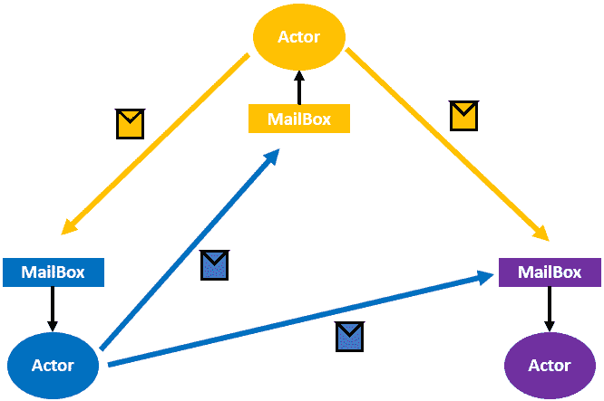
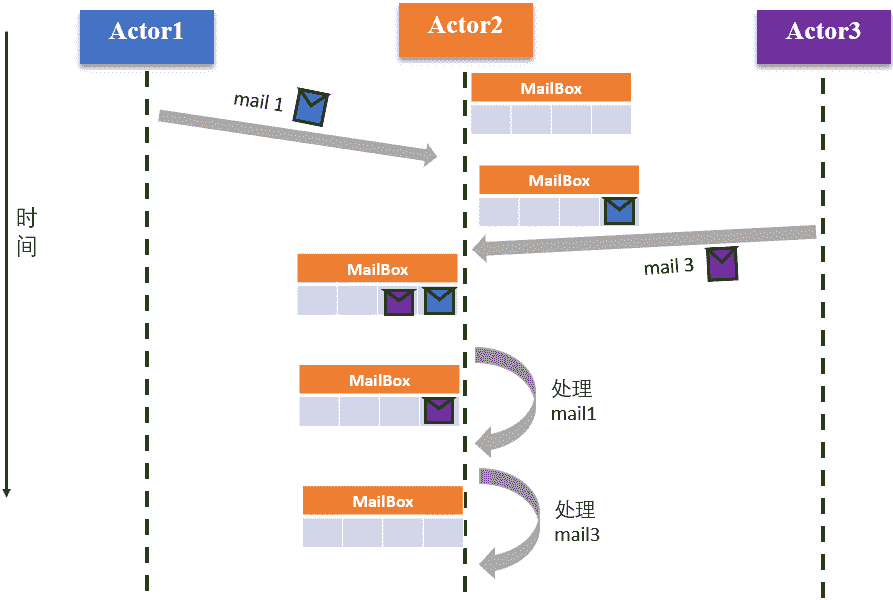
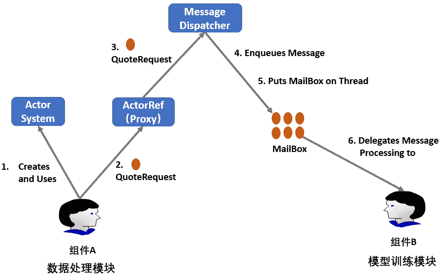
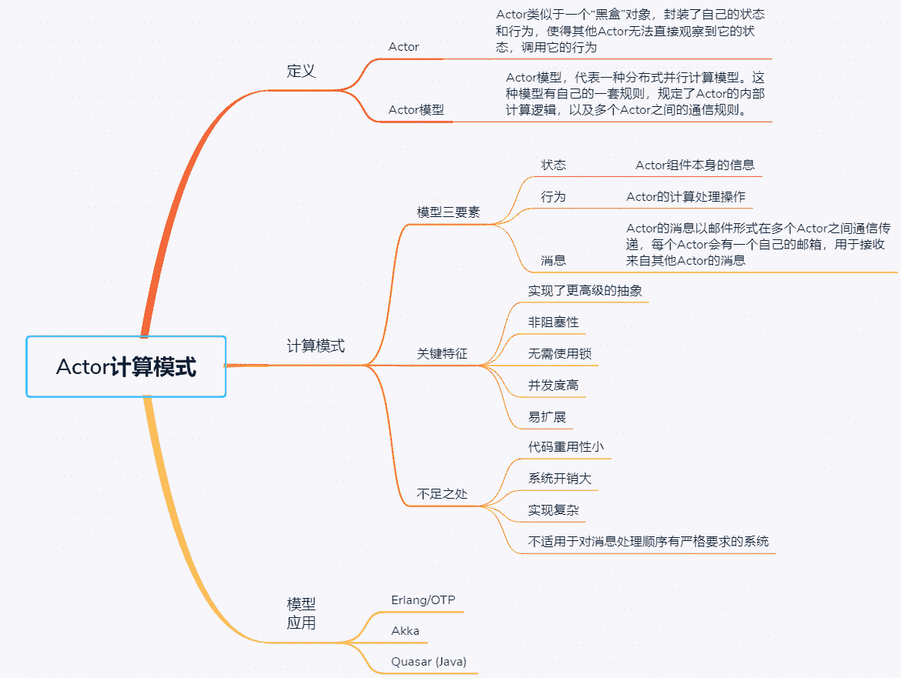

# 17 | 分布式计算模式之Actor：一门甩锅的艺术

 

你好，我是聂鹏程。今天，我来继续带你打卡分布式核心技术。

我在前两篇文章中，带你一起学习了 MapReduce 和 Stream 计算模式，相信你对批处理和流计算也有了一定的了解。虽然这两种计算模式对数据的处理方式不同，但都是以特定数据类型（分别对应静态数据和动态数据）作为计算维度。

在接下来两篇文章中，我将从计算过程或处理过程的维度，与你介绍另外两种分布式计算模式，即 Actor 和流水线。分布式计算的本质就是在分布式环境下，多个进程协同完成一件复杂的事情，但每个进程各司其职，完成自己的工作后，再交给其他进程去完成其他工作。当然，对于没有依赖的工作，进程间是可以并行执行的。

你是不是想说，分布式进程那么多，如果需要开发者自己去维护每个进程之间的数据、状态等信息，这个开发量可不是一般得大，而且特别容易出错。那么，有没有什么办法可以让开发者只关注自己的逻辑呢？

答案是肯定的，Actor 计算模式就能满足你的需求。也就是说，你可以把数据、状态等都扔给 Actor。这是不是“一门甩锅的艺术”呢？

接下来，我们就一起打卡分布式计算模式中的 Actor 模式。

## 什么是 Actor？

在第 10 篇文章“分布式体系结构之非集中式结构：众生平等”中，我曾提到 Akka 框架基于 Actor 模型，提供了一个用于构建可扩展的、弹性的、快速响应的应用程序的平台。

其中，Actor 类似于一个“黑盒”对象，封装了自己的状态和行为，使得其他 Actor 无法直接观察到它的状态，调用它的行为。多个 Actor 之间通过消息进行通信，这种消息类似于电子邮箱中的邮件。Actor 接收到消息之后，才会根据消息去执行计算操作。

那么，**Actor 模型又是什么呢？**Actor 模型，代表一种分布式并行计算模型。这种模型有自己的一套规则，规定了 Actor 的内部计算逻辑，以及多个 Actor 之间的通信规则。在 Actor 模型里，每个 Actor 相当于系统中的一个组件，都是基本的计算单元。

**Actor 模型的计算方式与传统面向对象编程模型（Object-Oriented Programming，OOP）类似**，一个对象接收到一个方法的调用请求（类似于一个消息），从而去执行该方法。

但是，OOP 因为数据封装在一个对象中，不能被外部访问，当多个外部对象通过方法调用方式，即同步方式进行访问时，会存在死锁、竞争等问题，无法满足分布式系统的高并发性需求。而 Actor 模型通过消息通信，采用的是异步方式，克服了 OOP 的局限性，适用于高并发的分布式系统。

举一个最简单的例子，假如你现在定义了三个对象 A、B 和 C，对象 C 中有一个函数 Function，现在对象 A 和对象 B 同时调用对象 C 中的 Function，此时对象 C 中的 Function 就成为了我们在第 3 篇文章“分布式互斥：有你没我，有我没你”中提到的共享资源，有可能会存在竞争、死锁等问题。

而对于 Actor 模式，对象 A、B 和 C 对应着 Actor A、Actor B 和 Actor C，当 Actor A 和 Actor B 需要执行 Actor C 中的 Function 逻辑时，Actor A 和 Actor B 会将消息发送给 Actor C， Actor C 的消息队列存储着 Actor A 和 Actor B 的消息，然后根据消息的先后顺序，执行 Function 即可。

也就是说，Actor 模式采用了异步模式，并且每个 Actor 封装了自己的数据、方法等，解决了 OOP 存在的死锁、竞争等问题。

## Actor 计算模式

接下来，我们再一起看看 Actor 计算模式吧。如下图所示，描述了具有 3 个 Actor 的 Actor 模型。

可以看到，**Actor 模型的三要素是状态、行为和消息**，有一个很流行的等式：Actor 模型 =（状态 + 行为）+ 消息。

接下来，我们一起看看这三要素的具体含义吧。

1. 状态（State）。Actor 的状态指的是，Actor 组件本身的信息，相当于 OOP 对象中的属性。Actor 的状态会受 Actor 自身行为的影响，且只能被自己修改。
2. 行为（Behavior）。Actor 的行为指的是，Actor 的计算处理操作，相当于 OOP 对象中的成员函数。Actor 之间不能直接调用其他 Actor 的计算逻辑。Actor 只有收到消息才会触发自身的计算行为。
3. 消息（Mail）。Actor 的消息以邮件形式在多个 Actor 之间通信传递，每个 Actor 会有一个自己的邮箱（MailBox），用于接收来自其他 Actor 的消息，因此 Actor 模型中的消息也称为邮件。一般情况下，对于邮箱里面的消息，Actor 是按照消息达到的先后顺序（FIFO）进行读取和处理的。

了解了 Actor 的三要素后，我们再一起看下 Actor 的工作原理吧。

### Actor 工作原理

为了方便你理解 Actor 的工作原理，我会通过讲述 3 个 Actor 之间基于消息和消息队列的工作流程进行说明。这 3 个 Actor 的工作流程，如下所示。

1. Actor1 和 Actor3 先后向 Actor2 发送消息，消息被依次放入 Actor2 的 MailBox 队列的队尾 ;
2. Actor2 从 MailBox 队列的队首依次取出消息执行相应的操作，由于 Actor1 先把消息发送给 Actor2，因此 Actor2 先处理 Actor1 的消息；
3. Actor2 处理完 Actor1 的消息后，更新内部状态，并且向其他 Actor 发送消息，然后处理 Actor3 发送的消息。

了解了 Actor 之间的消息交互和处理流程，我再以一个具体案例和你详细解读一下 Actor 之间的消息传递过程吧。

我们已经知道，在系统中，不同的组件 / 模块可以视为不同的 Actor。现在有一个执行神经网络的应用，其中有两个组件 A 和 B，分别表示数据处理模块和模型训练模块。假设，我们可以将组件 A 和 B 看作两个 Actor，训练过程中的数据可以通过消息进行传递。如上图所示，完整的消息传输过程为：

1. 组件 A 创建一个 Actor System，用来创建并管理多个 Actor。
2. 组件 A 产生 QuoteRequest 消息（即 mail 消息，比如数据处理后的数据），并将其发送给 ActorRef。ActorRef 是 Actor System 创建的组件 B 对应 Actor 的一个代理。
3. ActorRef 将消息（经过数据处理后的数据）传输给 Message Dispatcher 模块。Message Dispatcher 类似于快递的中转站，负责接收和转发消息。
4. Message Dispatcher 将消息（数据处理后的数据）加入组件 B 的 MailBox 队列的队尾。
5. Message Dispatcher 将 MailBox 加入线程。需要注意的是，只有当 MailBox 是线程时，才能处理 MailBox 中的消息。
6. 组件 B 的 MailBox 将队首消息（数据）取出并删除，队首消息交给组件 B 处理，进行模型训练。

### Actor 关键特征

通过上面的描述，可以看出 Actor 的通信机制与日常的邮件通信非常类似。因此，我们可以进一步总结出 Actor 模型的一些特点：

1. **实现了更高级的抽象。**我在前面提到过，Actor 与 OOP 对象类似，封装了状态和行为。但是，Actor 之间是异步通信的，多个 Actor 可以独立运行且不会被干扰，解决了 OOP 存在的竞争问题。
2. **非阻塞性。**在 Actor 模型中，Actor 之间是异步通信的，所以当一个 Actor 发送信息给另外一个 Actor 之后，无需等待响应，发送完信息之后可以在本地继续运行其他任务。也就是说，Actor 模型通过引入消息传递机制，从而避免了阻塞。
3. **无需使用锁**。Actor 从 MailBox 中一次只能读取一个消息，也就是说，Actor 内部只能同时处理一个消息，是一个天然的互斥锁，所以无需额外对代码加锁。
4. **并发度高。**每个 Actor 只需处理本地 MailBox 的消息，因此多个 Actor 可以并行地工作，从而提高整个分布式系统的并行处理能力。
5. **易扩展。**每个 Actor 都可以创建多个 Actor，从而减轻单个 Actor 的工作负载。当本地 Actor 处理不过来的时候，可以在远程节点上启动 Actor 然后转发消息过去。

虽然 Actor 模型有上述的诸多优点，但它并不适用于分布式领域中所有的应用平台或计算框架。因为，Actor 模型还存在如下一些不足之处：

1. Actor 提供了模块和封装，但缺少继承和分层，这使得即使多个 Actor 之间有公共逻辑或代码部分，都必须在每个 Actor 中重写这部分代码，也就是说重用性小，业务逻辑的改变会导致整体代码的重写。
2. Actor 可以动态创建多个 Actor，使得整个 Actor 模型的行为不断变化，因此在工程中不易实现 Actor 模型。此外，增加 Actor 的同时，也会增加系统开销。
3. Actor 模型不适用于对消息处理顺序有严格要求的系统。因为在 Actor 模型中，消息均为异步消息，无法确定每个消息的执行顺序。虽然可以通过阻塞 Actor 去解决顺序问题，但显然，会严重影响 Actor 模型的任务处理效率。

尽管 Actor 模型在需要同步处理的应用等场景具有局限性，但它在异步场景中应用还是比较广泛的。接下来，我们就一起看看 Actor 目前都应用在哪些地方吧。

## Actor 模型的应用

Actor 模型在 1973 年被提出，已广泛应用在多种框架和语言中。可以说，很多框架或语言支持 Actor 编程模型，是为了给开发者提供一个通用的编程框架，让用户可以聚焦到自己的业务逻辑上，而不用像面向对象等编程模型那样需要关心死锁、竞争等问题。

那么，到底有哪些框架或语言支持 Actor 编程模型呢？将下来，我就和你列举几个典型的框架或语言吧，以方便你参考。

1. Erlang/OTP。Erlang 是一种通用的、面向并发的编程语言，使用 Erlang 编写分布式应用比较简单，而 OTP 就是 Erlang 技术栈中的标准库。Actor 模型在 Erlang 语言中得到广泛支持和应用，其他语言的 Actor 逻辑实现在一定程度上都是参照了 Erlang 的模式。实现了 Actor 模型逻辑的 Erlang/OTP，可以用于构建一个开发和运行时环境，从而实现分布式、实时的、高可用性的系统。
2. Akka。Akka 是一个为 Java 和 Scala 构建高度并发、分布式和弹性的消息驱动应用程序的工具包。Akka 框架基于 Actor 模型，提供了一个用于构建可扩展的、弹性的、快速响应的应用程序的平台。通过使用 Actors 和 Streams 技术， Akka 为用户提供了多个服务器，使用户更有效地使用服务器资源并构建可扩展的系统。
3. Quasar (Java) 。Quasar 是一个开源的 JVM 库，极大地简化了高度并发软件的创建。Quasar 在线程实现时，参考了 Actor 模型，采用异步编程逻辑，从而为 JVM 提供了高性能、轻量级的线程，可以用在 Java 和 Kotlin 编程语言中。

## 知识扩展：Akka 中 Actor 之间的通信可靠性是通过 Akka 集群来保证的，那么 Akka 集群是如何检测节点故障的呢？

在第 10 篇文章“分布式体系结构之非集中式结构：众生平等”中，我与你介绍了 Akka 集群是一个去中心化的架构，比如现在集群中有 n 个节点，这 n 个节点之间的关系是对等的。节点之间采用心跳的方式判断该节点是否故障，但未采用集中式架构中的心跳检测方法。

Akka 集群中的故障检测方法是，集群中每个节点被 k 个节点通过心跳进行监控，比如 k = 3，节点 1 被节点 2、节点 3 和节点 4 通过心跳监控，当节点 2 发现节点 1 心跳不可达时，就会标记节点 1 为不可达（unreachable），并且将节点 1 为不可达的信息通过 Gossip 传递给集群中的其他节点，这样集群中所有节点均可知道节点 1 不可达。

其中，k 个节点的选择方式是，将集群中每个节点计算一个哈希值，然后基于哈希值，将所有节点组成一个哈希环（比如，从小到大的顺序），最后根据哈希环，针对每个节点逆时针或顺时针选择 k 个临近节点作为监控节点。

## 总结

接下来，我们小结一下吧。今天，我与你介绍了分布式计算中，一门甩锅的计算模型，即 Actor 模型。

首先，我介绍了什么是 Actor 模型以及 Actor 模型的三要素，包括状态、行为和消息。

其次，我介绍了 Actor 的工作原理，并通过实例介绍了 Actor 之间通过消息及消息队列进行异步通信的流程，以便于你进一步理解 Actor 的工作原理。

最后，我为你介绍了几个当前支持 Actor 编程模型的框架和语言，以便于你在需要采用 Actor 模型编程时做一个参考。

最后，我再通过一张思维导图来归纳一下今天的核心知识点吧。

著名的 Erlang 并发编程语言，以及 Akka 这一分布式计算框架都实现了 Actor 模型的计算逻辑。因此，即使你在之前未曾接触过 Actor 模型，学习了这篇文章后，你也可以根据开源的 Erlang 或 Akka 项目，去更深刻地理解 Actor 模型了，加油！

## 思考题

Actor 是否可以采用阻塞方式去运行呢，原因是什么呢？

我是聂鹏程，感谢你的收听，欢迎你在评论区给我留言分享你的观点，也欢迎你把这篇文章分享给更多的朋友一起阅读。我们下期再会！

