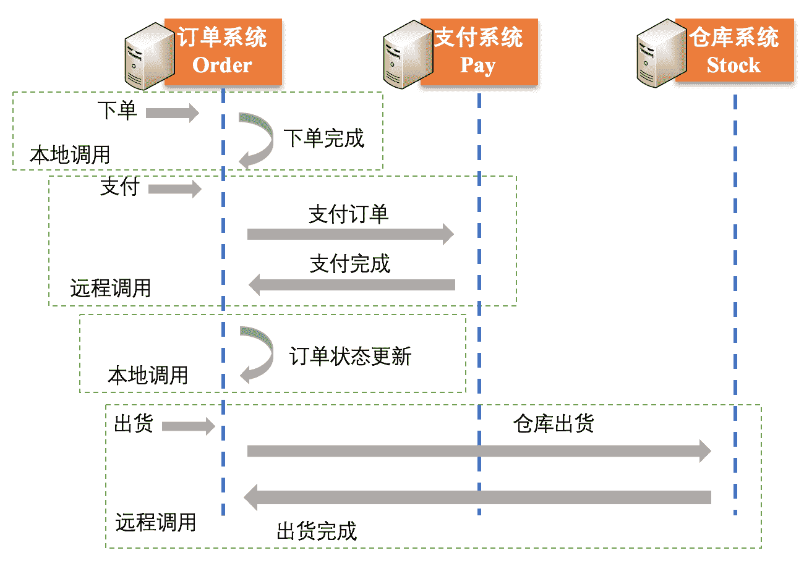
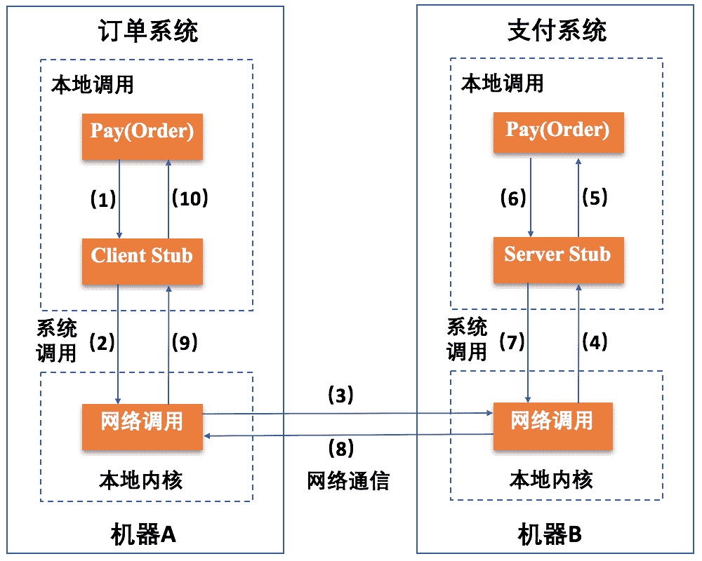
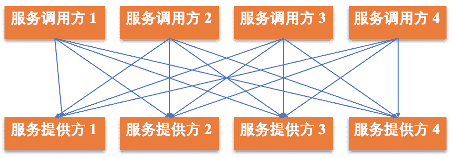
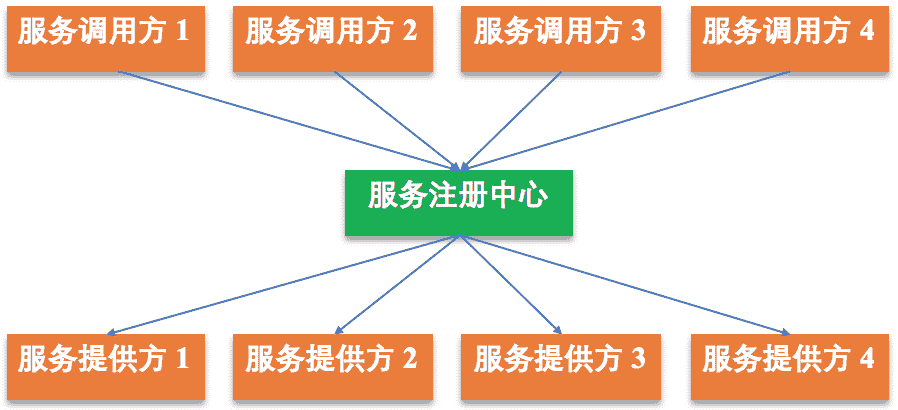
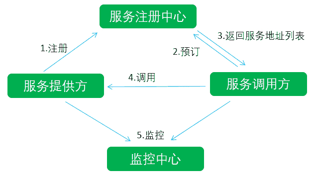
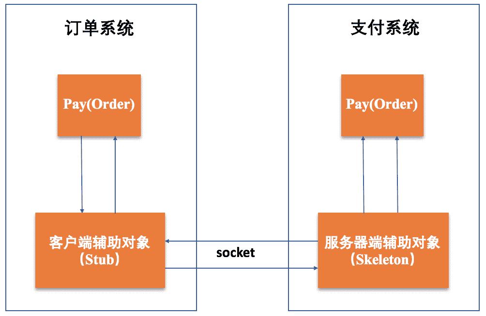
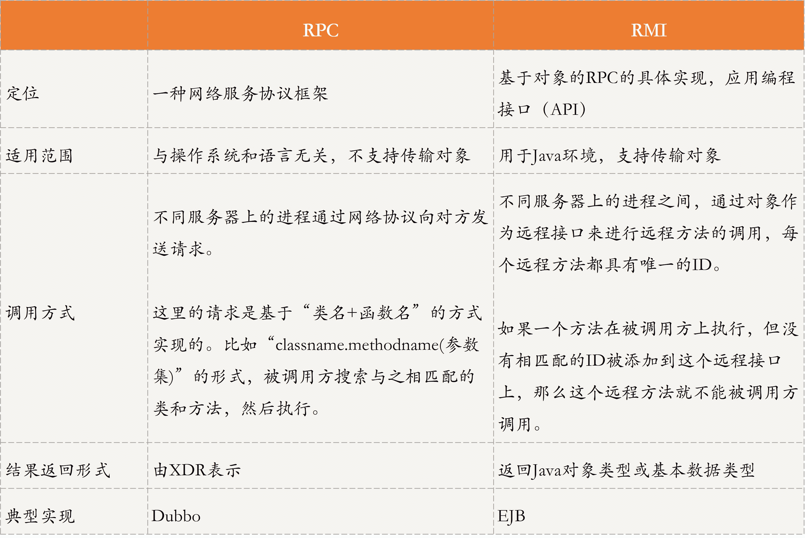
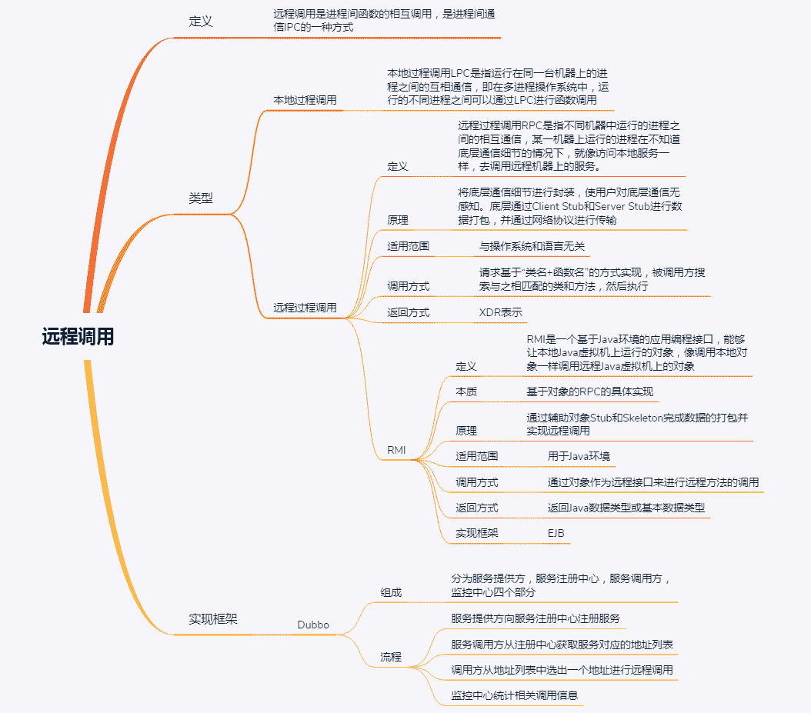

# 19 | 分布式通信之远程调用：我是你的千里眼

 

你好，我是聂鹏程。今天，我来继续带你打卡分布式核心技术。

在前面三个模块中，我带你学习了分布式领域中的分布式协调与同步、分布式资源管理与负载调度，以及分布式计算技术，相信你对分布式技术已经有了一定的了解。

通过前面的学习，不知道你有没有发现分布式的本质就是多进程协作，共同完成任务。要协作，自然免不了通信。那么，多个进程之间是如何通信的呢？这也就是在“第四站：分布式通信技术”模块中，我将要为你讲解的问题。

话不多说，接下来我们就一起进入分布式通信的世界吧。今天，我首先带你打卡的是，分布式通信中的远程调用。

## 什么是远程调用？

首先，我通过一个例子，来让你对远程调用和本地调用有一个直观了解。

以电商购物平台为例，每一笔交易都涉及订单系统、支付系统及库存系统，假设三个系统分别部署在三台机器 A、B、C 中独立运行，订单交易流程如下所示：

1. 用户下单时，调用本地（机器 A）的订单系统进行下单；
2. 下单完成后，会远程调用机器 B 上的支付系统进行支付，待支付完成后返回结果，之后在本地更新订单状态；
3. 在本地远程调用机器 C 上的仓库系统出货，出货完成后返回出货结果。

在整个过程中，“下单”和“订单状态更新”两个操作属于本地调用，而“支付”和“出货”这两个操作是通过本地的订单系统调用其他两个机器上的函数（方法）实现的，属于远程调用。

整个订单交易流程如下图所示。

通过这个例子，你应该对本地调用和远程调用有了一个初步的认识了。那到底什么是本地调用，什么是远程调用呢？

**本地调用**通常指的是，进程内函数之间的相互调用；而**远程调用**，是进程间函数的相互调用，是进程间通信 **IPC（Inter-Process Communication）**的一种方式。通过远程调用，一个进程可以看到其他进程的函数、方法等，这是不是与我们通常所说的“千里眼”有点类似呢？

在分布式领域中，一个系统由很多服务组成，不同的服务由各自的进程单独负责。因此，远程调用在分布式通信中尤为重要。

根据进程是否部署在同一台机器上，远程调用可以分为如下两类：

1. **本地过程调用（Local Procedure Call，LPC）**，是指运行在同一台机器上的进程之间的互相通信，即在多进程操作系统中，运行的不同进程之间可以通过 LPC 进行函数调用。
2. **远程过程调用（Remote Procedure Call，RPC）**，是指不同机器中运行的进程之间的相互通信，某一机器上运行的进程在不知道底层通信细节的情况下，就像访问本地服务一样，去调用远程机器上的服务。

在这两种远程调用中，RPC 中的不同进程是跨机器的，适用于分布式场景。因此，在今天这篇文章中，我主要针对 RPC 进行详细讲解。接下来，我再提到远程调用时，主要指的就是 RPC 了。

## 远程调用的原理及应用

我们经常会听别人提起 B/S ( Browser/Server，浏览器 / 服务器) 架构。在这种架构中，被调用方（服务器）有一个开放的接口，然后调用方（用户）通过 Browser 使用这个接口，来间接调用被调用方相应的服务，从而实现远程调用。

比如，用户 A 在自己的电脑上通过浏览器查询北京今天的天气， 浏览器会将用户查询请求通过远程调用方式调用远程服务器相应的服务，然后为用户返回北京今天的天气预报。

但是，B/S 架构是基于 HTTP 协议实现的，每次调用接口时，都需要先进行 HTTP 请求。这样既繁琐又浪费时间，不适用于有低时延要求的大规模分布式系统，所以远程调用的实现大多采用更底层的网络通信协议。

接下来，我将为你介绍两种常用的远程调用机制：**远程过程调用 RPC**(Remote Procedure Call) 和**远程方法调用 RMI**(Remote Method Invocation)。

首先，我们一起看一下 RPC 的原理和应用吧。

### RPC 的原理及应用

简单地说，RPC 就是调用方采用参数传递的方式，通过调用本机器上的一个函数或方法，去执行远程机器上的函数或方法（可以统称为服务），并返回结果。在整个过程中，RPC 会隐藏具体的通信细节。

如下图所示，我们以刚才电商购物平台例子中的“支付”操作为例，来详细看看一次 RPC 调用的完整流程吧：

1. 本地服务器也就是机器 A 中的订单系统，调用本地服务器上的支付系统中的支付操作 Pay(Order)，该方法会直接调用 Client Stub（其中，Stub 是用于转换 RPC 过程中在订单系统和支付系统所在机器之间传递的参数），这是一次正常的本地调用。
2. Client Stub 将方法 Pay、参数 Order 等打包成一个适合网络传输的消息，通过执行一次系统调用（也就是调用操作系统中的函数）来发送消息。
3. 订单系统所在机器 A 的本地操作系统通过底层网络通信，将打包好的消息根据支付系统所在机器 B 的地址发送出去。
4. 机器 B 上的操作系统接收到消息后，将消息传递给 Server Stub。
5. 机器 B 上的 Server Stub 将接收到的消息进行解包，获得里面的参数，然后调用本地的支付订单的操作 Pay(Order)。
6. 机器 B 上的支付操作 Pay(Order) 完成后，将结果发送给 Server Stub，其中结果可使用 XDR（External Data Representation，一种可以在不同计算机系统间传输的数据格式）语言表示。
7. 机器 B 上的 Server Stub 将结果数据打包成适合网络传输的消息，然后进行一次系统调用发送消息。
8. 机器 B 的本地操作系统通过底层网络将打包好的消息发送回机器 A。
9. 机器 A 的操作系统接收到来自机器 B 的消息，并将消息发送给本地的 Client Stub。
10. 本地的 Client Stub 将消息解包，然后将解包得到的结果返回给本地的订单系统。

到此，整个 RPC 过程结束。

从整个流程可以看出，机器 A 上的 Pay(Order)、 Client Stub 和网络调用之间的交互属于本地调用，机器 B 上的 Pay(Order)、Server Stub 和网络调用之间的交互也属于本地调用。而机器 A 和机器 B 之间的远程调用的核心是，发生在机器 A 上的网络调用和机器 B 上的网络调用。

RPC 的目的，其实就是要将第 2 到第 8 步的几个过程封装起来，让用户看不到这些细节。从用户的角度看，订单系统的进程只是做了一次普通的本地调用，然后就得到了结果。

也就是说，**订单系统进程并不需要知道底层是如何传输的，在用户眼里，远程过程调用和调用一次本地服务没什么不同。这，就是 RPC 的核心。**

接下来，我再带你一起看一下 **RPC 与本地调用（进程内函数调用）的区别**吧，以加深你对 RPC 的理解。

你可以先想象一下，本地调用过程是怎样的。

简单来说，同一进程是共享内存空间的，用户可以通过{函数名 + 参数}直接进行函数调用。

而在 RPC 中，由于不同进程内存空间无法共享，且涉及网络传输，所以不像本地调用那么简单。所以，RPC 与本地调用主要有三点不同。

**第一个区别是，调用 ID 和函数的映射。**在本地调用中，进程内可共享内存地址空间，因此程序可直接通过函数名来调用函数。而函数名的本质就是一个函数指针，可以看成函数在内存中的地址。比如，调用函数 f()，编译器会帮我们找到函数 f() 相应的内存地址。但在 RPC 中，只通过函数名是不行的，因为不同进程的地址空间是不一样的。

所以在 RPC 中，所有的函数必须要有一个调用 ID 来唯一标识。一个机器上运行的进程在做远程过程调用时，必须附上这个调用 ID。

另外，我们还需要在通信的两台机器间，分别维护一个函数与调用 ID 的映射表。两台机器维护的表中，相同的函数对应的调用 ID 必须保持一致。

当一台机器 A 上运行的进程 P 需要远程调用时，它就先查一下机器 A 维护的映射表，找出对应的调用 ID，然后把它传到另一台机器 B 上，机器 B 通过查看它维护的映射表，从而确定进程 P 需要调用的函数，然后执行对应的代码，最后将执行结果返回到进程 P。

**第二个区别是，序列化和反序列化。**我们知道了调用方调用远程服务时，需要向被调用方传输调用 ID 和对应的函数参数，那调用方究竟是怎么把这些数据传给被调用方的呢？

在本地调用中，进程之间共享内存等，因此我们只需要把参数压到栈里，然后进程自己去栈里读取就行。但是在 RPC 中，两个进程分布在不同的机器上，使用的是不同机器的内存，因此不可能通过内存来传递参数。

而网络协议传输的内容是二进制流，无法直接传输参数的类型，因此这就需要调用方把参数先转成一个二进制流，传到被调用方后，被调用方再把二进制流转换成自己能读取的格式。这个过程，就叫作序列化和反序列化。

同理，被调用方返回的结果也需要有序列化和反序列化的过程，不然调用方无法获取到结果。也就是说，RPC 与本地调用相比，参数的传递需要进行序列化和反序列化操作。

**第三个区别是，网络传输协议。**序列化和反序列化解决了调用方和被调用方之间的数据传输格式问题，但要想序列化后的数据能在网络中顺利传输，还需要有相应的网络协议，比如 TCP、UDP 等，因此就需要有一个底层通信层。

调用方通过该通信层把调用 ID 和序列化后的参数传给被调用方，被调用方同样需要该通信层将序列化后的调用结果返回到调用方。

也就是说，只要调用方和被调用方可以互传数据，就可以作为这个底层通信层。因此，它所使用的网络协议可以有很多，只要能完成网络传输即可。目前来看，大部分 RPC 框架采用的是 TCP 协议。

说完 RPC 的核心原理，下面我以一个具有代表性的 **RPC 框架 Apache Dubbo 为例**，帮助你更加深入的了解 RPC。

在讲解 Dubbo 之前，你可以先想一下：如果你是一个 RPC 框架的设计者，你会如何设计呢？

首先必须得有服务的提供方和调用方。如下图所示，假设服务提供方 1～4 为调用方 1～4 提供服务，每个调用方都可以任意访问服务提供方。

当服务提供方和服务调用方越来越多时，服务调用关系会愈加复杂。假设服务提供方有 n 个， 服务调用方有 m 个，则调用关系可达 n*m，这会导致系统的通信量很大。此时，你可能会想到，为什么不使用一个服务注册中心来进行统一管理呢，这样调用方只需要到服务注册中心去查找相应的地址即可。

这个想法很好，如下图所示，我们在服务调用方和服务提供方之间增加一个服务注册中心，这样调用方通过服务注册中心去访问提供方相应的服务，这个服务注册中心相当于服务调用方和提供方的中心枢纽。

这样是不是好多了呢？

Dubbo 就是在引入服务注册中心的基础上，又加入了监控中心组件（用来监控服务的调用情况，以方便进行服务治理），实现了一个 RPC 框架。如下图所示，Dubbo 的架构主要包括 4 部分：

1. **服务提供方。**服务提供方会向服务注册中心注册自己提供的服务。
2. **服务注册中心。**服务注册与发现中心，负责存储和管理服务提供方注册的服务信息和服务调用方订阅的服务类型等。
3. **服务调用方。**根据服务注册中心返回的服务所在的地址列表，通过远程调用访问远程服务。
4. **监控中心。**统计服务的调用次数和调用时间等信息的监控中心，以方便进行服务管理或服务失败分析等。

可以看到，Dubbo 的大致工作流程如下：

1. 服务提供方需要向服务注册中心注册自己提供的服务；
2. 服务调用方需要向注册中心预订调用服务的提供方地址列表；
3. 服务注册中心将服务对应的提供方地址列表返回给调用方；
4. 服务调用方根据服务地址信息进行远程服务调用；
5. 服务调用方和服务提供方定时向监控中心发送服务调用次数及调用时间等信息。

接下来，我再带你学习另一个远程调用机制 RMI。

### RMI 的原理及应用

RMI 是一个基于 Java 环境的应用编程接口，能够让本地 Java 虚拟机上运行的对象，像调用本地对象一样调用远程 Java 虚拟机上的对象。

RMI 可以说是 RPC 的一种具体形式，其原理与 RPC 基本一致，唯一不同的是 **RMI 是基于对象的，充分利用了面向对象的思想去实现整个过程，其本质就是一种基于对象的 RPC 实现**。

RMI 的具体原理如下图所示：

RMI 的实现中，客户端的订单系统中的 Stub 是客户端的一个辅助对象，用于与服务端实现远程调用；服务端的支付系统中 Skeleton 是服务端的一个辅助对象，用于与客户端实现远程调用。

也就是说，客户端订单系统的 Pay(Order) 调用本地 Stub 对象上的方法，Stub 打包调用信息，比如变量、方法名等，通过网络发送给服务端的 Skeleton 对象，Skeleton 对象将收到的包进行解析，然后调用服务端 Pay(Order) 系统中的相应对象和方法进行计算，计算结果又会以类似的方式返回给客户端。

为此，我们可以看出，**RMI 与 PRC 最大的不同在于调用方式和返回结果的形式**，RMI 通过对象作为远程接口来进行远程方法的调用，返回的结果也是对象形式，可以是 Java 对象类型，也可以是基本数据类型。 RMI 的典型实现框架有 EJB（Enterprise JavaBean，企业级 JavaBean），如果你需要深入了解这个框架的话，可以参考其官方文档。

### RPC 与 RMI 对比分析

好了，上面我带你学习了 RPC 和 RMI，接下来我通过一个表格来对比下它们的异同吧，以方便你进一步理解与记忆。

## 知识扩展：远程过程调用存在同步和异步吗？

分布式领域中，我们经常会听到同步和异步这两个词，那么远程过程调用存在同步和异步吗？

答案是肯定的。

远程过程调用包括同步调用和异步调用两种，它们的含义分别是：

1. 同步调用，指的是调用方等待被调用方执行完成并返回结果。这就好比在现实生活中，用户 A 让用户 B 完成一篇文章，用户 A 就在那里等着，一直等用户 B 将写好的文章交给用户 A 后才离开，并对文章进行审核。
2. 异步调用，指的是调用方调用后不用等待被调用方执行结果返回，并可以通过回调通知等方式获取返回结果。这就好比在现实生活中，用户 A 让用户 B 完成一篇文章，用户 A 告知用户 B 后，用户 A 离开去做其他事情，当用户 B 完成文章后反馈给用户 A，用户 A 收到反馈后开始审核文章。

也就是说，**同步调用和异步调用的区别是，是否等待被调用方执行完成并返回结果**。

因此，同步调用通常适用于需要关注被调用方计算结果的场景，比如用户查询天气预报，调用方需要直接返回结果；异步调用通常适用于对响应效率要求高、但对结果正确性要求相对较低的场景，比如用户下发部署一个任务，但真正执行该任务需要进行资源匹配和调度、进程拉起等过程，时间比较长，如果用户进程阻塞在那里，会导致体验很差，这种情况下可以采用异步调用。

## 总结

今天，我主要与你分享了分布式通信中的远程调用。

我以电商购物平台为例，首先让你对本地调用和远程调用有了一定的认识，然后分析了两种常用的远程调用机制 RPC 和 RMI，并对两者进行了比较。除此之外，我还介绍了 Dubbo 这个代表性的 RPC 框架。

接下来，我们再回顾下今天涉及的几个与远程调用相关的核心概念吧。

**本地调用**通常指的是同一台机器进程间函数的相互调用，而**远程调用**是指不同机器进程间函数的相互调用。

**RPC** 是指调用方通过参数传递的方式调用远程服务，并得到返回的结果。在整个过程中，RPC 会隐藏具体的通信细节，使调用方好像在调用本地函数或方法一样。

**RMI** 是一个基于 Java 环境的应用编程接口，能够让调用方 Java 虚拟机上运行的对象，像调用本地对象一样，调用其他机器 Java 虚拟机上的对象。可以说，RMI 是 RPC 的一种具体实现形式。

**Dubbo** 是一个代表性的 RPC 框架，服务提供方首先向注册中心注册自己提供的服务，调用方通过注册中心获取提供的相对应的服务地址列表，然后选择其中一个地址去调用相应的服务。

最后，我再通过一张思维导图来归纳一下今天的核心知识点吧。

现在，是不是觉得 RPC 没有之前那么神秘了呢？如果你对 RPC 感兴趣的话，Dubbo 就是一个很棒的出发点。加油，赶紧开启你的分布式通信之旅吧。

## 思考题

在 Dubbo 中引入了一个注册中心来存储服务提供方的地址列表，若服务消费方每次调用时都去注册中心查询地址列表。如果频繁查询，会导致效率比较低，你会如何解决这个问题呢？

我是聂鹏程，感谢你的收听，欢迎你在评论区给我留言分享你的观点，也欢迎你把这篇文章分享给更多的朋友一起阅读。我们下期再会！

