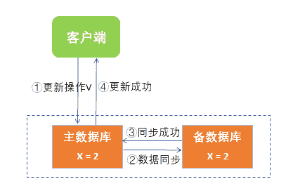
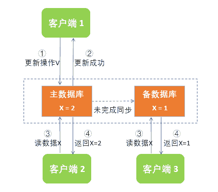
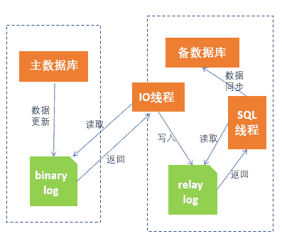
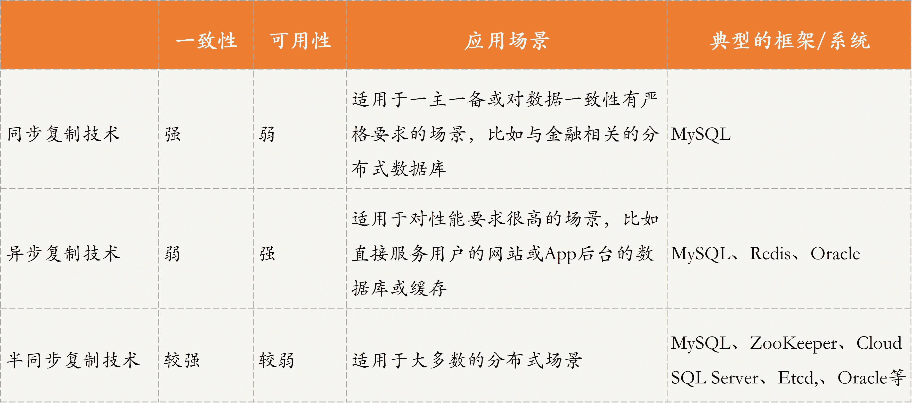
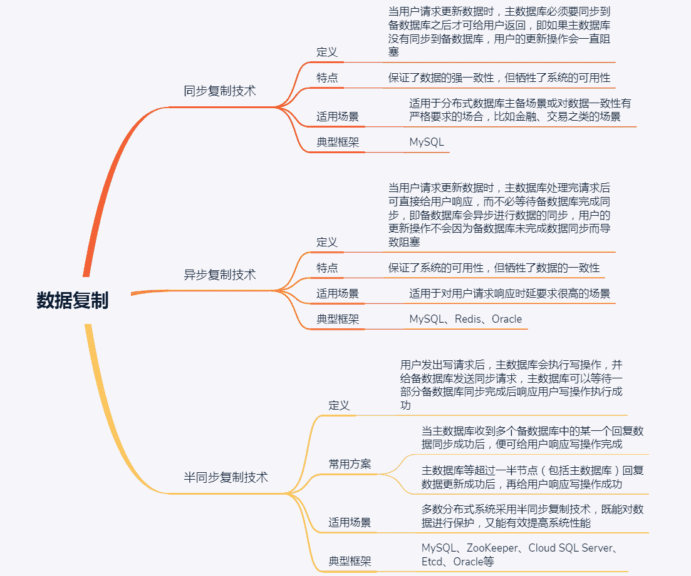

# 26 | 分布式数据复制技术：分身有术

 

你好，我是聂鹏程。今天，我来继续带你打卡分布式核心技术。

在上一篇文章中，我为你讲解了数据分布（也称数据分片）技术，主要用于构建数据索引，是实现“导购”功能的关键技术。数据分布的本质是，将原数据集划分为多个数据子集，以存储到不同的地方，在一定程度上体现了数据的可用性和可靠性（一个存储节点故障，只影响该存储节点的数据）。

我在第 24 讲中介绍“导购”时提到，数据分片和数据复制技术均是实现“导购”的关键技术。其中，数据分片是确定数据位置，数据复制是实现数据可靠性的关键方法。

**在实际情况下，仅考虑数据分片，其实是无法真正应用到生产环境的**。因为，故障导致数据丢失和不可用是很常见的情况。因此，在进行分布式数据存储设计时，通常会考虑对数据进行备份，以提高数据的可用性和可靠性，而实现数据备份的关键技术就是“数据复制技术”。

接下来，我们就一起打卡分布式数据复制技术吧。

## 什么是数据复制技术？

概括来讲，数据复制是一种实现数据备份的技术。比如，现在有节点 1 和节点 2，节点 1 上存储了 10M 用户数据，直观地说，数据复制技术就是将节点 1 上的这 10M 数据拷贝到节点 2 上，以使得节点 1 和节点 2 上存储了相同的数据，也就是节点 2 对节点 1 的数据进行了备份。当节点 1 出现故障后，可以通过获取节点 2 上的数据，实现分布式存储系统的自动容错。

也就是说，数据复制技术，可以保证存储在不同节点上的同一份数据是一致的。这样当一个节点故障后，可以从其他存储该数据的节点获取数据，避免数据丢失，进而提高了系统的可靠性。

这是不是就像数据有了自己的“分身”呢？那么，分布式系统是如何实现数据“分身有术”的呢？

接下来，我们通过一个例子来具体看下吧。

在分布式数据库系统中，通常会设置主备数据库，当主数据库出现故障时，备数据库可以替代主数据库进行后续的工作，从而保证业务的正常运行。这里，备数据库继续提供服务就是提高了分布式存储系统的可用性及可靠性。

那么，在这个过程中，又是如何实现备数据库替代主数据库的呢？这，就涉及到数据一致性的问题了，即只有主备数据库中的数据保持一致时，才可实现主备的替换。因此，在这个例子中，**数据复制技术实际就是指，如何让主备数据库保持数据一致的技术。**

理解了数据复制技术的基本含义，我们再一起看看数据复制技术的具体原理和应用吧。

## 数据复制技术原理及应用

不知你是否还记得，我在第 23 篇文章与你分享的 CAP 理论的 C、A 和 P 三个特性呢？我曾提到：在分布式存储系统中，分区容错性是肯定要满足的，为此需要在一致性和可用性之间做出权衡。

所以，对于数据的一致性，通常是指不同节点上数据要保持一致。要实现不同节点上的数据一致，数据复制技术必不可少。为此，对于分布式存储系统中的数据复制技术来讲，也需要在一致性和可用性之间做出一些权衡。因此，这就导致出现了多种数据复制技术方法，大体上有三类：

1. 第一类方法，比较注重一致性，比如同步复制技术；
2. 第二类方法，则更注重可用性，比如异步复制技术；
3. 第三类方法，是介于前两者之间的，比如半同步复制技术。

接下来，我就针对同步数据复制技术、异步数据复制技术，以及半同步数据复制技术分别进行详细讲解。

### 同步复制技术原理及应用

同步复制技术是指，当用户请求更新数据时，主数据库必须要同步到备数据库之后才可给用户返回，即如果主数据库没有同步到备数据库，用户的更新操作会一直阻塞。这种方式保证了数据的强一致性，但牺牲了系统的可用性。

接下来，我们看一个具体的案例吧。

在一个分布式数据库系统中，有两个节点，分别作为主节点和备节点。通常情况下，两个节点均可接收用户读请求，然后将本节点的数据及时返回给用户，也就是说读请求响应比较快。而如果用户发送的是写请求，写操作必须由主节点进行，即使用户将写请求发送到备节点，备节点也会将该请求转发给主节点，因此写请求通常比读请求响应慢。MySQL 集群的读写分离就是一个典型实例。

如此设计的原因是，读请求不需要改变数据，只需要在更改数据时保证数据一致，就可以随时读；而写请求，因为要修改数据，如果每个节点均修改同一数据，则可能导致数据不一致。因此只有主节点可以进行写操作，但又要保证主节点和备节点的数据一致，这就是数据复制技术要发挥的作用了。

对于上述场景，如果采用同步复制技术的话，对于写请求，主数据库会执行写操作，并将数据同步到所有备数据库之后才可以响应用户。如图所示，客户端向主数据库发起更新操作 V，将 X 设置为 2，主数据库会将写请求同步到备数据库，备数据库操作完后会通知主数据库同步成功，然后主数据库才会告诉客户端更新操作成功。MySQL 集群支持的全复制模式就采用了同步复制技术。

在同步复制技术中，主数据库需要等待所有备数据库均操作成功才可以响应用户，性能不是很好，会影响用户体验，因此，**同步复制技术经常用于分布式数据库主备场景**（对于一主多备场景，由于多个备节点均要更新成功后，主节点才响应用于，所需时延比较长）**或对数据一致性有严格要求的场合**，比如金融、交易之类的场景。

### 异步复制技术原理及应用

异步复制技术是指，当用户请求更新数据时，主数据库处理完请求后可直接给用户响应，而不必等待备数据库完成同步，即备数据库会异步进行数据的同步，用户的更新操作不会因为备数据库未完成数据同步而导致阻塞。显然，这种方式保证了系统的可用性，但牺牲了数据的一致性。

如图所示，客户端 1 向主数据库发起更新操作 V，主数据库执行该操作，将 X=1 修改为 X=2，执行后直接返回给客户端 1 更新操作成功，而未将数据同步到备数据库。因此，当客户端 2 请求主数据库的数据 X 时，可以得到 X=2，但客户端 3 请求备数据库中的数据 X 时，却只能得到 X=1，从而导致请求结果不一致。

当然，分布式数据库主备模式场景下，若对数据一致性要求不高，也可以采用异步复制方法。MySQL 集群默认的数据复制模式采用的是异步复制技术，我就以 MySQL 集群默认的复制模式为例，与你简单描述下主备数据库同步的流程吧。

1. 主数据库完成写操作后，可直接给用户回复执行成功，将写操作写入 binary log 中，binary log 中记录着主数据库执行的所有更新操作，以便备数据库获取更新信息。
2. 备数据库启动一个 IO 线程专门读取 binary log 中的内容然后写入 relay log 中。
3. 备数据库启动一个 SQL 线程会定时检查 relay log 里的内容，如发现有新内容则会立即在备数据库中执行，从而实现数据的一致。

**异步复制技术大多应用在对用户请求响应时延要求很高的场景**，比如很多网站或 App 等需要面向实际用户，这时后台的数据库或缓存如果采用同步复制技术，可能会流失用户，因此这种场景采用异步复制技术就比较合适。

除了 MySQL 集群，在缓存数据库 Redis 集群中，采用的也是异步复制技术，因此性能较高。但，在 Redis 中还会有其他机制来保证数据的一致性，我会在第 27 篇文章中与你详细介绍。

### 半同步复制技术原理及应用

同步复制技术会满足数据的强一致性，但会牺牲一定的可用性；异步复制技术会满足高可用，但一定程度上牺牲了数据的一致性。介于两者中间的是，半同步复制技术。

半同步复制技术的核心是，用户发出写请求后，主数据库会执行写操作，并给备数据库发送同步请求，但主数据库不用等待所有备数据库回复数据同步成功便可响应用户，也就是说主数据库可以等待一部分备数据库同步完成后响应用户写操作执行成功。

**半同步复制技术通常有两种方式：**

1. 一种是，当主数据库收到多个备数据库中的某一个回复数据同步成功后，便可给用户响应写操作完成；
2. 另一种是，主数据库等超过一半节点（包括主数据库）回复数据更新成功后，再给用户响应写操作成功。

显然，第二种半同步复制方案要求的一致性比第一种要高一些，但相对可用性会低一些。

前面所讲的 MySQL 集群，在一主多备场景下，也支持半同步复制模式，一般采用的是第一种半同步复制技术，这种技术既不会影响过多的性能，还可以更好地实现对数据的保护。

还记得我在第 23 篇文章中提到的具有 CP 特性的 ZooKeeper 集群吗？它采用的数据复制技术就是第二种半同步复制方案。在 ZooKeeper 集群中，写请求必须由 Leader 节点进行处理，每次写请求 Leader 会征求其他 Follower 的同意，只有当多数节点同意后写操作才可成功，因此保证了较高的一致性。

除此之外，还有很多系统采用了第二种半同步复制方案，比如微软云关系型数据库 Microsoft SQL Azure 的后端存储系统 Cloud SQL Server、Kubenetes 中保存集群所有网络配置和对象状态信息的 Etcd 组件（该组件采用的是 Raft 一致性协议，你可以再回顾下第 4 篇文章中的相关内容）等。

实际上，**多数的分布式存储系统可以通过配置来选择不同的数据复制技术**。比如上面讲过的 MySQL 数据库集群，就支持全同步复制、异步复制和半同步复制三种模式，再比如 Oracle 数据库，也提供了三种模式：

1. 最大保护模式，对于写请求，要求主数据库必须完成至少一个备数据库的数据同步才可成功返回给客户端，采用的是半同步复制技术中的第一种方式。
2. 最大性能模式，对于写请求，只要主数据库执行成功即可返回给客户端，采用的是异步复制技术。这种方式极大地提高了系统的可用性，但一致性难以保证。
3. 最大可用性模式，介于最大保护模式和最大性能模式两者之间。这种模式是指，系统在通常情况下采用最大保护模式，但当主备之间出现网络故障时，切换为最大性能模式，等到网络恢复后，备数据库再进行数据同步。这种方式在系统的一致性和可用性之间做了一个权衡。

### 三种数据复制技术对比

以上，就是同步复制技术、异步复制技术和半同步复制技术的核心知识点了。接下来，我通过一张表格对比下这三种方法，以便于你记忆和理解。

## 知识扩展：在半同步复制技术中，对于未回复数据更新结果的节点，如何解决数据不一致或冲突呢？

对于半同步复制技术，因为只有部分备节点更新数据后，主节点即可返回响应用户。那么，对于未回复数据更新结果的节点，如何解决可能存在的数据不一致或冲突呢？

对于这个问题，不同的场景有不同的处理方式，需要根据用户的需求进行选择，比如以最新数据为准、以最大数据为准等，没有统一的评判规则，和用户的需求紧密相关。由于在分布式系统中，很多系统采用了 Raft 算法（你可以再回顾下第 4 篇文章中的相关内容），因此这里，我以 Raft 算法的处理策略为例与你展开介绍，以便你理解大部分常用的分布式系统的处理策略。

我刚刚提到，Raft 算法采用的是第二种半同步复制技术，也就是主数据库等超过一半节点（包括主数据库）回复数据更新成功后，再给用户响应写操作成功。当有 Follower 节点的数据与 Leader 节点数据不一致时，采用强制复制策略来解决不一致情况。

由于所有的数据更新操作最先在 Leader 节点执行，因此当产生冲突时，以 Leader 节点为准。Leader 节点上会对比与自己数据不一致的 Follower 节点所存储的信息，找到两者最后达成一致的地方，然后强制将这个地方之后的数据复制到该 Follower 节点上。

**具体方法是，**Leader 节点将每一次数据操作看作一条记录，并对这条记录标记一个 index，用于索引。Leader 节点会为每个 Follower 节点维护一个记录状态变量 nextIndex，即下一个记录的索引位置（nextIndex 的值为 Leader 节点当前存储数据记录的下一个 Index 值）。Leader 节点会将 nextIndex 发送给 Follower 节点，若 Follower 节点发现与本节点的 nextIndex 不一致，则告知 Leader 节点不一致，Leader 节点将 nextIndex 减 1，重复上述过程，直到与 Follower 节点的 nextIndex 相等位置，即找到了两者最后达成一致的地方。

比如，对于变量 X，Leader 节点记录的操作是{(Index 1, X = 1, Version:0), (Index 2, X=2, Version:1), (Index3 , X=3, Version:2)}，其中，Follower 节点 2 记录的操作为{(Index 2, X=1, Version:0), (Index 6, X=4, Version:2)}。

那么，Leader 节点发现两者最后一致的状态是{(Index 1, X=1, Version:0)}，为此将后续的{(Index 2, X=2, Version:1), (Index 3, X=3, Version:2)}复制到节点 2 上，则节点 2 更新为 (Index 1, X = 1, Version: 0), (Index 2, X=2, Version:1), (Index3 , X=3, Version:2)}。从而，节点 2 与 Leader 节点的数据保持一致。

## 总结

今天，我主要和你分析的是分布式数据复制技术。

首先，我通过分布式数据库主备节点数据一致的例子，为你比较直观的讲解了什么是数据复制技术。

然后，我为你介绍了数据复制技术的原理及应用，以及同步复制技术、异步复制技术和半同步复制技术这三种方法。其中，对于用户更新数据的请求，同步复制技术要求主备节点均更新完成，才返回结果告知用户更新成功；异步复制技术只需要主节点更新成功，就可返回结果；半同步复制技术，要求主节点更新成功，且备节点中至少有 1 个或过半节点更新成功，才可返回结果。

最后，我再通过一张思维导图来归纳一下今天的核心知识点吧。

相信通过今天的学习，你对分布式数据复制技术已经有了深刻的理解，并且对于不同技术适用的场景也有了自己的看法。加油，赶紧行动起来，相信你可以为你的业务场景选择一个合适的复制策略，也能够比较容易看懂 ZooKeeper 等开源软件采用的复制技术的原理了。

## 思考题

本讲主要是从应用或分布式数据系统的角度介绍了三种比较基本的数据复制技术，你还知道一些其他的基于本讲介绍的复制技术的演进或变种的复制方法吗？

我是聂鹏程，感谢你的收听，欢迎你在评论区给我留言分享你的观点，也欢迎你把这篇文章分享给更多的朋友一起阅读。我们下期再会！

