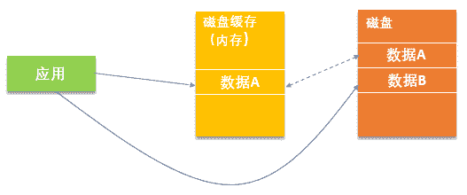
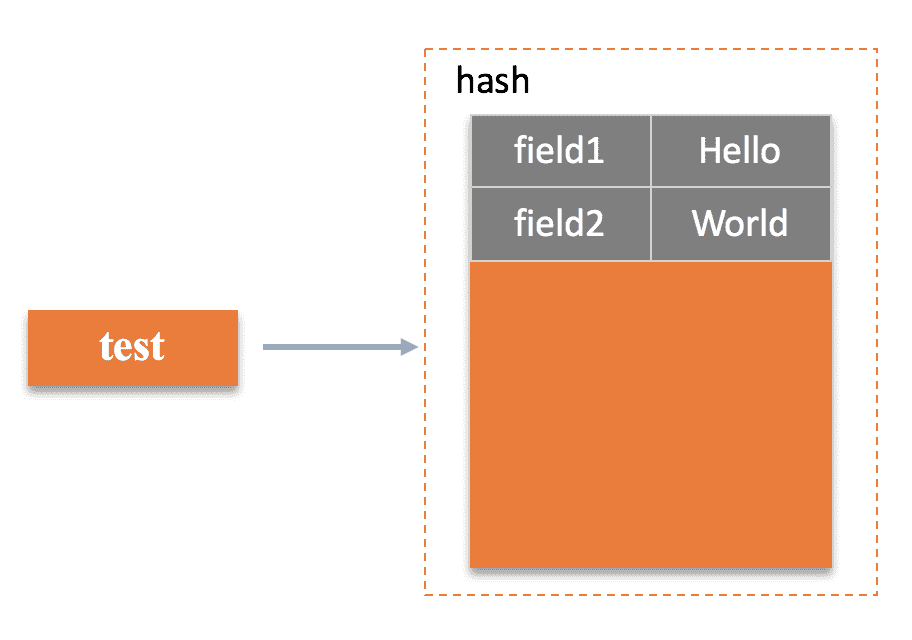
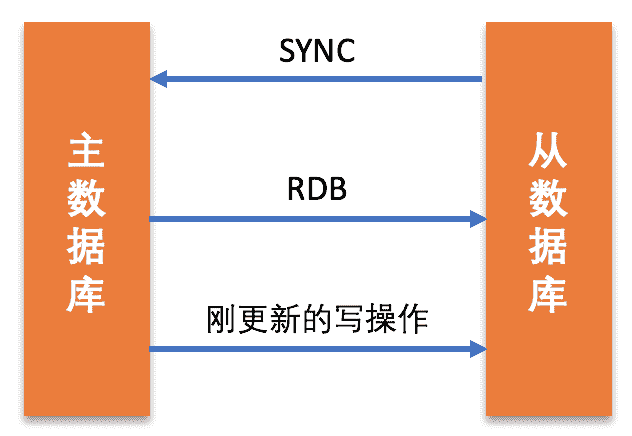
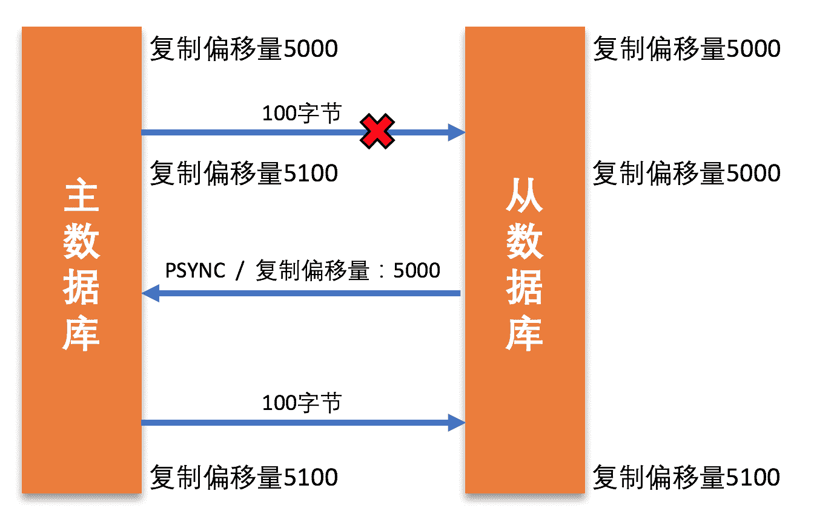
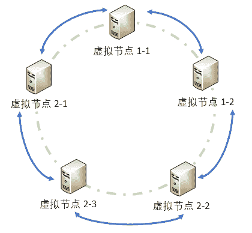
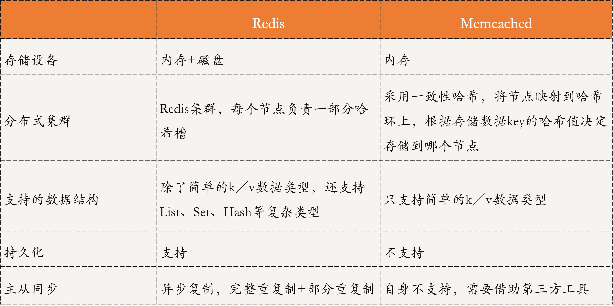
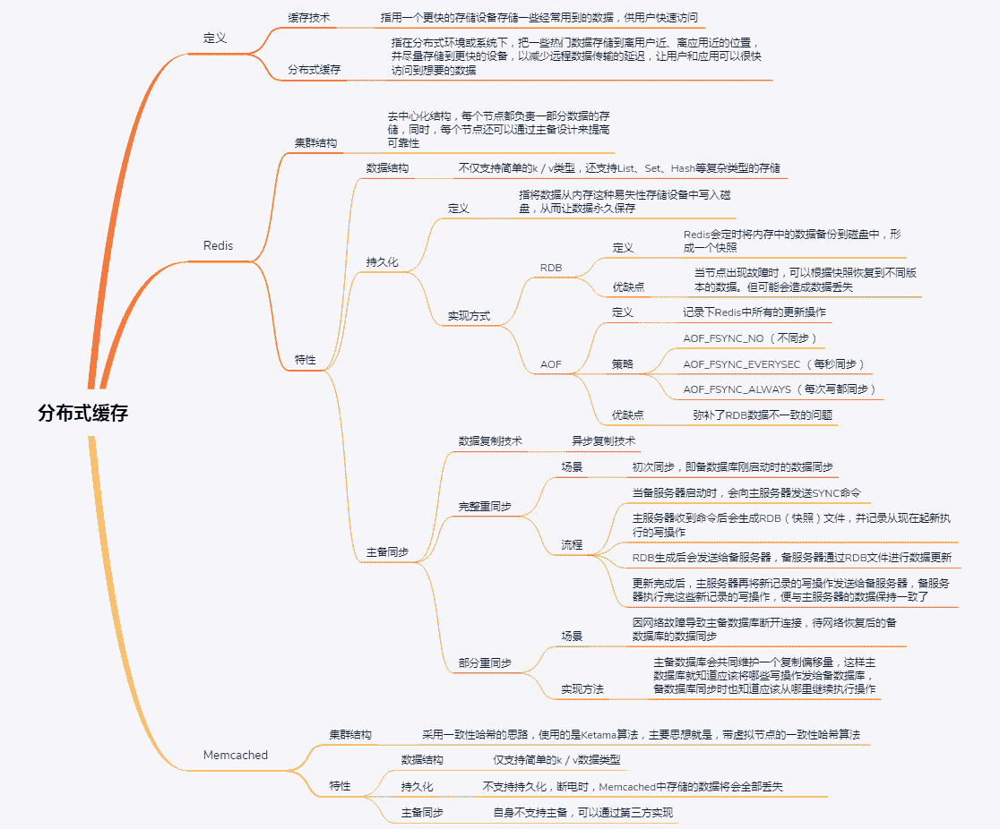

# 27 | 分布式数据之缓存技术：“身手钥钱”随身带

 

你好，我是聂鹏程。今天，我来继续带你打卡分布式核心技术。

不知不觉，分布式数据存储这一站已经到了最后一讲。在前面几讲，我与你分享了 CAP 理论、分布式存储系统的三要素（顾客、导购和货架）、数据分布式分片方法和数据复制技术，其中数据分片方法和数据复制技术均是导购中的关键技术。

在这一讲，我将为你讲解分布式存储中“货架”的关键技术——缓存技术。

在计算机领域的各个方面，缓存都非常重要，是提升访问性能的一个重要技术。为什么这么说呢？

从单个计算机的体系结构来看，内存和处理器速度差异很大，如果不采用缓存技术，处理器的性能会受到很大的限制。

再看计算机应用，如果不采用缓存技术，对于每个请求，应用都要与后台数据库做一次交互，而数据库中的数据存储在磁盘上，因此每次请求都要和磁盘做交互，而磁盘访问的性能很低，造成访问延迟。

除此之外，还有网络访问，如果没有缓存机制，每次访问主机都要与远程机器做交互，速度又可想而知。

接下来，我们就一起打卡分布式缓存技术吧。

## 什么是分布式缓存？

打比方来说，缓存技术其实就像一个水缸，平时它会存储一定的水，而这些水就来自深井。如果每次都去深井打水，一方面井口比较小，导致一次能接收的用水请求有限；另一方面，井比较深，打水的工序比较复杂，导致所需时间比较长。

而有了这个水缸，我们就不需要去深井里打水，当水缸里没水时，水泵会将深井里的水抽到水缸中暂时存储起来。也就是说，“缓存技术”存储了满足人们一定时间内常用的“水量”，以提高用水效率。

在计算机领域，**缓存技术**一般是指，用一个更快的存储设备存储一些经常用到的数据，供用户快速访问。用户不需要每次都与慢设备去做交互，因此可以提高访问效率。

**分布式缓存**就是指在分布式环境或系统下，把一些热门数据存储到离用户近、离应用近的位置，并尽量存储到更快的设备，以减少远程数据传输的延迟，让用户和应用可以很快访问到想要的数据。这，是不是可以形象地理解为“身手钥钱”随身带呢？

其实，**我们通常说的分布式数据缓存，属于计算机应用中的缓存的一种**。而计算机应用中的缓存，一般指内存，即内存存储了用户经常访问的数据，用户或应用不再需要到磁盘中去获取相应的数据，大幅提高访问速度。

如下图所示，数据 A 是应用经常访问的数据，而数据 B 很少被应用访问，因此当应用访问数据 A 时，不需要到磁盘，而直接访问内存即可得到对应的值，速度较快；相反，访问数据 B 时，由于内存中没有缓存数据 B，所以应用需要到磁盘中获取对应的值，速度较慢。

那么今天，我要与你分享的分布式数据存储相关的缓存技术，就是以内存做为磁盘的缓存。

## 分布式缓存原理

接下来，我以主流的分布式缓存系统 Redis 和 Memcached 为例，与你讲述分布缓存技术，以加深你的理解吧。

### Redis 分布缓存原理

Redis 的全称是 Remote Dictionary Server（远程字典服务器）。可以直观地看出，它是以字典结构将数据存储在内存中，应用可直接到内存读写 Redis 存储的数据。

Redis 集群是一个典型的去中心化结构，每个节点都负责一部分数据的存储，同时，每个节点还会进行主备设计来提高 Redis 的可靠性，具体原理你可以再回顾下第 10 篇文章中的相关内容。

接下来，我与你分享下，Redis 中与缓存关系最紧密的三个特性**：支持多数据结构、支持持久化和主备同步。**

**第一，Redis 支持多数据结构**。

Redis 是一个基于内存的 key-value 数据库，为了方便支持多应用的缓存，比如缓存文本类型、数据库的查询结果（字段与字段对应的值）等等，支持的数据结构不仅有简单的 k／v 类型，还可以支持 List、Set、Hash 等复杂类型的存储。

以 Hash 这种复杂类型的存储为例，Redis 将 Hash 视作一个整体当作数据库的 value（可以是一个对象，比如结构体对象）进行存储。如果把 Hash 结构的整体看作对象的话，Hash 结构里的 key-value 相当于该对象的属性名和属性值。

比如，插入 Hash 数据类型的命令：HMSET test field1 “Hello” field2 “World”中，如下图所示，test 为 key 值， field1 “Hello” field2 “World” 为 value 值，如果把整个 Hash 结构看做对象的话，则 field1、field2 类似于对象中的属性名，“Hello”“World”类似于对象中的属性值。

**第二，Redis 支持持久化。**

持久化是指，将数据从内存这种易失性存储设备中写入磁盘，从而让数据永久保存。Redis 中存储的数据虽然是基于内存的，但它也提供了持久化的机制，主要有两种方式：RDB 和 AOF。

**RDB**（Redis DataBase），也称快照方式，简单来说就是 Redis 会定时将内存中的数据备份到磁盘中，形成一个快照，比如每天保存一下过去一周的数据。这样当节点出现故障时，可以根据快照恢复到不同版本的数据。这种方式有一个明显的缺点，是会造成数据丢失，即当节点出现故障时，新数据可能还未备份到磁盘中。

**AOF**（Append Only File）的出现主要弥补了 RDB 数据不一致的问题，其思想与上一讲提到的数据库复制技术中 binary log 类似，即记录下 Redis 中所有的更新操作。

在 Redis 中，提供了三种实现 AOF 的策略：

1. AOF_FSYNC_NO （不同步），即不会自动触发写操作的同步；
2. AOF_FSYNC_EVERYSEC （每秒同步），即每隔一秒都会将写操作同步到磁盘；
3. AOF_FSYNC_ALWAYS （每次写都同步），即每次发生写操作会立即同步到磁盘。

Redis 中默认采用 AOF_FSYNC_EVERYSEC（每秒同步）的策略，因为这种策略的性能很不错，而且一旦出现故障，最多只会丢失一秒的数据。

**第三，Redis 支持主备同步。**

说到主备同步，我相信你应该想到了上一讲提到的数据复制技术。在 Redis 中，采用的是异步复制技术，但 Redis 可以通过配置 min-replicas-to-write 和 min-replicas-max-lag 这两个参数来有效地保证数据一致性。

比如，设置 min-replicas-to-write=3、min-replicas-max-lag=10，表示当至少有 3 个备数据库连接主数据库的延迟时间小于 10s 时，主数据库才可以执行写操作。延迟时间是从最后一次收到备数据库的心跳开始计算，通常每秒发送一次心跳。

除了上面对写操作的同步，在 Redis 中，还有两种情况是需要进行数据同步的：

1. 一种情况是初次同步，即备数据库刚启动时的数据同步；
2. 另一种情况是，因网络故障导致主备数据库断开连接，待网络恢复后的备数据库的数据同步。

针对这两种情况，Redis 提供了两种同步模式，即完整重同步和部分重同步。

**完整重同步**的流程如下所示：

1. 当备服务器启动时，会向主服务器发送 SYNC 命令；
2. 主服务器收到命令后会生成 RDB（快照）文件，并记录从现在起新执行的写操作；
3. RDB 生成后会发送给备服务器，备服务器通过 RDB 文件进行数据更新；
4. 更新完成后，主服务器再将新记录的写操作发送给备服务器，备服务器执行完这些新记录的写操作，便与主服务器的数据保持一致了。

简单地说，**部分重同步**就是，当网络恢复后，主数据库将主备数据库断开连接之后的一系列写操作发送给备服务器，备数据库执行这些写操作，从而保证数据保持一致。

在这种方式的实现中，主备数据库会共同维护一个复制偏移量，这样主数据库就知道应该将哪些写操作发给备数据库，备数据库同步时也知道应该从哪里继续执行操作。

如图所示，主数据库的复制偏移量为 5000 时，向备数据库发送了 100 个字节的数据，发送结束后复制偏移量为 5100。

此时主备数据库连接断开，备数据库没有接收到这 100 个字节的数据，等到备数据库重新与主数据库连接上之后，会给主数据库发送 PSYNC 命令，并带上自己的复制偏移量 5000，主数据库接收到信息后，根据接收到的复制偏移量，将 5000 之后的数据发给备数据库，从而完成数据的部分重同步。

以上，就是分布式缓存系统 Redis 中涉及的关键技术，包括支持的数据结构、数据持久化方法和数据同步方法，相信通过上面的介绍，你对分布式缓存技术已经有了一定的了解。

接下来，我再带你学习另一个缓存数据库 Memcached。

### Memcached 分布式缓存原理

与 Redis 类似，Memcached 也是一个基于内存的高性能 key-value 缓存数据库。Memcached 比 Redis 问世更早，也有很多公司在使用，比如 Facebook、Vox、LiveJournal 等。

其实，Memecached 的缓存原理和 Redis 类似。所以接下来的内容，我会着重于你讲述这两个数据库在支持的数据结构、持久化和主备同步上的不同。这样，你可以对比着学习这两个数据库，也会理解得更全面、深入些。

首先，我要先带你了解一下 Memcached 的集群结构。

Redis 的集群结构是每个节点负责一部分哈希槽，且每个节点可以设计主备。与 Redis 不同，Memcached 集群采用一致性哈希的思路，使用的是 Ketama 算法。该算法的主要思想就是，**带虚拟节点的一致性哈希算法**。

在实际应用中，每个物理节点对应 100~200 个虚拟节点，才能到达一个较好的存储均衡。这里为了方便理解，我对 Memcached 的集群结构做了简化，如下图所示，物理节点 1 对应两个虚拟节点 1-1、1-2，物理节点 2 对应三个虚拟节点 2-1、2-2 和 2-3。

采用带虚拟节点的一致性哈希方法，有一个优点是，当添加或移除节点时，不会出现大规模的数据迁移。你可以再回顾下第 25 篇文章中的相关内容。

对于数据结构的支持，Memcached 仅支持简单的 k／v 数据类型，如果想要存储复杂的数据类型，比如 List、Set 和 Hash 等，需要客户端自己处理，将其转化为字符串然后进行存储。这样就导致了一个缺点，操作不灵活。比如，Memcached 存储的数组中有一个元素需要修改，则需要将整个数组的数据取出来，修改后再整体写入到数据库中 。

而对于持久化，Memcached 是不支持的。这意味着断电时，Memcached 中存储的数据将会全部丢失。因为内存是一种易失性存储设备，断电后将不会存储数据。

在 Memcached 中，服务器和服务器之间没有任何通信，即自身不支持主备。如果想要实现高可用，需要通过第三方实现。比如，Repcached 实现了 Memcached 的复制功能，支持一主一备，从而使 Memcached 满足高可用。

### 对比分析

上面，我以 Redis 和 Memcached 这两个主流的分布式缓存系统为例，带你学习了分布式缓存技术。接下来，我以一个表格对它们进行分析对比，以便于你理解和查阅。

## 知识扩展：除了分布式存储中的缓存，还有计算机体系结构和网络中的缓存，它们又分别是什么呢？

**计算机体系结构中的缓存**，通常是指专用的缓存设备。由于内存和 CPU 访问速度相差很大，为了提高 CPU 的性能，计算机内部在 CPU 与内存之间设置了相应的缓存。

现在大多数机器分为三级缓存：L1 高级缓存、L2 高级缓存和 L3 高级缓存。就访问速度来讲，L1 高级缓存 > L2 高级缓存 > L3 高级缓存 > 内存。其中，L1 高级缓存的访问速度，几乎和 CPU 中寄存器的访问速度一样快。

有了这三级缓存，很多数据不需要到内存中读取，而直接读取这三级缓存中的数据即可，缩短了数据访问的时间，使得计算机运行速度变得更快。

**网络访问中的缓存**，通常是指本地的“磁盘”。通过网络访问数据时，需要与远程服务器交互来进行传输，而网络间数据传输以及远程服务器对请求的响应，会耗费很多时间。如果本机器的磁盘可以对你经常访问的远程内容进行存储，这样就不用每次都与远程服务器交互，从而减少网络数据传输与服务器响应的延迟，极大地提高性能。

可以看出，**缓存的概念是相对的，基于不同的背景或应用场景，缓存所映射的存储设备是不一样的。**

## 总结

今天，我主要与你分享了分布式数据的缓存技术。

首先，我以水缸的例子带你直观了解了什么是缓存，并引出了什么是分布式数据缓存。分布式数据缓存是以内存作为磁盘的缓存，存储一些用户经常需要用的数据，以提高访问速度。

其次，我以主流的 Redis 和 Memcached 为例，与你介绍了分布式缓存技术中的关键技术，包括支持的数据存储结构（比如 k/v、Set、List 等）、持久化技术（包括快照方式等）和数据同步技术（具体技术原理，可参见第 26 篇文章）。

最后，我再通过一张思维导图来归纳一下今天的核心知识点吧。

相信通过本讲的学习，你已不再觉得分布式缓存有多么神秘了，不管是使用 Redis 还是看 Redis 等系统的源码，一定会更容易理解和上手。加油，行动起来吧！

## 思考题

本讲我主要介绍了 Redis 和 Memcached 分布式数据缓存系统，你还知道哪些主流的分布式数据缓存系统呢？它们的缓存核心技术是什么呢？

我是聂鹏程，感谢你的收听，欢迎你在评论区给我留言分享你的观点，也欢迎你把这篇文章分享给更多的朋友一起阅读。我们下期再会！

