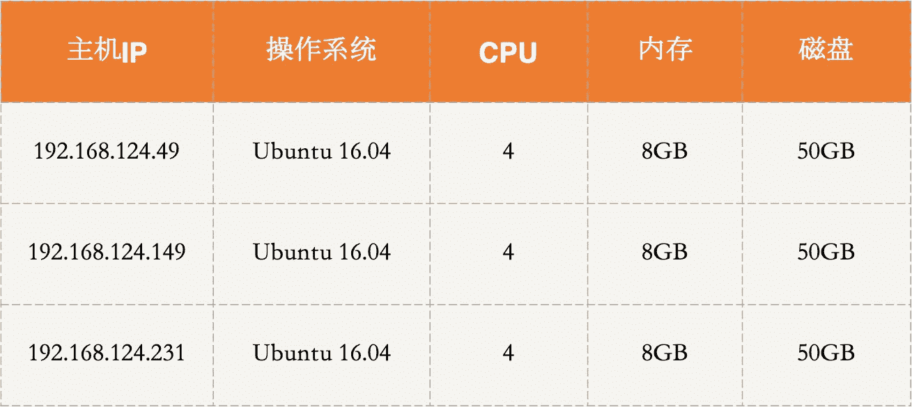

# 34 | 搭建一个分布式实验环境：纸上得来终觉浅，绝知此事要躬行

 

你好，我是聂鹏程。

上一讲，我以购买火车票为例，为你串讲了分布式技术的应用，帮助你理解所学分布式技术可以应用到哪些业务中。其实，到目前为止，我们主要是从理论上学习相关的分布式技术。但，“纸上得来终觉浅，绝知此事要躬行”。

今天，我就以 Kubernetes 为例，和你一起搭建一个分布式实验环境。我先简单和你说下这篇文章的内容分配：

1. 不会特别详细地讲述搭建过程，而是着重说明搭建的主要步骤以及可能遇到的问题；
2. 在讲述搭建过程时，串联一下其中涉及的分布式相关知识；
3. 搭建完 Kubernetes 集群之后，我会以部署 Nginx 服务为例，帮助你更直观地体验分布式技术，以巩固、加深对分布式技术的理解。

话不多说，接下来，我们就一起搭建这个分布式实验环境吧。

## 搭建目标

Kubernetes 是 Google 开源的容器集群管理系统，是 Borg 的开源版本。我在第 9 篇文章中讲解集中式架构时，和你分析过 Kubernetes 集群属于主从架构的分布式集群。

Kubernetes 集群主要由 Master 节点和 Worker 节点组成。Master 节点就是中心服务器，负责对集群进行调度管理；Worker 节点是真正的工作节点，负责运行业务应用的容器。而容器是一种虚拟化技术，通过限制自身使用的资源来实现资源隔离，可以为应用提供一整套运行环境，从而实现了服务运行环境的隔离，进而实现了故障隔离。你可以回顾下第 30 篇文章中，资源隔离的相关内容。

接下来，我们明确下这次搭建分布式实验室环境的目标：

1. 搭建一个 Kubernetes 集群，包括一个 Master 节点，两个 Worker 节点 ;
2. 在 Kubernetes 集群上创建一个 Nginx 服务。

## 搭建前的准备

今天我们要搭建的 Kubernetes 集群，以 3 台服务器为例，一台作为 Master 节点，两台作为 Worker 节点。服务器应具备的条件如下：

1. Ubuntu 16.04 操作系统；
2. 2GB 或以上的内存；
3. 2 核 CPU 或以上；
4. 服务器间网络连通；
5. 每台服务器具有唯一的主机名、MAC 地址和 product_uuid；
6. 通过执行命令 swapoff -a 来关闭 Swap；
7. 30GB 及以上的磁盘空间；
8. 具备外网访问权限，以方便获取相关镜像。

在这次部署中，我采用的机器配置如下：



准备工作完成后，我们就开始搭建集群吧。

## Kubernetes 集群搭建

搭建 Kubernetes 集群的步骤，主要包括安装 Docker，安装部署 kubeadm、kubelet、kubectl，部署 Master 节点，部署 Worker 节点，安装网络插件这几步。

其中，安装 Docker、部署 Master 节点和 Worker 节点涉及分布式的，需要在多个节点上部署，比如 Docker 节点需要在每个 Worker 节点部署，Master 节点若为集群模式，需要在多个节点上配置主备，Worker 节点需要与 Master 节点建立连接等。

接下来， 我们具体看看如何一步一步搭建出 Kubernetes 集群吧。

### 1. 安装 Docker

Kubernetes 是一个容器集群管理系统，因此每个 Worker 节点会运行容器，以实现业务运行环境隔离。我们在每台服务器上采用如下命令安装 Docker：

```
apt-get install -y docker.io

### 2. 安装部署 kubeadm、kubelet、kubectl

kubeadm 是 Kubernetes 社区提供的一个部署工具，该工具将 kubelet 组件之外的其他组件均采用容器部署，实现了自动化， 避免了手动部署容器的麻烦，简化了部署操作。
```

其中，Master 节点包括 API Server、Scheduler、Cluster State Store(默认 etcd) 和 Control Manager Srever 核心组件；Worker 节点包括 kubelet 和 kube-proxy 核心组件。具体的组件功能和原理，你可以再回顾下第 9 篇文章中的相关内容。

kubelet 组件本身是一个管控容器的组件，需要执行配置容器网络等操作，这些操作需要在宿主机上执行，不采用容器部署。因此，kubelet 组件需要单独部署，而不能用 kubeadm 进行部署。

除此之外，我们还需要安装一下 kubectl 组件。这个组件是 Kubernetes 的命令行工具，通过 kubectl 可以部署和管理应用，查看资源，创建、删除和更新组件。

那么，如何部署 kubeadm、kubelet 和 kubectl 这三个组件呢？

apt 是 Linux 下常用的安装管理工具，这里我就采用 apt 来安装这三个组件。

首先，我们需要添加 Kubernetes 源。

1. 你可以通过执行以下语句获取 Kubernetes 源（需要外网权限）：

```
sudo apt-get update && sudo apt-get install -y apt-transport-https curl  
curl -s https://packages.cloud.google.com/apt/doc/apt-key.gpg | sudo apt-key add -  
cat <<EOF | sudo tee /etc/apt/sources.list.d/kubernetes.list  
deb https://apt.kubernetes.io/ kubernetes-xenial main  
EOF
```

然后使用以下命令更新源：

```
sudo apt-get update
```

1. 这时，我们就可以使用如下命令来安装 kubelet、kubectl 和 kubeadm 了：

```
sudo apt-get install -y kubelet kubeadm kubectl
```

1. 如果没有外网访问权限，在添加 kubernetes 源的时候可以执行以下命令来添加阿里云的 Kubernetes 源：

```
cat <<EOF | sudo tee /etc/apt/sources.list.d/kubernetes.list  
deb https://mirrors.aliyun.com/kubernetes/apt kubernetes-xenial main  
EOF
```

同样的，使用以下命令来更新源：

```
apt-get update # 忽略 gpg 的报错信息
```

最后，使用如下命令安装 kubelet、kubectl 和 kubeadm：

```
apt-get install -y kubelet kubeadm kubectl --allow-unauthenticated
```

安装好这三个组件之后，我们就可以使用 kubeadm 来一键部署集群节点了。

首先，我们来部署 Master 节点。

### 3. 部署 Master 节点

这一步其实就是容器化启动 Master 节点中的各个组件，直接使用 kubeadm 工具提供的一条命令 kubeadm init 即可自动安装。

kubeadm init 这条命令底层其实就是将 Master 的各个组件，比如 API Server、etcd 等，以 Pod 形式（容器集合）运行起来。

当然了，你可以部署多个 Master 节点来实现集群的高可用，比如两个 Master 节点互为主备（你可以回顾下第 31 篇文章中介绍的主备机制）。具体的部署方法，你可以参考这篇文章。

除此之外，etcd 组件也可以采用集群方式部署，从而保证了数据不会丢失。etcd 采用的是 Raft 强一致性协议，相关技术你可以再回顾下第 4 篇文章中的相关问题。

**在本次部署中我以一个 Master 节点为例为你讲解集群的搭建**，关于 Master 为集群的方式，各节点上 kubernetes 配置类似，你可以参考 Kubernetes 官网。

在这里，我把 192.168.124.49 这台机器作为 Master 节点。在该机器上直接执行 kubeadm init，即可完成部署：

```
kubeadm init
```

如果有外网访问权限，基本就可以部署成功了。那么，我们可以根据如下信息判断自己是否部署成功：

```
Your Kubernetes control-plane has initialized successfully!  
  
To start using your cluster, you need to run the following as a regular user:  
  
  mkdir -p $HOME/.kube  
  sudo cp -i /etc/kubernetes/admin.conf $HOME/.kube/config  
  sudo chown $(id -u):$(id -g) $HOME/.kube/config  
  
You should now deploy a pod network to the cluster.  
Run "kubectl apply -f [podnetwork].yaml" with one of the options listed at:  
  https://kubernetes.io/docs/concepts/cluster-administration/addons/  
  
Then you can join any number of worker nodes by running the following on each as root:  
  
kubeadm join 192.168.124.49:6443 --token uv17vd.q3ber8i5knxg4h0x \  
    --discovery-token-ca-cert-hash sha256:c55bd70d346d809e1079565cc1fc1a05f001671cc9f2d02c55bbbc4a00bcc2a3
```

可以看到，想要使用集群，需要执行以下命令，执行结束后才可以使用 kubectl。

```
mkdir -p $HOME/.kube  
cp -i /etc/kubernetes/admin.conf $HOME/.kube/config  
chown $(id -u):$(id -g) $HOME/.kube/config
```

如果没有外网访问权限，会报 pull image xxxxxx 的错误。

此时不要慌，从报错信息中，我们可以看到哪些镜像拉取不成功。我们可以手动在 Docker Hub 上寻找相对应的组件及版本，进行拉取，然后再通过 Docker 打 tag，修改为需要的镜像。

比如，以 [ERROR ImagePull]: failed to pull image k8s.gcr.io/kube-apiserver:v1.16.3 为例，可以通过以下代码进行拉取。

```
# 可以拉取的相对应的组件和版本  
docker pull aiotceo/kube-apiserver:v1.16.3  
# 通过打 tag 的方式修改为所需要的镜像  
docker tag aiotceo/kube-apiserver:v1.16.3 k8s.gcr.io/kube-apiserver:v1.16.3
```

然后重新执行 kubeadm init 即可。

从以上操作也可以看出，**kubeadm 的底层其实就是将容器化组件的操作实现了自动化， 省去了手动部署的麻烦**。

部署完 Master 节点后，我们来继续部署 Worker 节点。

### 4. 部署 Worker 节点

部署 Worker 节点与部署 Master 节点类似，都可以通过命令一键部署。这里，我们使用 kubeadm 提供的 kubeadm join 命令来进行自动化部署。

kubeadm join 命令的底层与 kubeadm init 类似，会自动以 Pod 形式运行 Worker 节点中需要的组件。不同的是，命令执行后，底层还需要将 Worker 节点加入到 Kubernetes 集群中。

执行 kubeadm join 命令后（具体命令如下所示），就可以看到 Kubernetes 集群中的节点信息了。这条命令中需要配置 Master 节点的 IP 和 Port 信息，目的是 Worker 节点根据 IP 和 Port 信息建立连接，并在建立连接的基础上，建立心跳机制。

具体的心跳机制，你可以参考第 31 篇文章中关于故障恢复的内容。

到目前为止，Kubernetes 的集群已经完成大半了，下面我们继续部署集群。

根据 Master 节点部署成功后输出结果的最后几行可以知道，想要加入集群，可以执行 kubeadm join 命令。我在另外 2 台机器上都执行了如下命令：

```
kubeadm join 192.168.124.49:6443 --token uv17vd.q3ber8i5knxg4h0x \  
    --discovery-token-ca-cert-hash sha256:c55bd70d346d809e1079565cc1fc1a05f001671cc9f2d02c55bbbc4a00bcc2a3
```

这条命令执行后，一个集中式架构的雏形就搭建完成了。接下来，我们需要安装相应的网络插件，以实现 Kubernetes 集群中 Pod 之间的通信。

### 5. 安装网络插件

网络插件有很多，比如 Canal、Flannel、Weave 等。不同的插件命令不一致，具体命令可参考官网。

这里，我以安装 Weave 插件为例，通过执行以下命令完成安装：

```
sysctl net.bridge.bridge-nf-call-iptables=1  
  
kubectl apply -f "https://cloud.weave.works/k8s/net?k8s-version=$(kubectl version | base64 | tr -d '\n')"

### 6. 验证

到这里，集群就部署完成了，是不是很简单呢？接下来，我就通过获取节点和 Pod 信息来验证一下集群部署是否成功。
```

可以通过刚刚安装的 kubectl 组件提供的命令查看集群的相关信息。比如，查看节点的运行状态可以通过 kubectl get nodes 来获得，查看各个组件对应的 Pod 运行状态可以通过 kubectl get pods 来获得。命令执行结果，如下所示：

```
kubectl get nodes  
  
# NAME           STATUS   ROLES    AGE   VERSION  
# vm1-pc   Ready    master   11h   v1.16.3  
# vm2-pc   Ready    <none>   11h   v1.16.3  
# vm3-pc   Ready    <none>   24m   v1.16.3  
  
kubectl get pods --all-namespaces  
  
# NAMESPACE     NAME                                   READY   STATUS    RESTARTS   AGE  
# kube-system   coredns-5644d7b6d9-9dprc               1/1     Running   0          11h  
# kube-system   coredns-5644d7b6d9-ljv5w               1/1     Running   0          11h  
# kube-system   etcd-vm1-pc                      1/1     Running   0          11h  
# kube-system   kube-apiserver-vm1-pc            1/1     Running   0          11h  
# kube-system   kube-controller-manager-vm1-pc   1/1     Running   0          11h  
# kube-system   kube-proxy-qpvtb                       1/1     Running   0          25m  
# kube-system   kube-proxy-v2xnb                       1/1     Running   0          11h  
# kube-system   kube-proxy-wkxzg                       1/1     Running   0          11h  
# kube-system   kube-scheduler-vm1-pc            1/1     Running   0          11h  
# kube-system   weave-net-6nj4c                        2/2     Running   0          25m  
# kube-system   weave-net-lm6dh                        2/2     Running   0          37m  
# kube-system   weave-net-vwnc2                        2/2     Running   0          37m
```

可以看到，节点全部是 Ready 状态，各个组件对应的 Pod 也处于 Running 状态，表明部署成功。

### 7. 可能遇到的问题

如果整个安装失败的话，可以重置，重新安装，即重新 kubeadm init

```
kubeadm reset 
```

部署 Worker 节点时，pod 部署不成功。原因可能是因为没有外网访问权限，镜像拉取不下来，可以通过以下命令查看 pod 的相关信息：

```
# 检查所有 pod 是否正常  
kubectl get pod --all-namespaces -o wide  
# 如果 pod 处于非 running 状态，则查看该 pod：  
kubectl describe pod xxxxx -n kube-system 
```

从错误信息里可以查看到是哪个镜像拉取不下来，与部署 Master 节点时采用的方式一样，到 Docker Hub 上手动拉取镜像，并设置 Tag 即可。

至此，Kubernetes 集群就配置成功了。

集群环境搭建后，如何验证集群是可用的呢？或者说，如何在集群上运行服务呢？接下来，我就以 Nginx 服务为例，带你了解如何在 Kubernetes 集群上进行服务部署。当然，你可以参考这个例子，在 Kubernetes 集群上部署其他服务。

## Nginx 服务部署

Kubernetes 推荐使用 YAML 配置文件的方式来创建服务，所以我接下来会使用这种方式部署完成 Nginx 服务的部署。

部署 Nginx 服务这个 Demo 时，我会创建两个 Kubernetes 对象（Kubernetes 对象是 Kubernetes 系统中的持久实体，用于表示集群的状态），一个是 Deployment，一个是 Service：

1. Deployment 对象规定 Pod 创建的相关信息，比如期望创建几个 Pod，每个 Pod 应该部署什么应用等。
2. Service 对象用来给用户访问提供接口。它可以通过 Label Selector（标签选择器）来指定可以访问的 Pod 有哪些。关于 Kubernetes 对象的相关内容，你可以参考这篇文章。

因为 Pod 是 Kubernetes 中最小的工作单元，所以 Nginx 服务都部署在 Pod 中。下面，我就来创建一个 Deployment 对象来创建我们期望的 Pod 状态。

首先，创建一个 YAML 配置文件，我将其命名为 nginx-deployment.yaml。为将用户请求负载均衡到不同的 Pod，减轻单个 Pod 的访问压力，这里我会创建三个 Pod 共同运行 Nginx 服务。

文件内容如下：

```
apiVersion: apps/v1  
kind: Deployment  
metadata:  
  name: nginx-deployment  
  labels:  
    app: nginx  
spec:  
  replicas: 3  
  selector:  
    matchLabels:  
      app: nginx  
  template:  
    metadata:  
      labels:  
        app: nginx  
    spec:  
      containers:  
      - name: nginx  
        image: nginx:latest  
        ports:  
        - containerPort: 80
```

文件中，replicas 字段就是副本数量，也就是 Pod 数量，设置为 3，即创建三个 Pod 来运行 Nginx 服务；template 字段规定了单个 Pod 中运行哪些容器，这里运行的是名称为 nginx 的容器。

1. 创建完配置文件后，通过以下命令就可以将 Deployment 对象创建成功。

```
kubectl apply -f nginx-deployment.yaml
```

执行后，就等待对象的创建，可以通过以下命令来查看创建是否成功。

```
kubectl get deployment
```

以下是我创建成功后的输出：

```
NAME               READY   UP-TO-DATE   AVAILABLE   AGE  
nginx-deployment   3/3     3            3           3m17s
```

同时，你也可以通过以下命令来查看创建的 Pod 的信息：

```
kubectl get pod
```

以下是我的输出结果：

```
NAME                               READY   STATUS    RESTARTS   AGE  
nginx-deployment-59c9f8dff-dtg4w   1/1     Running   0          3m15s  
nginx-deployment-59c9f8dff-f2hmv   1/1     Running   0          3m15s  
nginx-deployment-59c9f8dff-lsvdh   1/1     Running   0          3m15s
```

创建完 deployment 之后，我们来创建 Service 服务。同样是通过配置文件来创建，文件名是 nginx-service.yaml，内容如下：

```
apiVersion: v1  
kind: Service  
metadata:  
  name: nginx-service  
  labels:  
    app: nginx  
spec:  
  ports:  
  - port: 88  
    targetPort: 80  
  selector:  
    app: nginx  
  type: NodePort
```

文件中 port 属性就是 service 对外提供的端口。

同样的，采用 kubectl apply 命令创建 Nginx 服务：

```
kubectl apply -f nginx-service.yaml
```

执行完成后，可以通过以下命令来查看创建是否成功：

```
kubectl get service
```

以下是我的输出结果：

```
NAME            TYPE        CLUSTER-IP       EXTERNAL-IP   PORT(S)          AGE  
kubernetes      ClusterIP   10.96.0.1        <none>        443/TCP          12h  
nginx-service   NodePort    10.101.29.9      <none>        88:30755/TCP     5m12s
```

现在我们就可以通过访问 Nginx 服务来查看它是否部署成功了。访问该服务可以通过以下命令：

```
curl 10.101.29.9:88
```

结果如下，表明 Nginx 服务部署成功。

```
<!DOCTYPE html>  
<html>  
<head>  
<title>Welcome to nginx!</title>  
<style>  
    body {  
        width: 35em;  
        margin: 0 auto;  
        font-family: Tahoma, Verdana, Arial, sans-serif;  
    }  
</style>  
</head>  
<body>  
<h1>Welcome to nginx!</h1>  
<p>If you see this page, the nginx web server is successfully installed and  
working. Further configuration is required.</p>  
  
<p>For online documentation and support please refer to  
<a href="http://nginx.org/">nginx.org</a>.<br/>  
Commercial support is available at  
<a href="http://nginx.com/">nginx.com</a>.</p>  
  
<p><em>Thank you for using nginx.</em></p>  
</body>  
</html>
```

在这个过程中，有两个步骤涉及负载均衡的相关知识：

1. 一个是创建 Deployment 时，该 Deployment 会创建三个 Pod，而 Pod 需要部署到某个 Worker 节点中，因此会将 Pod 均衡部署到各个 Worker 节点中；
2. 另一个是用户访问，Nginx 服务后台三个运行的 Pod 都可以提供服务，用户访问到来时，可以均衡分布到各个 Pod 中进行处理。

到这里，我们搭建的目标就完成了，下面为你留几个实验题，你可以尝试去搭建一下或运行一下，以进一步加深对分布式技术的理解。

1. 实验一：搭建高可用 Kubernetes 集群，也就是通过 etcd 实现 Master 节点以集群模式部署。具体搭建方法可参考https://kubernetes.io/docs/setup/production-environment/tools/kubeadm/high-availability/；
2. 实验二：在 Kubenetes 上部署 Cassandra，其中 Cassandra 作为服务部署到容器中，以学习 Cassandra 集群的节点发现、集群组件等原理，具体搭建方法可参考https://kubernetes.io/docs/tutorials/stateful-application/cassandra/；
3. 实验三：在 Kubenetes 集群上通过部署一个 MySQL 服务，体验在 Kubenetes 集群上如何运行一个单实例有状态应用。具体搭建方法可参考https://kubernetes.io/docs/tasks/run-application/run-single-instance-stateful-application/。

好了，整个搭建环境，我就讲到这里。

其实，到这里，对分布式世界的探索可以说才刚开始，只有动手去实践，你学到的知识才能真正转换为你自己的。加油，赶紧行动起来吧。

## 总结

今天，我主要带你学习了搭建分布式实验环境。

首先，我以 Kubernetes 为例，介绍了如何搭建 Kubernetes 集群环境，其中包括容器、Master 节点、Worker 节点等配置和安装。

然后，在搭建好的 Kubernetes 集群的基础上，我以 Nginx 服务为例，展示了如何在 Kubernetes 集群上部署服务。

其实，今天我演示的 Demo 只是冰山一角。在 Kubernetes 中，有很多非常实用的功能，比如 Kubernetes 可以让服务持续不断运行，当有 Pod 出现故障时，会自动重启另一个 Pod 来达到 Deployment 配置文件中规定的期望状态；还可以自动实现版本更迭等。

相信通过本讲的学习，你会对分布式技术有更进一步的认知。加油，赶紧行动起来，为你的服务搭建一个分布式实验环境吧。

我是聂鹏程，感谢你的收听，欢迎你在评论区给我留言分享你的观点，也欢迎你把这篇文章分享给更多的朋友一起阅读。我们下期再会！


