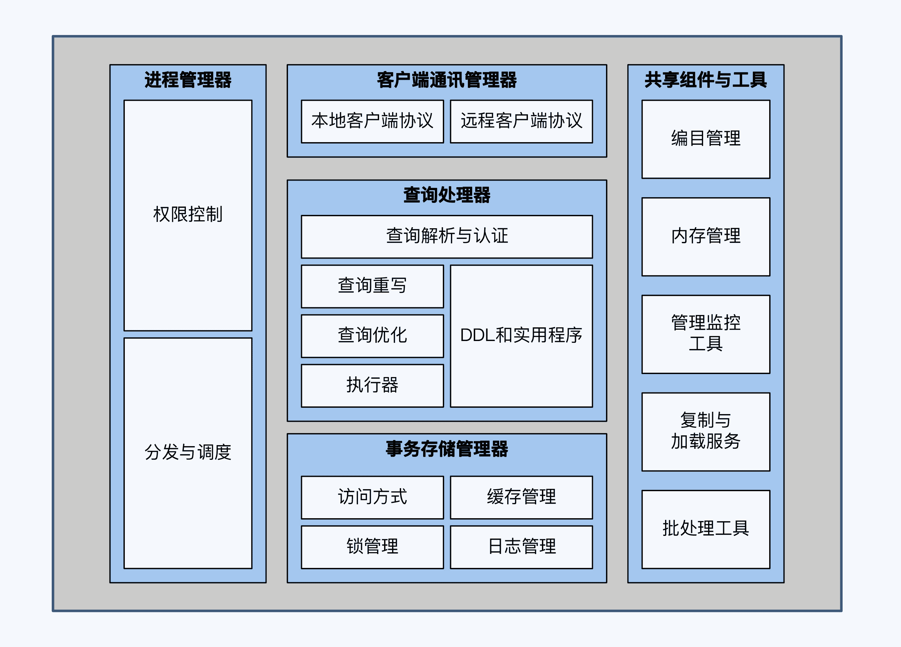
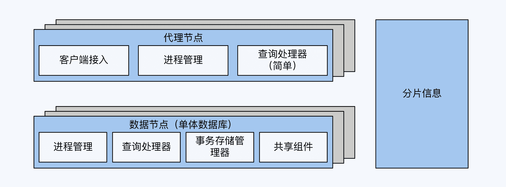
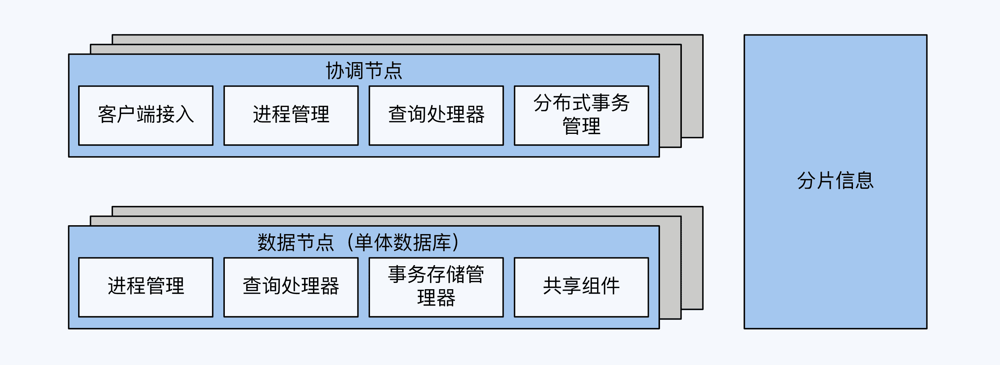
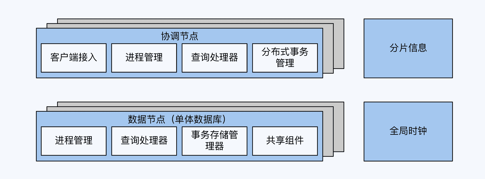
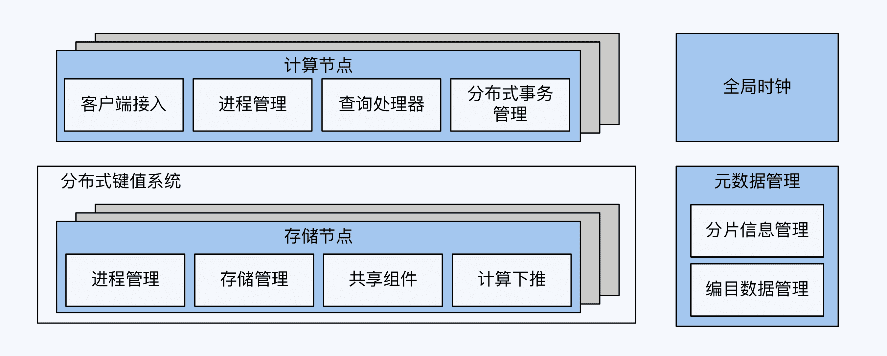
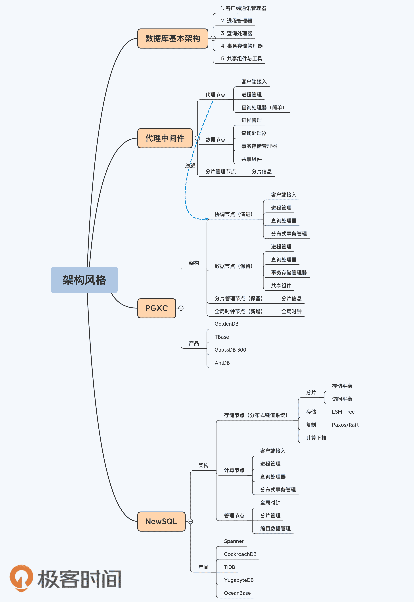

# 04 | 架构风格：NewSQL和PGXC到底有啥不一样？

 

你好，我是王磊，你也可以叫我 Ivan。

分布式数据库已经是技术新潮流了，所以产品也越来越多，如果你要做技术选型或者想要学习，该如何下手呢？怎么能更高效地了解不同产品的特点呢？这就需要你把它们分分类，有些差不多的产品，熟悉了其中的一个，剩下的我们只要记下差异点就可以了。那下面的问题就是如何分类了，这个其实很简单，因为业界已经有共识，把产品按照架构风格划分到不同的阵营。

总的来说，分布式数据库大多可以分为两种架构风格，一种是 NewSQL，它的代表系统是 Google Spanner；另一种是从单体数据库中间件基础上演进出来的，被称为 Prxoy 风格，没有公认的代表系统。我觉得 Prxoy 这个名字太笼统，没有反映架构的全貌，还是要有一个具体的架构模板，才能便于你理解，所以我选了一个出现较早的产品来指代这种风格，这就是 PostgreSQL-XC（下文简称 PGXC）。

我在后面的课程中讲述分布式数据库的特性和原理的时候，也会沿着这两种架构风格的思路，帮助你去迅速抓住不同产品的要点。因此，我们今天就先用一讲来学习下这两种架构风格。

## 数据库的基本架构

要搞清楚分布式数据库的架构风格，就要先了解“数据库”的架构。当然，我们这里说的数据库仍然默认是关系型数据库。我们先通过一张架构图看看数据库的全貌。

这张图从约瑟夫 · 海勒斯坦 (Joseph M. Hellerstein) 等人的论文“Architecture of a Database System”中翻译而来。文中将数据库从逻辑上拆分为 5 个部分，分别是客户端通讯管理器 (Client Communications Manager)、查询处理器（Relational Query Processor）、事务存储管理器（Transactional Storage Manager）、进程管理器（Process Manager）和共享组件与工具 (Shared Components and Utilities)，每个部分下面又可以拆分成一些组件。

你在各种数据库产品中都能找到这 5 个部分的对应实现，比如 Oracle、DB2、SQL Server 和 MySQL，无一例外。下面，我依次介绍下这 5 个部分的功能。

1. **客户端通讯管理器。**这是应用开发者能够直观感受到的模块，通常我们使用 JDBC 或者 ODBC 协议访问数据库时，连接的就是这个部分。
2. **进程管理器。**连接建好了，数据库会为客户端分配一个进程，客户端后续发送的所有操作都会通过对应的进程来执行。当然，这里的进程只是大致的说法。事实上，Oracle 和 PostgreSQL 是进程的方式，而 MySQL 使用的则是线程。还有，进程与客户也不都是简单的一对一关系，但这部分功能不会影响你对分布式数据库的理解，可以略过。
3. **查询处理器。**它包括四个部分，功能上是顺序执行的。首先是解析器，它将接收到的 SQL 解析为内部的语法树。然后是查询重写（Query Rewrite），它也被称为逻辑优化，主要是依据关系代数的等价变换，达到简化和标准化的目的，比如会消除重复条件或去掉一些无意义谓词 ，还有将视图替换为表等操作。再往后就是查询算法优化（Query Optimizer），它也被称为物理优化，主要是根据表连接方式、连接顺序和排序等技术进行优化，我们常说的基于规则优化（RBO）和基于代价优化（CBO）就在这部分。最后就是计划执行器（Plan Executor），最终执行查询计划，访问存储系统。
4. **事务存储管理器。**它包括四个部分，其中访问方式（Access Methods）是指数据在磁盘的具体存储形式。锁管理（Lock Manager）是指并发控制。日志管理（Log Manager）是确保数据的持久性。缓存管理（Buffer Manager）则是指 I/O 操作相关的缓存控制。
5. **共享组件和工具。**在整个过程中还会涉及到的一些辅助操作，当然它们对于数据库的运行也是非常重要的。例如编目数据管理器（Catalog Manager）会记录数据库的表、字段、视图等元数据信息，并根据这些信息来操作具体数据内容。复制机制（Replication）也很重要，它是实现系统高可靠性的基础，在单体数据库中，通过主备节点复制的方式来实现数据的复制。

到这里，你应该对数据库的运行过程有了一个大致的理解，这样就能够串接起后续要讲到的 PGXC 和 NewSQL 两种架构风格的关键功能了。当然，数据库本身的运行机制是比较复杂的，就算只是其中的一个具体模块，我们用整整一讲都不一定能够说清楚。如果你希望进一步了解的话，可以仔细研读约瑟夫 · 海勒斯坦的这篇论文。

## PGXC：单体数据库的自然演进

单体数据库的功能看似已经很完善了，但在面临高并发场景的时候，还是会碰到写入性能不足的问题，很难解决。因此，也就有了向分布式数据库演进的动力。要解决写入性能不足的问题，大家首先想到的，最简单直接的办法就是分库分表。

分库分表方案就是在多个单体数据库之前增加代理节点，本质上是增加了 SQL 路由功能。这样，代理节点首先解析客户端请求，再根据数据的分布情况，将请求转发到对应的单体数据库。

代理节点需要实现三个主要功能，它们分别是客户端接入、简单的查询处理器和进程管理中的访问控制。

另外，分库分表方案还有一个重要的功能，那就是分片信息管理，分片信息就是数据分布情况，是区别于编目数据的一种元数据。不过考虑到分片信息也存在多副本的一致性的问题，大多数情况下它会独立出来，更详细的原因我在第 7 讲中展开说明。

显然，如果把每一次的事务写入都限制在一个单体数据库内，业务场景就会很受局限。因此，跨库事务成为必不可少的功能，但是单体数据库是不感知这个事情的，所以我们就要在代理节点增加分布式事务组件。

同时，简单的分库分表不能满足全局性的查询需求，因为每个数据节点只能看到一部分数据，有些查询运算是无法处理的，比如排序、多表关联等。所以，代理节点要增强查询计算能力，支持跨多个单体数据库的查询。

随着分布式事务和跨节点查询等功能的加入，代理节点已经不再只是简单的路由功能，更多时候会被称为协调节点。

很多分库分表方案会演进到这个阶段，比如 MyCat。这时离分布式数据库还差重要的一步，就是全局时钟。我们在第 2 讲已经介绍了全局时钟的意义，它是实现数据一致性的必要条件。

加上这最后一块拼图，PGXC 区别于单体数据库的功能也就介绍完整了，它们是分片、分布式事务、跨节点查询和全局时钟。

协调节点与数据节点，实现了一定程度上的计算与存储分离，这也是所有分布式数据库的一个架构基调。但是，因为 PGXC 的数据节点本身就是完整的单体数据库，所以也具备很强的计算能力。

说了这么多，PGXC 风格的分布式数据库到底包括哪些产品呢？PGXC（PostgreSQL-XC）的本意是指以 PostgreSQL 为内核的开源分布式数据库。因为 PostgreSQL 的影响力和开放的软件版权协议（类似 BSD），很多厂商在 PGXC 上二次开发，推出自己的产品。不过，这些改动都没有变更主体架构风格，所以我把这类产品统称为 PGXC 风格，其中包括 TBase、GuassDB 300 和 AntDB 等。当然，这里所说的 PGXC 并不限于以 PostgreSQL 为内核，那些以 MySQL 为内核的产品往往也会采用同样的架构，例如 GoldenDB，所以我把它们也归入了 PGXC 风格。

## NewSQL：革命性的新架构

相对于 PGXC，NewSQL 有着完全不同的发展路线。NewSQL 也叫原生分布式数据库，我觉得这个名字能更准确地体现这类架构风格的特点，就是说它的每个组件在设计之初都是基于分布式架构的，不像 PGXC 那样带有明显的单体架构痕迹。

NewSQL 的基础是 NoSQL，更具体地说，是类似 BigTable 的分布式键值（K/V）系统。分布式键值系统选择做了一个减法，完全放弃了数据库事务处理能力，然后将重点放在对存储和写入能力的扩展上，这个能力扩展的基础就是分片。引入分片的另一个好处是，系统能够以更小的粒度调度数据，实现各节点上的存储平衡和访问负载平衡。

分布式键值系统由于具备这些鲜明的特点，所以在不少细分场景获得了成功（比如电商网站对于商品信息的存储），但在面对大量的事务处理场景时就无能为力了（比如支付系统）。这种状况直到 Google Spanner 横空出世才被改变，因为 Spanner 基于 BigTable 构建了新的事务能力。

除了上述内容，NewSQL 还有两个重要的革新，分别出现在高可靠机制和存储引擎的设计上。

高可靠机制的变化在于，放弃了粒度更大的主从复制，转而以分片为单位采用 Paxos 或 Raft 等共识算法。这样，NewSQL 就实现了更小粒度的高可靠单元，获得了更高的系统整体可靠性。存储引擎层面，则是使用 LSM-Tree 模型替换 B+ Tree 模型，大幅提升了写入性能。

由于 NewSQL 在架构上的革新性，产品实现的难度比 PGXC 要大，所以产品就相对少一些。Spanner 是 NewSQL 的开山鼻祖，这个不用说了；其他知名度比较高的产品有 CockroachDB、TiDB 和 YugabyteDB，这三款数据库都宣称设计灵感来自 Spanner；另外就是阿里自研的 OceanBase，因为它有一个代理层，有时会被同行质疑，但是从整体架构风格看，我还是愿意把它归为 NewSQL。

从系统架构上看，我个人认为，NewSQL 的设计思想更加领先，具有里程碑意义，而 PGXC 的架构偏于保守。但 PGXC 的优势则在于稳健，直接采用单机数据库作为数据节点，大幅降低了工程开发的工作量，也减少了引入风险的机会。总的来说，NewSQL 的长处在架构设计，PGXC 的长处则在工程实现。

当然，NewSQL 的架构设计也不是完美无缺。比如，作为一个计算与存储分离得更加彻底的架构，NewSQL 的计算节点需要借助网络才能与存储节点通讯，这意味着要花费更大的代价来传输数据。随着 NewSQL 分布式数据库的应用实践越来越多，很多产品为了获得更好的计算性能，会尽量将更多计算下压到存储节点执行。这种架构上的修正，似乎也可以理解为，NewSQL 朝 PGXC 的方向做了一点回拨。

## 小结

关于分布式数据库的两种架构风格，我们今天就先学到这里了。最后，我们再一起复习下今天的重点内容。

1. 从架构上，数据库可以被拆分为 5 个部分，分别是客户端通讯管理器、进程管理器、查询处理器、事务存储管理器和共享组件与工具。分布式数据库在此基础上增加四个主要功能，包括分片信息管理、分布式事务管理、跨节点查询和全局时钟。
2. PGXC 架构是从分库分表方案演进而来的。它设置了协调节点，在代理功能的基础上增加了分布式事务管理、跨节点查询功能；原有的单体数据继续作为数据节点；新增了全局时钟和分片信息管理两个功能，这两个功能又有两种实现情况，一是拆分为两个独立角色节点，例如 GoldenDB，二是合并为一个角色节点，例如 TBase。
3. NewSQL 架构是原生分布式数据库，架构中的每个层次的设计都是以分布式为目标。NewSQL 是从分布式键值系统演进而来，主要的工作负载由计算节点和存储节点承担，另外由管理节点承担全局时钟和分片信息管理功能。不过，这三类节点是逻辑功能上划分，在设计实现层面是可分可合的。比如，TiDB 是分为独立节点，CockroachDB 则是对等的 P2P 架构。
4. NewSQL 在架构上更加领先，而 PGXC 最大程度复用了单体数据库的工程实现，更加稳健。

今天我们从单体数据库架构出发，简单介绍了 PGXC 和 NewSQL 两种架构。为了帮助你迅速地把握要点，在内容上，我专门挑选了那些最能体现与单体数据库差异的部分。不过，这些内容尚不足以完全解释数据库的整体运作原理，但对于你理解两种架构风格的分布式数据库产品的基本框架足够了。如果你想更彻底、更全面地了解数据库架构，我建议你仔细研读“Architecture of a Database System”和另一本非常值得阅读的经典教材《数据库系统实现》。

## 思考题

按照惯例，最后是思考题时间。今天我们介绍了两种不同的架构风格，你会将自己熟悉的分布式数据库归入哪一类呢？或者如果你有熟悉的 NoSQL 产品，可以和 NewSQL 比较一下，谈谈它们架构上的差异。

欢迎你在评论区留言和我一起讨论，我会在答疑篇和你继续探讨这个问题。如果你身边的朋友也对分布式数据库的架构风格感兴趣，你也可以把今天这一讲分享给他，我们一起讨论。

## 学习资料

Joseph M. Hellerstein et al.：Architecture of a Database System

加西亚 - 莫利纳 等：《数据库系统实现》
