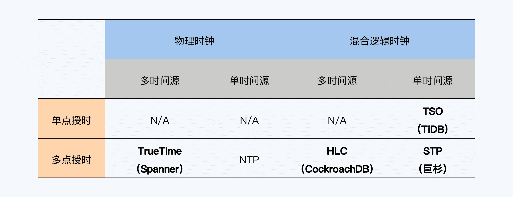
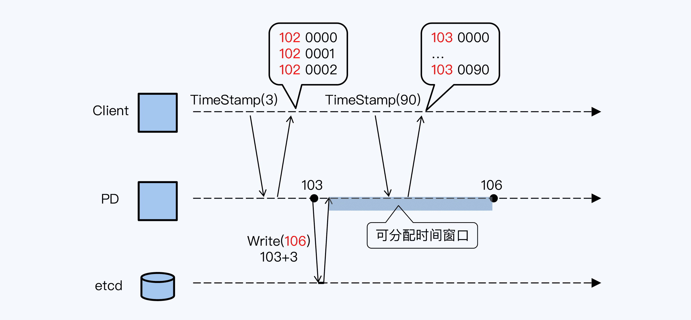
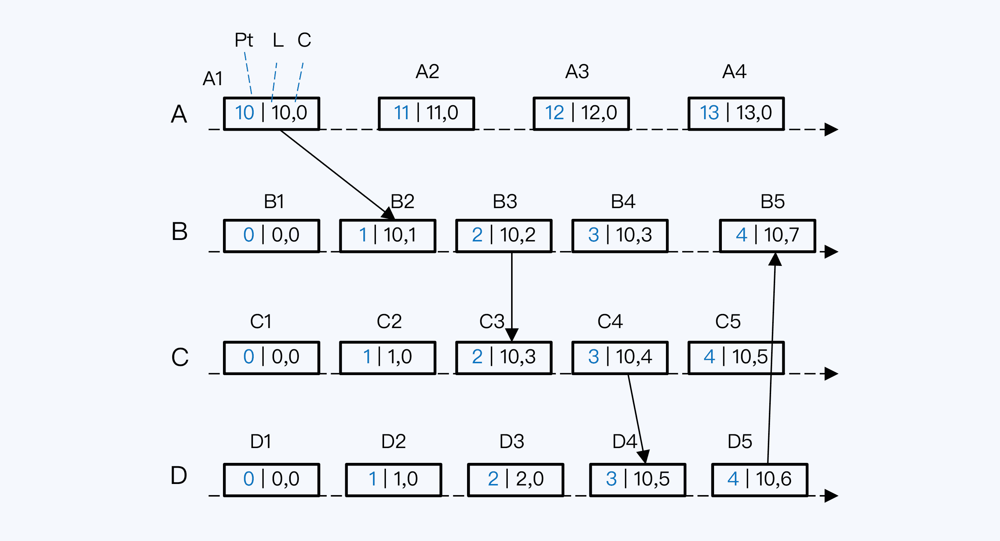
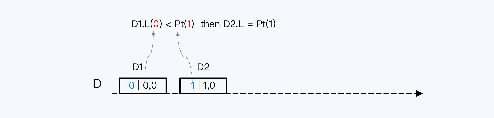
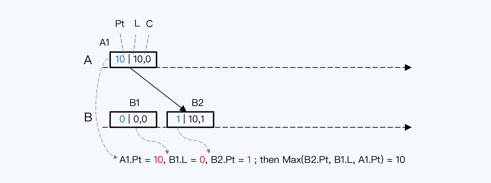
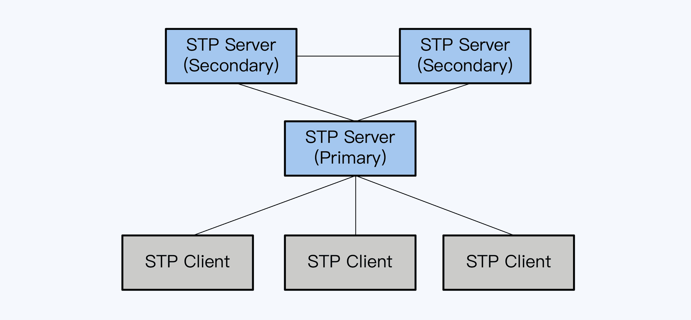
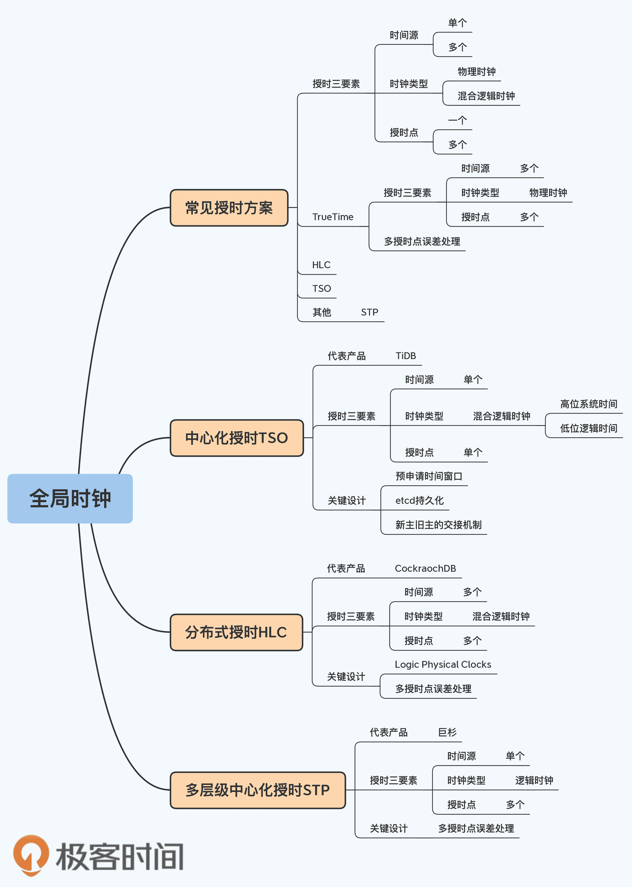

# 05 | 全局时钟：物理时钟和逻辑时钟你Pick谁？

 

你好，我是王磊，你也可以叫我 Ivan。

今天，我想和你聊聊时间的话题。

“时光一去永不回，往事只能回味”，这种咏叹时光飞逝的歌曲，你一定听过很多。但是，在计算机的世界里，时间真的是一去不回吗？还真不一定。

还记得我在第 2 讲提到的 TrueTime 吗？作为全局时钟的一种实现形式，它是 Google 通过 GPS 和原子钟两种方式混合提供的授时机制，误差可以控制在 7 毫秒以内。正是在这 7 毫秒内，时光是可能倒流的。

为什么我们这么关注时间呢？是穿越剧看多了吗？其实，这是因为分布式数据库的很多设计都和时间有关，更确切地说是和全局时钟有关。比如，我们在第 2 讲提到的线性一致性，它的基础就是全局时钟，还有后面会讲到的多版本并发控制（MVCC）、快照、乐观协议与悲观协议，都和时间有关。

## 常见授时方案

那既然有这么多分布式数据库，授时机制是不是也很多，很复杂呢？其实，要区分授时机制也很简单，抓住三个要素就可以了。

1. 时间源：单个还是多个
2. 使用的时钟类型：物理时钟还是混合逻辑时钟
3. 授时点：一个还是多个

根据排列组合，一共产生了 8 种可能性，其中 NTP（Network Time Protocol）误差大，也不能保证单调递增，所以就没有单独使用 NTP 的产品；还有一些方案在实践中则是不适用的（N/A）。因此常见的方案主要只有 4 类，我画了张表格，总结了一下。



### 1. TrueTime

Spanner 采用的方案是 TrueTime。它的时间源是 GPS 和原子钟，所以属于多时间源和物理时钟，同时它也采用了多点授时机制，就是说集群内有多个时间服务器都可以提供授时服务。

就像这一讲开头说的，TrueTime 是会出现时光倒流的。例如，A、B 两个进程先后调用 TrueTime 服务，各自拿到一个时间区间，如果在其中随机选择，则可能出现 B 的时间早于 A 的时间。不只是 TrueTime，任何物理时钟都会存在时钟偏移甚至回拨。

单个物理时钟会产生误差，而多点授时又会带来整体性的误差，那 TrueTime 为什么还要这么设计呢？

因为它也有两个显著的优势：首先是高可靠高性能，多时间源和多授时点实现了完全的去中心化设计，不存在单点；其次是支持全球化部署，客户端与时间服务器的距离也是可控的，不会因为两者通讯延迟过长导致时钟失效。

### 2. HLC

CockroachDB 和 YugabyteDB 也是以高性能高可靠和全球化部署为目标，不过 Truetime 是 Google 的独门绝技，它依赖于特定硬件设备的思路，不适用于开源软件。所以，它们使用了混合逻辑时钟（Hybrid Logical Clock，HLC），同样是多时间源、多点授时，但时钟采用了物理时钟与逻辑时钟混合的方式。HLC 在实现机制上也是蛮复杂的，而且和 TrueTime 同样有整体性的时间误差。

对于这个共性问题，Spanner 和 CockroachDB 都会通过一些容错设计来消除时间误差，我会在第 12 讲中具体介绍相关内容。

### 3. TSO

其他的分布式数据库大多选择了单时间源、单点授时的方式，承担这个功能的组件在 NewSQL 风格架构中往往被称为 TSO（Timestamp Oracle），而在 PGXC 风格架构中被称为全局事务管理器（Golobal Transcation Manager，GTM）。这就是说一个单点递增的时间戳和全局事务号基本是等效的。这种授时机制的最大优点就是实现简便，如果能够保证时钟单调递增，还可以简化事务冲突时的设计。但缺点也很明显，集群不能大范围部署，同时性能也有上限。TiDB、OceanBase、GoldenDB 和 TBase 等选择了这个方向。

### 4. STP

最后，还有一些小众的方案，比如巨杉的 STP(SequoiaDB Time Protoco)。它采用了单时间源、多点授时的方式，优缺点介于 HLC 和 TSO 之间。

到这里，我已经介绍了 4 种方案在技术路线上大致的区别。其中 TrueTime 是基于物理设备的外部授时方案，所以 Spanner 直接使用就可以了，自身不需要做专门的设计。而对于其他 3 种方案，如果我们想要深入理解，那么还得结合具体的产品来看。

## 中心化授时：TSO（TiDB）

首先，我们从最简单的 TSO 开始。

最早提出 TSO 的，大概是 Google 的论文“ Large-scale Incremental Processing Using Distributed Transactions and Notifications”。这篇论文主要是介绍分布式存储系统 Percolator 的实现机制，其中提到通过一台 Oracle 为集群提供集中授时服务，称为 Timestamp Oracle。所以，后来的很多分布式系统也用它的缩写来命名自己的单点授时机制，比如 TiDB 和 Yahoo 的 Omid。

考虑到 TiDB 的使用更广泛些，这里主要介绍 TiDB 的实现方式。

TiDB 的全局时钟是一个数值，它由两部分构成，其中高位是物理时间，也就是操作系统的毫秒时间；低位是逻辑时间，是一个 18 位的数值。那么从存储空间看，1 毫秒最多可以产生 262,144 个时间戳（2^18），这已经是一个很大的数字了，一般来说足够使用了。

单点授时首先要解决的肯定是单点故障问题。TiDB 中提供授时服务的节点被称为 Placement Driver，简称 PD。多个 PD 节点构成一个 Raft 组，这样通过共识算法可以保证在主节点宕机后马上选出新主，在短时间内恢复授时服务。

那问题来了，如何保证新主产生的时间戳一定大于旧主呢？那就必须将旧主的时间戳存储起来，存储也必须是高可靠的，所以 TiDB 使用了 etcd。但是，每产生一个时间戳都要保存吗？显然不行，那样时间戳的产生速度直接与磁盘 I/O 能力相关，会存在瓶颈的。

如何解决性能问题呢？TiDB 采用预申请时间窗口的方式，我画了张图来表示这个过程。



当前 PD（主节点）的系统时间是 103 毫秒，PD 向 etcd 申请了一个“可分配的时间窗口”。要知道时间窗口的跨度是可以通过参数指定的，系统的默认配置是 3 毫秒，示例采用了默认配置，所以这个窗口的起点是 PD 当前时间 103，时间窗口的终点就在 106 毫秒处。。写入 etcd 成功后，PD 将得到一个从 103 到 106 的“可分配时间窗口”，在这个时间窗口内 PD 可以使用系统的物理时间作为高位，拼接自己在内存中累加的逻辑时间，对外分配时间戳。

上述设计意味着，所有 PD 已分配时间戳的高位，也就是物理时间，永远小于 etcd 存储的最大值。那么，如果 PD 主节点宕机，新主就可以读取 etcd 中存储的最大值，在此基础上申请新的“可分配时间窗口”，这样新主分配的时间戳肯定会大于旧主了。

此外，为了降低通讯开销，每个客户端一次可以申请多个时间戳，时间戳数量作为参数，由客户端传给 PD。但要注意的是，一旦在客户端缓存，多个客户端之间时钟就不再是严格单调递增的，这也是追求性能需要付出的代价。

## 分布式授时：HLC（CockroachDB）

前面已经说过 TrueTime 依赖 Google 强大的工程能力和特殊硬件，不具有普适性。相反，HLC 作为一种纯软的实现方式，更加灵活，所以在 CockroachDB、YugabyteDB 和很多分布式存储系统得到了广泛使用。

HLC 不只是字面上的意思， TiDB 的 TSO 也混合了物理时钟与逻辑时钟，但两者截然不同。HLC 代表了一种计时机制，它的首次提出是在论文“Logical Physical Clocks and Consistent Snapshots in Globally Distributed Databases”中，CockroachDB 和 YugabyteDB 的设计灵感都来自于这篇论文。下面，我们结合图片介绍一下这个机制。



假如我们有 ABCD 四个节点，方框是节点上发生的事件，方框内的三个数字依次是节点的本地物理时间（简称本地时间，Pt）、HLC 的高位（简称 L 值）和 HLC 的低位（简称 C 值）。

A 节点的本地时间初始值为 10，其他节点的本地时间初始值都是 0。四个节点的第一个事件都是在节点刚启动的一刻发生的。首先看 A1，它的 HLC 应该是 (10,0)，其中高位直接取本地时间，低位从 0 开始。同理，其他事件的 HLC 都是 (0,0)。

然后我们再看一下，随着时间的推移，接下来的事件如何计时。

事件 D2 发生时，首先取上一个事件 D1 的 L 值和本地时间比较。L 值等于 0，本地时间已经递增变为 1，取最大值，那么用本地时间作为 D2 的 L 值。高位变更了，低位要归零，所以 D2 的 HLC 就是 (1,0)。



如果你看懂了 D2 的计时逻辑就会发现，D1 其实是一样的，只不过 D1 没有上一个事件的 L 值，只能用 0 代替，是一种特殊情况。

如果节点间有调用关系，计时逻辑会更复杂一点。我们看事件 B2，要先判断 B2 的 L 值，就有三个备选：

1. 本节点上前一个事件 B1 的 L 值
2. 当前本地时间
3. 调用事件 A1 的 L 值，A1 的 HLC 是随着函数调用传给 B 节点的

这三个值分别是 0、1 和 10。按照规则取最大值，所以 B2 的 L 值是 10，也就是 A1 的 L 值，而 C 值就在 A1 的 C 值上加 1，最终 B2 的 HLC 就是 (10,1)。



B3 事件发生时，发现当前本地时间比 B2 的 L 值还要小，所以沿用了 B2 的 L 值，而 C 值是在 B2 的 C 值上加一，最终 B3 的 HLC 就是 (10,2)。


论文中用伪码表述了完整的计时逻辑，我把它们复制在下面，你可以仔细研究。

```
Initially l:j := 0; c:j := 0  
Send or local event  
l’:j := l:j;  
l:j := max(l’:j; pt:j);  
If (l:j=l’:j) then c:j := c:j + 1  
Else c:j := 0;  
Timestamp with l:j; c:j  
Receive event of message m  
l’:j := l:j;  
l:j := max(l’:j; l:m; pt:j);  
If (l:j=l’:j=l:m) then c:j := max(c:j; c:m)+1  
Elseif (l:j=l’:j) then c:j := c:j + 1  
Elseif (l:j=l:m) then c:j := c:m + 1  
Else c:j := 0  
Timestamp with l:j; c:j
```

其中，对于节点 J，l.j 表示 L 值，c.j 表示 C 值，pt.j 表示本地物理时间。

在 HLC 机制下，每个节点会使用本地时钟作为参照，但不受到时钟回拨的影响，可以保证单调递增。本质上，HLC 还是 Lamport 逻辑时钟的变体，所以对于不同节点上没有调用关系的两个事件，是无法精确判断先后关系的。比如，上面例子中的 C2 和 D2 有同样的 HLC，但从上帝视角看，C2 是早于 D2 发生的，因为两个节点的本地时钟有差异，就没有体现这种先后关系。HLC 是一种松耦合的设计，所以不会去校正节点的本地时钟，本地时钟是否准确，还要靠 NTP 或类似的协议来保证。

## 多层级中心化授时：STP（巨杉）

巨杉采用了单时间源、多点授时机制，它有自己的全局时间协议，称为 STP（Serial Time Protocol），是内部逻辑时间同步的协议，并不依赖于 NTP 协议。

下面是 STP 体系下各角色节点的关系。



STP 是独立于分布式数据库的授时方案，该体系下的各角色节点与巨杉的其他角色节点共用机器，但没有必然的联系。

STP 下的所有角色统称为 STP Node，具体分为两类：

1. **STP Server。**多个 STP Server 构成 STP Server 组，组内根据协议进行选主，主节点被称为 Primary，对外提供服务。
2. **STP Client。**按照固定的时间间隔，从 Primary Server 同步时间。

巨杉数据库的其他角色节点，如编目节点（CATALOG）、协调节点（COORD）和数据节点（DATA）等，都从本地的 STP Node 节点获得时间。

STP 与 TSO 一样都是单时间源，但通过增加更多的授时点，避免了单点性能瓶颈，而负副作用是多点授时就会造成全局性的时间误差，因此和 HLC 一样需要做针对性设计。

## 小结

好了，今天的内容就到这里了，我们一起回顾下这节课的重点。

1. 分布式数据库有多种授时机制，它们的区别主要看三个维度。一，是单时间源还是多时间源；二，时间源采用的是物理时钟还是混合逻辑时钟；三，授时点是一个还是多个。
2. TrueTime 是多时间源、多授时点方案，虽然仍存在时间误差的问题，但实现了高可靠高性能，能够支持 Spanner 做到全球化部署，是一种非常强悍的设计方案。TrueTime 是 GPS 加原子钟的整合方案，可以看作为一种物理时钟，它完全独立于 Spanner 的授时服务，不需要 Spanner 做专门的设计。
3. HLC 同样是多时间源、多授时点，由于是纯软方案，所以具有更好的通用性。CockroachDB 和 YugabyteDB 都采用了这种方案，也都具备全球化部署能力。HLC 的设计基础是 Lamport 逻辑时钟，对 NTP 的时间偏移有一定的依赖。
4. TSO 是典型的单时间源、单点授时方案，实现简便，所以成为多数分布式数据库的选择。如果 TSO 能够做到单调递增，会简化读写冲突时候的处理过程，但缺点是集群部署范围受到极大的限制。
5. 还有一些小众的方案，比如巨杉的 STP，也试图在寻求新的平衡点。

有关时间的话题我们就聊到这了。时间误差是普遍存在的，只不过长期在单体应用系统下开发，思维惯性让我们忽略了它，但随着分布式架构的普及，我相信更多的架构设计中都要考虑这个因素。我建议你收藏今天的内容，因为即使抛开分布式数据库不谈，这些设计依然是值得借鉴的。



## 思考题

最后，今天留给你的思考题还是关于时间的。在后续课程没有展开之前，我们不妨先来开放式地讨论一下，你觉得时间对于分布式数据库的影响是什么？或者你也可以谈谈在其他分布式系统中曾经遇到的关于时间的问题。

欢迎你在评论区留言和我一起讨论，我会在答疑篇回复这个问题。如果你身边的朋友也对全局时钟或者分布式架构下如何同步时间这个话题感兴趣，你也可以把今天这一讲分享给他，我们一起讨论。

## 学习资料

Daniel Peng and Frank Dabek: Large-scale Incremental Processing Using Distributed Transactions and Notifications

Sandeep S. Kulkarni et al.: Logical Physical Clocks and Consistent Snapshots in Globally Distributed Databases
