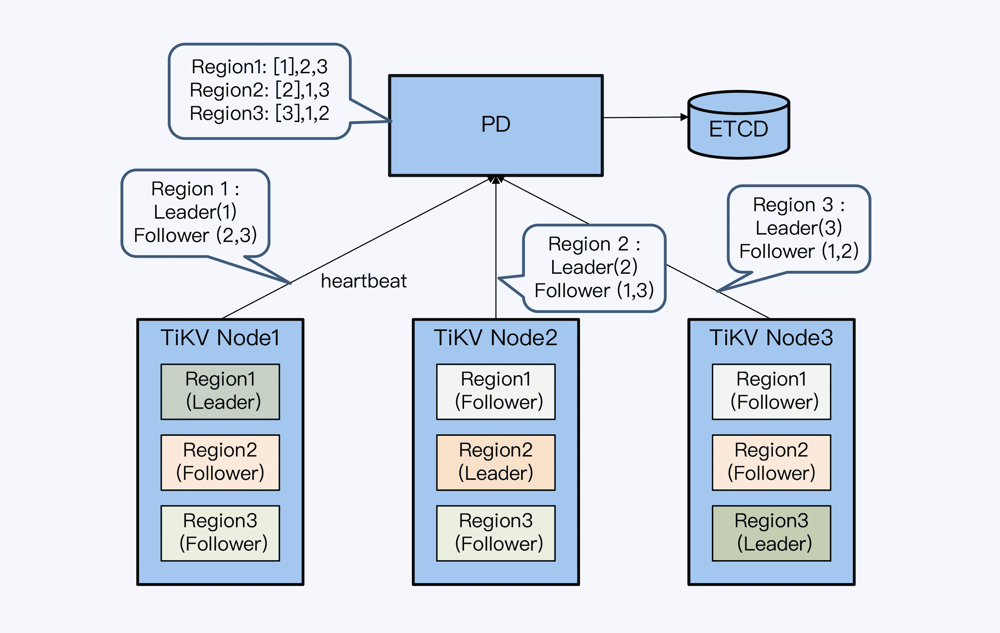
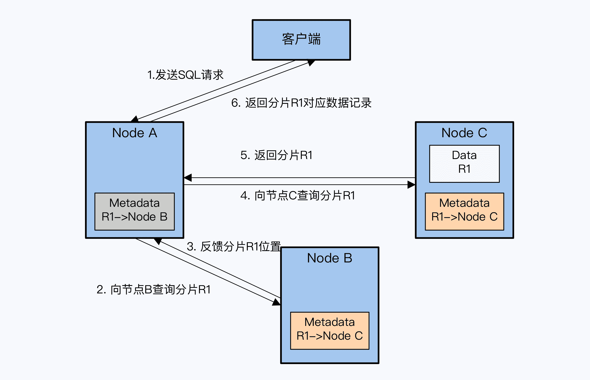
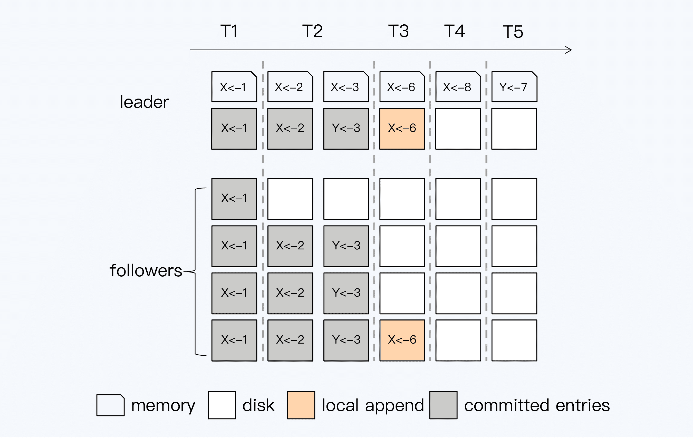
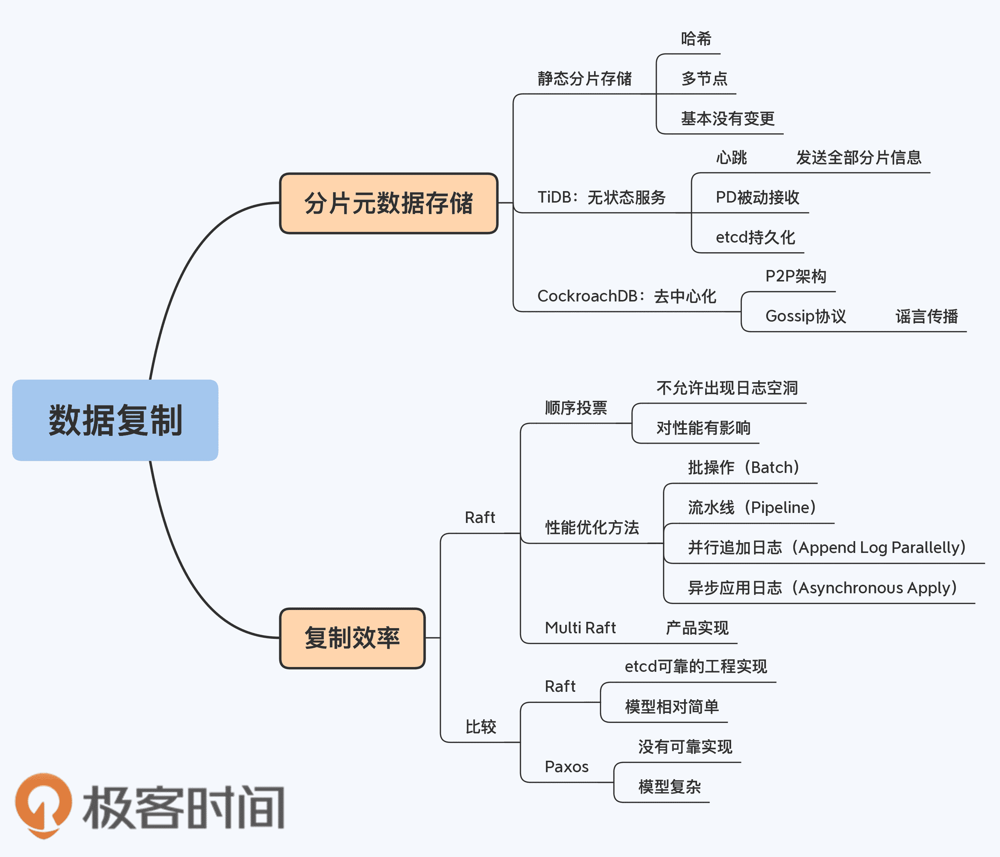

# 07 | 数据复制：为什么有时候Paxos不是最佳选择？

 

你好，我是王磊，你也可以叫我 Ivan。今天，我们要学习的是数据复制。

数据复制是一个老生常谈的话题了，典型的算法就是 Paxo 和 Raft。只要你接触过分布式，就不会对它们感到陌生。经过从业者这些年的探索和科普，网上关于 Paxos 和 Raft 算法的高质量文章也是一搜一大把了。

所以，今天这一讲我不打算全面展开数据复制的方方面面，而是会聚焦在与分布式数据库相关的，比较重要也比较有意思的两个知识点上，这就是分片元数据的存储和数据复制的效率。

## 分片元数据的存储

我们知道，在任何一个分布式存储系统中，收到客户端请求后，承担路由功能的节点首先要访问分片元数据（简称元数据），确定分片对应的节点，然后才能访问真正的数据。这里说的元数据，一般会包括分片的数据范围、数据量、读写流量和分片副本处于哪些物理节点，以及副本状态等信息。

从存储的角度看，元数据也是数据，但特别之处在于每一个请求都要访问它，所以元数据的存储很容易成为整个系统的性能瓶颈和高可靠性的短板。如果系统支持动态分片，那么分片要自动地分拆、合并，还会在节点间来回移动。这样，元数据就处在不断变化中，又带来了多副本一致性（Consensus）的问题。

下面，让我们看看，不同的产品具体是如何存储元数据的。

### 静态分片

最简单的情况是静态分片。我们可以忽略元数据变动的问题，只要把元数据复制多份放在对应的工作节点上就可以了，这样同时兼顾了性能和高可靠。TBase 大致就是这个思路，直接将元数据存储在协调节点上。即使协调节点是工作节点，随着集群规模扩展，会导致元数据副本过多，但由于哈希分片基本上就是静态分片，也就不用考虑多副本一致性的问题。

但如果要更新分片信息，这种方式显然不适合，因为副本数量过多，数据同步的代价太大了。所以对于动态分片，通常是不会在有工作负载的节点上存放元数据的。

那要怎么设计呢？有一个凭直觉就能想到的答案，那就是专门给元数据搞一个小规模的集群，用 Paxos 协议复制数据。这样保证了高可靠，数据同步的成本也比较低。

TiDB 大致就是这个思路，但具体的实现方式会更巧妙一些。

### TiDB：无服务状态

在 TiDB 架构中，TiKV 节点是实际存储分片数据的节点，而元数据则由 Placement Driver 节点管理。Placement Driver 这个名称来自 Spanner 中对应节点角色，简称为 PD。

在 PD 与 TiKV 的通讯过程中，PD 完全是被动的一方。TiKV 节点定期主动向 PD 报送心跳，分片的元数据信息也就随着心跳一起报送，而 PD 会将分片调度指令放在心跳的返回信息中。等到 TiKV 下次报送心跳时，PD 就能了解到调度的执行情况。

由于每次 TiKV 的心跳中包含了全量的分片元数据，PD 甚至可以不落盘任何分片元数据，完全做成一个无状态服务。这样的好处是，PD 宕机后选举出的新主根本不用处理与旧主的状态衔接，在一个心跳周期后就可以工作了。当然，在具体实现上，PD 仍然会做部分信息的持久化，这可以认为是一种缓存。

我将这个通讯过程画了下来，希望帮助你理解。

三个 TiKV 节点每次上报心跳时，由主副本（Leader）提供该分片的元数据，这样 PD 可以获得全量且没有冗余的信息。

虽然无状态服务有很大的优势，但 PD 仍然是一个单点，也就是说这个方案还是一个中心化的设计思路，可能存在性能方面的问题。

有没有完全“去中心化”的设计呢？当然是有的。接下来，我们就看看 P2P 架构的 CockroachDB 是怎么解决这个问题的。

### CockroachDB：去中心化

CockroachDB 的解决方案是使用 Gossip 协议。你是不是想问，为什么不用 Paxos 协议呢？

这是因为 Paxos 协议本质上是一种广播机制，也就是由一个中心节点向其他节点发送消息。当节点数量较多时，通讯成本就很高。

CockroachDB 采用了 P2P 架构，每个节点都要保存完整的元数据，这样节点规模就非常大，当然也就不适用广播机制。而 Gossip 协议的原理是谣言传播机制，每一次谣言都在几个人的小范围内传播，但最终会成为众人皆知的谣言。这种方式达成的数据一致性是 “最终一致性”，即执行数据更新操作后，经过一定的时间，集群内各个节点所存储的数据最终会达成一致。

看到这，你可能有点晕。我们在第 2 讲就说过分布式数据库是强一致性的，现在搞了个最终一致性的元数据，能行吗？

这里我先告诉你结论，**CockroachDB 真的是基于“最终一致性”的元数据实现了强一致性的分布式数据库**。我画了一张图，我们一起走下这个过程。

1. 节点 A 接到客户端的 SQL 请求，要查询数据表 T1 的记录，根据主键范围确定记录可能在分片 R1 上，而本地元数据显示 R1 存储在节点 B 上。
2. 节点 A 向节点 B 发送请求。很不幸，节点 A 的元数据已经过时，R1 已经重新分配到节点 C。
3. 此时节点 B 会回复给节点 A 一个非常重要的信息，R1 存储在节点 C。
4. 节点 A 得到该信息后，向节点 C 再次发起查询请求，这次运气很好 R1 确实在节点 C。
5. 节点 A 收到节点 C 返回的 R1。
6. 节点 A 向客户端返回 R1 上的记录，同时会更新本地元数据。

可以看到，CockroachDB 在寻址过程中会不断地更新分片元数据，促成各节点元数据达成一致。

看完 TiDB 和 CockroachDB 的设计，我们可以做个小结了。复制协议的选择和数据副本数量有很大关系：如果副本少，参与节点少，可以采用广播方式，也就是 Paxos、Raft 等协议；如果副本多，节点多，那就更适合采用 Gossip 协议。

## 复制效率

说完了元数据的存储，我们再看看今天的第二个知识点，也就是数据复制效率的问题，具体来说就是 Raft 与 Paxos 在效率上的差异，以及 Raft 的一些优化手段。在分布式数据库中，采用 Paxos 协议的比较少，知名产品就只有 OceanBase，所以下面的差异分析我们会基于 Raft 展开。

### Raft 的性能缺陷

我们可以在网上看到很多比较 Paxos 和 Raft 的文章，它们都会提到在复制效率上 Raft 会差一些，主要原因就是 Raft 必须“顺序投票”，不允许日志中出现空洞。在我看来，顺序投票确实是影响 Raft 算法复制效率的一个关键因素。

接下来，我们就分析一下为什么“顺序投票”对性能会有这么大的影响。

我们先看一个完整的 Raft 日志复制过程：

1. Leader 收到客户端的请求。
2. Leader 将请求内容（即 Log Entry）追加（Append）到本地的 Log。
3. Leader 将 Log Entry 发送给其他的 Follower。
4. Leader 等待 Follower 的结果，如果大多数节点提交了这个 Log，那么这个 Log Entry 就是 Committed Entry，Leader 就可以将它应用（Apply）到本地的状态机。
5. Leader 返回客户端提交成功。
6. Leader 继续处理下一次请求。

以上是单个事务的运行情况。那么，当多事务并行操作时，又是什么样子的呢？我画了张图来演示这个过程。

我们设定这个 Raft 组由 5 个节点组成，T1 到 T5 是先后发生的 5 个事务操作，被发送到这个 Raft 组。

事务 T1 的操作是将 X 置为 1，5 个节点都 Append 成功，Leader 节点 Apply 到本地状态机，并返回客户端提交成功。事务 T2 执行时，虽然有一个 Follower 没有响应，但仍然得到了大多数节点的成功响应，所以也返回客户端提交成功。

现在，轮到 T3 事务执行，没有得到超过半数的响应，这时 Leader 必须等待一个明确的失败信号，比如通讯超时，才能结束这次操作。因为有顺序投票的规则，T3 会阻塞后续事务的进行。T4 事务被阻塞是合理的，因为它和 T3 操作的是同一个数据项，但是 T5 要操作的数据项与 T3 无关，也被阻塞，显然这不是最优的并发控制策略。

同样的情况也会发生在 Follower 节点上，第一个 Follower 节点可能由于网络原因没有收到 T2 事务的日志，即使它先收到 T3 的日志，也不会执行 Append 操作，因为这样会使日志出现空洞。

Raft 的顺序投票是一种设计上的权衡，虽然性能有些影响，但是节点间日志比对会非常简单。在两个节点上，只要找到一条日志是一致的，那么在这条日志之前的所有日志就都是一致的。这使得选举出的 Leader 与 Follower 同步数据非常便捷，开放 Follower 读操作也更加容易。要知道，我说的可是保证一致性的 Follower 读操作，它可以有效分流读操作的访问压力。这一点我们在 24 讲再详细介绍。

### Raft 的性能优化方法（TiDB）

当然，在真正的工程实现中，Raft 主副本也不是傻傻地挨个处理请求，还是有一些优化手段的。TiDB 的官方文档对 Raft 优化说得比较完整，我们这里引用过来，着重介绍下它的四个优化点。

1. **批操作（Batch）。**Leader 缓存多个客户端请求，然后将这一批日志批量发送给 Follower。Batch 的好处是减少的通讯成本。
2. **流水线（Pipeline）。**Leader 本地增加一个变量（称为 NextIndex），每次发送一个 Batch 后，更新 NextIndex 记录下一个 Batch 的位置，然后不等待 Follower 返回，马上发送下一个 Batch。如果网络出现问题，Leader 重新调整 NextIndex，再次发送 Batch。当然，这个优化策略的前提是网络基本稳定。
3. **并行追加日志（Append Log Parallelly）。**Leader 将 Batch 发送给 Follower 的同时，并发执行本地的 Append 操作。因为 Append 是磁盘操作，开销相对较大，而标准流程中 Follower 与 Leader 的 Append 是先后执行的，当然耗时更长。改为并行就可以减少部分开销。当然，这时 Committed Entry 的判断规则也要调整。在并行操作下，即使 Leader 没有 Append 成功，只要有半数以上的 Follower 节点 Append 成功，那就依然可以视为一个 Committed Entry，Entry 可以被 Apply。
4. **异步应用日志（Asynchronous Apply）。**Apply 并不是提交成功的必要条件，任何处于 Committed 状态的 Log Entry 都确保是不会丢失的。Apply 仅仅是为了保证状态能够在下次被正确地读取到，但多数情况下，提交的数据不会马上就被读取。因此，Apply 是可以转为异步执行的，同时读操作配合改造。

其实，Raft 算法的这四项优化并不是 TiDB 独有的，CockroachDB 和一些 Raft 库也做了类似的优化。比如，SOFA-JRaft 也实现了 Batch 和 Pipeline 优化。

不知道你有没有听说过 etcd，它是最早的、生产级的 Raft 协议开源实现，TiDB 和 CockroachDB 都借鉴了它的设计。甚至可以说，它们选择 Raft 就是因为 etcd 提供了可靠的工程实现，而 Paxos 则没有同样可靠的工程实现。既然是开源，为啥不直接用呢？因为 etcd 是单 Raft 组，写入性能受限。所以，TiDB 和 CockroachDB 都改造成多个 Raft 组，这个设计被称为 Multi Raft，所有采用 Raft 协议的分布式数据库都是 Multi Raft。这种设计，可以让多组并行，一定程度上规避了 Raft 的性能缺陷。

同时，Raft 组的大小，也就是分片的大小也很重要，越小的分片，事务阻塞的概率就越低。TiDB 的默认分片大小是 96M，CockroachDB 的分片不超过 512M。那么，TiDB 的分片更小，就是更好的设计吗？也未必，因为分片过小又会增加扫描操作的成本，这又是另一个权衡点了。

## 小结

好了，今天的内容就到这里。我们一起回顾下这节课的重点。

1. 分片元数据的存储是分布式数据库的关键设计，要满足性能和高可靠两方面的要求。静态分片相对简单，可以直接通过多副本分散部署的方式实现。
2. 动态分片，满足高可靠的同时还要考虑元数据的多副本一致性，必须选择合适的复制协议。如果搭建独立的、小规模元数据集群，则可以使用 Paxos 或 Raft 等协议，传播特点是广播。如果元数据存在工作节点上，数量较多则可以考虑 Gossip 协议，传播特点是谣言传播。虽然 Gossip 是最终一致性，但通过一些寻址过程中的巧妙设计，也可以满足分布式数据的强一致性要求。
3. Paxos 和 Raft 是广泛使用的复制协议，也称为共识算法，都是通过投票方式动态选主，可以保证高可靠和多副本的一致性。Raft 算法有“顺序投票”的约束，可能出现不必要的阻塞，带来额外的损耗，性能略差于 Paxos。但是，etcd 提供了优秀的工程实现，促进了 Raft 更广泛的使用，而 etcd 的出现又有 Raft 算法易于理解的内因。
4. 分布式数据库产品都对 Raft 做了一定的优化，另外采用 Multi Raft 设计实现多组并行，再通过控制分片大小，降低事务阻塞概率，提升整体性能。

讲了这么多，回到我们最开始的问题，为什么有时候 Paxos 不是最佳选择呢？一是架构设计方面的原因，看参与复制的节点规模，规模太大就不适合采用 Paxos，同样也不适用其他的共识算法。二是工程实现方面的原因，在适用共识算法的场景下，选择 Raft 还是 Paxos 呢？因为 Paxos 没有一个高质量的开源实现，而 Raft 则有 etcd 这个不错的工程实现，所以 Raft 得到了更广泛的使用。这里的深层原因还是 Paxos 算法本身过于复杂，直到现在，实现 Raft 协议的开源项目也要比 Paoxs 更多、更稳定。

有关分片元数据的存储，在我看来，TiDB 和 CockroachDB 的处理方式都很优雅，但是 TiDB 的方案仍然建立在 PD 这个中心点上，对集群的整体扩展性，对于主副本跨机房、跨地域部署，有一定的局限性。

关于 Raft 的优化方法，大的思路就是并行和异步化，其实这也是整个分布式系统中常常采用的方法，在第 10 讲原子协议的优化中我们还会看到类似的案例。

## 思考题

最后是今天的思考题时间。我们在第 1 讲就提到过分布式数据库具备海量存储能力，那么你猜，这个海量有上限吗？或者说，你觉得分布式数据库的存储容量会受到哪些因素的制约呢？欢迎你在评论区留言和我一起讨论，我会在答疑篇回复这个问题。

你是不是也经常听到身边的朋友讨论数据复制的相关问题呢，而且得出的结论有可能是错的？如果有的话，希望你能把今天这一讲分享给他 / 她，我们一起来正确地理解分布式数据库的数据复制是怎么一回事。
