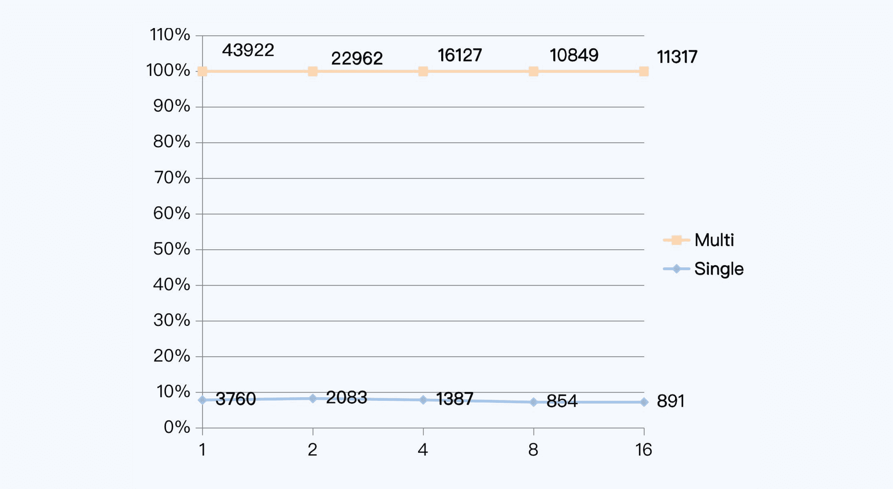
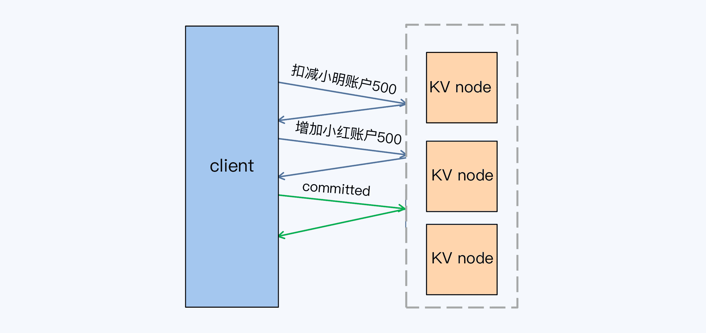
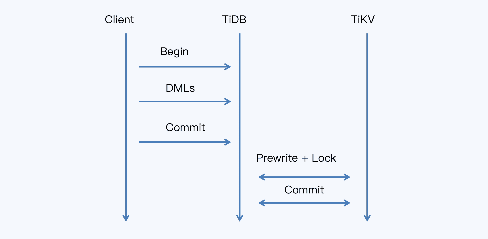
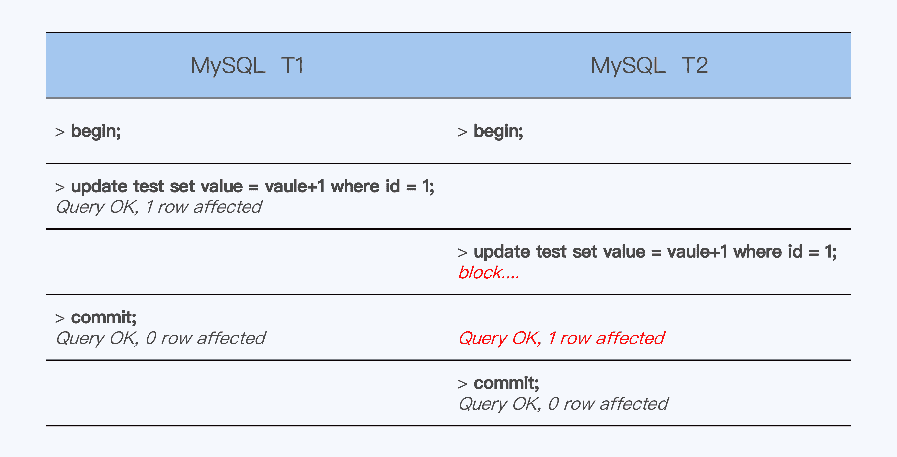
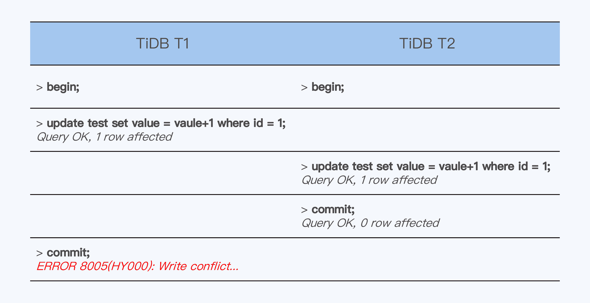
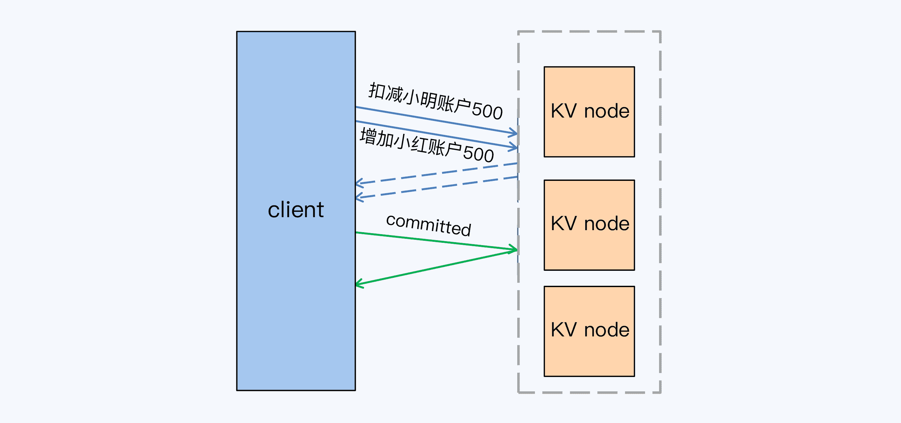
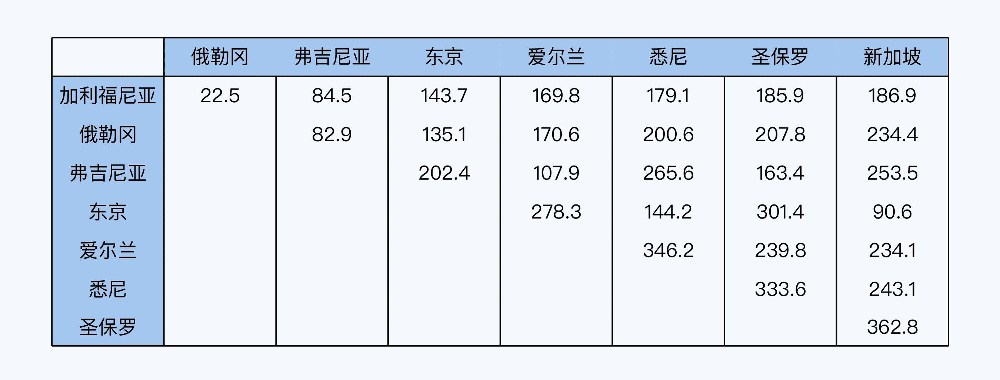
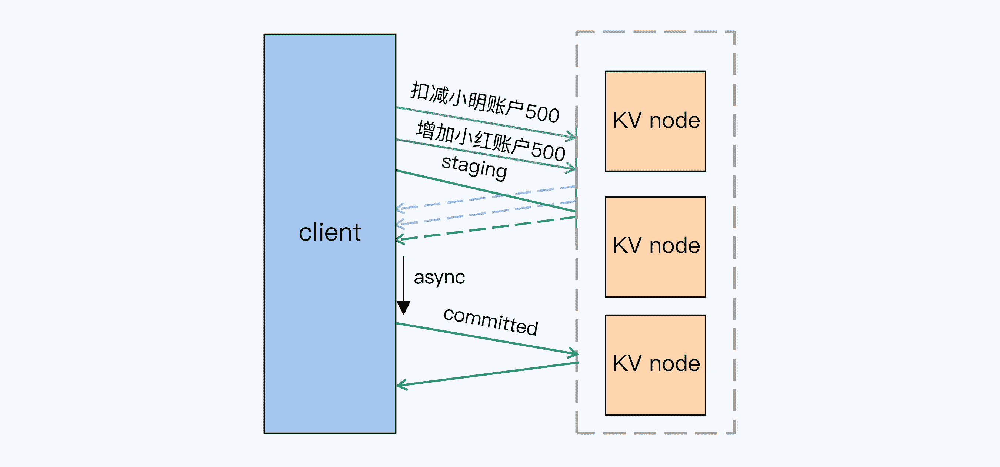
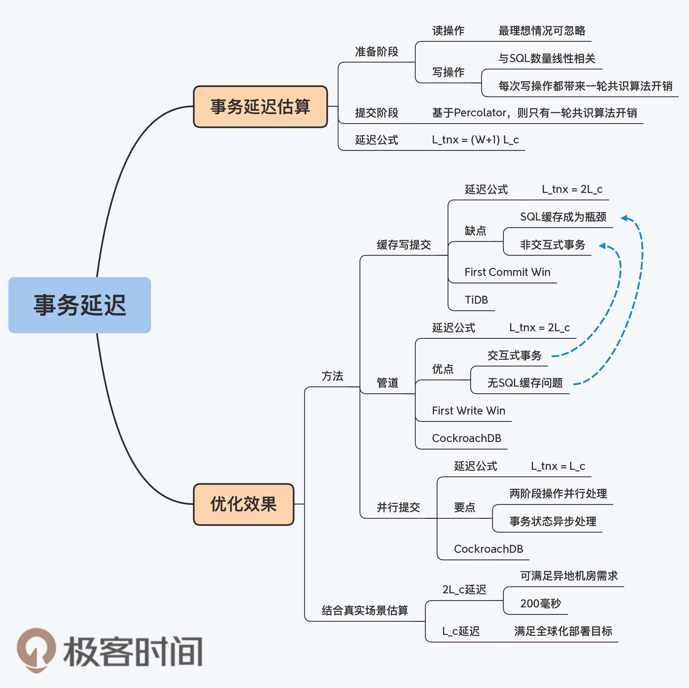

# 10 | 原子性：如何打破事务高延迟的魔咒？

 

你好，我是王磊，你也可以加我 Ivan。

通过上一讲的学习，你已经知道使用两阶段提交协议（2PC）可以保证分布式事务的原子性，但是，2PC 的性能始终是一个绕不过去的坎儿。

那么，它到底有多慢呢？

我们来看一组具体数据。2013 年的 MySQL 技术大会上（Percona Live MySQL C&E 2013），Randy Wigginton 等人在一场名为“Distributed Transactions in MySQL”的演讲中公布了一组 XA 事务与单机事务的对比数据。XA 协议是 2PC 在数据库领域的具体实现，而 MySQL（InnoDB 存储引擎）正好就支持 XA 协议。我把这组数据转换为下面的折线图，这样看起来会更加直观些。



其中，横坐标是并发线程数量，纵坐标是事务延迟，以毫秒为单位；蓝色的折线表示单机事务，红色的折线式表示跨两个节点的 XA 事务。我们可以清晰地看到，无论并发数量如何，XA 事务的延迟时间总是在单机事务的 10 倍以上。

这绝对是一个巨大的性能差距，所以这个演讲最终的建议是“不要使用分布式事务”。

很明显，今天，任何计划使用分布式数据库的企业，都不可能接受 10 倍于单体数据库的事务延迟。如果仍旧存在这样大的差距，那分布式数据库也必然是无法生存的，所以它们一定是做了某些优化。

具体是什么优化呢？这就是我们今天要讨论的主题，分布式事务要怎么打破高延迟的魔咒。

先别急，揭开谜底之前，我们先来算算，2PC 协议的事务延迟大概是多少。当然，这里我们所说的 2PC 都是指基于 Percolator 优化的改进型，如果你还不了解 Percolator 可以回到第 9 讲复习一下。

## 事务延迟估算

整个 2PC 的事务延迟由两个阶段组成，可以用公式表达为：
Ltxn​=Lprep​+Lcommit​

其中，Lprep​ 是准备阶段的延迟，Lcommit​ 是提交阶段的延迟。

我们先说准备阶段，它是事务操作的主体，包含若干读操作和若干写操作。我们把读操作的次数记为 R，读操作的平均延迟记为 Lr​，写操作次数记为 W，写操作平均延迟记为 Lw​。那么整个准备阶段的延迟可以用公式表达为:
Lprep​=R∗Lr​+W∗Lw​

在不同的产品架构下，读操作的成本是不一样的。我们选一种最乐观的情况，CockroachDB。因为它采用 P2P 架构，每个节点既承担了客户端服务接入的工作，也有请求处理和数据存储的职能。所以，最理想的情况是，读操作的客户端接入节点，同时是当前事务所访问数据的 Leader 节点，那么所有读取就都是本地操作。

磁盘操作相对网络延迟来说是极短的，所以我们可以忽略掉读取时间。那么，准备阶段的延迟主要由写入操作决定，可以用公式表达为：
Lprep​=W∗Lw​

我们都知道，分布式数据库的写入，并不是简单的本地操作，而是使用共识算法同时在多个节点上写入数据。所以，一次写入操作延迟等于一轮共识算法开销，我们用 Lc​ 代表一轮共识算法的用时，可以得到下面的公式：
Lprep​=W∗Lc​

我们再来看第二阶段，提交阶段，第 9 讲我们介绍了 Percolator 模型，它的提交阶段只需要写入一次数据，修改整个事务的状态。对于 CockroachDB，这个事务标识可以保存在本地。那么提交操作的延迟也是一轮共识算法，也就是：
Lcommit​=Lc​

分别得到两个阶段的延迟后，带入最开始的公式，可以得到：
Ltxn​=(W+1)∗Lc​

我们把这个公式带入具体例子里来看一下。

这次还是小明给小红转账，金额是 500 元。



在这个转账事务中，包含两条写操作 SQL，分别是扣减小明账户余额和增加小红账户余额，W 等于 2。再加上提交操作，一共有 3 个 Lc​。我们可以看到，这个公式里事务的延迟是与写操作 SQL 的数量线性相关的，而真实场景中通常都会包含多个写操作，那事务延迟肯定不能让人满意。

## 优化方法

### 缓存写提交（Buffering Writes until Commit）

怎么缩短写操作的延迟呢？

第一个办法是将所有写操作缓存起来，直到 commit 语句时一起执行，这种方式称为 Buffering Writes until Commit，我把它翻译为**“缓存写提交”**。而 TiDB 的事务处理中就采用这种方式，我借用 TiDB 官网的一张交互图来说明执行过程。



所有从 Client 端提交的 SQL 首先会缓存在 TiDB 节点，只有当客户端发起 Commit 时，TiDB 节点才会启动两阶段提交，将 SQL 被转换为 TiKV 的操作。这样，显然可以压缩第一阶段的延迟，把多个写操作 SQL 压缩到大约一轮共识算法的时间。那么整个事务延迟就是：
Ltxn​=2∗Lc​

但缓存写提交存在两个明显的缺点。

首先是在客户端发送 Commit 前，SQL 要被缓存起来，如果某个业务场景同时存在长事务和海量并发的特点，那么这个缓存就可能被撑爆或者成为瓶颈。

其次是客户端看到的 SQL 交互过程发生了变化，在 MySQL 中如果出现事务竞争，判断优先级的规则是 First Write Win，也就是对同一条记录先执行写操作的事务获胜。而 TiDB 因为缓存了所有写 SQL，所以就变成了 First Commit Win，也就是先提交的事务获胜。我们用一个具体的例子来演示这两种情况。



在 MySQL 中同时执行 T1，T2 两个事务，T1 先执行了 update，所以获得优先权成功提交。而 T2 被阻塞，等待 T1 提交后才完成提交。



在 TiDB 中执行同样的 T1、T2，虽然 T2 晚于 T1 执行 update，但却先执行了 commit，所以 T2 获胜，T1 失败。

First Write Win 与 First Commit Win 在交互上是显然不同的，这虽然不是大问题，但对于开发者来说，还是有一定影响的。可以说，TiDB 的“缓存写提交”方式已经不是完全意义上的交互事务了。

### 管道（Pipeline）

有没有一种方法，既能缩短延迟，又能保持交互事务的特点呢？还真有。这就是 CockroachDB 采用的方式，称为 Pipeline。具体过程就是在准备阶段是按照顺序将 SQL 转换为 K/V 操作并执行，但是并不等待返回结果，直接执行下一个 K/V 操作。

这样，准备阶段的延迟，等于最慢的一个写操作延迟，也就是一轮共识算法的开销，所以整体延迟同样是：
Lprep​=Lc​

那么，加上提交阶段的一轮共识算法开销：
Ltxn​=2∗Lc​

我们再回到小明转账的例子来看一下。



同样的操作，按照 Pipeline 方式，增加小红账户余额时并不等待小明扣减账户的动作结束，两条 SQL 的执行时间约等于 1 个 Lc​。加上提交阶段的 1 个 Lc​，一共是 2 个 Lc​，并且延迟也不再随着 SQL 数量增加而延长。

2 个 Lc​ 是多久呢？我们带入真实场景，来计算一下 。

首先，我们评估一下期望值。对于联机交易来说，延迟通常不超过 1 秒，如果用户体验良好，则要控制在 500 毫秒以内。其中留给数据库的处理时间不会超过一半，也就是 250-500 毫秒。这样推算，Lc​ 应该控制在 125-250 毫秒之间。

再来看看真实的网络环境。我们知道人类现有的科技水平是不能超越光速的，这个光速是指光在真空中的传播速度，大约是 30 万千米每秒。而光纤由于传播介质不同和折线传播的关系，传输速度会降低 30%，大致是 20 万千米每秒。但是，这仍然是一个比较理想的速度，因为还要考虑网络上的各种设备、协议处理、丢包重传等等情况，实际的网络延迟还要长很多。

为了让你有一个更直观的感受。我这里引用了论文“Highly Available Transactions: Virtues and Limitations“中的一些数据，这篇论文发表在 VLDB2014 上，在部分章节中初步探讨了系统全球化部署面临的延迟问题。论文作者在亚马逊 EC2 上，使用 Ping 包的方式进行了实验，并统计了一周时间内 7 个不同地区机房之间的 RTT（Round-Rip Time，往返延迟）数据。

简单来说，RTT 就是数据在两个节点之间往返一次的耗时。在讨论网络延迟的时候，为了避免歧义，我们通常使用 RTT 这个概念。



实验中，地理跨度较大两个机房是巴西圣保罗和新加坡，两地之间的理论 RTT 是 106.7 毫秒（使用光速测算），而实际测试的 RTT 均值为 362.8 毫秒，P95（95%）RTT 均值为 649 毫秒。将 649 毫秒代入公式，那 Ltxn​ 就是接近 1.3 秒，这显然太长了。而考虑到共识算法的数据包更大，这个延迟还会更长。

### 并行提交（Parallel Commits）

但是，像 CockroachDB、YugabyteDB 这样分布式数据库，它们的目标就是全球化部署，所以还要努力去压缩事务延迟。

可是，还能怎么压缩呢？准备阶段的操作已经压缩到极限了，commit 这个动作也不能少呀，那就只有一个办法，让这两个动作并行执行。

在优化前的处理流程中，CockroachDB 会记录事务的提交状态：

```
TransactionRecord{  
    Status: COMMITTED,  
    ...  
}
```

并行执行的过程是这样的。

准备阶段的操作，在 CockroachDB 中被称为意向写。这个并行执行就是在执行意向写的同时，就写入事务标志，当然这个时候不能确定事务是否提交成功的，所以要引入一个新的状态“Staging”，表示事务正在进行。那么这个记录事务状态的落盘操作和意向写大致是同步发生的，所以只有一轮共识算法开销。事务表中写入的内容是类似这样的：

```
TransactionRecord{  
    Status: STAGING,  
    Writes: []Key{"A", "C", ...},  
    ...  
}
```

Writes 部分是意向写的 Key。这是留给异步进程的线索，通过这些 Key 是否写成功，可以倒推出事务是否提交成功。

而客户端得到所有意向写的成功反馈后，可以直接返回调用方事务提交成功。**注意！这个地方就是关键了**，客户端只在当前进程内判断事务提交成功后，不维护事务状态，而直接返回调用方；事后由异步线程根据事务表中的线索，再次确认事务的状态，并落盘维护状态记录。这样事务操作中就减少了一轮共识算法开销。



你有没有发现，并行提交的优化思路其实和 Percolator 很相似，那就是不要纠结于在一次事务中搞定所有事情，可以只做最少的工作，留下必要的线索，就可以达到极致的速度。而后续的异步进程，只要根据线索，完成收尾工作就可以了。

## 小结

好了，这讲的内容到这里就该结束了。那么，让我们再回顾一下今日的内容吧。

1. 高延迟一直是分布式事务的痛点。在一些测试案例中，MySQL 多节点的 XA 事务延迟甚至达到单机事务的 10 倍。按照 2PC 协议的处理过程，分布式事务延迟与事务内写操作 SQL 语句数量直接相关。延迟时间可以用公式表达为 Ltxn​=(W+1)∗Lc​ 。
2. 使用缓存写提交方式优化，可以缩短准备阶段的延迟，Ltxn​=2∗Lc​。但这种方式与事务并发控制技术直接相关，仅在乐观锁时适用，TiDB 使用了这种方式。但是，一旦将并发控制改为悲观协议，事务延迟又会上升。
3. 通过管道方式优化，整体事务延迟可以降到两轮共识算法开销，并且在悲观协议下也适用。
4. 使用并行提交，可以进一步将整体延迟压缩到一轮共识算法开销。CockroachDB 使用了管道和并行提交这两种优化手段。

今天我们分析了分布式事务高延迟的原因和一些优化的手段，理想的情况下，事务延迟可以缩小到一轮共识算法开销。你看，是不是对分布式数据库更有信心了。当然，在测算事务延迟时我们还是预设了一些前提，比如读操作成本趋近于零，这仅在特定情况下对 CockroachDB 适用，很多时候是不能忽略的，其他产品则更是不能无视这个成本。那么，在全球化部署下，执行读操作时，如何获得满意延迟呢？或者还有什么其他难题，我们在第 24 讲中会继续探讨。



## 思考题

最后，我们的思考题还是关于 2PC 的。第 9 讲和第 10 讲中，我们介绍了 2PC 的各种优化手段，今天最后介绍的“并行提交”方式将延迟压缩达到的一轮共识算法开销，应该是现阶段比较极致的方法了。不过，在工程实现中其实还有一些其他的方法，也很有趣，我想请你也介绍下自己了解的 2PC 优化方法。

欢迎你在评论区留言和我一起讨论，我会在答疑篇和你继续讨论这个问题。如果你身边的朋友也对如何优化分布式事务性能这个话题感兴趣，你也可以把今天这一讲分享给他，我们一起讨论。

## 学习资料

Peter Bailis et al.: Highly Available Transactions: Virtues and Limitations

Randy Wigginton et al.: Distributed Transactions in MySQL
