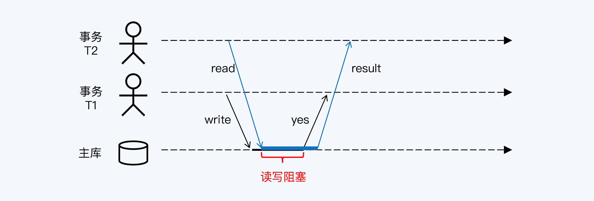
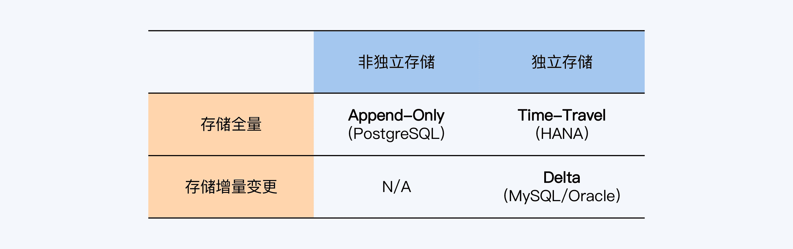
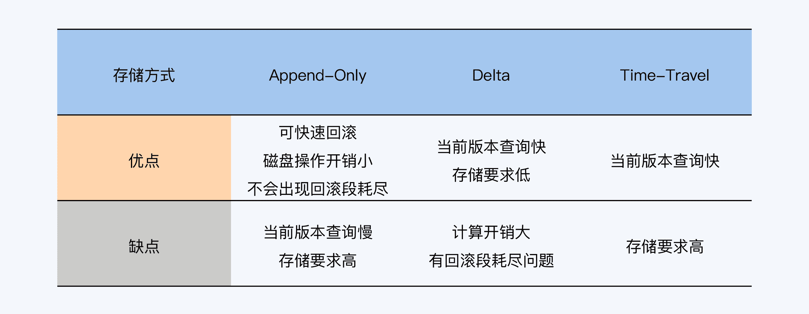
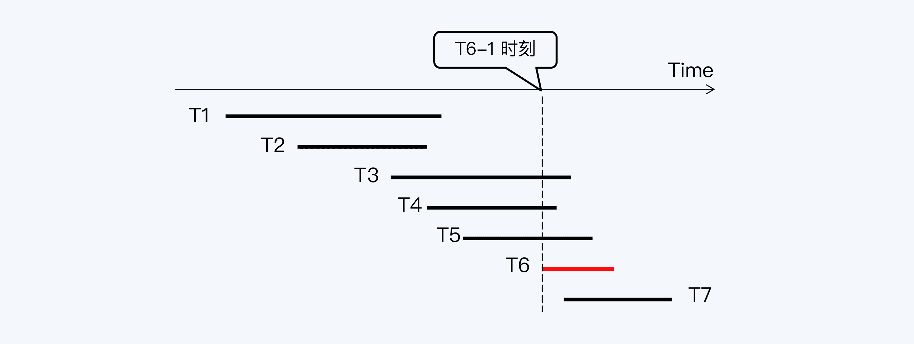
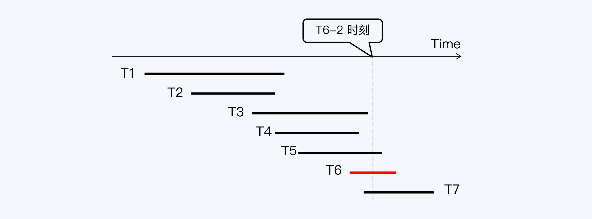
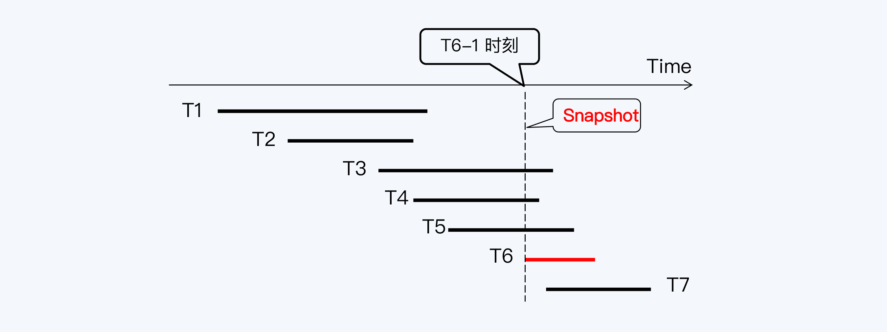
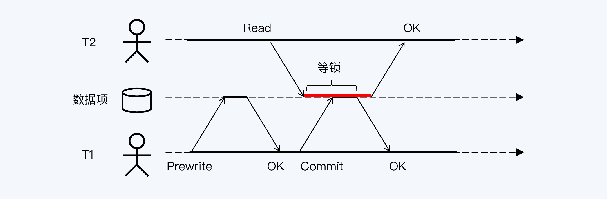
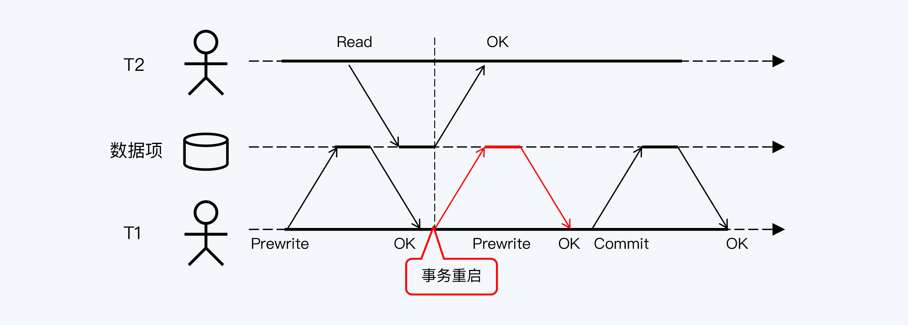
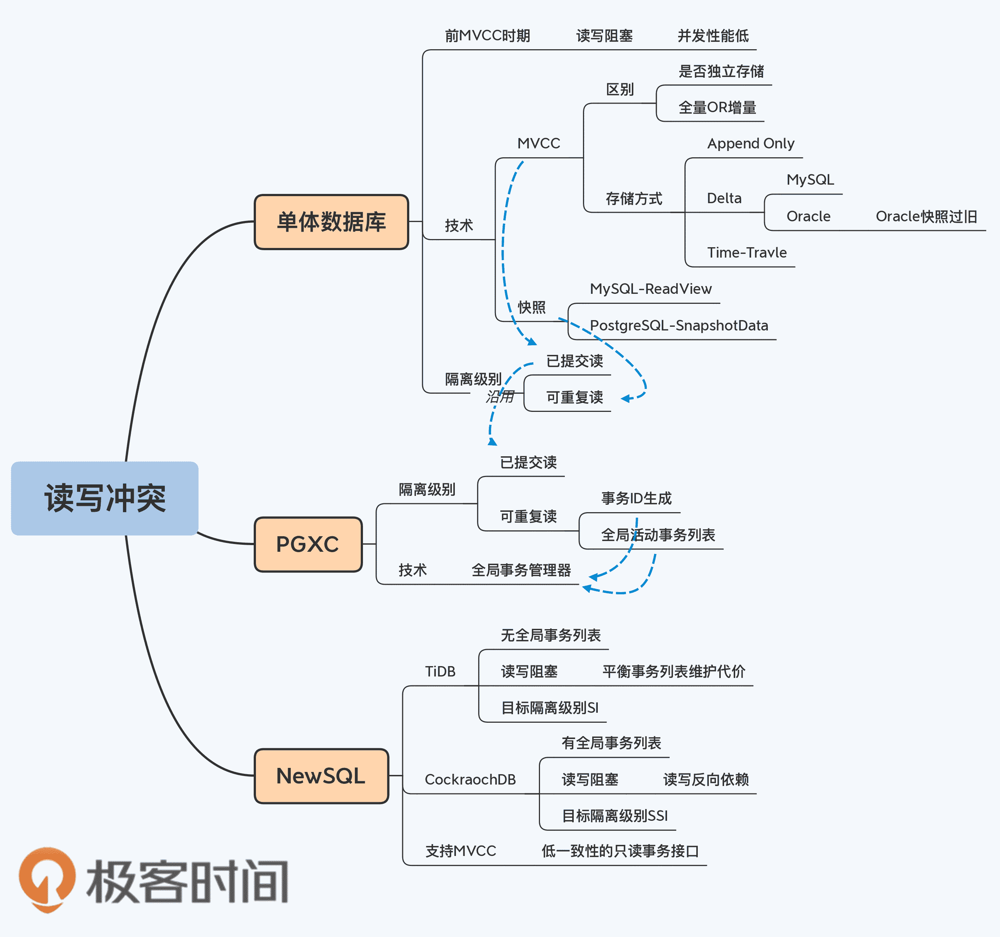

# 11｜隔离性：读写冲突时，快照是最好的办法吗？

 

你好，我是王磊，你也可以叫我 Ivan。我们今天的话题要从多版本并发控制开始。

多版本并发控制（Multi-Version Concurrency Control，MVCC）就是**通过记录数据项历史版本的方式，来提升系统应对多事务访问的并发处理能力**。今天，几乎所有主流的单体数据库都实现了 MVCC，它已经成为一项非常重要也非常普及的技术。

MVCC 为什么这么重要呢？我们通过下面例子来回顾一下 MVCC 出现前的读写冲突场景。

图中事务 T1、T2 先后启动，分别对数据库执行写操作和读操作。写操作是一个过程，在过程中任意一点，数据的变更都是不完整的，所以 T2 必须在数据写入完成后才能读取，也就形成了读写阻塞。反之，如果 T2 先启动，T1 也要等待 T2 将数据完全读取后，才能执行写入。

早期数据库的设计和上面的例子一样，读写操作之间是互斥的，具体是通过锁机制来实现的。

你可能会觉得这个阻塞也没那么严重，磁盘操作应该很快吧?

别着急下结论，让我们来分析下。如果先执行的是 T1 写事务，除了磁盘写入数据的时间，由于要保证数据库的高可靠，至少还有一个备库同步复制主库的变更内容。这样，阻塞时间就要再加上一次网络通讯的开销。

如果先执行的是 T2 只读事务，情况也好不到哪去，虽然不用考虑复制问题，但是读操作通常会涉及更大范围的数据，这样一来加锁的记录会更多，被阻塞的写操作也就更多。而且，只读事务往往要执行更加复杂的计算，阻塞的时间也就更长。

所以说，用锁解决读写冲突问题，带来的事务阻塞开销还是不小的。相比之下，用 MVCC 来解决读写冲突，就不存在阻塞问题，要优雅得多了。

第 4 讲中我们介绍了 PGXC 和 NewSQL 两种架构风格，而且还说到分布式数据库的很多关键设计是和整体架构风格有关的。MVCC 的设计就是这样，随架构风格不同而不同。在 PGXC 架构中，因为数据节点就是单体数据库，所以 **PGXC 的 MVCC 实现方式其实就是单体数据库的实现方式。**

## 单体数据库的 MVCC

那么，就让我们先看下单体数据库的 MVCC 是怎么设计的。开头我们说了实现 MVCC 要记录数据的历史版本，这就涉及到存储的问题。

### MVCC 的存储方式

MVCC 有三类存储方式，一类是将历史版本直接存在数据表中的，称为 Appane-Only，典型代表是 PostgreSQL。另外两类都是在独立的表空间存储历史版本，它们区别在于存储的方式是全量还是增量。增量存储就是只存储与版本间变更的部分，这种方式称为 Delta，也就是数学中常作为增量符号的那个 Delta，典型代表是 MySQL 和 Oracle。全量存储则是将每个版本的数据全部存储下来，这种方式称为 Time-Travle，典型代表是 HANA。我把这三种方式整理到了下面的表格中，你看起来会更直观些。

下面，我们来看看每种方式的优缺点。

#### Append-Only 方式

优点

1. 在事务包含大量更新操作时也能保持较高效率。因为更新操作被转换为 Delete + Insert，数据并未被迁移，只是有当前版本被标记为历史版本，磁盘操作的开销较小。
2. 可以追溯更多的历史版本，不必担心回滚段被用完。
3. 因为执行更新操作时，历史版本仍然留在数据表中，所以如果出现问题，事务能够快速完成回滚操作。

缺点

1. 新老数据放在一起，会增加磁盘寻址的开销，随着历史版本增多，会导致查询速度变慢。

#### Delta 方式

优点

1. 因为历史版本独立存储，所以不会影响当前读的执行效率。
2. 因为存储的只是变化的增量部分，所以占用存储空间较小。

缺点

1. 历史版本存储在回滚段中，而回滚段由所有事务共享，并且还是循环使用的。如果一个事务执行持续的时间较长，历史版本可能会被其他数据覆盖，无法查询。
2. 这个模式下读取的历史版本，实际上是基于当前版本和多个增量版本计算追溯回来的，那么计算开销自然就比较大。

Oracle 早期版本中经常会出现的 ORA-01555 “快照过旧”（Snapshot Too Old），就是回滚段中的历史版本被覆盖造成的。通常，设置更大的回滚段和缩短事务执行时间可以解决这个问题。随着 Oracle 后续版本采用自动管理回滚段的设计，这个问题也得到了缓解。

#### Time-Travel 方式

优点

1. 同样是将历史版本独立存储，所以不会影响当前读的执行效率。
2. 相对 Delta 方式，历史版本是全量独立存储的，直接访问即可，计算开销小。

缺点

1. 相对 Delta 方式，需要占用更大的存储空间。

当然，无论采用三种存储方式中的哪一种，都需要进行历史版本清理。

好了，以上就是单体数据库 MVCC 的三种存储方式，同时也是 PGXC 的实现方式。而 NewSQL 底层使用分布式键值系统来存储数据，MVCC 的存储方式与 PostgreSQL 类似，采用 Append 方式追加新版本。我觉得你应该比较容易理解，就不再啰嗦了。

为了便于你记忆，我把三种存储方式的优缺点提炼了一下放到下面表格中，其实说到底这些特点就是由“是否独立存储”和“存储全量还是存储增量变更”这两个因素决定的。

### MVCC 的工作过程

历史版本存储下来后又是如何发挥作用的呢？这个，我们开头时也说过了，是要解决多事务的并发控制问题，也就是保证事务的隔离性。在第 3 讲，我们介绍了隔离性的多个级别，其中可接受的最低隔离级别就是“已提交读”（Read Committed，RC）。

那么，我们先来看 RC 隔离级别下 MVCC 的工作过程。

按照 RC 隔离级别的要求，事务只能看到的两类数据：

1. 当前事务的更新所产生的数据。
2. 当前事务启动前，已经提交事务更新的数据。

我们用一个例子来说明。

T1 到 T7 是七个数据库事务，它们先后运行，分别操作数据库表的记录 R1 到 R7。事务 T6 要读取 R1 到 R6 这六条记录，在 T6 启动时（T6-1）会向系统申请一个活动事务列表，活动事务就是已经启动但尚未提交的事务，这个列表中会看到 T3、T4、T5 等三个事务。

T6 查询到 R3、R4、R5 时，看到它们最新版本的事务 ID 刚好在活动事务列表里，就会读取它们的上一版本。而 R1、R2 最新版本的事务 ID 小于活动事务列表中的最小事务 ID（即 T3），所以 T6 可以看到 R1、R2 的最新版本。

这个例子中 MVCC 的收益非常明显，T6 不会被正在执行写入操作的三个事务阻塞，而如果按照原来的锁方式，T6 要在 T3、T4、T5 三个事务都结束后，才能执行。

### 快照的工作原理

MVCC 在 RC 级别的效果还不错。那么，如果隔离级别是更严格一些的 “可重复读”（RR）呢？我们继续往下看。

还是继续刚才的例子，当 T6 执行到下一个时间点（T6-2），T1 到 T4 等 4 个事务都已经提交，此时 T6 再次向系统申请活动事务列表，列表包含 T5 和 T7。遵循同样的规则，这次 T6 可以看到 R1 到 R4 等四条记录的最新版本，同时看到 R5 的上一版本。

很明显，T6 刚才和现在这两次查询得到了不同的结果集，这是不符合 RR 要求的。

实现 RR 的办法也很简单，我们只需要记录下 T6-1 时刻的活动事务列表，在 T6-2 时再次使用就行了。那么，这个反复使用的活动事务列表就被称为“快照”（Snapshot）。

快照是基于 MVCC 实现的一个重要功能，从效果上看， 快照就是快速地给数据库拍照片，数据库会停留在你拍照的那一刻。所以，用“快照”来实现 RR 是很方便的。

从上面的例子可以发现，RC 与 RR 的区别在于 RC 下每个 SQL 语句会有一个自己的快照，所以看到的数据库是不同的，而 RR 下，所有 SQL 语句使用同一个快照，所以会看到同样的数据库。

为了提升效率，快照不是单纯的事务 ID 列表，它会统计最小活动事务 ID，还有最大已提交事务 ID。这样，多数事务 ID 通过比较边界值就能被快速排除掉，如果事务 ID 恰好在边界范围内，再进一步查找是否与活跃事务 ID 匹配。

快照在 MySQL 中称为 ReadView，在 PostgreSQL 中称为 SnapshotData，组织方式都是类似的。

## PGXC 读写冲突处理

在 PGXC 架构中，实现 RC 隔离级的处理过程与单体数据库差异并不大。我想和你重点介绍的是，PGXC 在实现 RR 时遇到的两个挑战，也就是实现快照的两个挑战。

一是如何保证产生单调递增事务 ID。每个数据节点自行处理显然不行，这就需要由一个集中点来统一生成。

二是如何提供全局快照。每个事务要把自己的状态发送给一个集中点，由它维护一个全局事务列表，并向所有事务提供快照。

所以，PGXC 风格的分布式数据库都有这样一个集中点，通常称为全局事务管理器（GTM）。又因为事务 ID 是单调递增的，用来衡量事务发生的先后顺序，和时间戳作用相近，所以全局事务管理器也被称为“全局时钟”。

## NewSQL 读写冲突处理

讲完 PGXC 的快照，再来看看 NewSQL 如何处理读写冲突。这里，我要向你介绍 TiDB 和 CockroachDB 两种实现方式，因为它们是比较典型的两种情况。至于它们哪里典型呢？我先不说，你可以在阅读过程中仔细体会。

### TiDB

首先来说 TiDB，我们看图说话。

TiDB 底层是分布式键值系统，我们假设两个事务操作同一个数据项。其中，事务 T1 执行写操作，由 Prewrite 和 Commit 两个阶段构成，对应了我们之前介绍的两阶段提交协议（2PC），如果你还不熟悉可以重新阅读第 9 讲复习一下。这里你也可以简单理解为 T1 的写操作分成了两个阶段，T2 在这两个阶段之间试图执行读操作，但是 T2 会被阻塞，直到 T1 完成后，T2 才能继续执行。

你肯定会非常惊讶，这不是 MVCC 出现前的读写阻塞吗？

TiDB 为什么没有使用快照读取历史版本呢？ TiDB 官方文档并没有说明背后的思路，我猜问题出在全局事务列表上，因为 TiDB 根本没有设计全局事务列表。当然这应该不是设计上的疏忽，我更愿意把它理解为一种权衡，是在读写效率和全局事务列表的维护代价之间的选择。

事实上，PGXC 中的全局事务管理器就是一个单点，很容易成为性能的瓶颈，而分布式系统一个普遍的设计思想就是要避免对单点的依赖。当然，TiDB 的这个设计付出的代价也是巨大的。虽然，TiDB 在 3.0 版本后增加了悲观锁，设计稍有变化，但大体仍是这样。

### CockroachDB

那么如果有全局事务列表，又会怎么操作呢？说来也巧，CockroachDB 真的就设计了这么一张全局事务列表。它是否照搬了单体数据库的“快照”呢？答案也是否定的。

我们来看看它的处理过程。

依旧是 T1 事务先执行写操作，中途 T2 事务启动，执行读操作，此时 T2 会被优先执行。待 T2 完成后，T1 事务被重启。重启的意思是 T1 获得一个新的时间戳（等同于事务 ID）并重新执行。

又是一个不可思议的过程，还是会产生读写阻塞，这又怎么解释呢？

CockroachDB 没有使用快照，不是因为没有全局事务列表，而是因为它的隔离级别目标不是 RR，而是 SSI，也就是可串行化。

你可以回想一下第 3 讲中黑白球的例子。对于串行化操作来说，没有与读写并行操作等价的处理方式，因为先读后写和先写后读，读操作必然得到两个不同结果。更加学术的解释是，先读后写操作会产生一个**读写反向依赖**，可能影响串行化事务调度。这个概念有些不好理解，你也不用着急，在 14 讲中我会有更详细的介绍。总之，CockroachDB 对于读写冲突、写写冲突采用了几乎同样的处理方式。

在上面的例子中，为了方便描述，我简化了读写冲突的处理过程。事实上，被重启的事务并不一定是执行写操作的事务。CockroachDB 的每个事务都有一个优先级，出现事务冲突时会比较两个事务的优先级，高优先级的事务继续执行，低优先级的事务则被重启。而被重启事务的优先级也会提升，避免总是在竞争中失败，最终被“饿死”。

TiDB 和 CockroachDB 的实现方式已经讲完了，现在你该明白它们典型在哪里了吧？对，那就是全局事务列表是否存在和实现哪种隔离级别，这两个因素都会影响最终的设计。

## 小结

好了，今天的话题就谈到这了，让我们一起回顾下这一讲的内容。

1. 用锁机制来处理读写冲突会影响并发处理能力，而 MVCC 的出现很好地解决了这个问题，几乎所有的单体数据库都实现了 MVCC。MVCC 技术包括数据的历史版本存储、清理机制，存储方式具体包括 Append-Only、Delta、Time-Travel 三种方式。通过 MVCC 和快照（基于 MVCC），单体数据库可以完美地解决 RC 和 RR 级别下的读写冲突问题，不会造成事务阻塞。
2. PGXC 风格的分布式数据库，用单体数据库作为数据节点存储数据，所以自然延续了其 MVCC 的实现方式。但 PGXC 的改变在于增加了全局事务管理器统一管理事务 ID 的生成和活动事务列表的维护。
3. NewSQL 风格的分布式数据库，没有普遍采用快照解决读写冲突问题，其中 TiDB 是由于权衡全局事务列表的代价，CockroachDB 则是因为要实现更高的隔离级别。但无论哪种原因，都造成了读写并行能力的下降。

要特别说明的是，虽然 NewSQL 架构的分布式数据库没有普遍使用快照处理读写事务，但它们仍然实现了 MVCC，在数据存储层保留了历史版本。所以，NewSQL 产品往往也会提供一些低数据一致性的只读事务接口，提升读取操作的性能。

## 思考题

最后，又到了我们的思考题时间。今天我介绍了两种风格的分布式数据库如何解决读写冲突问题。其实，无论是否使用 MVCC 实现快照隔离，时间都是一个重要的因素，每个事务都要获得一个事务 ID 或者时间戳，这直接决定了它能够读取什么版本的数据或者是否被阻塞。

但是你有没有想过时间误差的问题。我在第 2 讲中曾经提到 Spanner 的全局时钟存在 7 毫秒的误差，在第 5 讲又深入探讨了物理时钟和逻辑时钟如何控制时间误差。那么，你觉得时间误差会影响读写冲突的处理吗？

如果你想到了答案，又或者是触发了你对相关问题的思考，都可以在评论区和我聊聊，我会在下一讲和你一起探讨。最后，希望这节课能带给你一些收获，也欢迎你把它分享给周围的朋友，一起进步。
