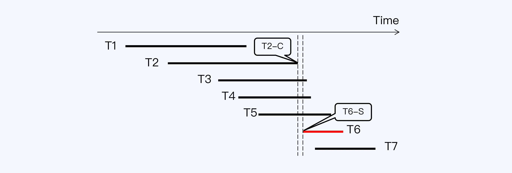
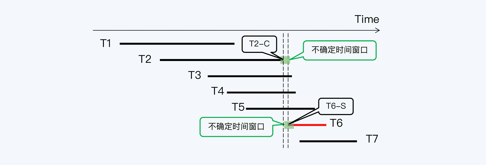
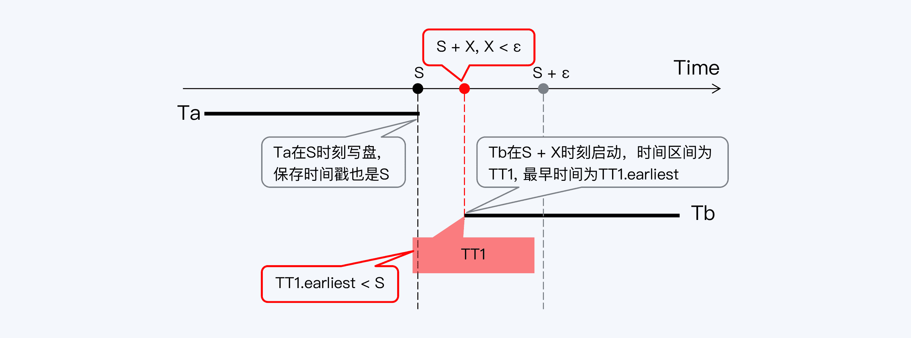
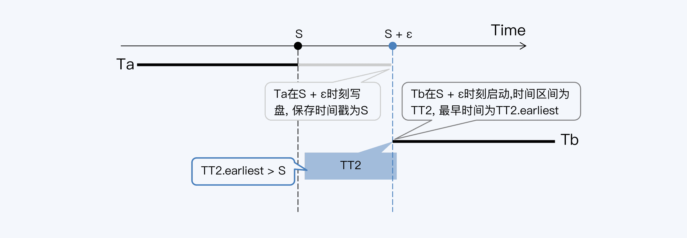
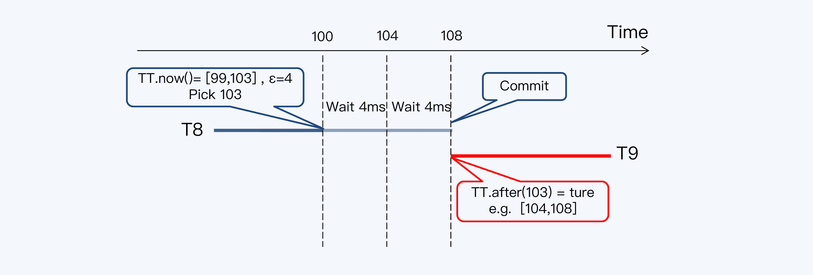
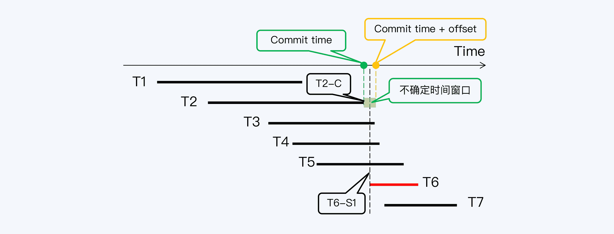
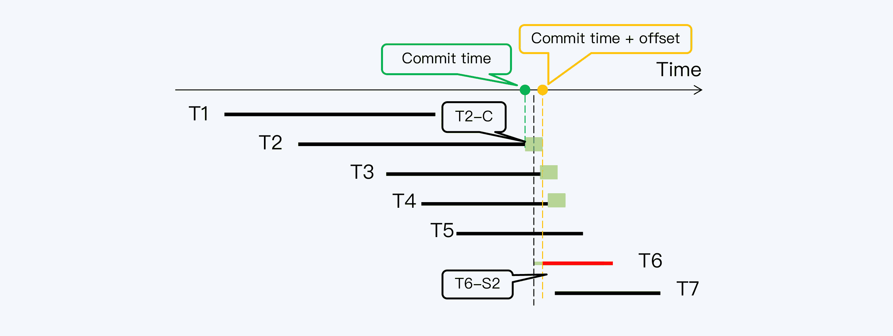
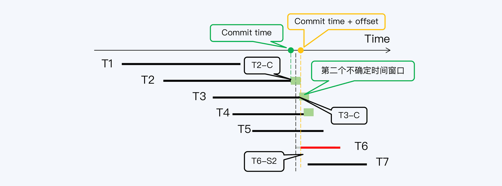
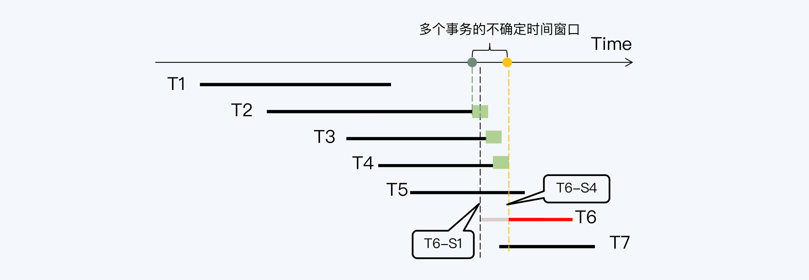
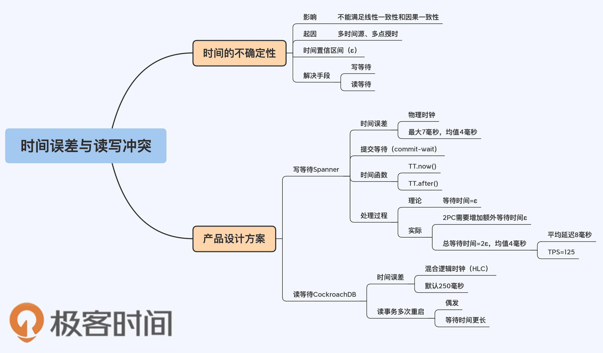

# 12 | 隔离性：看不见的读写冲突，要怎么处理？

 

你好，我是王磊，你也可以叫我 Ivan。

我们今天继续聊读写冲突。上一讲我们谈的都是显式的读写冲突，也就是写操作和读操作都在同一时间发生。但其实，还有一种看不见的读写冲突，它是由于时间的不确定性造成的，更加隐蔽，处理起来也更复杂。

关于时间，我们在第 5 讲中已经做了深入讨论，最后我们接受了一个事实，那就是无法在工程层面得到绝对准确的时间。其实，任何度量标准都没有绝对意义上的准确，这是因为量具本身就是有误差的，时间、长度、重量都是这样的。

## 不确定时间窗口

那么，时间误差会带来什么问题呢？我们用下面这张图来说明。

我们这里还是沿用上一讲的例子，图中共有 7 个数据库事务，T1 到 T7，其中 T6 是读事务，其他都是写事务。事务 T2 结束的时间点（记为 T2-C）早于事务 T6 启动的时间点（记为 T6-S），这是基于数据记录上的时间戳得出的判断，但实际上这个判断很可能是错的。

为什么这么说呢？这是因为时间误差的存在，T2-C 时间点附近会形成一个不确定时间窗口，也称为置信区间或可信区间。严格来说，我们只能确定 T2-C 在这个时间窗口内，但无法更准确地判断具体时间点。同样，T6-S 也只是一个时间窗口。时间误差不能消除，但可以通过工程方式控制在一定范围内，例如在 Spanner 中这个不确定时间窗口（记为ɛ）最大不超过 7 毫秒，平均是 4 毫秒。

在这个案例中，当我们还原两个时间窗口后，发现两者存在重叠，所以无法判断 T2-C 与 T6-S 的先后关系。这真是个棘手的问题，怎么解决呢？

只有避免时间窗口出现重叠。 那么如何避免重叠呢？

答案是等待。“waiting out the uncertainty”，用等待来消除不确定性。

具体怎么做呢？在实践中，我们看到有两种方式可供选择，分别是写等待和读等待。

## 写等待：Spanner

Spanner 选择了写等待方式，更准确地说是用提交等待（commit-wait）来消除不确定性。

Spanner 是直接将时间误差暴露出来的，所以调用当前时间函数 TT.now() 时，会获得的是一个区间对象 TTinterval。它的两个边界值 earliest 和 latest 分别代表了最早可能时间和最晚可能时间，而绝对时间就在这两者之间。另外，Spanner 还提供了 TT.before() 和 TT.after() 作为辅助函数，其中 TT.after() 用于判断当前时间是否晚于指定时间。

### 理论等待时间

那么，对于一个绝对时间点 S，什么时候 TT.after(S) 为真呢？至少需要等到 S + ɛ时刻才可以，这个ɛ就是我们前面说的不确定时间窗口的宽度。我画了张图来帮你理解这个概念。

从直觉上说，标识数据版本的“提交时间戳”和事务的真实提交时间应该是一个时间，那么我们推演一下这个过程。有当前事务 Ta，已经获得了一个绝对时间 S 作为“提交时间戳”。Ta 在 S 时刻写盘，保存的时间戳也是 S。事务 Tb 在 Ta 结束后的 S+X 时刻启动，获得时间区间的最小值是 TT1.earliest。如果 X 小于时间区间ɛ，则 TT1.earliest 就会小于 S，那么 Tb 就无法读取到 Ta 写入的数据。

你看，Tb 在 Ta 提交后启动却读取不到 Ta 写入的数据，这显然不符合线性一致性的要求。

写等待的处理方式是这样的。事务 Ta 在获得“提交时间戳”S 后，再等待ɛ时间后才写盘并提交事务。真正的提交时间是晚于“提交时间戳”的，中间这段时间就是等待。这样 Tb 事务启动后，能够得到的最早时间 TT2.earliet 肯定不会早于 S 时刻，所以 Tb 就一定能够读取到 Ta。这样就符合线性一致性的要求了。

综上，事务获得“提交时间戳”后必须等待ɛ时间才能写入磁盘，即 commit-wait。

到这里，写等待算是说清楚了。但是，你仔细想想，有什么不对劲的地方吗？

对，就是那个绝对时间 S。都说了半天时间有误差，那又怎么可能拿到一个绝对时间呢？这不是自相矛盾吗？

Spanner 确实拿不到绝对时间，为了说清楚这个事情，我们稍微延伸一下话题。

### 实际等待时间

Spanner 将含有写操作的事务定义为读写事务。读写事务的写操作会以两阶段提交（2PC）的方式执行。有关 2PC 的内容在第 9 讲中已经介绍过，如果你已经记不清了，可以去复习一下。

2PC 的第一阶段是预备阶段，每个参与者都会获取一个“预备时间戳”，与数据一起写入日志。第二阶段，协调节点写入日志时需要一个“提交时间戳”，而它必须要大于任何参与者的“预备时间戳”。所以，协调节点调用 TT.now() 函数后，要取该时间区间的 lastest 值（记为 s），而且 s 必须大于所有参与者的“预备时间戳”，作为“提交时间戳”。

这样，事务从拿到提交时间戳到 TT.after(s) 为 true，实际等待了两个单位的时间误差。我们还是画图来解释一下。

针对同一个数据项，事务 T8 和 T9 分别对进行写入和读取操作。T8 在绝对时间 100ms 的时候，调用 TT.now() 函数，得到一个时间区间[99,103]，选择最大值 103 作为提交时间戳，而后等待 8 毫秒（即 2ɛ）后提交。

这样，无论如何 T9 事务启动时间都晚于 T8 的“提交时间戳”，也就能读取到 T8 的更新。

回顾一下这个过程，第一个时间差是 2PC 带来的，如果换成其他事务模型也许可以避免，而第二个时间差是真正的 commit-wait，来自时间的不确定性，是不能避免的。

TrueTime 的平均误差是 4 毫秒，commit-wait 需要等待两个周期，那 Spanner 读写事务的平均延迟必然大于等于 8 毫秒。为啥有人会说 Spanner 的 TPS 是 125 呢？原因就是这个了。其实，这只是事务操作数据出现重叠时的吞吐量，而无关的读写事务是可以并行处理的。

对数据库来说，8 毫秒的延迟虽然不能说短，但对多数场景来说还是能接受的。可是，TrueTime 是 Google 的独门招式，其他分布式数据库怎么办呢？它们的时间误差远大于 8 毫秒，难道也用 commit-wait，那一定是灾难啊！

这就要说到第二种方式，读等待。

## 读等待：CockroachDB

读等待的代表产品是 CockroachDB。

因为 CockroachDB 采用混合逻辑时钟（HLC），所以对于没有直接关联的事务，只能用物理时钟比较先后关系。CockroachDB 各节点的物理时钟使用 NTP 机制同步，误差在几十至几百毫秒之间，用户可以基于网络情况通过参数”maximum clock offset”设置这个误差，默认配置是 250 毫秒。

写等待模式下，所有包含写操作的事务都受到影响，要延后提交；而读等待只在特殊条件下才被触发，影响的范围要小得多。

那到底是什么特殊条件呢？我们还是使用开篇的那个例子来说明。

事务 T6 启动获得了一个时间戳 T6-S1，此时虽然事务 T2 已经在 T2-C 提交，但 T2-C 与 T6-S1 的间隔小于集群的时间偏移量，所以无法判断 T6 的提交是否真的早于 T2。

这时，CockroachDB 的办法是重启（Restart）读操作的事务，就是让 T6 获得一个更晚的时间戳 T6-S2，使得 T6-S2 与 T2-C 的间隔大于 offset，那么就能读取 T2 的写入了。

不过，接下来又出现更复杂的情况， T6-S2 与 T3 的提交时间戳 T3-C 间隔太近，又落入了 T3 的不确定时间窗口，所以 T6 事务还需要再次重启。而 T3 之后，T6 还要重启越过 T4 的不确定时间窗口。

最后，当 T6 拿到时间戳 T6-S4 后，终于跳过了所有不确定时间窗口，读等待过程到此结束，T6 可以正式开始它的工作了。

在这个过程中，可以看到读等待的两个特点：一是偶发，只有当读操作与已提交事务间隔小于设置的时间误差时才会发生；二是等待时间的更长，因为事务在重启后可能落入下一个不确定时间窗口，所以也许需要经过多次重启。

## 小结

到这里，今天的内容就告一段落了，时间误差的问题比较抽象，你可能会学得比较辛苦，让我帮你整理一下今天内容。

1. 时间误差是客观存在的，任何系统都不能获得准确的绝对时间，只能得到一个时间区间，差别仅在于有些系统承认这点，而有些系统不承认。
2. 有两种方式消除时间误差的影响，分别是写等待和读等待。写等待影响范围大，所有包含写操作的事务都要至少等待一个误差周期。读等待的影响范围小，只有当读操作时间戳与访问数据项的提交时间戳落入不确定时间窗口后才会触发，但读等待的周期可能更长，可能是数个误差周期。
3. 写等待适用于误差很小的系统，Spanner 能够将时间误差控制在 7 毫秒以内，所以有条件使用该方式。读等待适用于误差更大的系统，CockroachDB 对误差的预期达到 250 毫秒。

总之，处理时间误差的方式就是等待，“waiting out the uncertainty”，等待不确定性过去。你可能觉得写等待和读等待都不完美，但这就是全球化部署的代价。我想你肯定会追问，那为什么要实现全球化部署呢？简单地说，全球化部署最突出的优势就是可以让所有节点都处于工作状态，就近服务客户；而缺失这种能力就只能把所有主副本限制在同机房或者同城机房的范围内，异地机房不具备真正的服务能力，这会带来资源浪费、用户体验下降、切换演练等一系列问题。我会在第 24 讲专门讨论全球化部署的问题。

## 思考题

最后，我要留给你一道思考题。

今天，我们继续探讨了读写冲突的话题，在引入了时间误差后，整个处理过程变得更复杂了，而无论是“读等待”还是“写等待”都会让系统的性能明显下降。说到底是由多个独立时间源造成的，而多个时间源是为了支持全球化部署。那么，今天的问题就是，你觉得在什么情况下，不用“等待”也能达到线性一致性或因果一致性呢？

欢迎你在评论区留言和我一起讨论，我会在答疑篇和你继续讨论这个问题。如果你身边的朋友也对时间误差下的读写冲突这个话题感兴趣，你也可以把今天这一讲分享给他，我们一起讨论。
