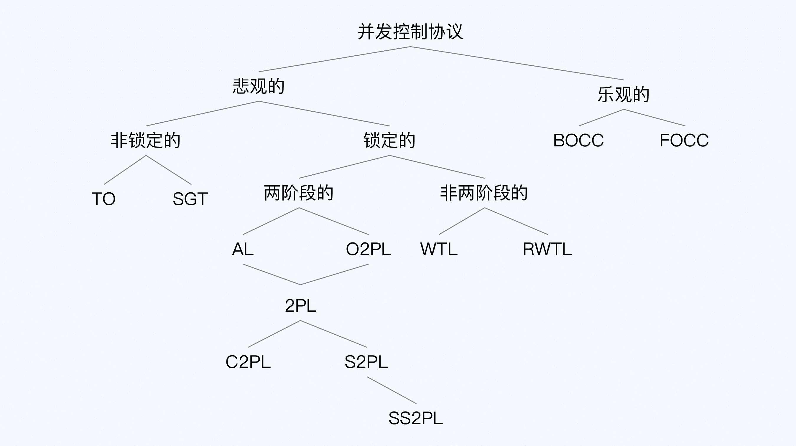
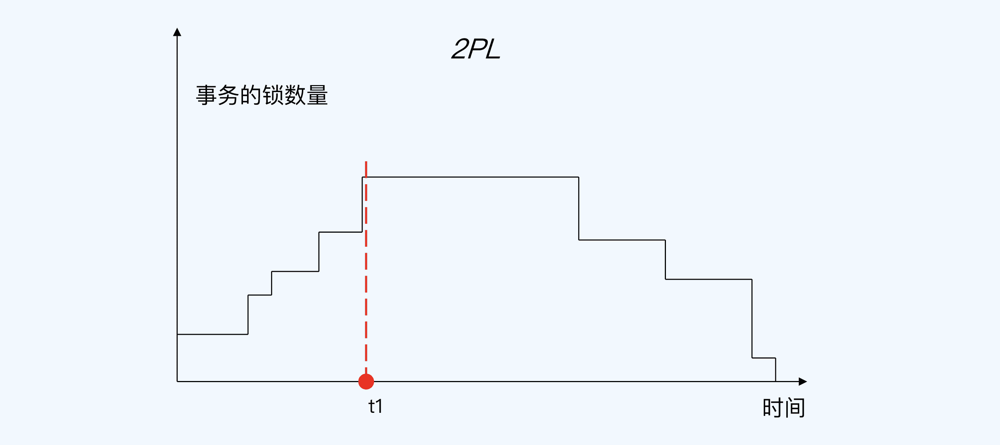
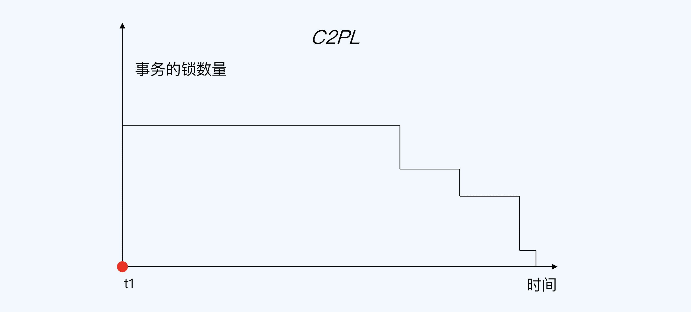
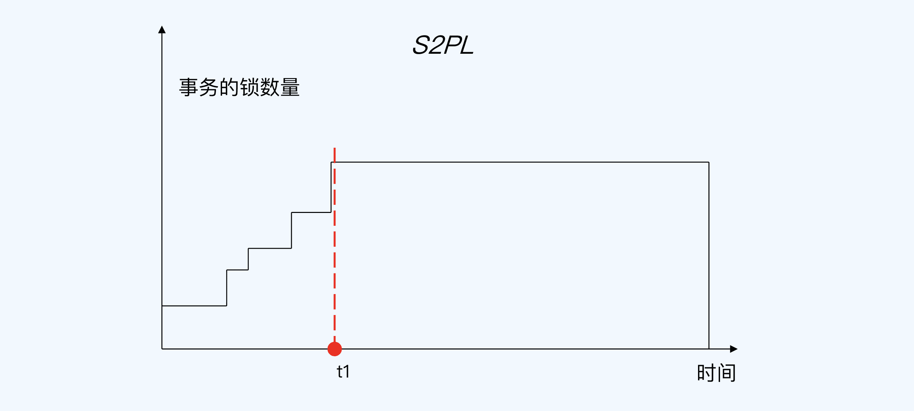
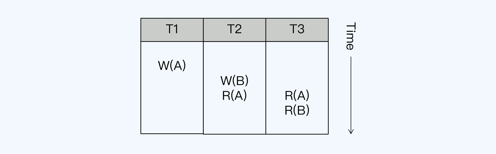
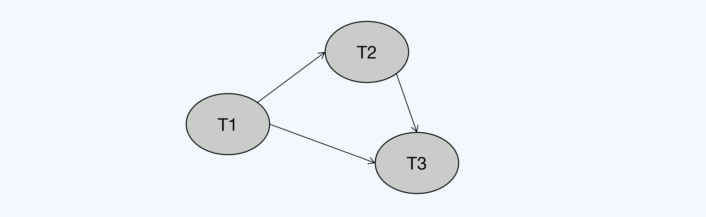
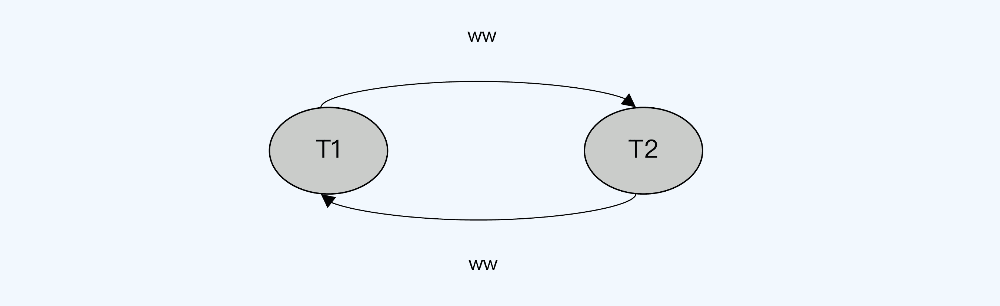
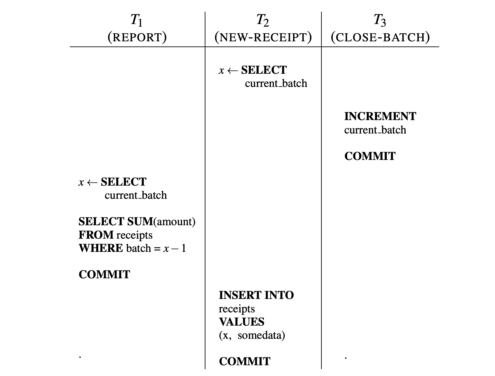
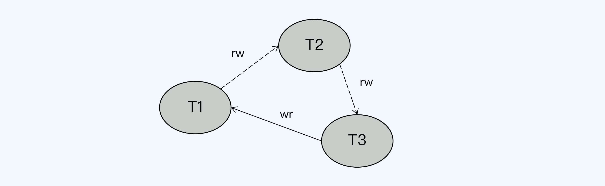
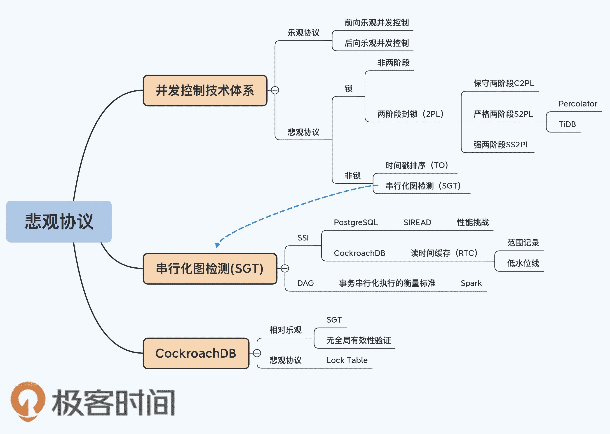

# 14 | 隔离性：实现悲观协议，除了锁还有别的办法吗？

 

你好，我是王磊，你也可以叫我 Ivan。

我们今天的主题是悲观协议，我会结合第 13 讲的内容将并发控制技术和你说清楚。在第 13 讲我们以并发控制的三阶段作为工具，区分了广义上的乐观协议和悲观协议。因为狭义乐观很少使用，所以我们将重点放在了相对乐观上。

其实，相对乐观和局部悲观是一体两面的关系，识别它的要点就在于是否有全局有效性验证，这也和分布式数据库的架构特点息息相关。但是关于悲观协议，还有很多内容没有提及，下面我们就来填补这一大块空白。

## 悲观协议的分类

要搞清楚悲观协议的分类，其实是要先跳出来，从并发控制技术整体的分类体系来看。

事实上，并发控制的分类体系，连学术界的标准也不统一。比如，在第 13 讲提到的两本经典教材中，“Principles of Distributed Database Systems”的分类是按照比较宽泛的乐观协议和悲观协议进行分类，子类之间又有很多重叠的概念，理解起来有点复杂。

而“Transactional Information Systems : Theory, Algorithms, and the Practice of Concurrency Control and Recovery”采用的划分方式，是狭义乐观协议和其他悲观协议。这里狭义乐观协议，就是指我们在第 13 讲提到过的，基于有效性验证的并发控制，也是学术上定义的 OCC。

我个人认为，狭义乐观协议和其他悲观协议这种分类方式更清晰些，所以就选择了“ Transactional Information Systems : Theory, Algorithms, and the Practice of Concurrency Control and Recovery”中的划分体系。下面我摘录了书中的一幅图，用来梳理不同的并发控制协议。

这个体系首先分为悲观和乐观两个大类。因为这里的乐观协议是指狭义乐观并发控制，所以包含内容就比较少，只有前向乐观并发控制和后向乐观并发控制；而悲观协议又分为基于锁和非锁两大类，其中基于锁的协议是数量最多的。

## 两阶段封锁（Two-Phase Locking，2PL）

基于锁的协议显然不只是 2PL，还包括有序共享（Ordered Sharing 2PL, O2PL）、利他锁（Altruistic Locking, AL）、只写封锁树（Write-only Tree Locking, WTL）和读写封锁树（Read/Write Tree Locking， RWTL）。但这几种协议在真正的数据库系统中很少使用，所以就不过多介绍了，我们还是把重点放在数据库系统主要使用的 2PL 上。

2PL 就是事务具备两阶段特点的并发控制协议，这里的两个阶段指加锁阶段和释放锁阶段，并且加锁阶段严格区别于紧接着的释放锁阶段。我们可以通过一张图来加深对 2PL 理解。

在 t1 时刻之前是加锁阶段，在 t1 之后则是释放锁阶段，我们可以从时间上明确地把事务执行过程划分为两个阶段。2PL 的关键点就是释放锁之后不能再加锁。而根据加锁和释放锁时机的不同，2PL 又有一些变体。

**保守两阶段封锁协议**（Conservative 2PL，C2PL），事务在开始时设置它需要的所有锁。

**严格两阶段封锁协议**（Strict 2PL，S2PL），事务一直持有已经获得的所有写锁，直到事务终止。

**强两阶段封锁协议**（Strong Strict 2PL，SS2PL），事务一直持有已经获得的所有锁，包括写锁和读锁，直到事务终止。SS2PL 与 S2PL 差别只在于一直持有的锁的类型，所以它们的图形是相同的。

理解了这几种 2PL 的变体后，我们再回想一下第 13 讲中的 Percolator 模型。当主锁（Primary Lock）没有释放前，所有的记录上的从锁（Secondary Lock）实质上都没有释放，在主锁释放后，所有从锁自然释放。所以，Percolator 也属于 S2PL。TiDB 的乐观锁机制是基于 Percolator 的，那么 TiDB 就也是 S2PL。

事实上，S2PL 可能是使用最广泛的悲观协议，几乎所有单体数据都依赖 S2PL 实现可串行化。而在分布式数据库中，甚至需要使用 SS2PL 来保证可串行化执行，典型的例子是 TDSQL。但 S2PL 模式下，事务持有锁的时间过长，导致系统并发性能较差，所以实际使用中往往不会配置到可串行化级别。这就意味着我们还是没有生产级技术方案，只能期望出现新的方式，既达到可串行化隔离级别，又能有更好的性能。最终，我们等到了一种可能是性能更优的工程化实现，这就是 CockroachDB 的串行化快照隔离（SSI）。而 SSI 的核心，就是串行化图检测（SGT）。

## 串行化图检测（SGT）

SSI 是一种隔离级别的命名，最早来自 PostgreSQL，CockroachDB 沿用了这个名称。它是在 SI 基础上实现的可串行化隔离。同样，作为 SSI 核心的 SGT 也不是 CockroachDB 首创，学术界早就提出了这个理论，但真正的工程化实现要晚得多。

### 理论来源：PostgreSQL

PostgreSQL 在论文“Serializable Snapshot Isolation in PostgreSQL”中最早提出了 SSI 的工程实现方案，这篇论文也被 VLDB2012 收录。

为了更清楚地描述 SSI 方案，我们先要了解一点理论知识。

串行化理论的核心是串行化图（Serializable Graph，SG）。这个图用来分析数据库事务操作的冲突情况。每个事务是一个节点，事务之间的关系则表示为一条有向边。那么，什么样的关系可以表示为边呢？

串行化图的构建规则是这样的，事务作为节点，当一个操作与另一个操作冲突时，在两个事务节点之间就可以画上一条有向边。

具体来说，事务之间的边又分为三类情况：

1. 写读依赖（WR-Dependencies），第二个操作读取了第一个操作写入的值。
2. 写写依赖（WW-Dependencies），第二个操作覆盖了第一个操作写入的值。
3. 读写反依赖（RW-Antidependencies），第二个操作覆盖了第一个操作读取的值，可能导致读取值过期。

我们通过一个例子，看看如何用这几条规则来构建一个简单的串行化图。

图中一共有三个事务先后执行，事务 T1 先执行 W(A)，T2 再执行 R(A)，所以 T1 与 T2 之间存在 WR 依赖，因此形成一条 T1 指向 T2 的边；同理，T2 的 W(B) 与 T3 的 R(B) 也存在 WR 依赖，T1 的 W(A) 与 T3 的 R(A) 之间也是 WR 依赖，这样就又形成两条有向边，分别是 T2 指向 T3 和 T1 指向 T3。

最终，我们看到产生了一个有向无环图（Directed Acyclic Graph，DAG）。能够构建出 DAG，就说明相关事务是可串行化执行的，不需要中断任何事务。

我们可以使用 SGT，验证一下典型的死锁情况。我们知道，事务 T1 和 T2 分别以不同的顺序写两个数据项，那么就会形成死锁。

用串行化图来体现就是这个样子，显然构成了环。

在 SGT 中，WR 依赖和 WW 依赖都与我们的直觉相符，而 RW 反向依赖就比较难理解了。在 PostgreSQL 的论文中，专门描述了一个 RW 反向依赖的场景，这里我把它引用过来，我们一起学习一下。

这个场景一共需要维护两张表：一张收入表（reciepts）会记入当日的收入情况，每行都会记录一个批次号；另一张独立的控制表（current_batch），里面只有一条记录，就是当前的批次号。你也可以把这里的批次号理解为一个工作日。

同时，还有三个事务 T1、T2、T3。

1. T2 是记录新的收入（NEW-RECEIPT），从控制表中读取当前的批次号，然后在收入表中插入一条新的记录。
2. T3 负责关闭当前批次（CLOSE-BATCH），而具体实现是通过将控制表中的批次号递增的方式，这就意味着后续再发生的收入会划归到下一个批次。
3. T1 是报告（REPORT），读取当前控制表的批次号，处理逻辑是用当前已经加一的批次号再减一。T1 用这个批次号作为条件，读取收据表中的所有记录。查询到这个批次，也就是这一日，所有的交易。

其实，这个例子很像银行存款系统的日终翻牌。

因为 T1 要报告当天的收入情况，所以它必须要在 T3 之后执行。事务 T2 记录了当天的每笔入账，必须在 T3 之前执行，这样才能出现在当天的报表中。三者顺序执行可以正常工作，否则就会出现异常，比如下面这样的：

T2 先拿到一个批次号 x，随后 T3 执行，批次号关闭后，x 这个批次号其实已经过期，但是 T2 还继续使用 x，记录当前的这笔收入。T1 正常在 T3 后执行，此时 T2 尚未提交，所以 T1 的报告中漏掉了 T2 的那笔收入。因为 T2 使用时过期的批次号 x，第二天的报告中也不会统计到这笔收入，最终这笔收入就神奇地消失了。

在理解了这个例子的异常现象后，我们用串行化图方法来验证一下。我们是把事务中的 SQL 抽象为对数据项的操作，可以得到下面这张图。

图中 batch 是指批次号，reps 是指收入情况。

接下来，我们按照先后顺序提取有向边，先由 T2.R(batch) -> T3.W(batch)，得到 T2 到 T3 的 RW 依赖；再由 T3.W(batch)->T1.R(batch)，得到 T3 到 T1 的 WR 依赖；最后由 T1.R(reps)->T2.W(reps)，得到 T1 到 T2 的 RW 依赖。这样就构成了下面的串行化图。

显然这三个事务之间是存在环的，那么这三个事务就是不能串行化的。

这个异常现象中很有意思的一点是，虽然 T1 是一个只读事务，但如果没有 T1 的话，T2 与 T3 不会形成环，依然是可串行化执行的。这里就为我们澄清了一点：我们直觉上认为的只读事务不会影响事务并发机制，其实是不对的。

### 工程实现：CockroachDB

RW 反向依赖是一个非常特别的存在，而特别之处就在于传统的锁机制无法记录这种情况。因此在论文“Serializable Snapshot Isolation in PostgreSQL”中提出，增加一种锁 SIREAD，用来记录快照隔离（SI）上所有执行过的读操作（Read），从而识别 RW 反向依赖。本质上，SIREAD 并不是锁，只是一种标识。但这个方案面临的困境是，读操作涉及到的数据范围实在太大，跟踪标识带来的成本可能比 S2PL 还要高，也就无法达到最初的目标。

针对这个问题，CockroachDB 做了一个关键设计，**读时间戳缓存**（Read Timestamp Cache），简称 RTC。

基于 RTC 的新方案是这样的，当执行任何的读取操作时，操作的时间戳都会被记录在所访问节点的本地 RTC 中。当任何写操作访问这个节点时，都会以将要访问的 Key 为输入，向 RTC 查询最大的读时间戳（MRT），如果 MRT 大于这个写入操作的时间戳，那继续写入就会形成 RW 依赖。这时就必须终止并重启写入事务，让写入事务拿到一个更大的时间戳重新尝试。

具体来说，RTC 是以 Key 的范围来组织读时间戳的。这样，当读取操作携带了谓词条件，比如 where 子句，对应的操作就是一个范围读取，会覆盖若干个 Key，那么整个 Key 的范围也可以被记录在 RTC 中。这样处理的好处是，可以兼容一种特殊情况。

例如，事务 T1 第一次范围读取（Range Scan）数据表，where 条件是“>=1 and <=5”，读取到 1、2、5 三个值，T1 完成后，事务 T2 在该表插入了 4，因为 RTC 记录的是范围区间[1,5]，所以 4 也可以被检测出存在 RW 依赖。这个地方，有点像 MySQL 间隙锁的原理。

RTC 是一个大小有限的，采用 LRU（Least Recently Used，最近最少使用）淘汰算法的缓存。当达到存储上限时，最老的时间戳会被抛弃。为了应对缓存超限的情况，会将 RTC 中出现过的所有 Key 上最早的那个读时间戳记录下来，作为低水位线（Low Water Mark）。如果一个写操作将要写的 Key 不在 RTC 中，则会返回这个低水位线。

## 相对乐观

到这里，你应该大概理解了 SGT 的运行机制，它和传统的 S2PL 一样属于悲观协议。但 SGT 没有锁的管理成本，所以性能比 S2PL 更好。

CockroachDB 基于 SGT 理论进行工程化，使可串行化真正成为生产级可用的隔离级别。从整体并发控制机制看，CockroachDB 和上一讲的 TiDB 一样，虽然在局部看是悲观协议，但因为不符合严格的 VRW 顺序，所以在全局来看仍是一个相对乐观的协议。

这种乐观协议同样存在第 13 讲提到的问题，所以 CockroachDB 也在原有基础上进行了改良，通过增加全局的锁表（Lock Table），使用加锁的方式，先进行一轮全局有效性验证，确定无冲突的情况下，再使用单个节点的 SGT。

## 小结

有关悲观协议的内容就聊到这里了，我们一起梳理下今天课程的重点。

1. 并发控制机制的划分方法很多，没有统一标准，我们使用了Transactional Information Systems : Theory, Algorithms, and the Practice of Concurrency Control and Recovery提出的划分标准，分为悲观协议与乐观协议两种。这里的乐观协议是上一讲提到的狭义乐观协议，悲观协议又分为锁和非锁两大类，我们简单介绍了 2PL 这一个分支。
2. 我们回顾了 Percolator 模型，按照 S2PL 的定义，Percoloatro 本质就是 S2PL，因此 TiDB 的乐观锁也属于 S2PL。
3. S2PL 是数据库并发控制的主流技术，但是锁管理复杂，在实现串行化隔离级别时开销太大。而后，我们讨论了非锁协议中的串行化图检测（SGT）。PostgreSQL 最早提出了 SGT 的工程实现方式 SSI。CockroachDB 在此基础上又进行了优化，降低了 SIREAD 的开销，是生产级的可串行化隔离。
4. CockroachDB 最初和 TiDB 一样都是局部采用悲观协议，而不做全局有效性验证，是广义的乐观协议。后来，CockroachDB 同样也将乐观协议改为悲观协议，采用的方式是增加全局的锁表，进行全局有效性验证，而后再转入单个的 SGT 处理。

今天的课程中，我们提到了串行化理论，只有当相关事务形成 DAG 图时，这些事务才是可串行化的。这个理论不仅适用于 SGT，2PL 的最终调度结果也同样是 DAG 图。在更大范围内，批量任务调度时 DAG 也同样被作为衡量标准，例如 Spark。

## 思考题

课程的最后，我们来看看今天的思考题。

在第 11 讲中我们提到了 MVCC。有的数据库教材中将 MVCC 作为一种重要的并发控制技术，与乐观协议、悲观协议并列，但我们今天并没有单独提到它。所以，我的问题是，你觉得该如何理解 MVCC 与乐观协议、悲观协议的关系呢？

欢迎你在评论区留言和我一起讨论，我会在答疑篇回复这个问题。如果你身边的朋友也对悲观协议或者并发控制技术这个话题感兴趣，你也可以把今天这一讲分享给他，我们一起讨论。

## 学习资料

最早的 SSI 工程实现方案：Serializable Snapshot Isolation in PostgreSQL

按照狭义乐观协议和其他悲观协议划分并发控制协议：Transactional Information Systems : Theory, Algorithms, and the Practice of Concurrency Control and Recovery
