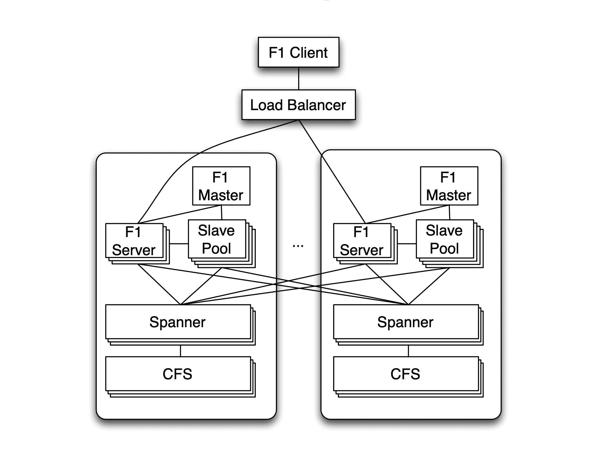
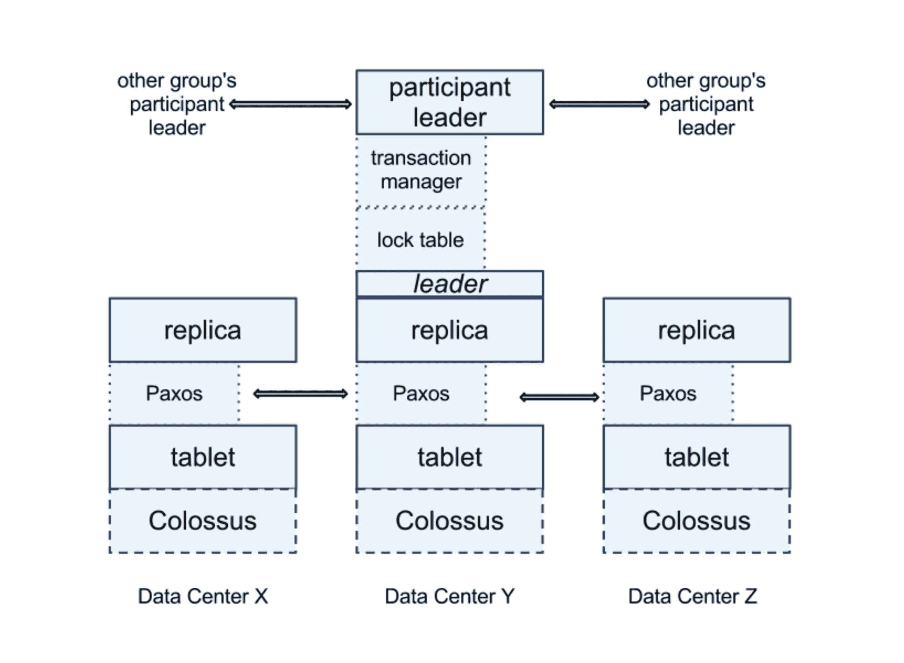
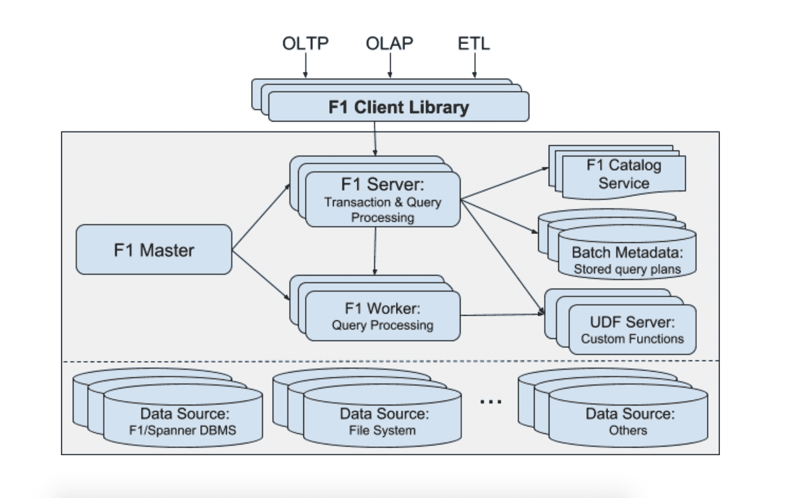
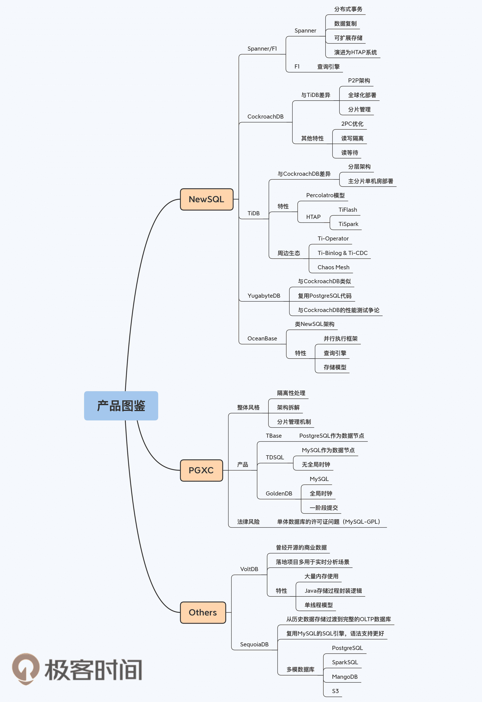

# 29 | 产品图鉴：哪些分布式数据库值得看？

 

你好，我是王磊，你也可以叫我 Ivan。

今天是课程正文的最后一讲，时间过得好快呀。在基础篇和开发篇，课程安排追求的是庖丁解牛那样的风格，按照第 4 讲提到的数据库基本架构，来逐步拆解分布式数据库系统。在介绍每一个关键部件时，我会去关联主流产品的设计，分析背后的理论依据什么，工程优化的思路又是什么。

这样做的好处是能够将抽象理论与具体产品对应起来，更容易理解每个设计点。但它也有一个缺点，就是产品特性被分散开来，不便于你了解整体产品。

为了弥补这个遗憾，今天这一讲，我会把视角切换到产品方向，为你做一次整体介绍。当然对于具体特性，这里我不再重复，而是会给出前面课程的索引。所以，你也可以将这一讲当作一个产品版的课程索引，让你在二刷这门课程时有一个崭新的视角。

分布式数据库产品，从架构风格上可以分为 PGXC 和 NewSQL 这两个大类，以及另外一些小众些的产品。

## NewSQL

### Spanner

既然要说分布式数据库产品，第一个必须是 Google 的 Spanner。严格来说，是 Spanner 和 F1 一起开创了 NewSQL 风格，它是这一流派当之无愧的开山鼻祖。

在 2012 年 Google 论文“F1: A Distributed SQL Database That Scales”中首先描述了这个组合的整体架构。

其中 F1 主要作为 SQL 引擎，而事务一致性、复制机制、可扩展存储等特性都是由 Spanner 完成的，所以我们有时会忽略 F1，而更多地提到 Spanner。

Google 在 2012 年的另一篇论文 “Spanner: Google’s Globally-Distributed Database”中介绍了 Spanner 的主要设计。

Spanner 架构中的核心处理模块是 Spanserver，下面是它的架构图。

从图中我们可以看到，Spanserver 的核心工作有三部分：

1. 基于 Paxos 协议的数据复制
2. 基于 Tablet 的分片管理
3. 基于 2PC 的事务一致性管理

这三个特性的我们分别在第 6 讲、第 7 讲和第 9 讲做了介绍。

在第 5 讲和第 12 讲，我们还介绍了基于全局时钟的数据一致性管理机制和处理时间误差的“写等待机制”。

我们都知道，软件架构会随着业务发展而演进，2017 年，Google 又发表了两篇新论文，介绍了 Spanner 和 F1 的最新变化。它们从原来的“金牌组合”走向了“单飞”模式。

Spanner 的论文是“Spanner: Becoming a SQL System”。就像论文名字所说的，Spanner 完善了 SQL 功能，这样就算不借助 F1，也能成为一个完整的数据库。

这篇论文用大量篇幅介绍了 SQL 处理机制，同时在系统定位上相比 2012 版有一个大的变化，强调了兼容 OLTP 和 OLAP，也就是 HTAP。对应的，Spanner 在存储层的设计也从 2012 版中的 CFS 切换到了 Ressi。Ressi 是类似 PAX 的行列混合数据布局（Data Layout），我们在第 18 讲专门谈了对 HTAP 未来发展的看法，并对各种不同的数据布局进行了分析。

F1 的新论文是“F1 Query: Declarative Querying at Scale”。这一版论文中 F1 不再强调和 Spanner 的绑定关系，而是支持更多的底层存储。非常有意思的是，F1 也声称自己可以兼顾 OLTP 和 OLAP。

这个架构中还有一个我们很感兴趣的点，就是 F1 通过 UDF Server 来实现存储过程的支持。我们在第 16 讲中对此进行了简单的探讨。

### CockroachDB

按照时间顺序，在 Spanner 之后出现的 NewSQL 产品是 CockroachDB。CockroachDB 和 TiDB、YugabyteDB 都公开声称设计灵感来自 Spanner，所以往往会被认为是同构的产品。尤其是 CockroachDB 和 TiDB，经常会被大家拿来比较。但是，从系统架构上看，这两个产品有非常大的差别。让我们先从 CockroachDB 角度来总结下。

最大的差别来自架构的整体风格。CockroachDB 采用了标准的 P2P 架构，这是一个非常极客的设计。只有 P2P 架构能够做到绝对的无中心，这意味着只要损坏的节点不超过总数一半，那么集群就仍然可以正常工作。因此，CockroachDB 具有超强的生存能力，而这也很符合产品名称的语义。

第二个重要差异是全球化部署。CockroachDB 采用了混合逻辑时钟（HLC），所以能够在全球物理范围下做到数据一致性。这一点对标了 Spanner 的特性，不同之处是 Spanner 的 TrueTime 是依赖硬件的，而 HLC 机制完全基于软件实现。我在第 5 讲对它的设计做了深入的分析，而对于 HLC 的理论基础 Lamport 时钟，我在第 2 讲中也做了介绍。

第三个点则是分片管理机制的不同。因为整体架构的差异，CockroachDB 在分片管理上也跟 TiDB 有明显的区别，我们在第 6 讲中做了介绍。

另外，我还在第 10 讲介绍了 CockroachDB 的 2PC 优化，第 11 讲介绍了 CockroachDB 的读写隔离策略，第 12 讲介绍了如何用读等待方式解决时间误差问题。

2020 年，CockroachDB 发表的论文“CockroachDB: The Resilient Geo-DistributedSQL Database”被 SIGMOD 收录。这篇论文对 CockroachDB 的架构设计做了比较全面的介绍，非常值得你仔细阅读。

### TiDB

TiDB 也是对标 Spanner 的 NewSQL 数据库，因为开源的运行方式和良好的社区运营，它在工程师群体中拥有很高的人气。

不同于 CockroachDB 的 P2P 架构，TiDB 采用了分层架构，由 TiDB、TiKV 和 PD 三类角色节点构成，TiKV 作为底层分布式键值存储，TiDB 作为 SQL 引擎，PD 承担元数据管理和全局时钟的职责。

与 Spanner 不同的是，底层存储 TiKV 并不能独立支持事务，而是通过 TiDB 协调实现，事务控制模型采用了 Percolator。我们在第 9 讲和第 13 讲介绍了 TiDB 的事务模型。

作为与 CockroachDB 的另一个显著区别，TiDB 更加坚定的走向 HTAP，在原有架构上拓展 TiSpark 和 TiFlash，在第 18 讲我们介绍了这部分的设计。同时，TiDB 对于周边生态工具建设投入了大量资源，由此诞生了一些衍生项目：

1. Ti-Binlog 和 Ti-CDC 可以将数据导出，构建逃生通道或者实现数据分析。
2. Ti-Operator 可以更方便的实现容器云部署
3. Chaos Mesh 支持混沌工程

第 25 讲、第 26 讲和第 27 讲的内容与上述项目具有直接的对应关系。这些项目的创立，丰富了 TiDB 的服务交付方式，也使 TiDB 的产品线变得更长。但是它们否都有很好的发展前景，还有待观察。

当然，TiDB 架构也存在一些明显的缺陷，比如不支持全球化部署，这为跨地域大规模集群应用 TiDB 设置了障碍。

与 CockroachDB 一样，TiDB 在 2020 年也发布了一篇论文“TiDB, A Raft-based HTAP Database”被 VLDB 收录，论文全面介绍了 TiDB 的架构设计，同样推荐你仔细阅读。

SIGMOD 和 VLDB 是数据库领域公认的两大顶会，而 TiDB 和 CockroachDB 先后发表产品论文，颇有一时瑜亮的感觉。

### YugabyteDB

YugabyteDB 是较晚推出的 NewSQL 数据库，在架构上和 CockroachDB 有很多相似之处，比如支持全球化部署，采用混合逻辑时钟（HLC），基于 Percolator 的事务模型，兼容 PostgreSQL 协议。所以，课程中对 CockroachDB 的介绍会帮助你快速了解 YugabyteDB。

为数不多的差异是，YugabyteDB 选择直接复用 PostgreSQL 的部分代码，所以它的语法兼容性更好。

可能是由于高度的相似性，YugabyteDB 与 CockroachDB 的竞争表现得更加激烈。YugabyteDB 率先抛出了产品比对测试，证明自己处理性能全面领先，这引发了 CockroachDB 的反击，随后双方不断回应。我们在第 17 讲引用了这场论战中的部分内容。如果你想了解更多内容可以查看的相关博客。

### OceanBase

从历史沿革看，OceanBase 诞生的时间可以追溯到 2010 年，但是那时产品形态是 KV 存储，直到在 1.0 版本后才确立了目前的产品架构。OceanBase 大体上也是 P2P 架构，但会多出一个 Proxy 层。

由于 OceanBase 是一款商业软件，所以对外披露的信息比较有限，我们的课程中在并行执行框架、查询引擎和存储模型三部分对 OceanBase 做了一些介绍，分别对应第 20 讲、第 21 讲和第 22 讲。期待 OceanBase 团队能够放出更多有价值的材料。

## PGXC

PGXC 使用单体数据库作为数据节点，在架构上的创新远少于 NewSQL，所以我们在课程内容上所占篇幅也较少，而且是作为一个整体风格进行介绍。在第 3 讲，我们从单体数据库的隔离级别引申到 PGXC 的隔离性协议。第 4 讲，我们详细拆解了 PGXC 的架构，也就是协调节点、数据节点、全局时钟和元数据管理等四个部分。第 6 讲，我们介绍了 PGXC 的分片机制。还有一些特性，例如数据复制是继承自单体数据库。事实上，有关单体数据库实现的说明都对了解 PGXC 有所帮助。

### TBase

TBase 是最标准的 PGXC，采用 PostgreSQL 作为数据节点。但 TBase 推出的时间较晚，应用案例也相对较少。从一些宣传资料看，TBase 更加强调 HTAP 的属性。但考虑到 TBase 与 TDSQL 都是腾讯出品，我认为这或许是出于商业策略的考虑，毕竟从架构本身看，TBase 与 TDSQL 的差异是比较有限的。

### TDSQL

TDSQL 是腾讯公司内部最早的分布式数据库，它的数据节点选择了 MySQL。我曾经提到过，TDSQL 目前的主推版本并没有实现全局时钟，这意味着它在数据一致性上是存在缺失的。所以严格意义上说，它并不是分布式数据库，当然我们也可以通过一些公开信息了解到 TDSQL 在一致性方面的努力，相信完善这部分功能应该只是时间问题。

### GoldenDB

GoldenDB 几乎是国内银行业应用规模最大的分布式数据库，和 TDSQL 同样在数据节点上选择了 MySQL，但全局时钟节点的增加使它称为一个标准的 PGXC 架构。

GoldenDB 对事务模型进行了改造，我们在第 9 讲介绍了它的分布式事务模型“一阶段提交”。

分库分表方案是一个长期流行的方案，有各种同质化产品，所以进一步演化出多少种 PGXC 风格的数据库很难历数清楚。借助单体数据库的优势，无疑会发展的更加快捷，但始终存在一个隐患。那就是单体数据库的许可证问题，尤其是那些选择 MySQL 作为数据节点的商业数据库。

MySQL 采用的 GPL 协议，这意味着不允许修改后和衍生的代码作为商业化软件发布和销售，甚至是只要采用了开源软件的接口和库都必须开放源码，否则将面对很大的法律风险。

## Others

除了以上两种主流分布式数据库外，还有一些小众产品。虽然它们的使用不那么广泛也，但也很有特点。

### VoltDB

VoltDB 一度也是开源数据库，但在 2019 年正式闭源，变为纯商业化产品。而同时，VoltDB 在国内也没有建立完备的服务支持体系，这在很大程度上影响到它的推广。另外，VoltDB 虽然支持 OLTP 场景，但在国内的落地项目中多用于实时分析场景，例如金融反欺诈等。

VoltDB 的主要特点是完全基于内存的分布式数据库，使用存储过程封装业务逻辑，采用单线程方式简化了事务模型。我们在第 16 讲对 VoltDB 做了简单介绍。

### SequoiaDB

巨杉数据库（SquoiadDB）在早期并不支持完整事务，所以应用场景主要是归档数据和影像数据存储，而后从 3.0 版本开始逐步过渡到完整的 OLTP 分布式数据库。我们在第 4 讲介绍了巨杉的全局时钟实现方式，就是它在完善事务一致性方面的重大进展。

巨杉的架构其实跟 MySQL 架构非常相似，也分为 SQL 引擎和存储引擎上下两层。巨杉在上层直接复用了 MySQL 的 SQL 引擎，下层则使用自己的分布式存储引擎替换了 InnoDB。这种架构设计意味着巨杉可以非常好地兼容 MySQL 语法，就像 YugabyteDB 兼容 PostgreSQL 那样。

巨杉支持的还不只 MySQL，事实上它已经逐渐发展为一款多模数据库，同时兼容 MySQL、PostgreSQL、SparkSQL，并支持 Json 类型数据部分兼容 MangoDB，和 S3 对象存储等。

## 小结

那么，今天的课程就到这里了，让我们梳理一下这一讲的要点。

1. 2012 年 Google 发表的两篇论文奠定了 Spanner/F1 作为 NewSQL 数据库开山鼻祖的地位。因为其中存储引擎、复制机制、分布式事务都在 Spanner 中实现，所以大家有时会略去 F1。而后，Spanner 演进为一个自带 SQL 引擎的完整数据库，并且同时兼顾 OLAP 和 OLTP 场景。
2. CockroachDB 与 TiDB 都是 Github 上非常热门的项目，设计灵感均来自 Spanner。虽然两者在部分设计上采用了相同的策略，例如引入 RocksDB、支持 Raft 协议等，但在很多重要特性上仍有很大差距，例如全球化部署、时钟机制、分片管理、HTAP 支持程度等。
3. YugabyteDB 与 CockroachDB 具有更大的相似性，导致两者间的竞争更加激烈。OceanBase 作为阿里的一款自研软件，整体风格上接近于 NewSQL，所以很多设计在原理上完全相同的。但由于商用软件的关系，开放的资料上远少于其他 NewSQL 数据库。
4. PGXC 数据库是从分库分表方案上发展而来，而这一步跨越的关键就是通过全局时钟支持更严格的数据一致性和事务一致性。PGXC 具有架构稳定的优势，往往被视为更稳妥的方案，但单体数据库的软件许可证始终是 PGXC 架构商业数据库一个很大的法律隐患。
5. VoltDB 和巨杉数据库是小众一些的数据库，在设计上采用了较为独特的方式，从而也带来了差异化的特性。

## 思考题

课程的最后，我们来看下思考题。今天，我们简要总结了课程中提到的各类分布式数据库的特点。但是近年来，学术界对分布式数据库的研究非常活跃，工业实践的热潮也日益高涨，短短的 30 讲真的难以历数。所以，我的问题是，除了上面提到的数据库之外，你还了解哪些有特点的分布式数据库吗？提示一下，在课程中出现过的至少还有两种。

欢迎你在评论区留言和我一起讨论，我会在答疑篇和你继续讨论这个问题。如果你身边的朋友想快速了解分布式数据库都有哪些产品，你可以把今天这一讲分享给他，可能会帮他更高效的锁定产品，期待你的朋友们也一起加入我们的讨论。

## 学习资料

Bart Samwel et al: F1 Query: Declarative Querying at Scale

David F. Bacon et al: Spanner: Becoming a SQL System

Dongxu Huang et al.: TiDB, A Raft-based HTAP Database

Jeff Shute et al.: F1: A Distributed SQL Database That Scales

James C. Corbett et al.: Spanner: Google’s Globally-Distributed Database

Rebecca Taft et al.: CockroachDB: The Resilient Geo-DistributedSQL Database
