# 14 | 理解触屏交互：方寸触屏大乾坤

 

你好，我是 Rocky。今天我们来谈谈触屏交互的人因学。

从乔帮主第一次发布苹果手机到现在已经 14 年了，但触屏交互并未发生什么革命性的变革。目前的主流依然是电容技术触摸屏 CTP（Capacity Touch Panel）。

这种交互为什么生命力顽强？从人因学的角度来说，滑动意味着抚摸，触屏意味着机器和人的亲密接触响应式交互。

这门课讲到现在，我已经提了很多次自然交互。在当代社会，没有任何一种交互比触屏交互更加自然，并且被如此广泛地应用了。甚至你可能都会提出质疑，现在我还需要学习触屏交互的人因基础吗？

## 理想的按钮尺寸

我先问你一个问题：你知道在移动触摸屏设备上，一个应用按钮的大小多少是合理的？

如果你查找苹果的交互规范，你会找到最小要 4444dp，折算为 7mm。而安卓定义的最小尺寸是 4848dp，折算为 7.4mm。如果你查询 ISO 标准的话，你会看到最小尺寸是 6.4mm。看到这么多标准，你是不是会有些懵？

如果你不了解人因，就只能盲目跟随这些标准。在理解这个问题之前，我们先看一下人手指的尺寸。人的拇指宽度是 11~22mm，食指宽度是 9~22mm。你会发现不管是苹果、安卓还是 ISO 国际标准，定义的最小按钮都比手指宽度要小很多，是标准定义错了吗？

从下面这个图你能看得比较清楚。由于人的指腹不是平面的，所以我们手指按压在屏幕上的大小远小于手指宽度（差不多只有手指宽度的一半）。这也就解释了为什么按钮的最小尺寸远小于手指的宽度。

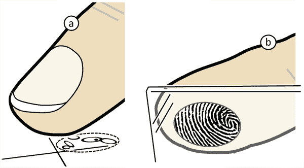

以上的信息其实也给按钮和其他控件之间的间距提出了要求。因为有的时候用户会用力按压屏幕，按压的面积会变大（但肯定还是小于手指的宽度），所以安全的间距要用手指的宽度减去按钮的宽度。

如果按钮是 7mm，以最大手指 22mm 来计算，这个数值就是 7.5mm，这是一个非常安全的距离。而如果我们以 9mm 的小手指来计算，这个数值就是 1mm，这就是最小的间距要求（约等于安卓定义的最小间距 8dp）。如果你觉得这段描述理解起来有些费劲，你可以参考下面这个图。

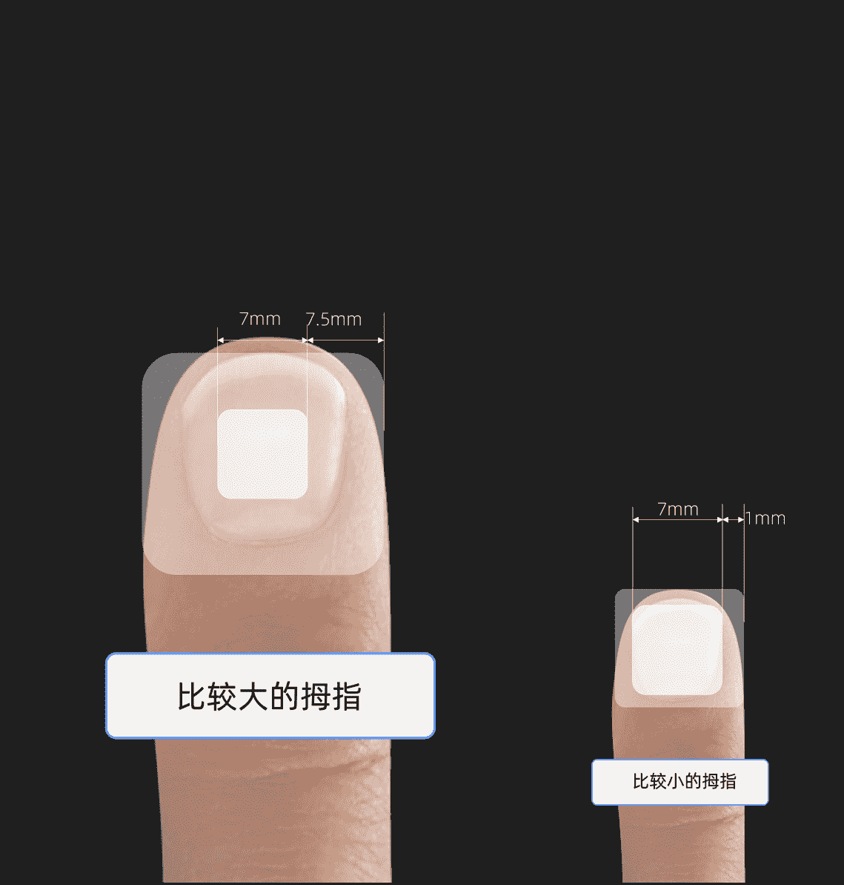

所以说按钮和其他交互控件的间距并不是和按钮大小成正比，而是和手指宽度相关。

好了，学到这儿，如果你之前没有从以上角度仔细思考过这个问题，那么我觉得你很有必要认真学学这节课的余下内容了。

## 握持对移动设备交互的影响

在系统理解触屏交互之前，让我们先看一下人是如何握持移动设备的。

如果是手机竖屏状况握持，基本上会是以下的统计情况：

1. 单手握持占 59%，其中靠拇指交互的占 49%，靠另一只手食指交互的占 10%；
2. 双手握持占 41%，其中仅依靠单拇指交互占 26%，而双手拇指都参与交互的占了 15%。

从这个统计中我们可以轻易总结出规律，那就是有 90% 的交互式依赖于拇指完成，其中 75% 的情况是单拇指操作。

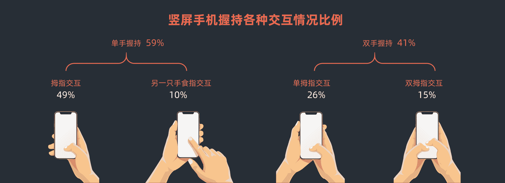

### 易操作区域

不同的交互手势意味着有不同的交互适宜区域，而且这个差别还是蛮大的。你可以参考下图。绿色区域是容易自然交互的区域，橘红色是努力可达到的费力交互区域，而红色是很难达到的交互盲区。不同人去握持同一款手机，适宜交互的区域也会有些许不同。

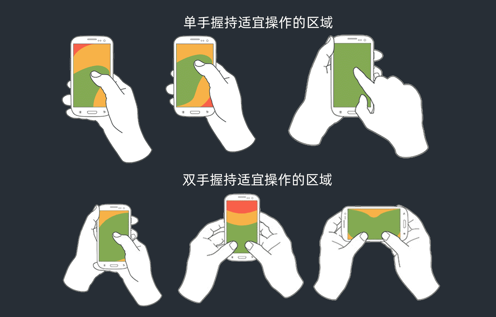

单手握持的情况更为复杂。以前手机屏幕较小的时候，我们握持的时候手指还能够到屏幕上半部分。但是随着手机屏幕越来越大，人的拇指基本上只能在屏幕下半部分操作了。如果我们要操作手机上半部分的屏幕，一般要借助于另外一只手。

单手握持的情况也分为左手握持和右手握持。有趣的现象是左撇子更偏重于右手握持，而右撇子更偏重于左手握持。下图是某调研机构做的研究。

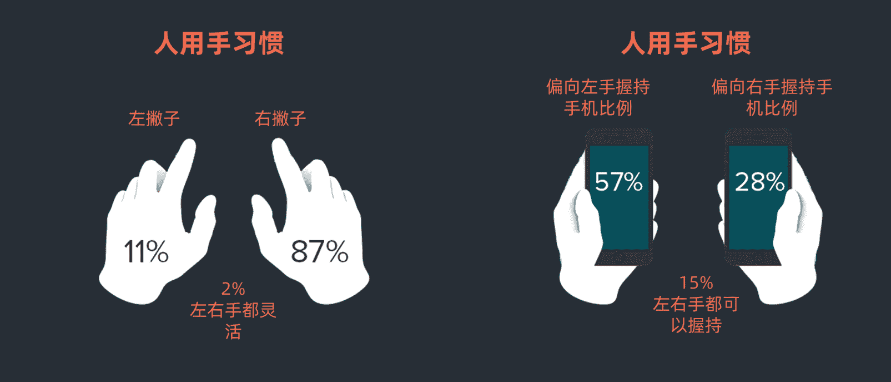

人们之所以有这种倾向主要是两个原因造成。

首先因为握持手机的动作并不复杂，大多数人会一边右手进行一些相对复杂的动作（比如用筷子吃饭），另外一边腾出左手来握持手机。考虑单手握持易交互区域的局限，复杂交互还是要依赖于右手的食指。

其次人有主视眼。大脑会优先采用主视眼信息，另一个眼睛主要用来扫视。多数人以左眼为主视眼，而左手握持更容易方便看左眼手机。

### 单手模式

提到单手握持，那么必然要提到单手模式。手机厂家考虑到很多人依然有单手操作屏幕上方的需求，于是有了单手模式的诞生。不同厂家有不同的处理方式，下图左边是华为的单手模式，右边是苹果的单手模式，你可以对比一下（华为单手模式的调出方式是底边缘横滑调出，苹果是底部导航条向下滑动调出）。

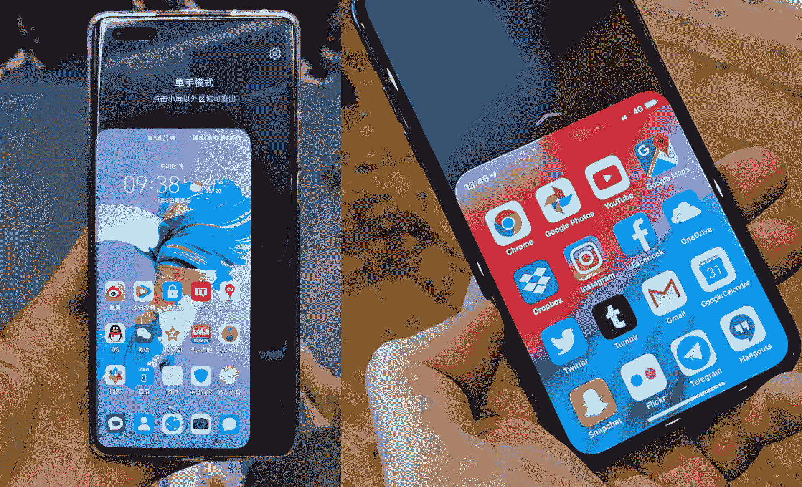

从人因方面来看，其实华为的交互更为理想。华为这种让整体交互区域下移的做法，考虑到了在屏幕宽的情况下拇指短的用户会操作不便的情况。而且从单手模式的调出方式上来说，底部横滑也比向下滑要容易操作，因为向下滑动的距离实在太短。

### 内容在上，操作在下

不管是哪只手握持，我们在界面布局设计的时候，都要兼顾考虑两种情况。所以对自然交互区域考虑的真实界面设计，会更倾向于下图的第三种。你可以从图中很清晰地看到一个信息，那就是上半部分内容，下半部分操作。

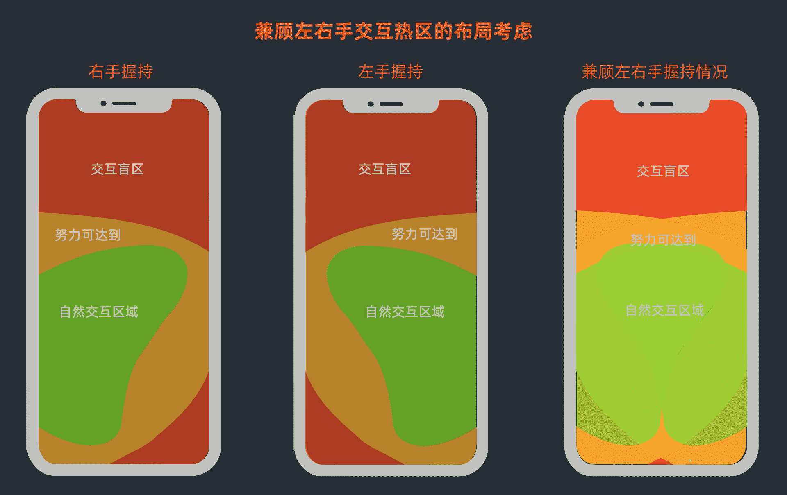

三星的 OneUI 最早清晰定义了“内容在上，操作在下”的规范并严格遵循。你可以参考下图：

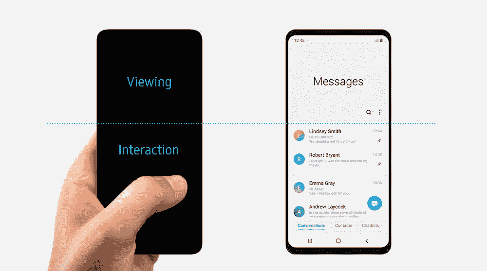

上半部分 1/3 的区域定义为浏览区，是不需要交互的区域（比如大标题会放在这个区域）。而下半部分 2/3 的区域是需要密集交互的区域（功能按钮、滑动列表、对话框和导航等会放在这个区域）。

如果你负责一个 App 的设计，而且主要的应用模式是竖屏握持，那你就要注意了，**常用的交互控件要放在靠下并且用户拇指可以方便够到的位置。**

### 侧边交互

在全面屏普及之前，我们几个华为设计团队的核心成员曾讨论过基于人的屏幕握持，全面屏的导航到底应该怎样做才能更符合用户的体验。是否一定要从底部开始滑动操作？

从上面左右手兼顾的易操作区域图中，你也许已经注意到了，其实底边缘操作是需要拇指费力的。在单手握持的方式下，拇指在屏幕上操作主要需要三个关节的参与。

你可以参考一下下面这张图。

1. 第一拇指关节最大弯曲可达 90 度，在操作靠近握持侧屏幕使用；
2. 第二拇指关节最大弯曲也可以达到 90 度，可以操作更远的范围；
3. 腕掌关节能够进行较大程度的屈伸和收展，能够完成对掌的运动，操作范围更广泛。

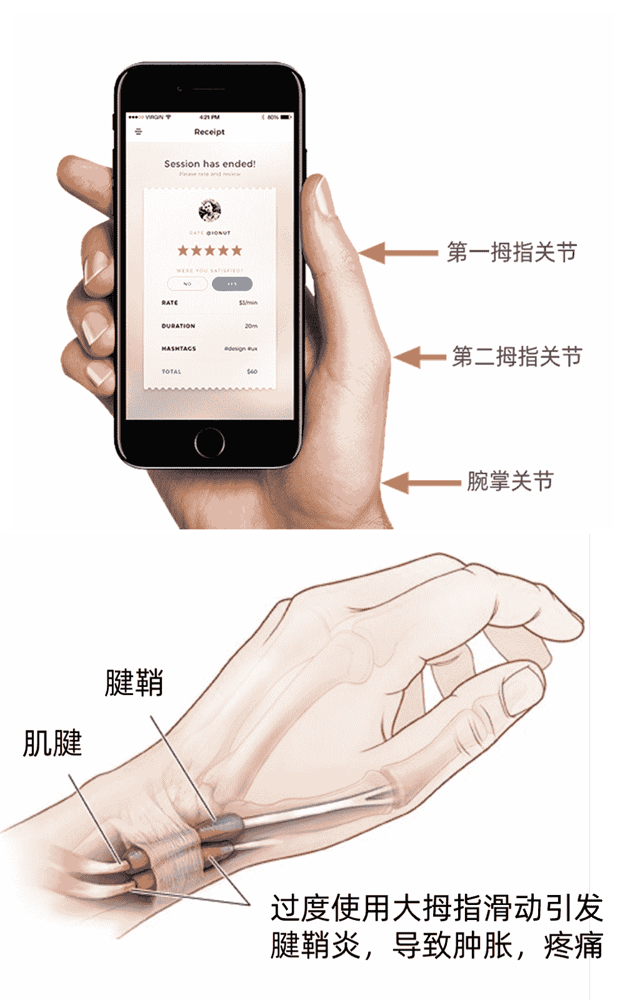

如果交互区域设计不合理导致我们过度使用腕掌关节，会造成这个关节处的腱鞘炎，进而引发不适、肿胀甚至疼痛。

如何能缓解拇指移动的距离呢？有无侧边交互的可能？

在华为的全面屏导航里，为了避免人的大拇指关节和肌肉过度疲劳进而导致腱鞘炎发生，特意设计了从侧边缘内滑返回，以及继续内滑停顿会调出侧边栏。

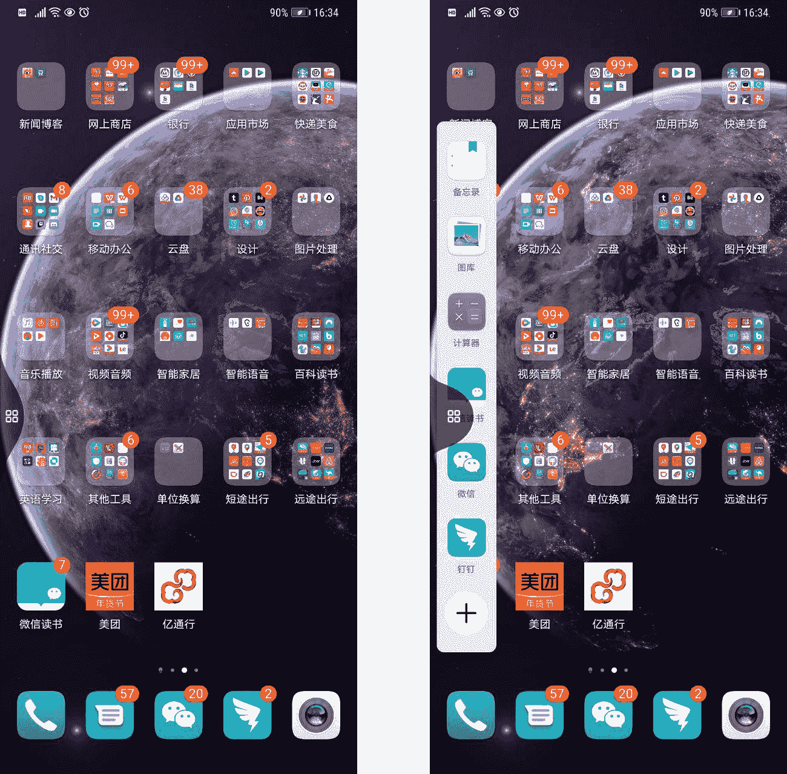

### 更大屏幕的易操作区域

当然如果你考虑的是更大的屏幕交互（比如平板），那么握持的方式以及易操作区域将完全不同。你可以参考下图，从操作区中你可以看出，平板的关键交互要靠近屏幕边缘而不是在屏幕中间，这个和智能手机的设计理念差别很大。

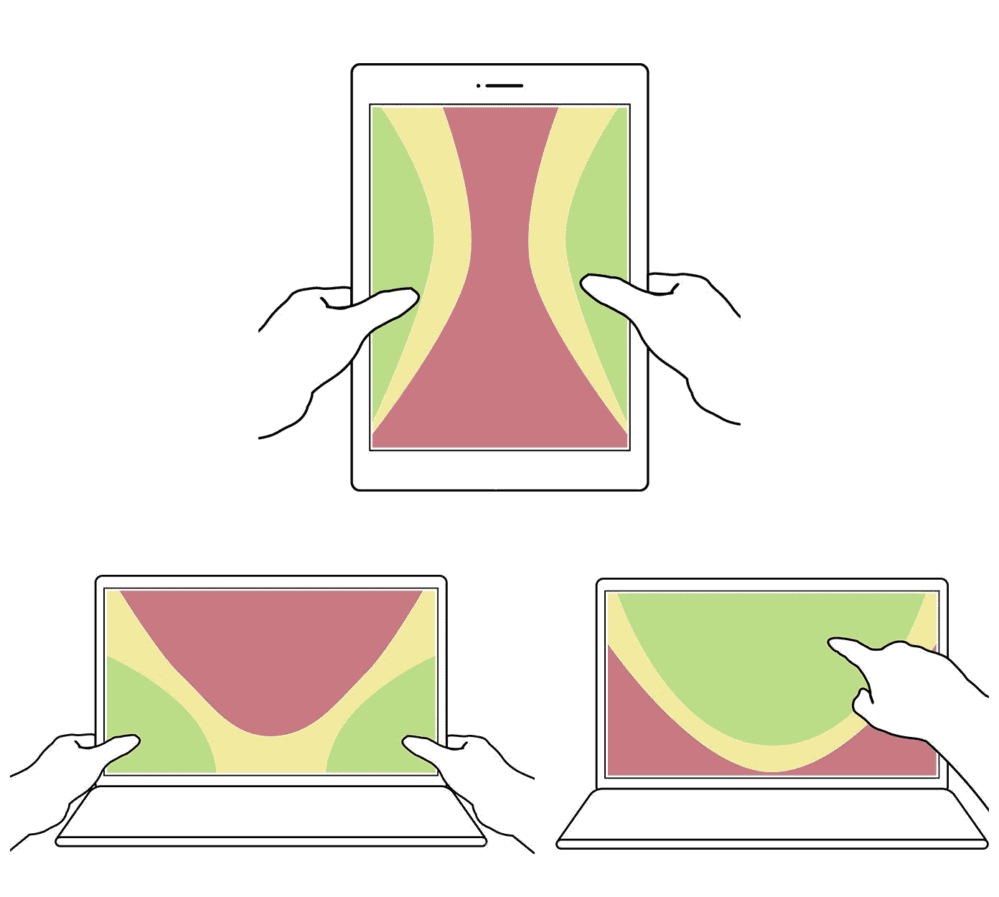

很多应用在设计 Pad 布局时，简单等比放大在手机上的界面布局，完全没有考虑到人在 Pad 上的易操作区的变化，于是设计就变成了不在乎用户交互体验的偷懒设计。

比如应用导航栏的设计。在手机上导航栏需要考虑易于拇指交互，所以得放在底部。但是在 Pad 的应用上，导航栏应该放在更适合交互的侧边。你可以参考下图印象笔记的应用设计。

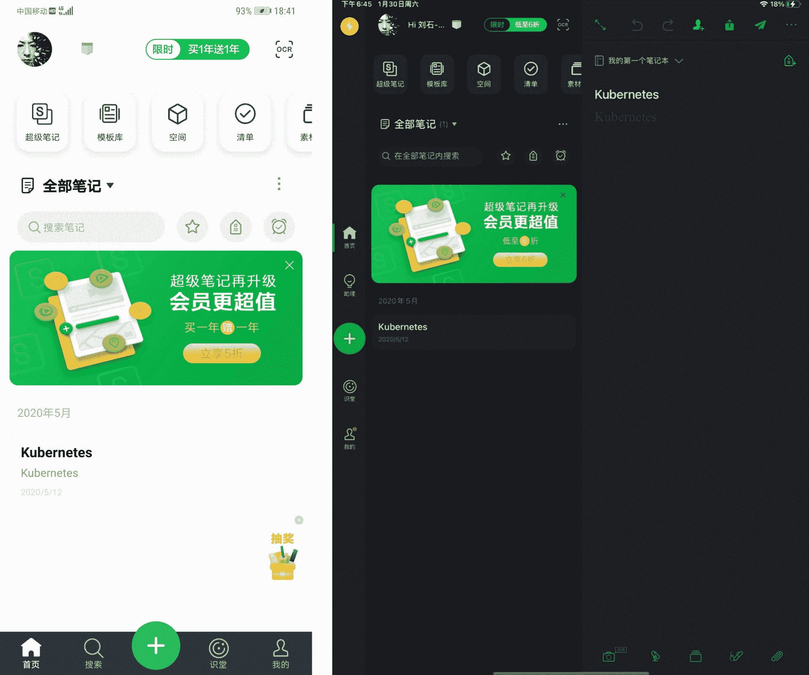

## 触屏交互的手势

前面我们聊了握持对移动设备交互的影响，但真正的交互还是要靠手指对屏幕的操作。屏幕的交互手势有很多种，自从触摸屏诞生之后，有很多人尝试去定义这些操作规范。下图是其中一种定义方式，你可以简单参考一下。

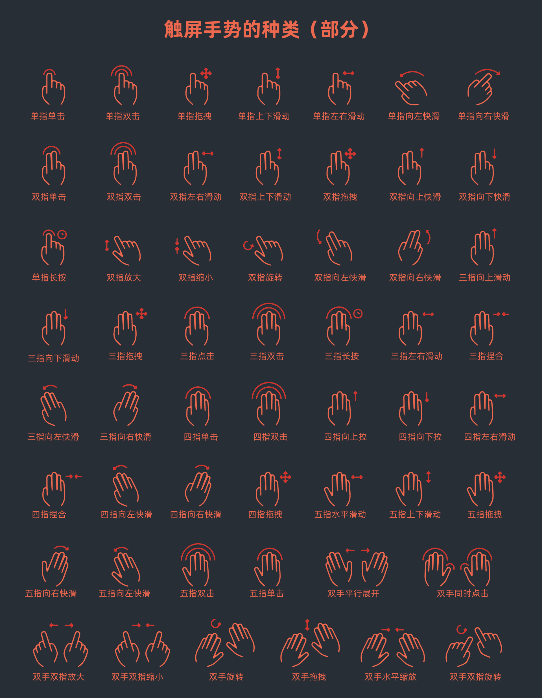

别看上面的触屏手势种类这么多，其实我们熟知的手势就是经典的几种。最常用的点击、滑动、长按都是单指。不管屏幕有多大，除非涉及捏合延展旋转的复杂操作，我们才会尝试用双指，但也很少会超过双指。背后的原因是什么呢？

### 触屏手势易用性原则

从人因的角度来分析，当我们手指在屏幕上滑动时，约束越小就意味着越省力越易用。把这个触屏易用性原则展开来说的话：

1. 交互判别面积越大越易用，你可以回想下刚刚讲的拇指大小对最小按钮的约束；
2. 滑动距离越短越易用，对滑动距离的约束越少越易用；
3. 因为人的手指在屏幕上滑动的轨迹很难做到直线，所以对操作方向约束越宽泛，越易用。当然，这里面还要平衡上下左右交互误判的情况。如果角度约束过小而恰巧有上下左右的滑动区别，会容易出现误触；
4. 在屏幕上操作的时间越短越易用，点击的易用性远好于长按，双击也没有单击易用；
5. 在屏幕上接触点越少越易用，也就是说参与交互的手指数量越少越易用。

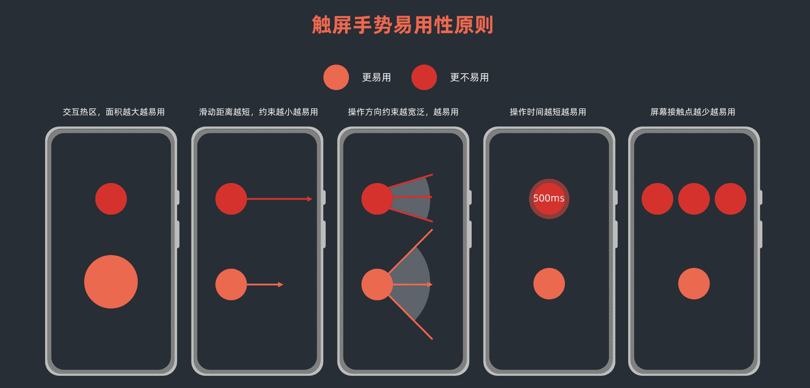

当然，除了以上的易用性判定标准之外，还有一些易用性需要结合感官的配合来看。比如有无视觉的提示，反馈是否及时，是否映射真实世界的物理规律，是否符合人的认知等等。

### 指关节交互

在华为的移动设备里有一个非常独特的触屏交互，那就是指关节截屏交互。具体交互方式如下图所示。为什么华为引入指关节作为截屏操作呢？

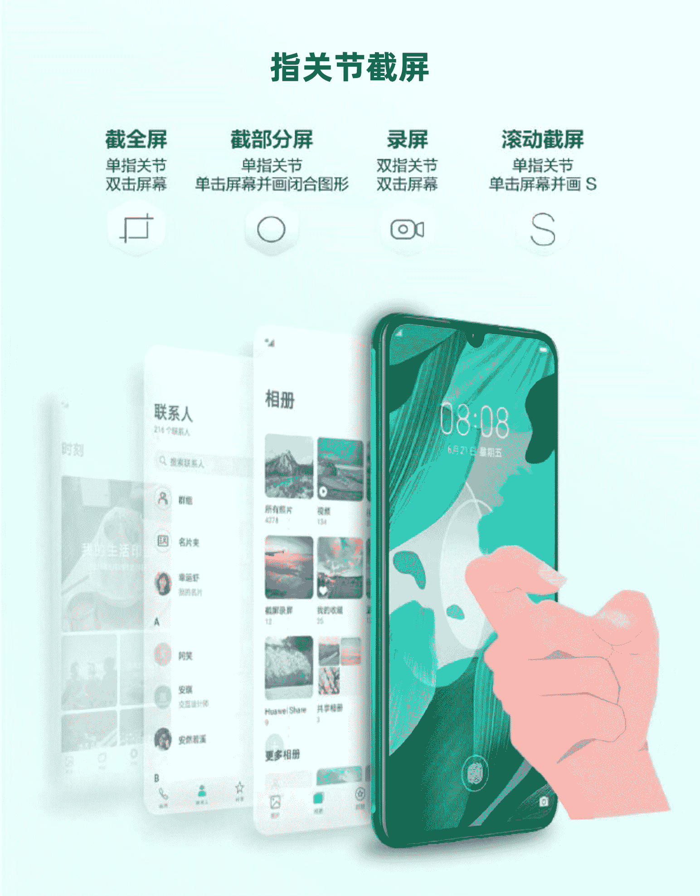

我们按照上面的触屏易用性原则来分析一下：

1. 指关节截屏在屏幕上任意位置敲击都可以。所以操作面积的约束几乎没有，非常易用。
2. 指关节仅检测指关节敲击的次数，不存在滑动距离，从距离维度来看易用性最高。
3. 由于不存在滑动距离，所以也没有操作方向的约束，指关节是在 Z 轴维度的操作。
4. 指关节的截屏判断周期非常短，连续双击的周期远小于长按，易用性适中。
5. 屏幕接触点仅是指关节一点，不存在多点触控，易用性高。

由此可见指关节截屏在触屏交互中，其实是一种非常好的交互方式。

## 总结

好了，讲到这里，今天的内容也就基本结束了。最后我来给你总结一下今天讲的要点。

今天我们主要讲了从人因的角度来理解触屏手势交互。我先从手指的尺寸谈起，带你学习了最小按钮尺寸，以及按钮和其他控件间距设计的原因。

然后，我们谈到了握持对移动设备交互的影响。在我们使用手机时，有 59% 的人会选择单手握持，在交互中 75% 的操作是通过单拇指来进行，左右手握持比例差不多是 2:1。这些数据让我们在设计界面布局的时候，要特别注意哪些区域是易交互区域，哪些是努力可达到的区域，哪些是不适于交互设计的盲区。

单手模式是考虑到了易交互区的一种设计。华为的单手模式比苹果的单手模式更为易用。三星的 OneUI（内容在上 1/3 区域，操作在下 2/3 区域）是一个践行易操作区的优秀设计。

华为的侧边导航返回和侧边栏交互很好地考虑到了减少腕掌关节的运动，以避免腱鞘炎的发生。

对于不同尺寸的屏幕来说，人的握持方式完全不同。所以你不能简单放大手机的交互布局在 Pad 上，要结合新的易用性区域重新考虑布局。比如在 Pad 上导航栏更适合在侧边而不是底部。

最后，我带你学习了触屏手势的易用性原则。触屏手势的易用性原则简单来说，就是交互判别面积越大、滑动距离越短、滑动方向约束越宽泛、操作时间越短、接触点越少，那么我们的触屏交互就越易用。华为的指关节交互很好地做到了易用性原则。

## 作业

最后，我给你留了一个小作业，从今天我讲的内容，结合你当下从事的设计，哪些触屏手势的优化设计可以改进呢？

同时也希望你分享一下，有没有什么 App 的触屏交互设计让你特别不顺手？
