# 29｜普适计算交互：如何和海量的设备进行交互？

 

你好，我是 Rocky。

今天我们来聊聊普适计算（Ubiquitous Computing）交互。之前我们课上讲的所有交互，都是和某一个设备之间的交互。但是你不难发现，现在随着我们身边的智能设备越来越多，这些设备之间还可以相互配合着给我们提供服务，人类的生活已经逐渐进入到多设备体验的时代。

据估算，到 2021 年底，全球约有 348 亿台智能设备连接到互联网（其中物联网设备 116 亿台，非物联网设备 232 亿台），平均每个人就有 5 台设备。

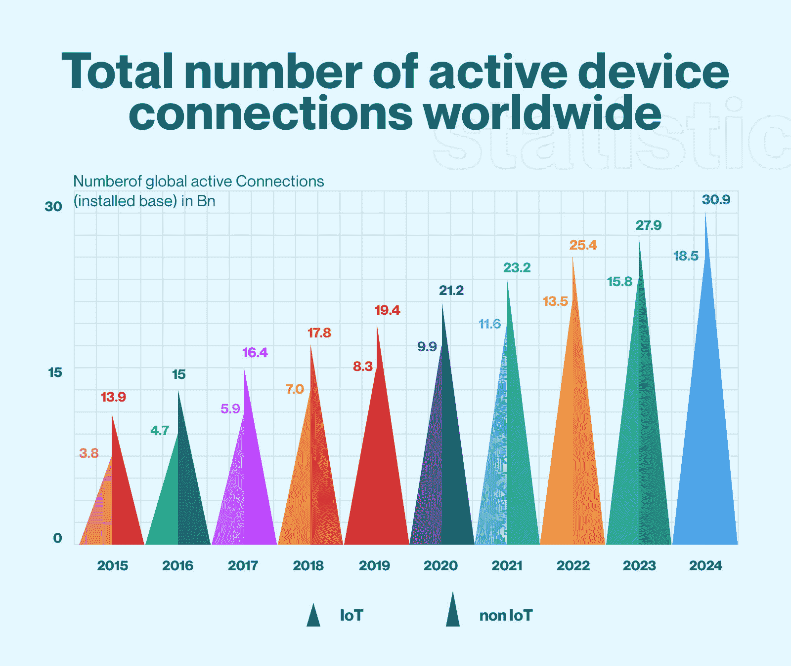

那如何进行多设备的交互设计呢？这里面的复杂度远远超过单设备的情况。你至少要从四个维度去思考，分别是**用户、设备类型、使用场景变化以及 3C 的设计及业务种类**。

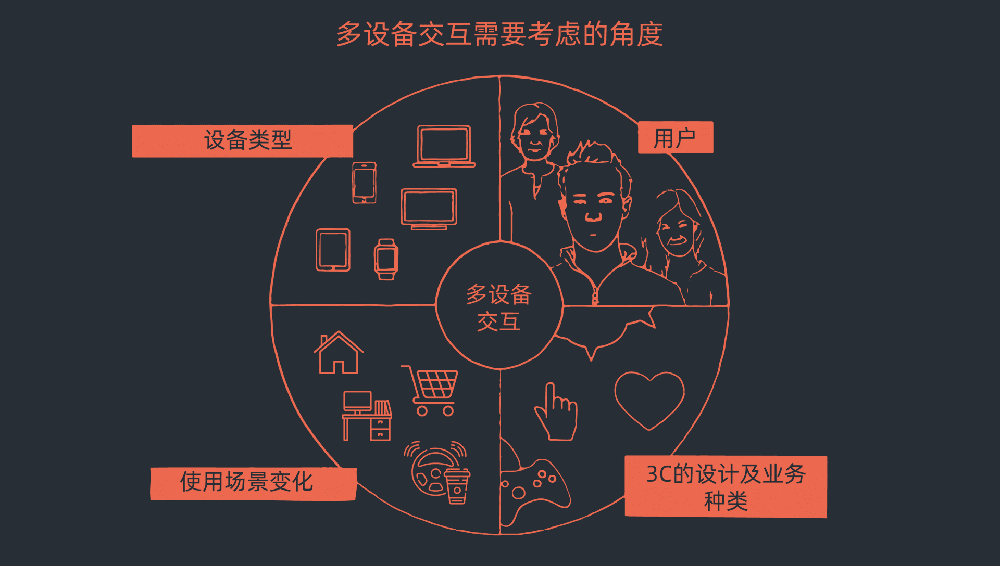

## 用户特点

在剖析这种复杂度之前，最先应该切入的点就是**对人的理解**。不同的人对多设备使用的习惯千差万别。在你急于设计之前，先要搞清楚你是在为谁，或者是在为哪些人做多设备交互设计。

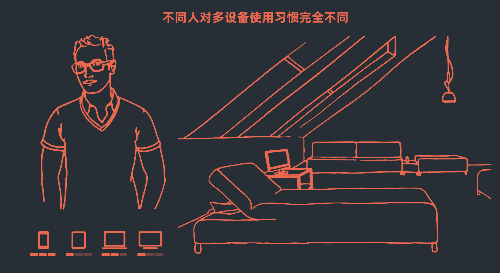

我之所以说是“哪些人”，而不是“哪个人”，是因为以前是一个人对应一个或者多个设备的情况，而现在有些设备并非清晰地带着私人属性，所以会存在更加复杂的多人对应多个设备的情况，再加上社交距离的考量，这种关系会是复杂并且动态变化的。**用户或者用户群画像，是我们在进行多设备交互设计时要做的首要动作。**

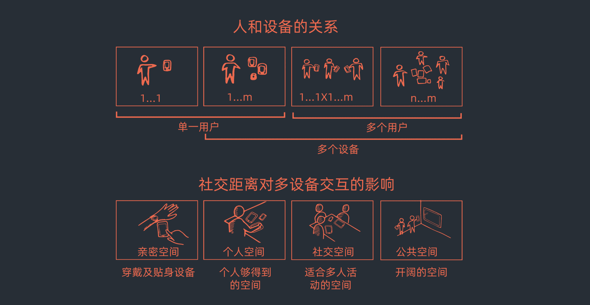

## 3C 框架模型

人已经分析好了，那我们怎么知道哪些最佳业务和最佳实践适合于我们分析的用户呢？在下面这个图中，我给你归纳了一些多设备一起配合给用户提供服务的种类，有些是多个设备同时提供服务，有些是做某些业务的连续性迁移。

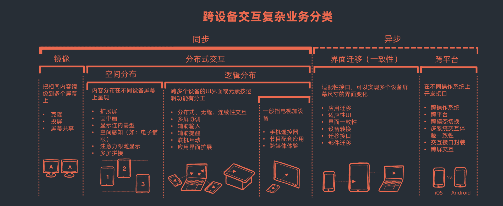

如果再次提炼上述业务的特点，可以用 3 个 C 来概括。也就是**一致性**（Consistent）、**连续性**（Continuous）和**互补性**（Complementary）。

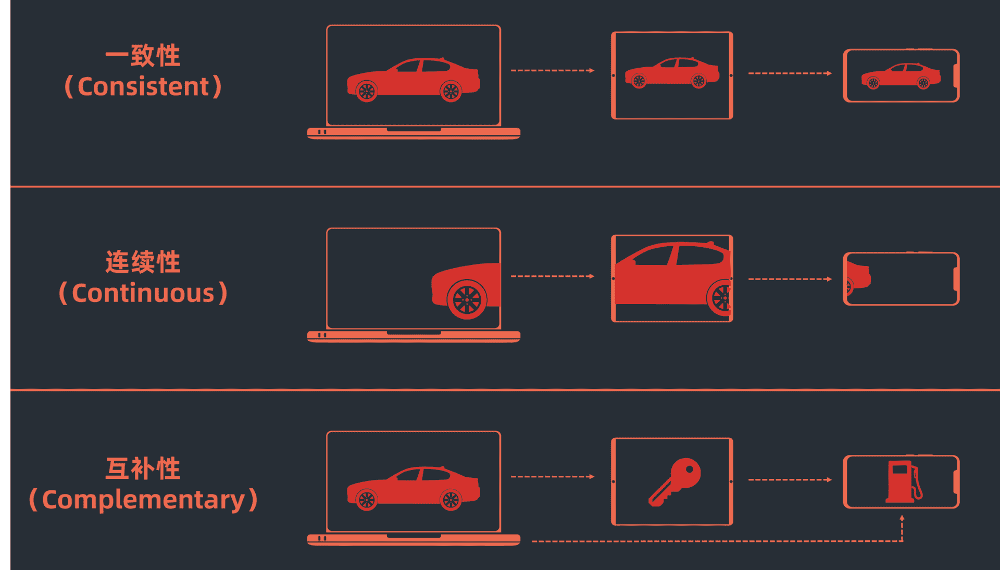

### 一致性

**一致性说的是业务需要根据设备的自身属性（主要是屏幕尺寸、形状、以及交互模式差别）进行相应的调整和映射，确保整体体验的一致性。**响应式布局就是典型的一致性运用。

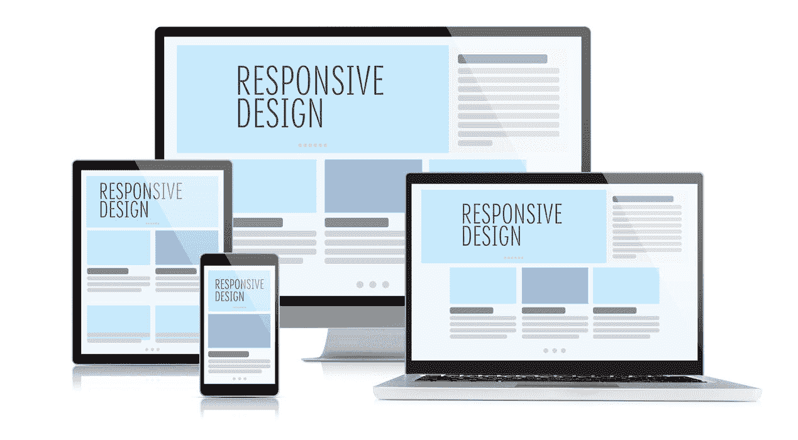

一致性绝对不是根据不同设备屏幕大小和比例做适应性的缩放或拉伸。因为分辨率的差异、人眼的视力局限以及千变万化的屏幕形状，如果我们只是简单地缩放内容，实际上就等于放弃了易读性和舒适性。好的一致性设计要保证不管是在什么尺寸的屏幕上，人眼看起来都应该是舒适自然的。

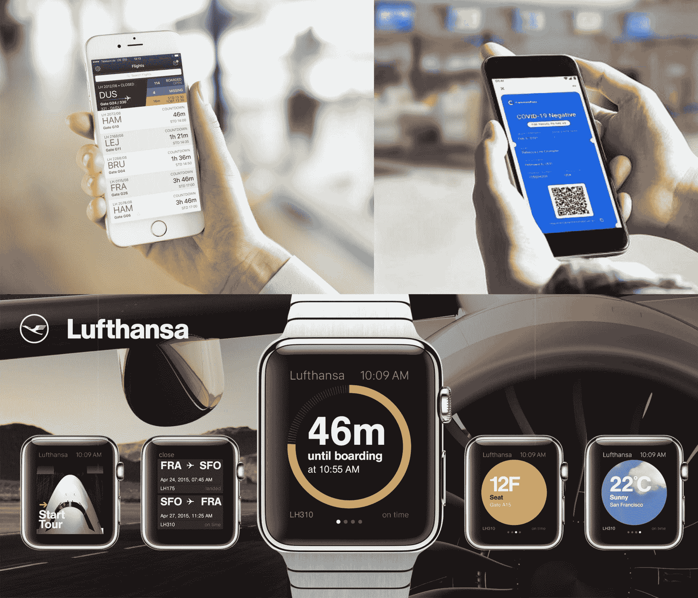

以响应式界面的布局调整为例，你要确保显示的一致性是有套路和规律的。下面我列出了比较常用的一些示例：

1. 可伸缩的内容区块；
2. 能够适应比例变化、甚至可以智能裁切的图片；
3. 适应屏幕尺寸的边距进行布局重排；
4. 能够自动隐藏部分显示的内容，在小屏上简化信息呈现；
5. 可自动排布的内容区块，比如设计一些栅格档位做一些自动排布的模板套换；
6. 能自动适配的控件，比如导航和菜单隐藏、位置的调整，或者干脆可以改变形态。

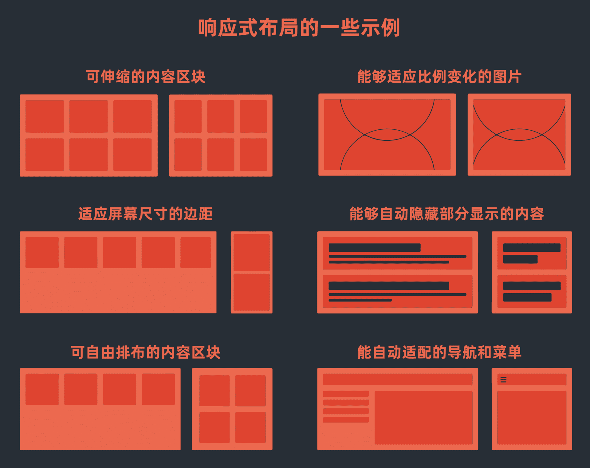

除了显示的一致性，**操作体验一致性也很重要**。比如我们要把鼠标的点击和触屏操作体验做好对应，避免用户在切换不同设备后，操作体验不够顺畅和自然。比如在下面微软的操作规范里，你可以看到微软把触屏的手势和电脑鼠标的操作做了符合用户习惯认知的映射。

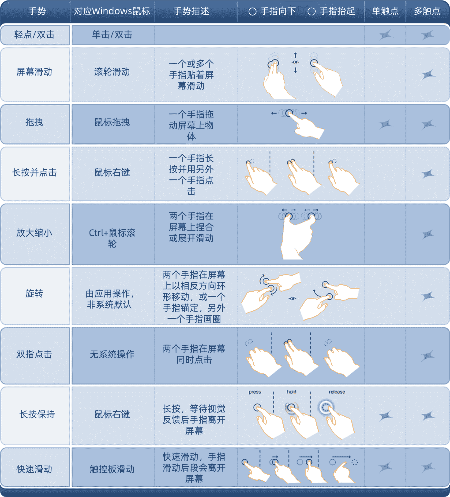

不过，一致性还只是多设备交互的基石。如果每个设备之间没有做到相互配合，缺乏多设备在任务上的协同性，那么用户仅仅是感觉起来一致而已，这并不是一个合格的多设备交互。协同性主要通过连续性和互补性体现。

### 连续性

连续性说的是一个业务在一个设备延续到另外一个设备上，类似设备间的“接力赛”一样，比如换了个设备后我们的文档继续编辑、电影可以继续观看等等。

对于一个 App 应用来说，如果业务数据都在云端，那么实现连续性并不难。但如果是未接入云端的设备投屏、文件共享，如何快速达成自然的连续性交互，就成了一种用户体验上的关键考量。下图的**轻扫**就是一种快速达成目标的交互手段，但前提是双方设备都已经明确了当前的交互意图，并且已经连接就绪。

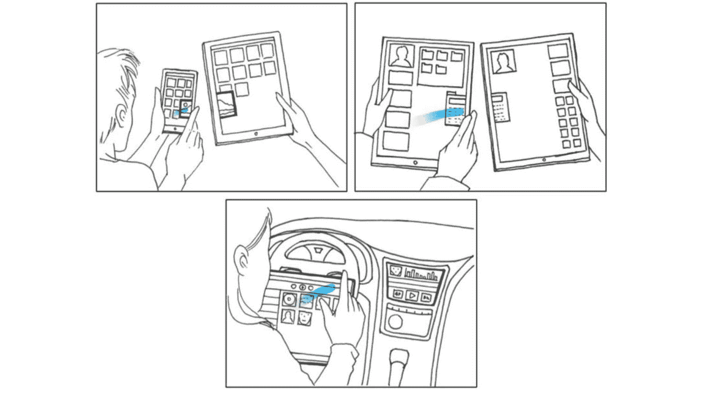

华为的“一碰传”也是一个不错的连续性设计，它给信息在不同设备的流转提供了一个简单的触点：**碰一碰**。通过 NFC 技术支撑下的触碰来实现多屏协同、音视频电话的接续、文件照片的传输等连续性业务。

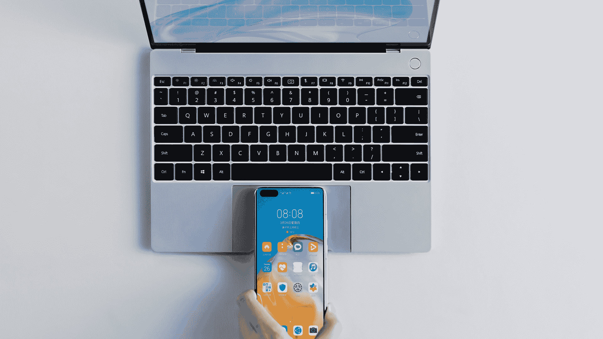

当然，碰一碰也并非一种适用于各个场合的连续性交互触发手段。如果对方设备比较远，近场通信技术 NFC（碰一碰背后的技术）就爱莫能助了。这个时候，超宽带通信（UWB）技术就提供了另外一种远距离指向性交互的可能。

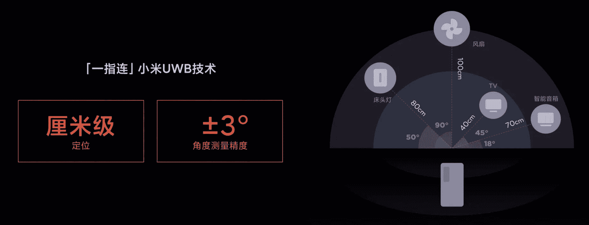

**指向性交互**一般适用于家里支持连续性或互补性的设备数量较多、位置不同，需要快速选择意向设备的应用场景。但这个技术严重依赖于对目标设备的距离测算和角度测算的精准度，如果用户抬手多次试图连接 A 设备，结果连接到的是 B 设备，就会非常地沮丧。

其实，关于内容共享的自然交互设计，你不必拘泥于以上情况，我下面再给你两个例子，你体会一下。实现连续性的技术有很多种，关键看你是否在体验设计上有足够的脑洞，能够利用技术找到自然的交互手段。

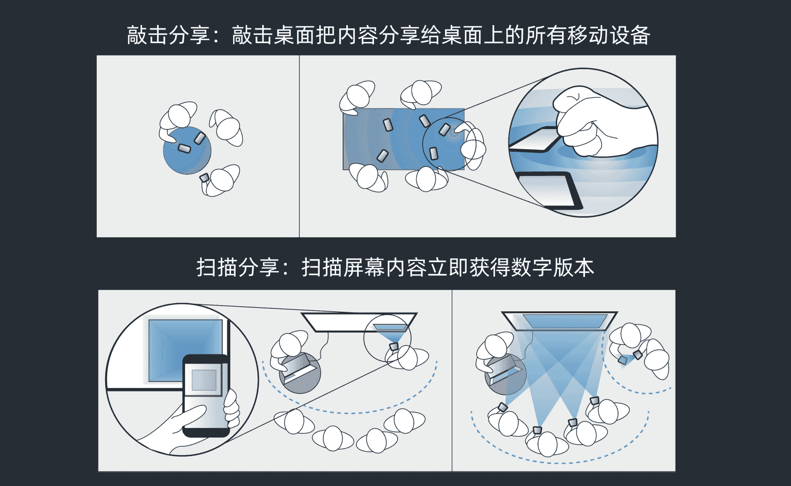

### 互补性

互补性这是一种相对高级的玩法，要求**知道每个设备各自的强项，然后强强联合**，提供更加酷炫的体验。比如智能手机可以做智能家居里所有电器的遥控器，还有苹果的随航（Sidecar）功能等等。

互补性交互中，多个设备的关系一般分为两种：一种是**合作关系**，同一时刻两者有不同内容和不同侧重，互为补充；一种是两个设备之间有明显的**主控关系**，例如设备 1 给设备 2 提供输入，或者设备 1 控制设备 2。

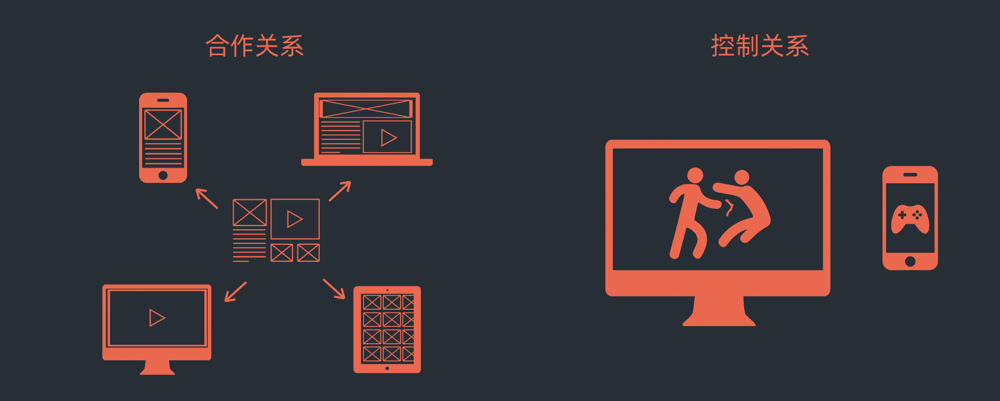

给你举个例子，比如在手机上，运行多任务其实要依靠后台的任务切换器。因为手机屏幕相对较小，最佳体验是单任务运行。

但如果把手机屏幕投到电脑等大屏幕设备上，电脑优秀的处理性能和巨大的屏幕空间，已经没有必要约束着自己只显示一个前台单任务了。因此手机的很多藏在后台的任务，在电脑上可以并行放在一起，实现手机上无法实现的多窗口业务特性，如下就是华为在 MateBook 上运行手机的多任务示例。

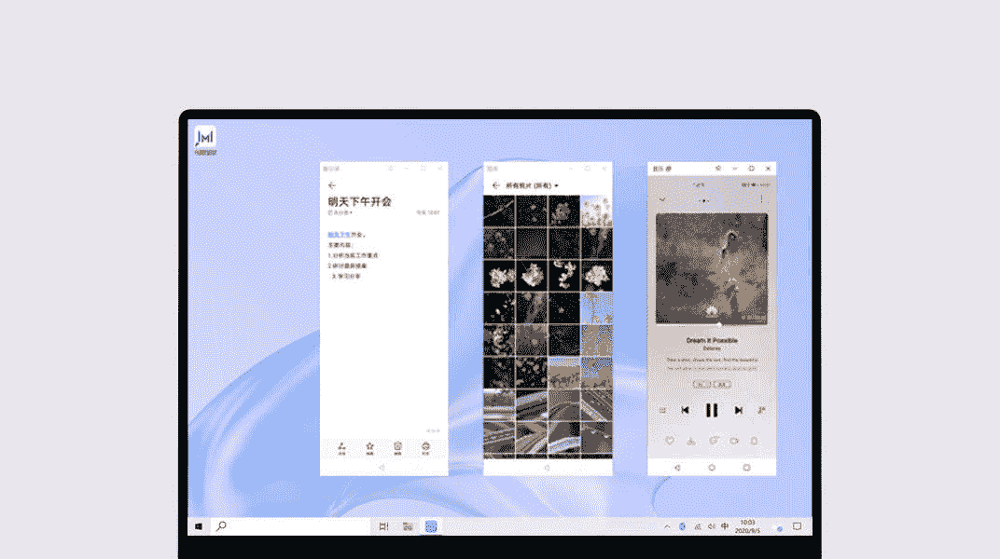

再比如电视屏幕适合沉浸式内容欣赏，而手持移动设备更适合交互式体验。在下图中电视上一个普通的做菜视频，在平板上播放的时候就会直接给出对应材料的附属说明信息和购买链接，用户可以直接触屏采购这道菜的所有原材料。

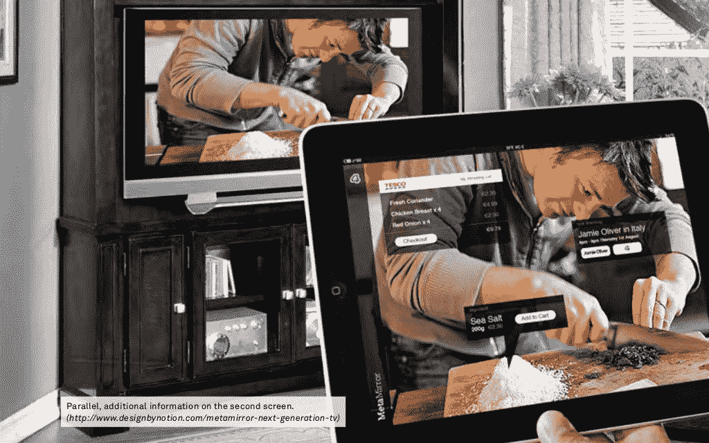

## 上下文的环境考虑

考虑到了人，也考虑到了交互业务的设计，我们还应该在**环境（Contextual）理解**上下功夫。让设备理解环境，这背后就要有很多场景识别、用户意图识别的人工智能技术作支撑了。

人机之间的互动，不一定需要非常强烈的视觉和声音的提醒，更重要的是要让机器识别当下的环境状况，针对性地选择和人的交互方式，比如当下光线如何、是否嘈杂、人和什么设备离得最近、是否有其他人在场等等。

就比如我在前面第 27 课谈多模态交互的时候提到的谷歌的 Soli 技术，它运用了毫米波雷达技术能够很好地感知上下文环境。它可以检测到：

1. 是否有人靠近？

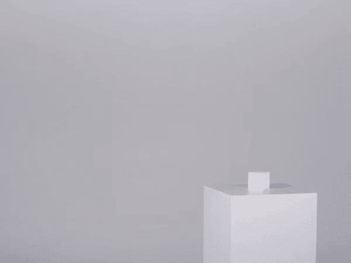

1. 是一个人还是多个人？

1. 靠近后是站着，还是坐下？

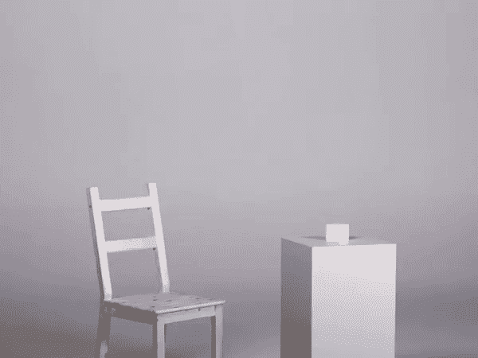

1. 靠近后，是背对着、还是面对着设备？

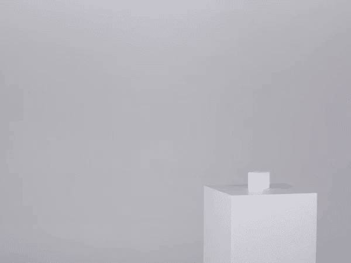

1. 是否面对着，还侧身仔细看这个设备？

1. 又或者是否尝试伸手去和这个设备进行手势交互？

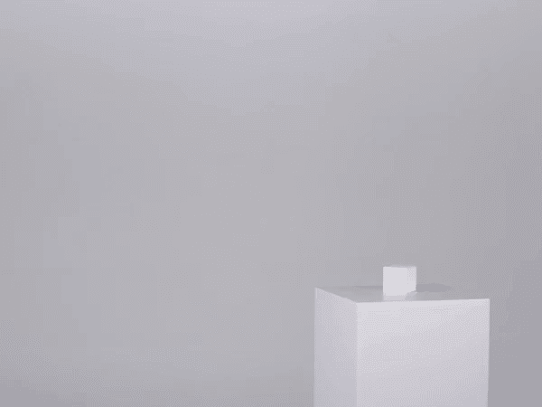

那落实到我们具体的多设备设计中，如何去利用这种环境感知能力呢？

举个非常简单的例子：苹果为什么用 Apple Watch 来解锁 Mac 而不用 iPhone 来解锁呢？因为前者是私密设备或者是个人设备，后者不是。从体验上来说，Apple Watch 除了洗澡几乎都带在手上，iPhone 就未必了。

如果 iPhone 也能自动解锁 Mac，可能会出现到你家拜访的朋友，用你的 iPhone 解锁你的 Mac 看到隐私邮件的情况。

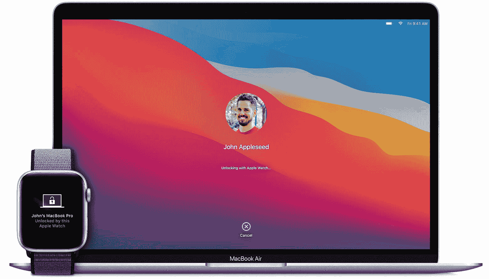

再比如，如果你喊了一声：“Hi，Siri”，你是希望哪个设备响应你呢？是距离你最近的设备？还是与你问话中提及的业务最相关那个（比如：调低电视音量）？还是一个连着你蓝牙耳机的设备？不管是哪种，你都不希望所有的智能设备都同时响应你：“我在！我在！”，因为这会让你崩溃的。

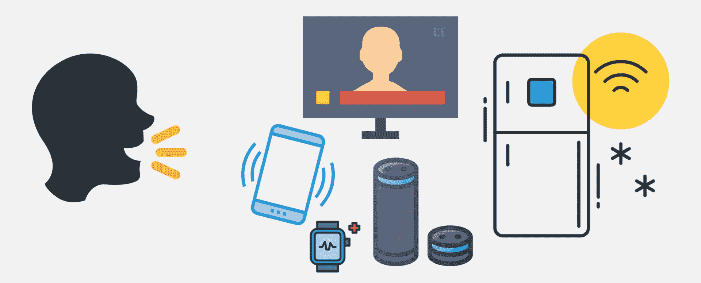

## 平静技术原则

让你崩溃掉的原因是，**我们的注意力通道无法承载过多的信息输入**。

在这个万物互联的时代，如果我们还固守着传统一对一的交互设计原则，你很快就会发现，用户会被淹没在各种弹窗、对话框、通知和提醒中应接不暇、无所适从。

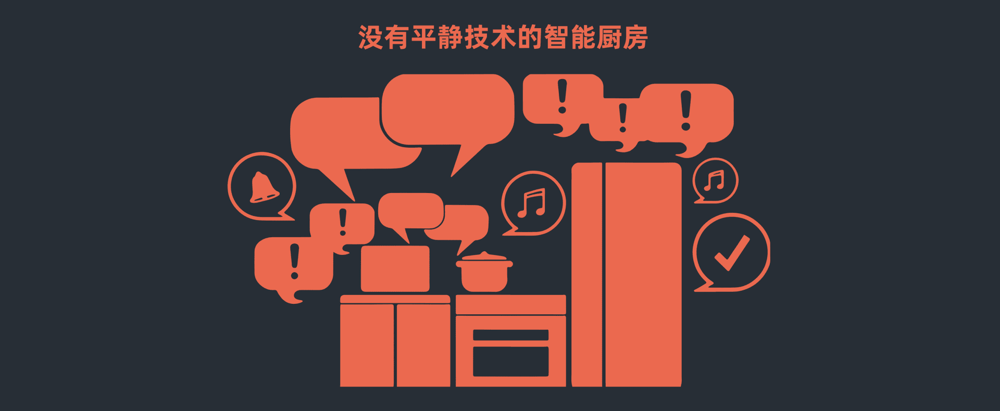

这里面的本质变化是设备的数量在翻倍地高速增长，但是人类注意力的带宽是极为有限的，而且生物进化的缓慢速度相比于设备的增长、处理能力的提升几乎可以被定性为停滞不前。

因为注意力被各种设备透支占用，我们早已从之前的从容处理任务，逐渐过渡到被高负荷信息压得喘不过气的时代。

在这种背景下我们不仅得注意单人和设备的互动，还要增加大量的设备与设备的互动，以避免人在中间成为信息转换的瓶颈。

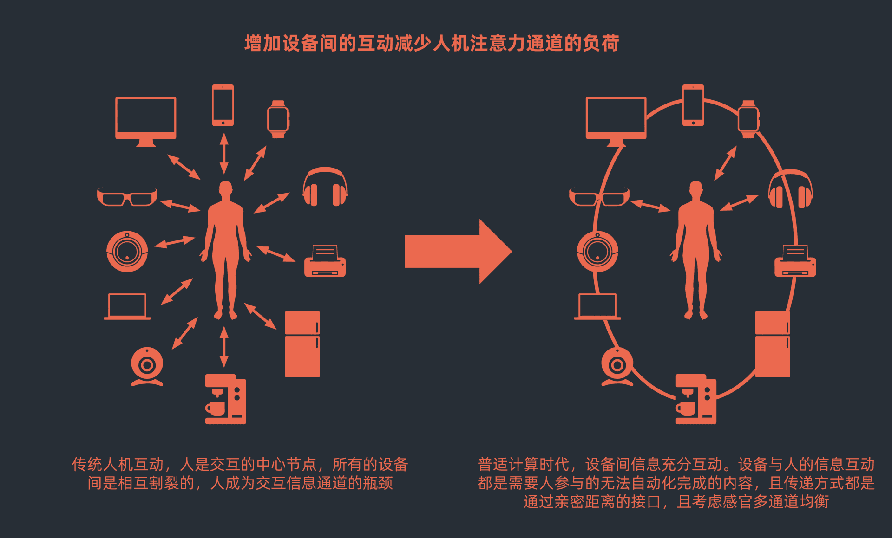

我们需要一种让人们花费更少精力去实现目标的人机交互模式。平静技术就是基于这个目的而诞生的设计指导原则，主要包括以下四个方面。

首先，我们应**尽可能减少设备对人的骚扰和流连忘返式的吸引**，即用即走，不要过多耗费用户的注意力，快速处理完事情后用户应立即撤回注意力做别的事情。

我举个例子，就如以前的传统水壶烧热水，会有鸣笛声响起，让你从客厅急速地跑到厨房关火提起水壶。但是现在的电水壶只要开始烧水，你就完全不用管它了，甚至再往后它可以做到自动帮你沏茶，帮你把茶端到你面前。

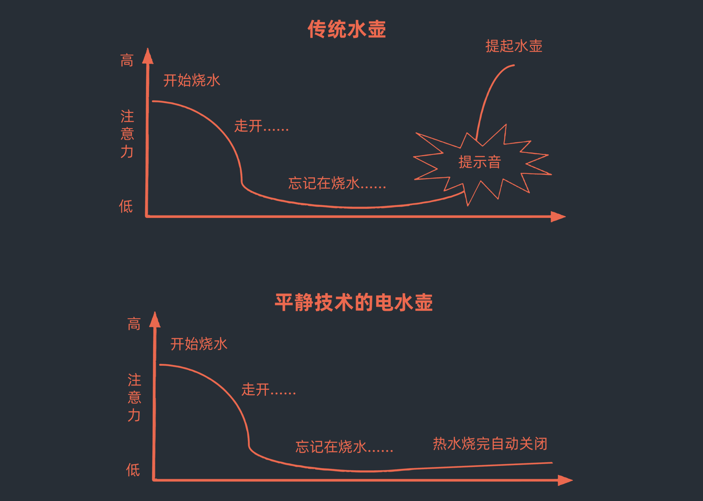

其次，**低带宽的信息编码呈现可以用提示灯，或者是简单、短促而不刺耳的声音，**不要用复杂的图形界面和音乐铃音来提醒用户，特别是根本不重要的信息。

比如设备后台录音启动后，屏幕的一角要有一个小图标提醒录音进行中；带有前置镜头的设备，在后台开启摄像头时需要有轻微的小灯闪烁提醒用户摄像头正在工作。你可以参考下面这个坐姿提醒设备，它通过振动来提醒用户。

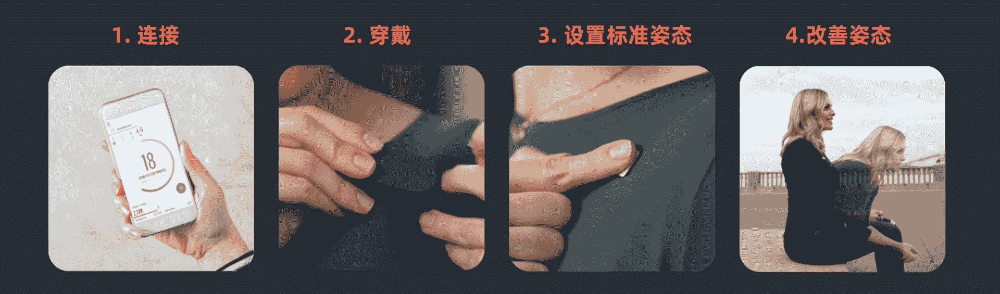

再者，**要善于判断用户的注意力通道的空闲状态，选择更通畅的通道来传达信息。**比如当听觉通道相对通畅时使用听觉，当用户的触觉通道通畅时选择振动反馈来提醒，如果手被占用选择其他可能的交互点。

举个例子，用户洗手的时候就不要非得用触觉通道让用户感知到烫，才赶紧旋转水龙头把水调冷，我们可以用下面的这种通过灯光色彩暗示水温状况的设计来提示用户，这就是通过视觉通道来传达本应该由触觉通道来感知的信息。

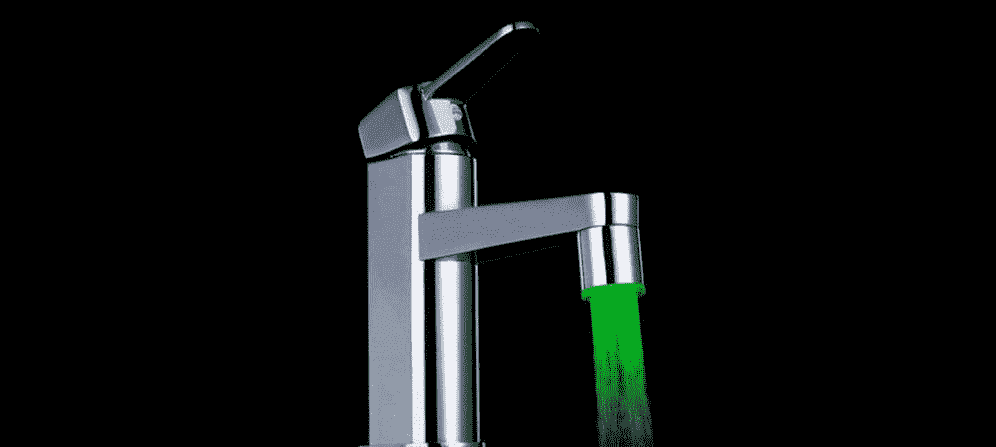

最后，**要明确什么是用户的主要目标，什么是次要目标**，什么是优先级高的任务，什么不是。所有的事情都要聚焦在用户的核心任务上，其他的辅助性任务也应该为核心任务服务。

## 总结

好了，讲到这里，今天的内容也就基本结束了。最后我来给你总结一下今天讲的要点。

今天我们谈的话题是多设备交互，也可以称为普适计算交互。

多设备交互，需要考虑以下几个方面：

1. 用户特点上，我们要考虑不同用户有不同的多设备使用习惯，可能存在多人对应多设备的情况。
2. 设备多样性方面的考虑，概括为 3C 框架，也就是一致性（Consistent）、连续性（Continuous）和互补性（Complementary）。
3. 上下文的环境感知，在多设备交互中也非常重要。比如人物状态、周围环境状况、隐私状况等。
4. 平静技术原则，主要是指通过强化设备间的信息流动和自动化处理，最大程度减少人的注意力负荷。在这个原则的使用过程中，你需要尽量减少设备所需的注意力、用低带宽的信息编码呈现、让多通道负荷均衡以及主次目标清晰。

## 作业

最后我给你留了一个小作业，从今天我讲的内容，试着思考一下，如何根据今天学习的平静技术原则，来优化你的产品设计？
