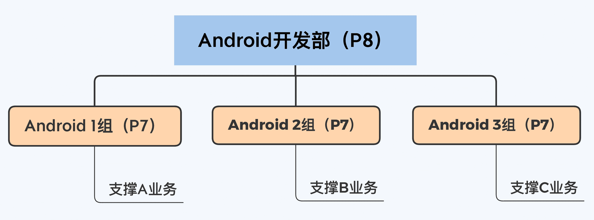
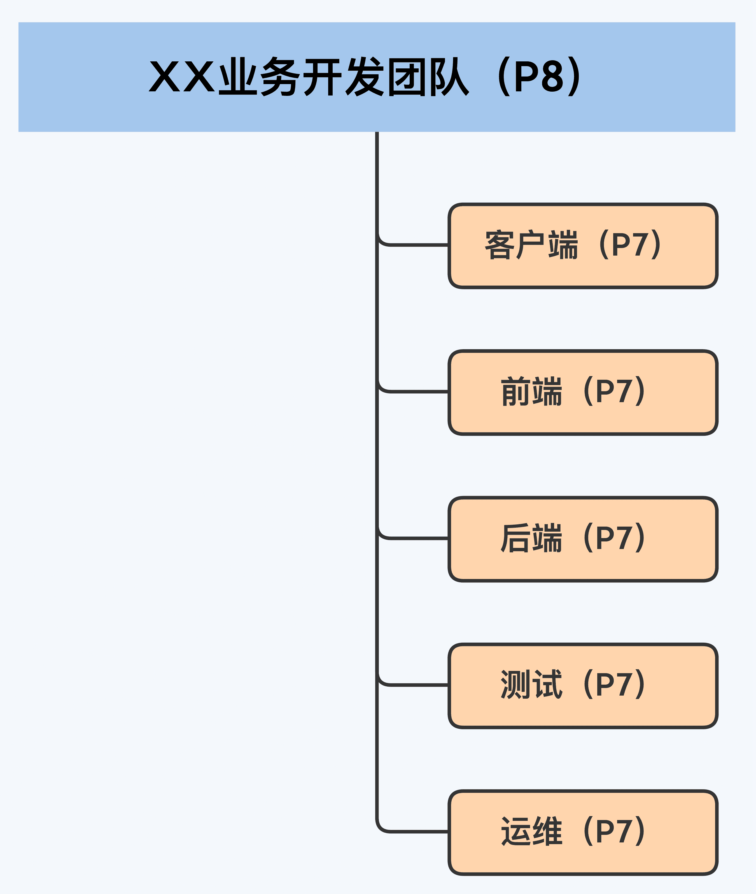
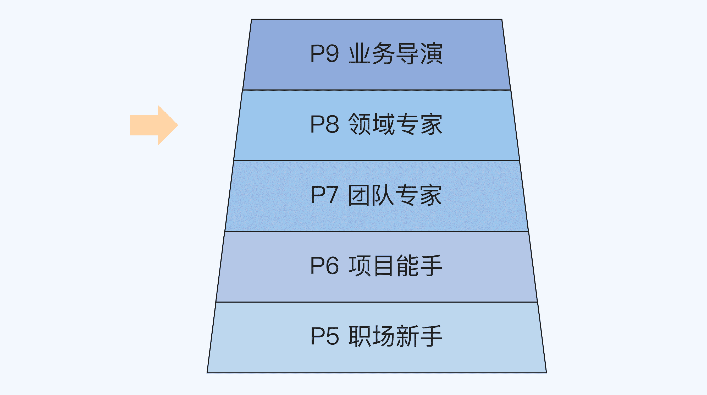
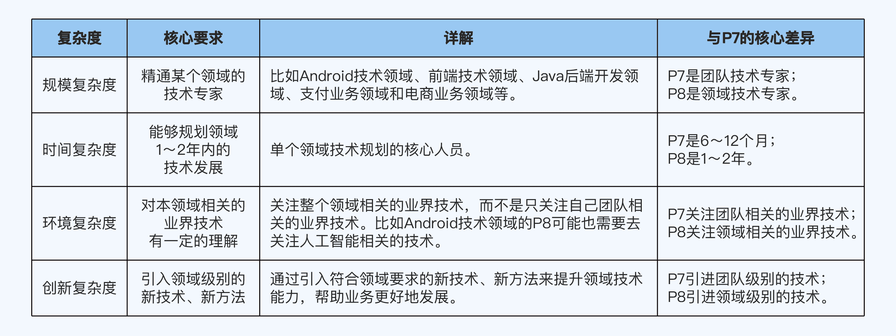
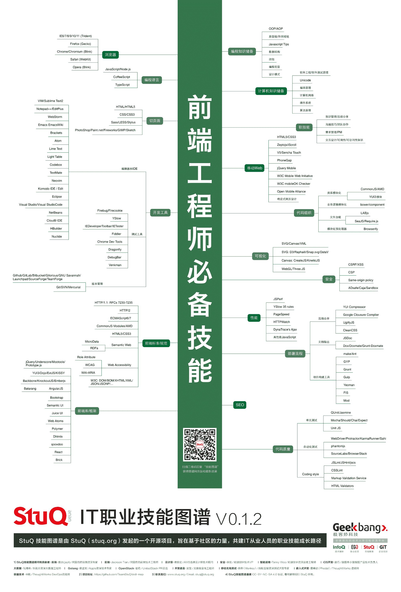
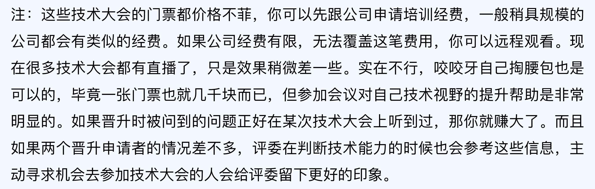
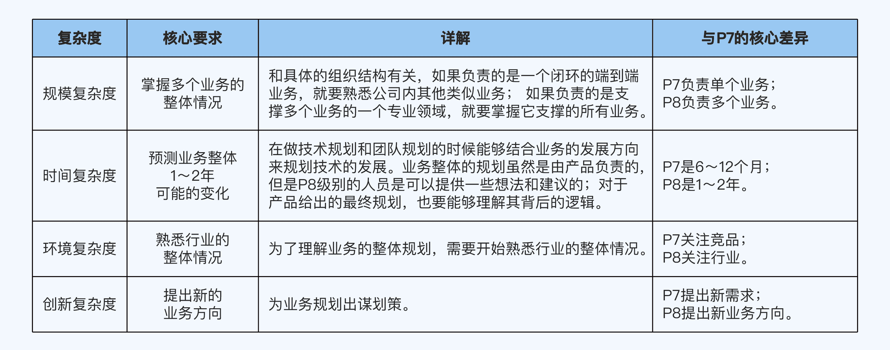
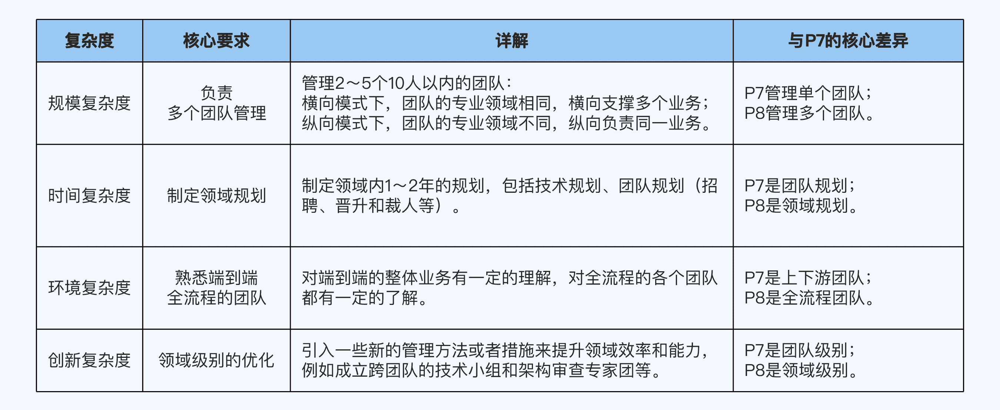
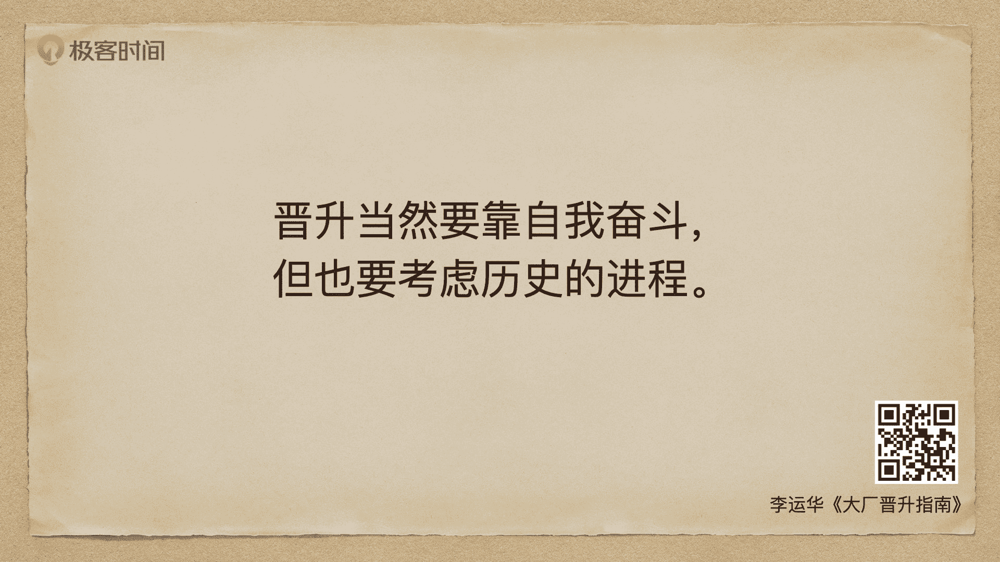

# 10 | P8提升攻略：怎么成为有影响力的“领域专家”？

 

你好，我是华仔。

在第 6 讲中我曾经介绍过，P7/P8 是同一档次的职级，核心能力都是指挥团队，区别只在于团队数量是一个还是多个（一般是 2～5 个）。

但是在真实的职场环境中，P7 级别就像“永恒钻石”段位，大部分人升到 P7 就很难再往上晋升了。为什么 P7 和 P8 的核心能力一样都是指挥团队，而 P7 升 P8 却这么难呢？指挥一个团队和指挥多个团队的区别到底体现在哪？

## 从团队专家到领域专家

我们还是先剖析一下 P8 的要求。P8 对应的工作年限一般是 8 年以上，核心能力要求可以用一句话来概括，**指挥多个团队达成目标**。

这些团队的构成不是随机的，而是跟业务发展阶段和团队规模大小有关，通常有两种构成模式。

第一种是**横向模式**，指的是 P8 带领的团队的专业领域相同，横向支撑多个业务。

这种模式常见于业务成熟期或者规模比较大的团队。比如某业务线所有 Android 开发人员都由 1 个 P8 带领，然后拆分为 3 个 Android 小组，每个小组支撑不同业务的 App 开发。团队结构示意图如下：

第二种是**纵向模式**，指的是 P8 带领的团队的专业领域不同，端到端地纵向负责同一业务。

这种模式常见于新业务初期或者规模不大的团队，很多 BAT 出身的 P8 到创业公司担任 CTO 或者技术总监时，就会采用这种模式带团队。比如 1 个 P8 负责带某业务的所有技术团队，包括客户端（含 Android 和 iOS）、前端、后端、运维和测试等。团队结构示意图如下：

现在，我们再对比一下 P7 和 P8 的核心能力要求就会发现，虽然看上去只是从“**单**个团队”到“**多**个团队”的一字之差，但是在影响力上却发生了本质的改变，主要体现为两点。

第一，专业影响力范围从团队内提升到领域内。

P7 带单个团队，而 P8 是带单个领域的多个团队。如果 P8 带的是横向模式的团队，那么负责的就是单个专业领域；如果带的是纵向模式的团队，那么负责的就是单个业务领域。

这就对 P8 的**技术水平**和**业务理解**提出了更高层次的要求。

第二，组织影响力范围从单个团队提升到跨团队。

P7 只需要指挥自己团队内部的人就行了。但 P8 不同，虽然已经带了 2～5 个 10 人以内规模的团队，但是要想实现目标，光靠他们有时还不够，P8 还需要指挥这些团队以外的人。比如有的项目涉及产品和运营配合，有的需要客户端、后台、运维一起协作。

这在一方面对 P8 的**管理手段**提出了更高层次的要求，另一方面也把晋升**跟业务目标绑定**起来，增加了很多不确定和不可控的因素。

总的来说，P8 的主要提升目标是**成为有影响力的领域专家**。接下来，我就从技术、业务和管理三个维度一一展开讲解。

## 技术：精通领域相关技术

我们先看技术维度。

P8 级别是技术能力的顶峰。在 P5～P8 的晋升过程中，考察核心都是技术能力。业务能力和管理能力只是加分项，只要技术不行，业务能力和管理能力再好都很难晋升。（相比之下，从 P9 开始，对业务能力、管理能力和业界影响力等维度的考核比重会大大上升。就算你技术很厉害，只要业务能力和管理能力不行，同样很难晋升。）

P8 级别的技术详细要求，我总结在了这张表格里：

### 技术深度 + 领域相关的技术宽度

那么 P8 提升技术能力的关键是什么呢？答案是技术深度和技术宽度齐头并进。

如果只有技术宽度，可能给人一种比较飘的感觉，成为“什么都知道，什么都不懂”的 **PPT 技术专家**；如果只有技术深度，技术视野太窄，就难以跟上业界技术的发展步伐，无法做出合理的技术判断、选择和规划。

P7 虽然也在技术深度的基础上增加了技术宽度的要求，但技术宽度的范围是和**团队相关**的，而 P8 的技术宽度范围是**领域相关**的，范围要大得多，你要学习和提升的东西也多得多。**这是 P7 很难晋升 P8 的第一个原因。**

### 领域的划分和边界

既然我们说 P8 是“领域专家”，那么这里的“领域”是怎么划分的呢？业界一般有两种方法：

一是按照技术领域划分，比如 Android 开发、Java 业务开发和大数据等。

二是按照业务领域划分，比如推荐业务、广告系统和支付业务等。

通俗地说，“领域专家”就是在自己负责的领域“什么都懂”。不过问题又来了，“领域”的边界要怎么定义呢？

很多人把领域理解成“整个专业领域”，以为懂得越多越好。所以有的 Android 开发人员会去学习 MySQL 或者 Redis，这样的做法在 P8 级别是不合适的，往往投入很大而收益却很少（P9 反而要这样做，因为要拓展技术广度）。

其实，要界定领域的边界，有一个很简单的方法，那就是画技能图谱。只要画出完整的技能图谱，领域的范围也就基本界定了。

我在下面放了一张前端领域的技能图谱，供你参考。

我们可以看到，领域的范围确实很大。想成为领域专家，需要提升的东西可不少。

很多人在晋升 P8 的时候都遇到这样一个场景：某位评委问了你专业领域里的一项技术，你又刚好不太熟，没有回答好，结果评委团就因此认定你在技术维度上表现得不够好，最终没有让你通过晋升。

也许你觉得很委屈或者运气不好，但是从 P8 的要求来看，这种考核标准其实是有一定道理的。

可是问题在于，很多尝试晋升 P8 的技术人员，已经承担了比较重的任务，没有那么多的时间来提升技术。

那么，怎么才能高效地提升自己的技术深度和技术宽度呢？除了前两讲提到过的链式学习法和比较学习法之外，我再介绍两种很管用的方法。

第一种方法是**研究业界的开源项目**。

你可以通过学习和研究开源项目的原理和设计来提升技术宽度，通过研究开源项目的源码来提升技术深度。具体的学习方法，你可以参考《如何高效地学习开源项目》这篇文章。

当然，开源项目的数量非常多，每个都深入研究的话时间和精力不允许，可以优先关注本领域成熟的、流行的开源项目。比如 Java 后端开发领域的 MySQL、Redis、Nginx 和 Netty 等，前端开发领域的 Vue、React 和 Node 等，Android 开发领域的 OkHttp、Picasso 和 EventBus 等。

第二种方法是**参加业界的技术大会**，比如 QCon 技术大会、架构师峰会、GMTC（全球大前端技术大会）、GOPS（全球运维大会）和人工智能峰会等。

你可以通过参加技术大会，快速地掌握本领域相关技术在业界的应用情况。尤其是领头羊企业（BAT 和 TMD 等）的技术积累和经验，具有很好的借鉴意义。同时，你只要关注一下大会上讲得最多的技术是哪些，就能够识别出业界整体的技术发展趋势。

当然，如果你能直接在技术大会上做主题演讲，把自己在技术上的经验整理成优质的内容输出给业界，那就更有利于晋升了。因为这会大大提升你的影响力，而 P7 升 P8 的时候，在公司和业界的技术影响力恰恰是评委考察的一个重要方面。

## 业务：熟悉多个业务或精通端到端业务

接着，我们来看业务维度。P8 级别对业务的要求和团队构成模式有关。

如果是横向模式，P8 需要熟悉团队涉及的每一个业务。而且因为这些业务本质上属于某个大的行业，为了能够更好地理解业务，P8 还需要对行业有一定理解。

如果是纵向模式，P8 只负责 1 个业务。跟横向模式相比，虽然需要熟悉的业务数量更少，但是对于理解深度的要求要高得多，除了要熟悉自己负责的业务之外，还要深入理解公司内或者行业内类似的业务。

P8 级别对业务的详细要求，我总结在了这张表格里：

P5/P6 核心能力的关键词是完成“任务”，而 P7/P8 核心能力的核心是指挥团队达成“目标”。它们的差别在于：**任务是从过程的角度来衡量的，而目标是从结果的角度来衡量的。**

以最简单的需求开发为例，P5/P6 只需要按照项目计划完成各项任务就行了，而 P7/P8 要对业务最后的结果负责。

P7 虽然也要为业务结果负责，但在晋升考核的时候，技术能力还是核心考察项，业务结果是加分项；而对 P8 来说，能不能拿到好的业务结果，这一点在考核中所占的比重要大得多，基本上和技术能力是平起平坐的地位。**这就是 P7 很难晋升 P8 的第二个原因。**

可能很多人会认为这么做不公平，因为业务结果很多时候并不是由技术人员决定的，比如新冠疫情导致旅游、航空的业务量大幅下降，某些地方的政治局势不稳定导致线下消费用户量大幅减少。

虽然这些情况是客观存在的，但是这并不意味着技术人员对业务结果就完全不可控了。其实，我们可以在很多方面对业务结果做出直接贡献。

以互联网 2C 业务为例，常见的技术手段包括通过降低 App 包大小提升下载成功率、优化某些功能让用户体验更好、提出更合理的方案来满足用户需求以及设计良好的架构来应对秒杀抢购等特殊场景等。

采取合适手段的前提是，我们对业务足够了解。那么，P8 阶段要怎么提升对业务的认知呢？

针对单个业务，P8 和 P7 提升的方式差不多，你可以回顾上一讲的内容；针对行业的业务战略，你可以借助**宝洁战略模型**，从愿景、使命、定位、策略、能力和组织等方面来理解。关于宝洁战略模型，我会在**专项提升**部分详细介绍。

站在公司的角度看，引导员工拿到更好的业务结果是理所当然的，这也在侧面体现了第 3 讲提到的价值原则。

不过，过于重视业务结果的做法，确实会增加运气因素对晋升的影响，导致结果有时候看起来不那么公平。

比如 A 和 B 两个人都是 P7，其中 A 的能力比较强，但是运气不好，所在的业务没有发展，甚至还出现了倒退；而 B 正好在一个业务快速发展的团队中，拿到了更多的漂亮的结果。如果他们俩同时申请晋升，B 通过的可能性反而更大。

这种现象是不可避免的，尤其是到了 P8 之后，运气很多时候就是晋升的关键，有机会展现能力并且拿到结果的人可以晋升，有能力但是没法通过结果展现出来的人就不能晋升。

如果个人遇到这种情况，认为自己有能力但是没机会展现的话，换个岗位甚至公司可能是更好的选择，找到适合自己发展的岗位比找一个名气很大的团队更重要。

所以说，**晋升当然要靠自我奋斗，但也要考虑历史的进程。**

## 管理：核心是抓重点

最后的管理维度。P8 需要指挥一个领域的多个团队。

P8 级别对管理的详细要求，我总结在了这张表格里：

跟 P7 相比，P8 的管理范围更大，可能存在以下困难：

1. 团队人员数量变多，不可能熟悉每个人了。
2. 项目数量大大增加，不可能参加每个项目了，包括需求评审、方案设计等。
3. 需要参与的各种管理事项大大增加。

所以，我们不能简单地使用和 P7 一样的管理方法，而是需要对管理技能进行升级。那么，怎么提升自己的管理能力呢？

核心思路就是要学会**抓重点**。我们必须认识到，P8 的管理方式不能再像 P7 那样偏重细节和执行方面的管理（否则时间和精力根本不够用），而是应该关注重点事项的管理。

我根据自己的实践经验，总结了 P8 阶段管理的三大重点：

1. **团队管理：搭建梯度**

因为 P8 无法关注团队的每一个人，很多事情的传达和具体执行效果是靠 P7/P6 级别的人来把控的，所以 P8 需要重点关注**搭建合理的团队梯度**，包括核心的 TL/P7/P6 有哪些，核心人员的状态，核心人员的晋升规划等，都是需要重点考虑的。

什么样的团队梯度就算合理呢？一个简单的判断原则是，**每个核心人员都至少有一个备份人员**。比如 P8 自己要有 1 个以上的 P8/P7+ 能够做自己的备份人员，每个 TL 要有 1 个潜在的 TL 备份人员，每个核心业务都至少有 2 个 P7 能够支撑，依此类推。

1. **目标管理：参与制定，保证理解**

P8 需要指挥多个团队达成业务目标，所以对于业务目标的制定和理解是很关键的。P8 级别已经有机会参与业务目标的讨论和制定，不能只是带着耳朵去听一下，而要真正地参与进去。

对于最终确定的业务目标，P8 级别的人必须是充分理解和赞同的，因为之后 P8 还需要向团队（包括自己直接指挥的团队和相关协作团队）解读业务目标。如果不理解或者不赞同，在目标讨论过程中就应该提出来，经过讨论或者 PK 最终达成共识，这样才能为团队拿到更合理的业务目标。

千万不能在讨论业务目标的时候不认同或者不理解但是却不说，然后跟下面团队沟通的时候来一句“其实我也不怎么认同这个目标”，这样做会大大伤害团队的积极性和稳定性。

1. **技术管理：关注演进**

P8 级别负责的是整个领域的技术，需要重点关注领域技术的演进。也只有 P8 来做这个事情是最合适的，相比 P7 来说，P8 有几个优势：一是技术视野，P8 关注的是整个领域的技术，技术宽度比 P7 更强；二是团队资源，领域技术的演进投入可能会比较大，P8 能够协调多个团队共同来完成；三是业务理解能力，P8 的业务理解能力更好，而且能够掌握更多的业务信息，所以更容易结合业务来考虑技术演进。

最后，我再分享一下 P8 级别精力分配的经验。如果带横向模式的团队，可以参考 532 标准，也就是技术 50%、管理 30%、业务 20%；如果带纵向模式的团队，可以参考 433 标准。

实际比例可以视情况灵活调整。总的原则是，既不要丢掉技术，也要重视业务，技术比例不要低于 30%，业务比例不要低于 20%。

## 小结

这一讲我基于 COMD 能力模型，给你详细解读了 P8 级别的具体要求以及对应的提升技巧。现在，我们回顾一下这一讲的重点：

1. P8 的核心能力要求是指挥多个团队达成目标，主要提升目标是成为有影响力的领域专家。
2. 技术维度上，P8 需要精通领域相关的技术，重点提升领域技术宽度，可以通过研究开源项目和参加技术大会来拓宽自己的技术宽度，也可以在技术大会上做主题演讲来提升自己的影响力。
3. 业务维度上，P8 需要熟悉多个业务，并且开始需要掌握战略规划相关的技能，以帮助自己理解业务整体规划，可以采取“宝洁战略模型”的方法快速提升自己的业务理解力。
4. 管理维度上，P8 需要负责指挥多个团队，提升自己管理技能的核心是学会抓住三个管理重点：搭建团队梯队，参与目标制定，关注技术演进。

## 思考题

这就是今天的全部内容，留一道课后思考题给你吧。

对于你现在负责的业务和指挥的团队来说，晋升 P8 的机会可能在哪里？如果要把握这样的机会，你会怎么规划接下来的行动？（就算你目前不是处在 P7 晋升 P8 的阶段，也不妨假设自己是团队里的 P7，来分析一下这个问题。）

欢迎你把答案写到留言区，和我一起讨论。相信经过深度思考的回答，也会让你对知识的理解更加深刻。

